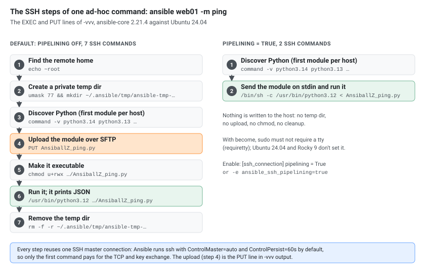
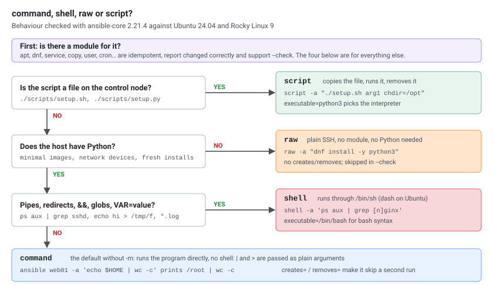

Ad-hoc commands run one module against your hosts without writing a playbook. They're ideal for one-off operations, quick checks and live troubleshooting across a fleet.

## Scope

Everything below was run with ansible-core 2.21.4 (the Ansible 14.4 package) on the control node against two Ubuntu 24.04 hosts (`web01`, `web02`) and one Rocky Linux 9 host (`db01`). Outputs are from those runs. For playbooks, inventories, variables, roles and Vault see the [Ansible Cheatsheet](/cheatsheet/ansible-cheatsheet/).

The inventory used throughout:

```ini
[webservers]
web01
web02

[databases]
db01

[ubuntu]
web01
web02

[rhel]
db01

[production]
web01
db01
```

## Basic Syntax

```bash
ansible <pattern> -m <module> -a "<arguments>" [options]
ansible <pattern> -i <inventory> -m <module> -a "<arguments>" [options]
```

Without `-m` Ansible runs the `command` module. Module arguments are `key=value` pairs in one `-a` string; a second `-a` **replaces** the first instead of adding to it.

## How an Ad-Hoc Command Runs

Each module is a small Python program. Ansible wraps it into `AnsiballZ_<module>.py`, sends it over SSH, runs it with the host's Python and reads back JSON. With `-vvv` you can count the SSH round trips: seven per host for `ping` by default, two with pipelining:

[](adhoc-ssh-steps.svg "Open the diagram full size")

## Common Options

| Option | Short | Description |
|--------|-------|-------------|
| `--become` | `-b` | Execute with sudo/privilege escalation |
| `--become-user=USER` | | Run as specific user (default: root) |
| `--ask-become-pass` | `-K` | Prompt for the sudo password |
| `--become-password-file=FILE` | | Read the sudo password from a file |
| `--ask-pass` | `-k` | Prompt for the SSH password (needs `sshpass`) |
| `--inventory=FILE` | `-i` | Inventory file, directory or `host1,host2,` list |
| `--user=USER` | `-u` | Connect as this user |
| `--private-key=KEY` | | SSH private key file |
| `--forks=N` | `-f N` | Number of parallel processes (default: 5) |
| `--timeout=SECS` | `-T` | SSH **connection** timeout (default: 10), not a task time limit |
| `--limit=SUBSET` | `-l` | Limit to specific hosts/groups |
| `--check` | `-C` | Dry run (no changes made) |
| `--diff` | `-D` | Show file differences |
| `--background=SECS` | `-B` | Run asynchronously, fail after SECS |
| `--poll=SECS` | `-P` | Poll interval for `-B` (0 = fire and forget) |
| `--extra-vars` | `-e` | Set variables (`key=value` or JSON) |
| `-v` / `-vv` / `-vvv` / `-vvvv` | | Increase verbosity |
| `--list-hosts` | | Show matched hosts without executing |

Three options from older guides are gone or going:

- `--gather-facts` doesn't exist; `ansible` exits with its usage message (exit code 2). Ad-hoc commands never gather facts, only `-m setup` does.
- `--async` and `--poll` as a pair never existed; the long names are `--background` and `--poll`.
- `-o`/`--one-line` and `--tree` still work but warn: `The '-o' argument is deprecated. This feature will be removed from ansible-core version 2.23.`

## Host Patterns

```bash
# All hosts
ansible all -m ping

# List all hosts from inventory
ansible all --list-hosts
ansible-inventory --graph
ansible-inventory --list --yaml

# Specific group or host
ansible webservers -m ping
ansible web01 -m ping

# Multiple hosts (comma-separated)
ansible web01,web02,db01 -m ping

# Multiple groups (union)
ansible webservers:databases -m ping

# Exclude hosts from a group (quote: ! and & mean something to the shell)
ansible 'webservers:!web02' -m ping

# Intersection of groups (hosts in BOTH groups)
ansible 'webservers:&production' -m ping

# Wildcard patterns
ansible 'web*' -m ping
ansible '192.168.1.*' -m ping

# Regex pattern (prefix with ~)
ansible '~web[0-9]+' -m ping

# Slices of a group: both ends are included
ansible 'webservers[0]' --list-hosts      # first host
ansible 'webservers[0:1]' --list-hosts    # first TWO hosts
ansible 'webservers[-1]' --list-hosts     # last host

# Limit execution to a subset
ansible all --limit 'web01,web02' -m ping
ansible all --limit @failed_hosts.txt -m ping

# List matched hosts without running anything
ansible webservers --list-hosts
```

```text
$ ansible 'webservers[0:1]' --list-hosts
  hosts (2):
    web01
    web02
```

There is no step syntax: `'all[::2]'` matches nothing (`Could not match supplied host pattern, ignoring: all[::2]`). Ranges like `web[01:05]` work only inside the inventory file, where they define hosts, not in patterns. The [Ansible Cheatsheet](/cheatsheet/ansible-cheatsheet/#host-patterns) has a diagram of every pattern operator.

## Connection & Authentication

```bash
# Specify inventory
ansible all -i inventory.ini -m ping
ansible all -i /etc/ansible/hosts -m ping

# Connect as specific user
ansible all -u ubuntu -m ping
ansible all -u root --ask-pass -m ping

# Use specific SSH key
ansible all --private-key=~/.ssh/id_ed25519 -m ping

# Use sudo
ansible all --become -m ping
ansible all --become --become-user=root -m ping
ansible all --become --ask-become-pass -m ping

# Combined options
ansible webservers -i inventory.ini -u admin --become \
  --private-key=~/.ssh/admin_key -m ping

# Enable SSH pipelining (fewer SSH round trips, see the diagram above)
ansible all -m ping -e 'ansible_ssh_pipelining=true'
```

SSH multiplexing needs no option: `-vvv` shows Ansible already runs `ssh -C -o ControlMaster=auto -o ControlPersist=60s` by default.

### Silence the Interpreter Warning

ansible-core 2.21 warns on every host where it discovered Python:

```text
[WARNING]: Host 'web01' is using the discovered Python interpreter at '/usr/bin/python3.12', but future installation of another Python interpreter could cause a different interpreter to be discovered.
```

Pin the interpreter per host or group (`ansible_python_interpreter=/usr/bin/python3`), or keep discovery and drop the warning in `ansible.cfg`:

```ini
[defaults]
interpreter_python = auto_silent
```

## Ping & Connectivity

```bash
# Basic connectivity test
ansible all -m ping

# Test specific group
ansible webservers -m ping

# Verbose ping
ansible all -m ping -v

# Test with specific user
ansible all -m ping -u ansible

# Test with sudo
ansible all -m ping -b
```

`ping` checks SSH and a usable Python, it doesn't send ICMP:

```text
web01 | SUCCESS => {
    "ansible_facts": {
        "discovered_interpreter_python": "/usr/bin/python3.12"
    },
    "changed": false,
    "ping": "pong"
}
```

## Command Execution

Four modules run commands. Pick by what the command needs:

[](adhoc-run-modules.svg "Open the diagram full size")

### command Module (Safe: No Shell Features)

```bash
# Simple commands (no pipes, no redirects, no shell expansion)
ansible all -m command -a "date"
ansible all -m command -a "whoami"
ansible all -m command -a "uptime"
ansible all -m command -a "uname -a"
ansible all -m command -a "cat /etc/os-release"
ansible all -m command -a "du -sh /var/log"

# Change working directory
ansible all -m command -a "ls -la chdir=/var/log"

# Only run if file does NOT exist (creates)
ansible all -m command -a "touch /tmp/marker creates=/tmp/marker"

# Only run if file DOES exist (removes)
ansible all -m command -a "rm /tmp/marker removes=/tmp/marker"

# Run as different user
ansible all -m command -a "whoami" -b --become-user=www-data
```

`command` passes `|` and other shell syntax as plain arguments, so a pipe silently does something else:

```text
$ ansible web01 -a 'echo $HOME | wc -c'
web01 | CHANGED | rc=0 >>
/root | wc -c
```

With `creates=`/`removes=` a second run is skipped and reported as `SUCCESS` instead of `CHANGED`:

```text
web01 | SUCCESS | rc=0 >>
skipped, since /tmp/marker existsDid not run command since '/tmp/marker' exists
```

### shell Module (Supports Pipes, Redirects, Variables)

```bash
# Commands with pipes
ansible all -m shell -a "ps aux | head -10"
ansible all -m shell -a "ss -tlnp | grep :80"

# Commands with redirects
ansible all -m shell -a "echo 'test' > /tmp/test.txt"
ansible all -m shell -a "tail -20 /var/log/syslog > /tmp/last-logs.txt"

# Remote variables: single quotes outside, so the local shell leaves $HOME alone
ansible all -m shell -a 'echo $HOME'
ansible all -m shell -a "APP_ENV=production /opt/app/deploy.sh" -b

# Complex shell commands
ansible all -m shell -a "df -h | grep -vE '^Filesystem|tmpfs|cdrom'"
ansible all -m shell -a "hostname && whoami && date"

# Use bash instead of /bin/sh
ansible all -m shell -a "echo \$0 executable=/bin/bash"
ansible all -m shell -a 'echo $0' -e ansible_shell_executable=/bin/bash
```

The quotes decide **where** `$HOME` is expanded. Connected as `ansible`, double quotes let the control node's shell put its own `/root` in before Ansible runs:

```text
$ ansible web01 -u ansible -m shell -a "echo $HOME"
web01 | CHANGED | rc=0 >>
/root
$ ansible web01 -u ansible -m shell -a 'echo $HOME'
web01 | CHANGED | rc=0 >>
/home/ansible
```

`shell` uses `/bin/sh`, which is dash on Ubuntu (`readlink /proc/$$/exe` printed `/usr/bin/dash`); bash-only syntax needs `executable=/bin/bash`.

### script Module (Run Local Script Remotely)

```bash
# Copy and execute a local script on all remote hosts
ansible all -m script -a "./scripts/setup.sh"
ansible all -m script -a "./scripts/setup.sh" -b

# Script with arguments
ansible all -m script -a "./scripts/configure.sh arg1 arg2"

# Script with working directory
ansible all -m script -a "./scripts/install.sh chdir=/opt"

# Execute with specific interpreter (in the same -a string)
ansible all -m script -a "./scripts/setup.py executable=python3"
```

Two `-a` options don't merge, the second one wins:

```text
$ ansible web01 -m script -a ./scripts/setup.py -a executable=python3
[ERROR]: Task failed: one of the following is required: _raw_params, cmd
```

### raw Module (No Python Required on Target)

```bash
# Useful for bootstrapping systems without Python
ansible all -m raw -a "uptime"
ansible ubuntu -m raw -a "apt-get install -y python3" -b
ansible rhel -m raw -a "dnf install -y python3" -b
```

## Exit Codes and Failures

| Exit code | When | Example from the lab |
|-----------|------|----------------------|
| `0` | Every host succeeded, or the pattern matched no host (only a warning) | `ansible nosuchhost -m ping` |
| `1` | Error before running, e.g. `--limit` left no host | `Specified inventory, host pattern and/or --limit leaves us with no hosts to target.` |
| `2` | A task failed on at least one host, or a bad option (usage message) | `ansible web01 -m command -a false` |
| `4` | A host was unreachable | `Failed to connect to the host via ssh: ... Connection timed out` |

`command` and `shell` mark **any** non-zero return code as a failure, which catches commands that only use the code to report something:

```text
$ ansible web01 -m shell -a "grep -c 'Failed password' /var/log/auth.log" -b
web01 | FAILED | rc=1 >>
0The command exited with a non-zero return code.
```

`grep -c` with no match, `test -f missing && ...` and `systemctl status` on a stopped or missing unit (rc=4) all show `FAILED`. Use `| wc -l`, `|| true`, or `systemctl is-active`.

## Package Management

### APT (Ubuntu/Debian)

```bash
# Update cache
ansible ubuntu -m apt -a "update_cache=yes" -b

# Install package
ansible ubuntu -m apt -a "name=nginx state=present" -b

# Install multiple packages
ansible ubuntu -m apt -a "name=nginx,git,vim,curl state=present update_cache=yes" -b

# Install specific version (look it up with: apt-cache policy nginx)
ansible ubuntu -m apt -a "name=nginx=1.24.0-2ubuntu7.19 state=present" -b

# Upgrade package to latest
ansible ubuntu -m apt -a "name=nginx state=latest" -b

# Remove package
ansible ubuntu -m apt -a "name=apache2 state=absent" -b

# Purge package (remove + delete configs)
ansible ubuntu -m apt -a "name=apache2 state=absent purge=yes" -b

# Full system upgrade (preview with --check first)
ansible ubuntu -m apt -a "upgrade=dist update_cache=yes" -b --check

# Autoremove unused packages
ansible ubuntu -m apt -a "autoremove=yes" -b

# Clean package cache
ansible ubuntu -m apt -a "autoclean=yes" -b

# Install from .deb file already on the host
ansible ubuntu -m apt -a "deb=/tmp/package.deb state=present" -b
```

A version that isn't in the repository fails: `no available installation candidate for nginx=1.18.0-0ubuntu1`.

### DNF (RHEL/Rocky/AlmaLinux/Fedora)

The `yum` module name still works on EL8 and later, it runs `dnf`.

```bash
# Install package
ansible rhel -m dnf -a "name=nginx state=present" -b

# Install multiple packages (allowerasing: EL9 images ship curl-minimal, which conflicts with curl)
ansible rhel -m dnf -a "name=git,vim,curl state=present allowerasing=yes" -b

# Install specific version
ansible rhel -m dnf -a "name=httpd-2.4.62 state=present" -b

# Update package
ansible rhel -m dnf -a "name=nginx state=latest" -b

# Update all packages (preview with --check first)
ansible rhel -m dnf -a "name=* state=latest update_cache=yes" -b --check

# Security updates only
ansible rhel -m dnf -a "name=* state=latest security=yes" -b

# Remove package
ansible rhel -m dnf -a "name=httpd state=absent" -b

# Install from URL (import the signing key first, or the GPG check fails)
ansible rhel -m rpm_key -a "key=https://dl.fedoraproject.org/pub/epel/RPM-GPG-KEY-EPEL-9" -b
ansible rhel -m dnf -a "name=https://dl.fedoraproject.org/pub/epel/epel-release-latest-9.noarch.rpm state=present" -b

# Install package group
ansible rhel -m dnf -a "name='@Development Tools' state=present" -b

# List advisories, then install one
ansible rhel -m command -a "dnf updateinfo list --available" -b
ansible rhel -m command -a "dnf update -y --advisory RLSA-2026:88459" -b
```

Without `allowerasing=yes` the curl install fails with `package curl-minimal-7.76.1-40.el9.aarch64 from @System conflicts with curl provided by curl-7.76.1-40.el9_8.9.aarch64`. Without the key the URL install fails with `Failed to validate GPG signature for epel-release-9-11.el9.noarch`. Advisory IDs depend on the distribution: `RHSA`/`RHBA` on RHEL, `RLSA`/`RLBA` on Rocky.

The `command` module no longer accepts `warn=no`: `Unsupported parameters for (ansible.legacy.command) module: warn`. It was removed in ansible-core 2.14.

### package Module (Cross-Platform)

```bash
# Works on both apt and dnf systems
ansible all -m package -a "name=git state=present" -b
ansible all -m package -a "name=vim state=latest" -b
ansible all -m package -a "name=httpd state=absent" -b
```

Package names still differ per distribution (`httpd` vs `apache2`), so cross-platform only covers the module, not the name.

## Service Management

```bash
# Start service
ansible all -m service -a "name=nginx state=started" -b

# Stop service
ansible all -m service -a "name=apache2 state=stopped" -b

# Restart service (sshd works on both Ubuntu and RHEL; ssh only on Ubuntu)
ansible all -m service -a "name=sshd state=restarted" -b

# Reload service
ansible all -m service -a "name=nginx state=reloaded" -b

# Enable at boot
ansible all -m service -a "name=nginx enabled=yes" -b

# Start + enable
ansible all -m service -a "name=nginx state=started enabled=yes" -b

# Disable at boot
ansible all -m service -a "name=apache2 enabled=no" -b

# Check status (is-active returns 0 when running; status returns 3 or 4 otherwise)
ansible all -m command -a "systemctl is-active nginx" -b
ansible all -m shell -a "systemctl status nginx" -b

# All services as facts
ansible all -m service_facts

# systemd-specific (supports daemon_reload)
ansible all -m systemd_service -a "name=nginx state=started" -b
ansible all -m systemd_service -a "name=nginx state=restarted daemon_reload=yes" -b
```

A service that isn't installed fails, even when you only want it stopped: `Could not find the requested service apache2: host`. On Rocky, `name=ssh` fails the same way, because the unit is `sshd`.

## File Operations

### Copy (Local → Remote)

```bash
# Copy file
ansible all -m copy -a "src=/local/file.txt dest=/remote/file.txt"

# Copy with ownership and permissions
ansible all -m copy -a "src=index.html dest=/var/www/html/ owner=www-data group=www-data mode=0644" -b

# Copy with backup of existing file (backup = nginx.conf.<pid>.<date>@<time>~)
ansible all -m copy -a "src=nginx.conf dest=/etc/nginx/nginx.conf backup=yes" -b

# Copy directory contents (trailing slash) or the directory itself (no slash)
ansible all -m copy -a "src=configs/ dest=/etc/myapp/" -b      # /etc/myapp/app.conf
ansible all -m copy -a "src=configs dest=/etc/myapp/" -b       # /etc/myapp/configs/app.conf

# Create file with inline content (\n becomes a real newline)
ansible all -m copy -a "content='Hello World\n' dest=/tmp/hello.txt"

# Copy a file that is already on the host
ansible all -m copy -a "src=/etc/hosts dest=/etc/hosts.backup remote_src=yes" -b

# Copy and validate before placing
ansible all -m copy -a "src=sshd_config dest=/etc/ssh/sshd_config validate='sshd -t -f %s' backup=yes" -b
```

When validation fails, the file is not replaced:

```text
"msg": "failed to validate",
"stderr_lines": [
    "/tmp/bad_sshd_config: line 1: Bad configuration option: Bogus",
    "/tmp/bad_sshd_config: terminating, 1 bad configuration options"
```

### File Module (Manage File Properties)

```bash
# Create empty file
ansible all -m file -a "path=/tmp/test.txt state=touch"

# Create directory
ansible all -m file -a "path=/opt/myapp state=directory mode=0755" -b

# Create nested directories (the new parents get the same mode)
ansible all -m file -a "path=/opt/myapp/config/ssl state=directory mode=0750" -b

# Remove file, or a directory with everything in it
ansible all -m file -a "path=/tmp/unwanted.txt state=absent"
ansible all -m file -a "path=/tmp/olddir state=absent"

# Change permissions (octal or symbolic)
ansible all -m file -a "path=/opt/script.sh mode=0755"
ansible all -m file -a "path=/opt/script.sh mode=u+x,g-w"

# Change ownership
ansible all -m file -a "path=/var/www/html owner=www-data group=www-data recurse=yes" -b

# Create symbolic link
ansible all -m file -a "src=/opt/myapp/current dest=/opt/myapp/live state=link"
```

### Fetch (Remote → Local)

```bash
# Download file from all remote hosts (lands in /tmp/hostnames/<host>/etc/hostname)
ansible all -m fetch -a "src=/etc/hostname dest=/tmp/hostnames/"

# Flat structure: put the host name in the file name, or every host overwrites the same file
ansible all -m fetch -a "src=/etc/hostname dest=/tmp/flat/{{ inventory_hostname }}-hostname flat=yes"
```

With `dest=/tmp/logs/ flat=yes` on two hosts, both wrote `/tmp/logs/hostname` and only the last one survived. `fetch` verifies the checksum by default (`validate_checksum=yes`).

### File Content Editing

```bash
# Add a line to a file
ansible all -m lineinfile -a "path=/etc/hosts line='192.168.1.100 myserver' state=present" -b

# Remove a line matching pattern
ansible all -m lineinfile -a "path=/etc/hosts regexp='^192.168.1.100' state=absent" -b

# Replace text in file
ansible all -m replace -a "path=/etc/config regexp='old_value' replace='new_value'" -b

# Insert a block of text (\n becomes a newline)
ansible all -m blockinfile -a "path=/etc/hosts block='192.168.1.100 server1\n192.168.1.101 server2'" -b

# Remove that block again
ansible all -m blockinfile -a "path=/etc/hosts state=absent" -b

# Template a file
ansible all -m template -a "src=nginx.conf.j2 dest=/etc/nginx/nginx.conf" -b
```

`blockinfile` wraps the block in markers so it can find it again:

```text
# BEGIN ANSIBLE MANAGED BLOCK
192.168.1.100 server1
192.168.1.101 server2
# END ANSIBLE MANAGED BLOCK
```

Ad-hoc commands don't gather facts, so a template that uses one fails: `'ansible_processor_vcpus' is undefined`. Pass the value with `-e`, or use a playbook.

## User & Group Management

```bash
# Create user
ansible all -m user -a "name=john state=present" -b

# Create user with details
ansible all -m user -a "name=alice state=present create_home=yes shell=/bin/bash" -b

# Create user with specific UID (fails if the UID is taken: "useradd: UID 1001 is not unique")
ansible all -m user -a "name=bob uid=1101 state=present" -b

# Add user to groups (the groups must exist)
ansible all -m user -a "name=charlie groups=sudo,docker append=yes" -b

# Set password (hashed on the control node; use Vault for the real value)
ansible all -m user -a "name=dave password={{ 'secretpass' | password_hash('sha512') }}" -b

# Lock user account
ansible all -m user -a "name=john password_lock=yes" -b

# Change shell
ansible all -m user -a "name=john shell=/bin/zsh" -b

# Remove user and home directory
ansible all -m user -a "name=olduser state=absent remove=yes" -b

# Create user and disable password aging
ansible all -m user -a "name=daniel uid=1501 create_home=yes shell=/bin/bash comment='Daniel'" -b
ansible all -m user -a "name=daniel password_expire_max=-1 password_expire_min=-1 password_expire_warn=-1" -b

# Create group (optionally with GID), remove group
ansible all -m group -a "name=developers state=present" -b
ansible all -m group -a "name=apps gid=1500 state=present" -b
ansible all -m group -a "name=oldgroup state=absent" -b

# Deploy SSH authorized key
ansible all -m authorized_key -a "user=ansible key=\"{{ lookup('file', '~/.ssh/id_ed25519.pub') }}\"" -b
```

`shell=/bin/zsh` is accepted even when zsh isn't installed, and the user then can't log in. The password hash lands in `/etc/shadow` as `$6$rounds=65600$...`; the module output shows `"password": "NOT_LOGGING_PASSWORD"`.

## System Information (Facts)

```bash
# Gather all facts
ansible all -m setup

# Filter specific facts (wildcards and comma-separated lists work)
ansible all -m setup -a "filter=ansible_distribution*"
ansible all -m setup -a "filter=ansible_distribution,ansible_distribution_version"
ansible all -m setup -a "filter=ansible_os_family"
ansible all -m setup -a "filter=ansible_memory_mb"
ansible all -m setup -a "filter=ansible_processor*"
ansible all -m setup -a "filter=ansible_mounts"
ansible all -m setup -a "filter=ansible_default_ipv4"
ansible all -m setup -a "filter=ansible_interfaces"

# Gather subset of facts (faster)
ansible all -m setup -a "gather_subset=network,hardware"
ansible all -m setup -a "gather_subset=!all"

# Custom facts (/etc/ansible/facts.d/*.fact on the host, shown under ansible_local)
ansible all -m setup -a "filter=ansible_local"
```

```text
$ ansible db01 -m setup -a "filter=ansible_os_family"
db01 | SUCCESS => {
    "ansible_facts": {
        "ansible_os_family": "RedHat",
```

`gather_subset=!all` still returns the minimal set (distribution, architecture, date, DNS and so on). An INI file `/etc/ansible/facts.d/app.fact` with `[app]` and `version=1.4` showed up as `ansible_local.app.app.version`.

## Cron Jobs

```bash
# Add cron job
ansible all -m cron -a "name='backup logs' minute=0 hour=2 job='/opt/backup.sh'" -b

# Add cron job for specific user
ansible all -m cron -a "name='user backup' user=backup minute=30 hour=1 job='/home/backup/script.sh'" -b

# Remove cron job (by name)
ansible all -m cron -a "name='backup logs' state=absent" -b

# List cron jobs
ansible all -m command -a "crontab -l" -b
ansible all -m command -a "crontab -l -u backup" -b
```

The `name` becomes a marker comment, which is how the module finds the job again:

```text
#Ansible: backup logs
0 2 * * * /opt/backup.sh
```

## Mount Operations

```bash
# Mount filesystem and add it to fstab
ansible all -m ansible.posix.mount -a "path=/mnt/data src=/dev/sdb1 fstype=ext4 state=mounted" -b

# Unmount (the fstab line stays)
ansible all -m ansible.posix.mount -a "path=/mnt/data state=unmounted" -b

# Unmount and remove from fstab
ansible all -m ansible.posix.mount -a "path=/mnt/data state=absent" -b

# Add to fstab (without mounting now)
ansible all -m ansible.posix.mount -a "path=/mnt/data src=/dev/sdb1 fstype=ext4 state=present" -b

# Check mounts
ansible all -m command -a "findmnt /mnt/data"
ansible all -m shell -a "df -h | grep -v tmpfs"
```

## Archive Operations

```bash
# Create archive
ansible all -m archive -a "path=/var/log dest=/tmp/logs.tar.gz format=gz" -b

# Create zip
ansible all -m archive -a "path=/etc/nginx dest=/tmp/nginx-config.zip format=zip" -b

# Extract archive (already on remote)
ansible all -m unarchive -a "src=/tmp/archive.tar.gz dest=/opt/ remote_src=yes" -b

# Extract archive from control machine
ansible all -m unarchive -a "src=archive.tar.gz dest=/opt/" -b

# Download and extract from URL
ansible all -m unarchive -a "src=https://github.com/octocat/Hello-World/archive/refs/heads/master.tar.gz dest=/opt/ remote_src=yes" -b
```

## Download & URL Operations

```bash
# Download file
ansible all -m get_url -a "url=https://example.com/file.tar.gz dest=/tmp/file.tar.gz"

# Download with permissions
ansible all -m get_url -a "url=https://example.com/script.sh dest=/opt/script.sh mode=0755" -b

# Download with checksum
ansible all -m get_url -a "url=https://dl.fedoraproject.org/pub/epel/RPM-GPG-KEY-EPEL-9 dest=/tmp/epel.key checksum=sha256:fcf0eab4f05a1c0de6363ac4b707600a27a9d774e9b491059e59e6921b255a84"

# Download with custom headers (headers is a dict: JSON inside the k=v string)
ansible all -m get_url -a "url=https://api.example.com/data dest=/tmp/data.json headers='{\"Authorization\": \"Bearer token123\"}'"

# HTTP requests
ansible all -m uri -a "url=https://www.google.com/generate_204 status_code=204"
ansible all -m uri -a "url=https://api.example.com/health method=GET return_content=yes"

# Check port connectivity
ansible all -m wait_for -a "host=google.com port=443 timeout=10"
ansible all -m wait_for -a "port=22 timeout=1"
```

A wrong checksum stops the download from being saved: `The checksum for ... did not match 0000...; it was fcf0eab4f05a1c0de6363ac4b707600a27a9d774e9b491059e59e6921b255a84.` A header given as plain text fails: `argument 'headers' is of type str and we were unable to convert to dict`.

## Synchronize (rsync)

Needs `rsync` on the control node and on the hosts.

```bash
# Sync files from control machine to targets (push)
ansible all -m synchronize -a "src=/local/path/ dest=/remote/path/"

# Sync with delete (mirror: removes extra files on remote)
ansible all -m synchronize -a "src=/local/path/ dest=/remote/path/ delete=yes"

# Pull files from remote to local
ansible all -m synchronize -a "src=/remote/path/ dest=/local/path/ mode=pull"
```

## SSL/TLS Operations

The modules are in `community.crypto` and need the Python `cryptography` package on the host (`python3-cryptography`).

```bash
# Generate private key
ansible all -m community.crypto.openssl_privatekey -a "path=/etc/ssl/private/server.key size=2048" -b

# Generate a CSR with a subject, then a self-signed certificate from it
ansible all -m community.crypto.openssl_csr -a "path=/etc/ssl/server.csr privatekey_path=/etc/ssl/private/server.key common_name=web01.example.com" -b
ansible all -m community.crypto.x509_certificate -a "path=/etc/ssl/certs/server.crt csr_path=/etc/ssl/server.csr privatekey_path=/etc/ssl/private/server.key provider=selfsigned" -b

# Check it
ansible all -m command -a "openssl x509 -in /etc/ssl/certs/server.crt -noout -subject -dates"
```

```text
subject=CN = web01.example.com
notBefore=Nov 16 13:36:37 2026 GMT
notAfter=Nov 13 13:36:37 2036 GMT
```

The old name `openssl_certificate` is still redirected to `x509_certificate`. Without a CSR the certificate gets an empty subject (`subject=`).

## Git Operations

```bash
# Clone repository
ansible all -m git -a "repo=https://github.com/user/repo.git dest=/opt/repo"

# Clone specific branch or tag
ansible all -m git -a "repo=https://github.com/user/repo.git dest=/opt/repo version=develop"

# Shallow clone
ansible all -m git -a "repo=https://github.com/user/repo.git dest=/opt/repo depth=1"

# Update to latest
ansible all -m git -a "repo=https://github.com/user/repo.git dest=/opt/repo version=HEAD"
```

The output shows the commit before and after, so you can see whether anything changed. A branch that doesn't exist fails with `Failed to checkout develop`.

## Firewall

The modules call the firewall tools, so those must be installed first (`Failed to find required executable "ufw"`).

```bash
# UFW (Ubuntu): allow SSH before enabling
ansible ubuntu -m ufw -a "rule=allow port=22 proto=tcp" -b
ansible ubuntu -m ufw -a "rule=allow port=80 proto=tcp" -b
ansible ubuntu -m ufw -a "rule=allow port=443 proto=tcp" -b
ansible ubuntu -m ufw -a "state=enabled" -b

# Firewalld (RHEL): permanent alone only changes the saved config, immediate applies it now
ansible rhel -m firewalld -a "service=http state=enabled permanent=yes immediate=yes" -b
ansible rhel -m firewalld -a "port=8080/tcp state=enabled permanent=yes immediate=yes" -b

# iptables
ansible all -m iptables -a "chain=INPUT protocol=tcp destination_port=22 jump=ACCEPT" -b

# Check status
ansible ubuntu -m command -a "ufw status" -b
ansible rhel -m command -a "firewall-cmd --list-all" -b
```

## Database Operations

The hosts need the Python driver (`python3-PyMySQL`, `python3-psycopg2`).

```bash
# MySQL/MariaDB: root logs in through the Unix socket
ansible databases -m ansible.mysql.mysql_db -a "name=mydb state=present login_unix_socket=/var/lib/mysql/mysql.sock" -b
ansible databases -m ansible.mysql.mysql_user -a "name=dbuser password=secret priv=mydb.*:ALL state=present login_unix_socket=/var/lib/mysql/mysql.sock" -b
ansible databases -m ansible.mysql.mysql_db -a "name=mydb state=dump target=/tmp/mydb.sql login_unix_socket=/var/lib/mysql/mysql.sock" -b

# PostgreSQL: run as the postgres user
ansible databases -m postgresql_db -a "name=mydb" -b --become-user=postgres
ansible databases -m postgresql_user -a "name=dbuser password=secret" -b --become-user=postgres
ansible databases -m postgresql_privs -a "db=mydb type=database privs=ALL roles=dbuser" -b --become-user=postgres
```

Without the socket (or a `/root/.my.cnf` with `socket=`), MariaDB answers `Access denied for user 'root'@'localhost'`. The `community.mysql` names still work but warn `community.mysql.mysql_db has been deprecated. Use ansible.mysql.mysql_db instead.` For PostgreSQL, `-b` alone gives `Peer authentication failed for user "postgres"`. `postgresql_user` no longer has `priv` (`Unsupported parameters for (postgresql_user) module: priv`); grants are in `postgresql_privs`.

## Process Management

```bash
# List processes
ansible all -m shell -a "ps aux | head -20"

# Find specific process (pgrep doesn't match itself, ps | grep does)
ansible all -m command -a "pgrep -a nginx"
ansible all -m shell -a "ps aux | grep [n]ginx"

# Kill process (pkill returns 1, so FAILED, when nothing matched)
ansible all -m command -a "pkill nginx" -b

# Check listening ports
ansible all -m command -a "ss -tlnp" -b

# Check system load
ansible all -m shell -a "top -b -n1 | head -5"
ansible all -m command -a "cat /proc/loadavg"
```

`killall` is in the `psmisc` package, which minimal images don't have: `/bin/sh: 1: killall: not found`.

## Log Analysis

```bash
# System logs (syslog on Ubuntu, messages on RHEL; both need rsyslog)
ansible ubuntu -m command -a "tail -20 /var/log/syslog" -b
ansible rhel -m command -a "tail -20 /var/log/messages" -b

# Auth logs (wc -l, unlike grep -c, doesn't fail on zero matches)
ansible ubuntu -m shell -a "grep 'Failed password' /var/log/auth.log | tail -5" -b
ansible ubuntu -m shell -a "grep 'Failed password' /var/log/auth.log | wc -l" -b

# Service logs
ansible webservers -m command -a "tail -20 /var/log/nginx/error.log" -b

# Journald (works without rsyslog)
ansible all -m command -a "journalctl -n 20" -b
ansible all -m command -a "journalctl -u nginx -n 10" -b
ansible all -m command -a "journalctl -p err -n 10" -b

# Boot messages
ansible all -m shell -a "dmesg | tail -20" -b
```

## Reboot

```bash
# Reboot all systems (waits until they are back)
ansible all -m reboot -b

# Reboot with custom timeout
ansible all -m reboot -a "reboot_timeout=600" -b

# Reboot with message
ansible all -m reboot -a "msg='Scheduled maintenance reboot'" -b

# One host at a time
ansible webservers -m reboot -b -f 1
```

With `--check`, `reboot` reports `"rebooted": true` without rebooting.

## Background Jobs and Timeouts

```bash
# Run in the background, check every 10 s, give up after an hour
ansible all -m shell -a "/opt/long-script.sh" -b -B 3600 -P 10

# Fire and forget: returns a job id at once
ansible all -m shell -a "/opt/long-script.sh" -b -B 3600 -P 0

# Check the job later (same become user as the job)
ansible all -m async_status -a "jid=j143420716446.7446" -b

# Limit how long a task may run (seconds)
ANSIBLE_TASK_TIMEOUT=300 ansible all -m shell -a "/opt/long-script.sh" -b
```

`-P 0` prints the job id and the file where the result lands:

```text
web01 | CHANGED => {
    "ansible_job_id": "j143420716446.7446",
    "changed": true,
    "finished": false,
    "results_file": "/root/.ansible_async/j143420716446.7446",
    "started": true
}
```

The job file lives in the home of the user that ran it, so checking a `-b` job without `-b` answers `could not find job`.

`-T`/`--timeout` only limits the SSH connection: `sleep 5` with `-T 1` succeeded. The task timeout stops it: `Task failed: Timed out after 2 second(s).`

## Logging

```bash
# Log output to file (set via environment variable)
ANSIBLE_LOG_PATH=/tmp/ansible.log ansible all -m shell -a "uptime"

# Or configure in ansible.cfg:
# [defaults]
# log_path = /var/log/ansible.log
```

```text
2026-11-16 13:38:53,062 p=5252 u=root n=ansible INFO| web01 | CHANGED | rc=0 >>
```

> **Note:** `ignore_errors`, `when` and `retries` are playbook-only directives. Ad-hoc commands have no conditions: `-e "ansible_os_family=='RedHat'"` only sets a variable, and the command ran on all three hosts. Pick the hosts with a pattern (`ansible rhel ...`) instead.

## Inventory Patterns

```bash
# Standard inventory file
ansible -i inventory.ini webservers -m ping

# Inline inventory (note the trailing comma for a single host)
ansible -i web01, all -m ping

# Dynamic inventory plugin or script
ansible -i aws_ec2.yml all -m ping

# Multiple inventory sources (merged)
ansible -i staging -i production all -m ping

# Limit to specific hosts from inventory
ansible all -m ping --limit web01,web02

# Limit using a file of hosts
ansible all -m ping --limit @failed_hosts.txt

# Show one host's variables
ansible-inventory --host web01
```

Groups like `tag_Environment_production` exist only when a dynamic inventory creates them (for example `keyed_groups` in the `amazon.aws.aws_ec2` plugin).

## Performance

```bash
# Increase parallelism (default: 5)
ansible all -m ping -f 50

# Enable pipelining (2 SSH round trips per module instead of 7)
ansible all -m ping -e 'ansible_ssh_pipelining=true'

# See the current values
ansible-config dump | grep -E '^(DEFAULT_FORKS|ANSIBLE_PIPELINING|DEFAULT_TIMEOUT|TASK_TIMEOUT)'
```

```text
ANSIBLE_PIPELINING(default) = False
DEFAULT_FORKS(default) = 5
DEFAULT_TIMEOUT(default) = 10
TASK_TIMEOUT(default) = 0
```

An `ansible.cfg` for ad-hoc work:

```ini
[defaults]
inventory = inventory.ini
forks = 20
interpreter_python = auto_silent

[ssh_connection]
pipelining = True
```

Pipelining needs `requiretty` to be off in sudoers when you use `become`; current Ubuntu and RHEL don't set it.

## Debugging

```bash
# Verbose output levels
ansible all -m ping -v        # result and the config file used
ansible all -m ping -vv       # plus the Ansible version and paths
ansible all -m ping -vvv      # plus every SSH command (ESTABLISH, EXEC, PUT)
ansible all -m ping -vvvv     # plus plugin loading and callback details

# Dry run with diff
ansible all -m copy -a "content='new\n' dest=/tmp/hello.txt" --check --diff

# Test sudo access
ansible all -m command -a "whoami" -b

# Check Python version on targets
ansible all -m command -a "python3 --version"

# Module arguments without leaving the terminal
ansible-doc -s ping
ansible-doc copy

# Save output to file
ansible all -m command -a "uptime" > results.txt
```

```text
--- before: /tmp/hello.txt
+++ after: /tmp/hello.txt
@@ -1 +1 @@
-Hello World
+new

web01 | CHANGED => {
    "changed": true
}
```

`--check` can't predict a `command` or `shell` result, so they are skipped (`web01 | SKIPPED`) unless they have `creates=` or `removes=`.

## Practical Recipes

```bash
# System health check
ansible all -m shell -a "uptime && free -h && df -h /"

# Quick security audit
ansible ubuntu -m shell -a "grep 'Failed password' /var/log/auth.log | wc -l" -b

# Mass service restart, one host at a time
ansible webservers -m service -a "name=nginx state=restarted" -b -f 1

# Back up a config file from every host
ansible all -m fetch -a "src=/etc/nginx/nginx.conf dest=/backup/{{ inventory_hostname }}-nginx.conf flat=yes"

# Install, configure, start
ansible webservers -m package -a "name=nginx state=present" -b && \
ansible webservers -m copy -a "src=nginx.conf dest=/etc/nginx/nginx.conf backup=yes validate='nginx -t -c %s'" -b && \
ansible webservers -m service -a "name=nginx state=restarted enabled=yes" -b

# Back up before a change
ansible all -m copy -a "src=/etc/hosts dest=/etc/hosts.backup remote_src=yes" -b && \
ansible all -m lineinfile -a "path=/etc/hosts line='192.168.1.100 newhost'" -b

# Copy a script, run it, clean up (or use -m script in one step)
ansible all -m copy -a "src=./scripts/setup.sh dest=/tmp/setup.sh mode=0755" -b
ansible all -m command -a "/tmp/setup.sh" -b
ansible all -m file -a "path=/tmp/setup.sh state=absent" -b

# Disk cleanup
ansible ubuntu -m apt -a "autoremove=yes autoclean=yes" -b

# Disable root password login (matches the commented default too, validated before saving)
ansible all -m lineinfile -a "path=/etc/ssh/sshd_config regexp='^#?PermitRootLogin' line='PermitRootLogin prohibit-password' validate='sshd -t -f %s'" -b
ansible all -m service -a "name=sshd state=restarted" -b

# Run only if a file exists (FAILED with rc=1 on hosts without it)
ansible all -m shell -a "test -f /etc/nginx/nginx.conf && /opt/scripts/nginx-check.sh" -b

# Update scripts with limited parallelism
ansible all -m script -a "./scripts/system-update.sh" -b -f 3
```

## Tips

1. **Use `script`** for local scripts you want to execute remotely.
2. **Use `shell`** for pipes, redirects and variables; quote with single quotes so `$VAR` is expanded on the host.
3. **Use `command`** for simple, safe command execution (no shell injection).
4. **Prefer a module** (`apt`, `service`, `user`, ...) over `shell`: it is idempotent and supports `--check`.
5. **Test first** with `--check` and on one host (`--limit web01`).
6. **Check the pattern** with `--list-hosts` before running anything destructive.
7. **Use `-B`/`-P`** for long-running operations, and `ANSIBLE_TASK_TIMEOUT` to cap them.
8. **Use verbosity flags** (`-v` to `-vvvv`) for debugging; `-vvv` shows the SSH commands.
9. **Logging**: set `ANSIBLE_LOG_PATH` for an audit trail.
10. **Security**: use `--ask-become-pass` instead of passwordless sudo in sensitive environments.

## Useful Aliases

```bash
# Add to ~/.bashrc or ~/.zshrc
alias a='ansible'
alias ap='ansible-playbook'
alias aping='ansible all -m ping'
alias afacts='ansible all -m setup'
alias auptime='ansible all -a uptime'
alias adf='ansible all -a "df -h"'
alias amem='ansible all -a "free -h"'
```

## Module Quick Reference

| Module | Purpose | Example |
|--------|---------|---------|
| `ping` | Test SSH and Python | `ansible all -m ping` |
| `command` | Run command (no shell) | `ansible all -m command -a "date"` |
| `shell` | Run command (with shell) | `ansible all -m shell -a "ps aux \| head"` |
| `script` | Run local script remotely | `ansible all -m script -a "./setup.sh"` |
| `raw` | Run without Python | `ansible all -m raw -a "uptime"` |
| `copy` | Copy files to remote | `ansible all -m copy -a "src=f dest=/tmp/f"` |
| `fetch` | Fetch files from remote | `ansible all -m fetch -a "src=/etc/hosts dest=./"` |
| `file` | Manage files/dirs | `ansible all -m file -a "path=/tmp/d state=directory"` |
| `apt` | APT packages | `ansible all -m apt -a "name=nginx state=present" -b` |
| `dnf` | DNF packages | `ansible all -m dnf -a "name=nginx state=present" -b` |
| `package` | Cross-platform packages | `ansible all -m package -a "name=git state=present" -b` |
| `service` | Manage services | `ansible all -m service -a "name=nginx state=started" -b` |
| `systemd_service` | Manage systemd units | `ansible all -m systemd_service -a "name=nginx daemon_reload=yes" -b` |
| `user` | Manage users | `ansible all -m user -a "name=john state=present" -b` |
| `group` | Manage groups | `ansible all -m group -a "name=devs state=present" -b` |
| `cron` | Manage cron jobs | `ansible all -m cron -a "name='job' job='/opt/run.sh'" -b` |
| `ansible.posix.mount` | Manage mounts | `ansible all -m ansible.posix.mount -a "path=/mnt src=/dev/sdb1 ..." -b` |
| `lineinfile` | Edit single line | `ansible all -m lineinfile -a "path=/etc/f line='text'" -b` |
| `replace` | Search and replace | `ansible all -m replace -a "path=/etc/f regexp='old' replace='new'" -b` |
| `blockinfile` | Insert text block | `ansible all -m blockinfile -a "path=/etc/f block='text'" -b` |
| `get_url` | Download files | `ansible all -m get_url -a "url=https://... dest=/tmp/"` |
| `uri` | HTTP requests | `ansible all -m uri -a "url=https://... method=GET"` |
| `git` | Git operations | `ansible all -m git -a "repo=url dest=/opt/repo"` |
| `archive` | Create archives | `ansible all -m archive -a "path=/var/log dest=/tmp/a.gz"` |
| `unarchive` | Extract archives | `ansible all -m unarchive -a "src=/tmp/a.gz dest=/opt/"` |
| `setup` | Gather facts | `ansible all -m setup` |
| `async_status` | Check a background job | `ansible all -m async_status -a "jid=j123.456"` |
| `debug` | Debug output | `ansible all -m debug -a "msg='hello'"` |
| `wait_for` | Wait for condition | `ansible all -m wait_for -a "port=80 timeout=10"` |
| `reboot` | Reboot system | `ansible all -m reboot -b` |
