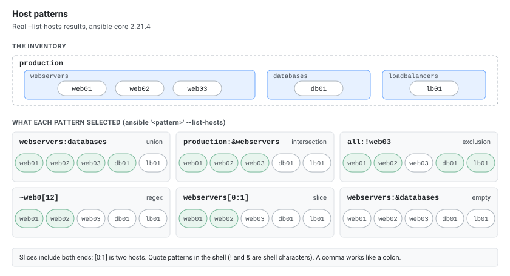
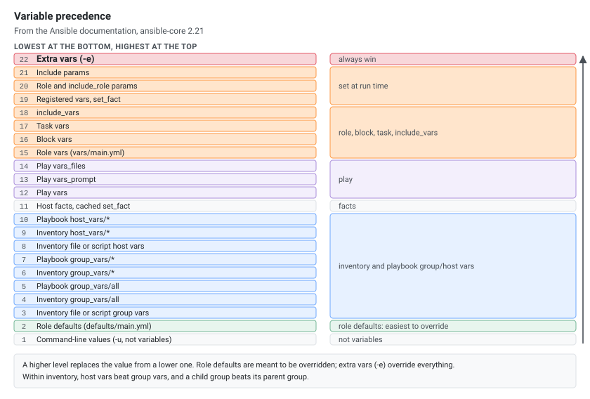
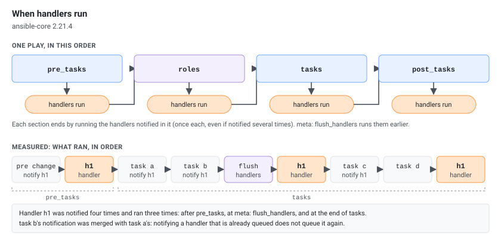

Ansible is an agentless automation tool that uses SSH to configure systems, deploy software, and orchestrate workflows. It uses YAML playbooks to describe desired state and executes tasks against inventory hosts in parallel. Everything below was run with ansible-core 2.21.4 (the Ansible 14.4 package) against Ubuntu 24.04 and Rocky Linux 9 hosts.

## Install

| Platform | Command | Installs |
|----------|---------|----------|
| Any (pipx) | `pipx install --include-deps ansible` | Latest: ansible-core 2.21.5 |
| Any (virtualenv) | `python3 -m venv ~/ansible-venv && ~/ansible-venv/bin/pip install ansible` | Latest: ansible-core 2.21.5 |
| Ubuntu / Debian | `sudo apt update && sudo apt install ansible` | Ubuntu 24.04: ansible 9.2.0, ansible-core 2.16.3 |
| RHEL / Rocky / Alma 9 | `sudo dnf install ansible-core` | ansible-core 2.14.18 (AppStream, no collections) |
| RHEL / Rocky / Alma 9, with collections | `sudo dnf install epel-release && sudo dnf install ansible` | ansible 7.7.0 (EPEL) |
| macOS | `brew install ansible` | ansible 14.4.0, ansible-core 2.21.4 |
| ansible-lint (separate tool) | `pipx install ansible-lint` | ansible-lint 26.10.1 |

Check the result with `ansible --version`. Plain `pip3 install ansible` into the system Python fails on Ubuntu 24.04 with `error: externally-managed-environment`; use pipx or a virtualenv. Distribution packages lag behind the pip release. ansible-core 2.21 needs Python 3.9 or newer on the managed nodes.

## SSH Setup for Ansible

```bash
# Generate SSH key pair (if not already done)
ssh-keygen -t rsa -b 4096

# Copy public key to managed hosts (enables passwordless SSH)
ssh-copy-id user@hostname
ssh-copy-id -i ~/.ssh/id_rsa.pub user@192.168.1.10

# Test connection
ssh user@hostname
```

## Disable Host Key Checking

```bash
# Temporary (current shell session only)
export ANSIBLE_HOST_KEY_CHECKING=False

# Permanent (in ansible.cfg)
# [defaults]
# host_key_checking = False

# Permanent (in ~/.ansible.cfg)
cat <<'EOF' > ~/.ansible.cfg
[defaults]
host_key_checking = False
EOF

# Per-command
ANSIBLE_HOST_KEY_CHECKING=False ansible all -m ping
```

### Pre-populate known_hosts (Preferred Over Disabling)

```bash
# Add specific hosts
ssh-keyscan server1.example.com >> ~/.ssh/known_hosts
ssh-keyscan server2.example.com >> ~/.ssh/known_hosts

# Add all hosts from inventory file
for i in $(cat inventory.txt); do
  ssh-keyscan "$i" >> ~/.ssh/known_hosts
done

# Add all hosts from Ansible inventory (uses ansible_host and ansible_port when set)
ansible-inventory --list \
  | jq -r '._meta.hostvars | to_entries[] | "\(.value.ansible_host // .key) \(.value.ansible_port // 22)"' \
  | while read -r h p; do ssh-keyscan -p "$p" "$h"; done >> ~/.ssh/known_hosts
```

`ansible all --list-hosts` prints inventory names (`web01`), not the addresses Ansible connects to: `ssh-keyscan web01` fails with `getaddrinfo web01: nodename nor servname provided, or not known` when the name only exists in the inventory.

> **Security note:** Disabling host key checking skips SSH MITM protection. In production, pre-populate `known_hosts` with `ssh-keyscan` instead.

## Core Commands

| Command | Purpose |
|---------|---------|
| `ansible` | Run ad-hoc commands on hosts |
| `ansible-playbook` | Execute playbooks |
| `ansible-inventory` | Show/manage inventory |
| `ansible-vault` | Encrypt/decrypt sensitive data |
| `ansible-galaxy` | Install roles and collections |
| `ansible-config` | View/dump configuration |
| `ansible-doc` | Module documentation |
| `ansible-pull` | Pull and run playbooks from VCS |
| `ansible-lint` | Lint playbooks for best practices (installed separately) |

## Ad-hoc Commands

`ansible <pattern> -m <module> -a "<args>"` runs one module without a playbook. Without `-m` it runs `command`.

```bash
# Connectivity check
ansible all -m ping

# Run a command (command is the default module)
ansible webservers -a "uptime"

# Pipes, redirects and variables need the shell module
ansible web01 -m shell -a "ps aux | grep -c sshd"

# Copy a file, then remove it
ansible web01 -m copy -a "src=vars.yml dest=/tmp/vars.yml mode=0644"
ansible web01 -m file -a "path=/tmp/vars.yml state=absent"

# Fetch a file from the hosts (lands in fetched/<host>/etc/hostname)
ansible webservers -m fetch -a "src=/etc/hostname dest=fetched/"

# Packages, services and users (-b = become root, -K = ask for the sudo password)
ansible web01 -b -m apt -a "name=tree state=present update_cache=yes"
ansible db01 -b -m dnf -a "name=tree state=present"
ansible webservers -b -m service -a "name=nginx state=restarted"
ansible web01 -b -K -m user -a "name=carol state=present"

# One fact
ansible web01 -m setup -a "filter=ansible_memtotal_mb"

# One host at a time
ansible all -m ping -f 1
```

`command` and `shell` output looks like this; the result is `CHANGED` because Ansible cannot know whether a command changed anything:

```text
web01 | CHANGED | rc=0 >>
 21:04:47 up 0 min,  0 user,  load average: 0.59, 0.14, 0.05
```

`-o` (one line per host) still works but is deprecated in ansible-core 2.21: `The '-o' argument is deprecated. This feature will be removed from ansible-core version 2.23.`

## Host Patterns

Patterns select hosts for `ansible`, `hosts:` in a play and `--limit`. With the inventory above (webservers web01–web03, databases db01, loadbalancers lb01, all of them in production):

| Pattern | Meaning | Hosts |
|---------|---------|-------|
| `all` | Every host | web01 web02 web03 db01 lb01 |
| `web*` | Wildcard on host names | web01 web02 web03 |
| `webservers:databases` | Union (`,` works too) | web01 web02 web03 db01 |
| `production:&webservers` | Intersection: in both groups | web01 web02 web03 |
| `all:!web03` | Exclusion | web01 web02 db01 lb01 |
| `~web0[12]` | Regular expression (starts with `~`) | web01 web02 |
| `webservers[0]` | First host of the group | web01 |
| `webservers[0:1]` | Slice, both ends included | web01 web02 |
| `webservers[-1]` | Last host of the group | web03 |
| `webservers:&databases` | Intersection with no common host | none |

[](host-patterns.svg "Open the diagram full size")

```bash
# Check a pattern before using it (quote it: ! and & mean something to the shell)
ansible 'all:!web03' --list-hosts

# Limit a playbook to the hosts listed in a file
ansible-playbook playbook.yml --limit @retry.txt
```

## ansible-playbook

```bash
# Run a playbook
ansible-playbook playbook.yml

# Specify inventory
ansible-playbook -i inventory.ini playbook.yml
ansible-playbook -i production/ playbook.yml

# Dry run (check mode)
ansible-playbook playbook.yml --check
ansible-playbook playbook.yml --check --diff

# Limit to specific hosts
ansible-playbook playbook.yml --limit web01
ansible-playbook playbook.yml --limit webservers
ansible-playbook playbook.yml --limit 'webservers:!web03'

# Pass extra variables
ansible-playbook playbook.yml -e "env=production version=2.1"
ansible-playbook playbook.yml -e "@vars.yml"
ansible-playbook playbook.yml --extra-vars '{"env": "prod", "debug": true}'

# Run with tags
ansible-playbook playbook.yml --tags "deploy,restart"
ansible-playbook playbook.yml --skip-tags "debug"

# List tasks/hosts/tags without executing
ansible-playbook playbook.yml --list-tasks
ansible-playbook playbook.yml --list-hosts
ansible-playbook playbook.yml --list-tags

# Start at a specific task
ansible-playbook playbook.yml --start-at-task="Install nginx"

# Step through tasks (confirm each)
ansible-playbook playbook.yml --step

# Verbose output
ansible-playbook playbook.yml -v
ansible-playbook playbook.yml -vvv

# Set forks (parallel hosts)
ansible-playbook playbook.yml -f 20

# Become (sudo)
ansible-playbook playbook.yml -b
ansible-playbook playbook.yml --become --become-user=root --ask-become-pass

# Syntax check (no execution)
ansible-playbook playbook.yml --syntax-check

# Clear the fact cache for every host in the inventory
ansible-playbook playbook.yml --flush-cache
```

Vault password options (`--ask-vault-pass`, `--vault-password-file`, `--vault-id`) are in [Ansible Vault](#ansible-vault).

### Special Tags: always and never

```yaml
- name: Check prerequisites
  debug: {msg: always runs}
  tags: always

- name: Deploy
  debug: {msg: deploy}
  tags: deploy

- name: Reset the database
  debug: {msg: only when asked}
  tags: [never, reset]
```

| Command | Tasks that ran |
|---------|----------------|
| `ansible-playbook site.yml` | Check prerequisites, Deploy |
| `ansible-playbook site.yml --tags deploy` | Check prerequisites, Deploy |
| `ansible-playbook site.yml --tags reset` | Check prerequisites, Reset the database |
| `ansible-playbook site.yml --skip-tags always` | Deploy |

An `always` task runs whatever `--tags` selects; only `--skip-tags always` stops it. A `never` task runs only when one of its other tags (here `reset`) is asked for.

## Inventory

The [Ansible Inventory Guide]() covers inventories in depth: `group_vars` directories, jump hosts, Docker and WinRM connections, and dynamic inventories for AWS, Azure, GCP and Terraform.

### INI Format

```ini
# inventory.ini
[webservers]
web01 ansible_host=192.168.1.10
web02 ansible_host=192.168.1.11
web03 ansible_host=192.168.1.12

[databases]
db01 ansible_host=192.168.1.20 ansible_port=2222
db02 ansible_host=192.168.1.21

[loadbalancers]
lb01 ansible_host=192.168.1.5

# Group of groups
[production:children]
webservers
databases
loadbalancers

# Group variables
[webservers:vars]
ansible_user=deploy
ansible_python_interpreter=/usr/bin/python3
http_port=80

[all:vars]
ansible_ssh_private_key_file=~/.ssh/id_rsa
```

### YAML Format

```yaml
# inventory.yml
all:
  vars:
    ansible_user: deploy
    ansible_python_interpreter: /usr/bin/python3
  children:
    webservers:
      hosts:
        web01:
          ansible_host: 192.168.1.10
        web02:
          ansible_host: 192.168.1.11
      vars:
        http_port: 80
    databases:
      hosts:
        db01:
          ansible_host: 192.168.1.20
        db02:
          ansible_host: 192.168.1.21
    production:
      children:
        webservers:
        databases:
```

### Inventory Commands

```bash
# List all hosts
ansible-inventory --list
ansible-inventory --graph
ansible-inventory --graph --vars

# Show specific host vars
ansible-inventory --host web01

# List all groups
ansible localhost -m debug -a 'var=groups.keys()'

# Use multiple inventories
ansible-playbook -i staging/ -i production/ playbook.yml
```

### Dynamic Grouping with group_by

Create host groups at runtime based on facts — no need to hardcode OS-specific groups in inventory:

```yaml
# First play: classify hosts by OS family
- name: Group hosts by OS
  hosts: all
  tasks:
    - name: Create dynamic groups based on OS family
      group_by:
        key: "os_{{ ansible_facts['os_family'] }}"

# Second play: target only Debian-family hosts (Debian, Ubuntu)
- name: Configure Debian servers
  hosts: os_Debian
  tasks:
    - name: Install packages via apt
      apt:
        name: nginx
        state: present

# Third play: target only RedHat-family hosts (RHEL, Rocky, Alma, CentOS)
- name: Configure RHEL servers
  hosts: os_RedHat
  tasks:
    - name: Install packages via dnf
      dnf:
        name: nginx
        state: present
```

> Group on `os_family`, not `distribution`: Rocky Linux reports `distribution` as `Rocky`, so a group keyed on it would be `os_Rocky` and a `hosts: os_RedHat` play would skip it.
>
> `group_by` runs during the play and creates ephemeral groups that exist only for the current playbook run. Useful when the same inventory contains mixed OS hosts and you want different tasks per OS without duplicating inventory groups.

### Common Host Variables

| Variable | Description |
|----------|-------------|
| `ansible_host` | IP or hostname to connect to |
| `ansible_port` | SSH port (default: 22) |
| `ansible_user` | SSH user |
| `ansible_password` | SSH password (use vault!) |
| `ansible_ssh_private_key_file` | SSH key path |
| `ansible_python_interpreter` | Path to Python on target (see [Ansible and the Target's Python]()) |
| `ansible_become` | Enable privilege escalation |
| `ansible_become_user` | Escalation user |
| `ansible_become_method` | Method (sudo, su, pbrun, etc.) |
| `ansible_connection` | Connection type (ssh, local, docker) |
| `ansible_shell_type` | Shell type (sh, csh, fish) |

## Playbook Structure

### Minimal Playbook

```yaml
---
- name: Install and start nginx
  hosts: webservers
  become: yes

  tasks:
    - name: Install nginx
      apt:
        name: nginx
        state: present
        update_cache: yes

    - name: Start nginx
      service:
        name: nginx
        state: started
        enabled: yes
```

### Full Playbook

```yaml
---
- name: Configure web servers
  hosts: webservers
  become: yes
  gather_facts: yes
  vars:
    http_port: 80
    app_version: "2.1.0"
  vars_files:
    - vars/common.yml
    - vars/{{ env }}.yml

  pre_tasks:
    - name: Update apt cache
      apt:
        update_cache: yes
        cache_valid_time: 3600

  roles:
    - common
    - nginx
    - app

  tasks:
    - name: Deploy application
      copy:
        src: "app-{{ app_version }}.tar.gz"
        dest: /opt/app/
      notify: restart app

  post_tasks:
    - name: Verify deployment
      uri:
        url: "http://localhost:{{ http_port }}/health"
        status_code: 200

  handlers:
    - name: restart app
      service:
        name: myapp
        state: restarted
```

### Task Keywords

```yaml
- name: Example task with common keywords
  command: nginx -t
  become: yes
  become_user: root
  when: ansible_facts['os_family'] == "Debian"
  register: nginx_test
  changed_when: false
  failed_when: nginx_test.rc != 0
  ignore_errors: yes
  retries: 3
  delay: 5
  until: nginx_test.rc == 0
  tags:
    - nginx
  environment:
    HTTP_PROXY: "http://proxy:3128"
```

`failed_when` can only use keys the module returns. The `apt` module returns no `rc` when it succeeds, so `failed_when: result.rc != 0` on an `apt` task fails with `object of type 'dict' has no attribute 'rc'`. `command` and `shell` always return `rc`.

## Variables

### Variable Precedence (Low → High)

1. Command-line values (for example `-u my_user`; these are not variables)
2. Role defaults (`roles/x/defaults/main.yml`)
3. Inventory file or script group vars
4. Inventory `group_vars/all`
5. Playbook `group_vars/all`
6. Inventory `group_vars/*`
7. Playbook `group_vars/*`
8. Inventory file or script host vars
9. Inventory `host_vars/*`
10. Playbook `host_vars/*`
11. Host facts and cached `set_fact`
12. Play `vars`
13. Play `vars_prompt`
14. Play `vars_files`
15. Role vars (`roles/x/vars/main.yml`)
16. Block vars (tasks in the block only)
17. Task vars (the task only)
18. `include_vars`
19. Registered vars and `set_fact`
20. Role (and `include_role`) params
21. Include params
22. Extra vars (`-e`) — **always win**

[](variable-precedence.svg "Open the diagram full size")

### Variable Definition

```yaml
# In playbook
vars:
  app_name: myapp
  app_port: 8080
  packages:
    - nginx
    - git
    - curl

# From file
vars_files:
  - vars/common.yml

# Prompted at runtime
vars_prompt:
  - name: deploy_version
    prompt: "Version to deploy?"
    private: no
```

### Directory Structure for Variables

```
inventory/
├── group_vars/
│   ├── all.yml            # All hosts
│   ├── webservers.yml     # webservers group
│   └── production.yml     # production group
├── host_vars/
│   ├── web01.yml          # web01 only
│   └── db01.yml           # db01 only
└── hosts.ini
```

### Using Variables

```yaml
# Simple
"{{ app_name }}"

# Default value
"{{ app_port | default(8080) }}"

# Dictionary access
"{{ db_config.host }}"
"{{ db_config['host'] }}"

# List access
"{{ servers[0] }}"

# Registered variables
- name: Check service
  command: systemctl status nginx
  register: nginx_status

- name: Print result
  debug:
    msg: "{{ nginx_status.stdout }}"

# Set fact (create variable at runtime)
- name: Set derived variable
  set_fact:
    full_app_name: "{{ app_name }}-{{ app_version }}"

- name: Use set_fact
  debug:
    msg: "Deploying {{ full_app_name }}"
```

## Conditionals

```yaml
# Simple when
- name: Install on Debian
  apt:
    name: nginx
  when: ansible_facts['os_family'] == "Debian"

# Multiple conditions
- name: Install on Ubuntu 22.04+
  apt:
    name: nginx
  when:
    - ansible_facts['distribution'] == "Ubuntu"
    - ansible_facts['distribution_major_version'] | int >= 22

# Or conditions
- name: Install on Debian or Ubuntu
  apt:
    name: nginx
  when: ansible_facts['distribution'] == "Debian" or ansible_facts['distribution'] == "Ubuntu"

# Variable defined
- name: Only if var exists
  debug:
    msg: "{{ custom_var }}"
  when: custom_var is defined

# Boolean
- name: Only in production
  service:
    name: monitoring
    state: started
  when: enable_monitoring | bool

# Register + when
- name: Check if file exists
  stat:
    path: /opt/app/config.yml
  register: config_file

- name: Create config if missing
  template:
    src: config.yml.j2
    dest: /opt/app/config.yml
  when: not config_file.stat.exists
```

Read facts from `ansible_facts['os_family']`, not the top-level `ansible_os_family`. ansible-core 2.21 warns on every top-level fact: `INJECT_FACTS_AS_VARS default to True is deprecated, top-level facts will not be auto injected after the change. This feature will be removed from ansible-core version 2.24.`

## Loops

```yaml
# Simple list
- name: Install packages
  apt:
    name: "{{ item }}"
    state: present
  loop:
    - nginx
    - git
    - curl

# Better: pass list directly (faster)
- name: Install packages
  apt:
    name:
      - nginx
      - git
      - curl
    state: present

# Loop with dict
- name: Create users
  user:
    name: "{{ item.name }}"
    uid: "{{ item.uid }}"
    groups: "{{ item.groups }}"
    append: yes
  loop:
    - { name: alice, uid: 2001, groups: "adm" }
    - { name: bob, uid: 2002, groups: "users" }

# Loop with index
- name: Create numbered files
  file:
    path: "/tmp/file-{{ idx }}"
    state: touch
  loop: "{{ range(1, 6) | list }}"
  loop_control:
    loop_var: idx

# Nested loops (every user × every database; with_nested is the legacy form)
# mysql_user is community.mysql and needs PyMySQL on the target
- name: Grant access
  mysql_user:
    name: "{{ item[0] }}"
    priv: "{{ item[1] }}.*:ALL"
  loop: "{{ ['alice', 'bob'] | product(['db1', 'db2']) | list }}"

# Loop over dict
- name: Set sysctl values
  sysctl:
    name: "{{ item.key }}"
    value: "{{ item.value }}"
  loop: "{{ sysctl_settings | dict2items }}"

# Legacy syntax (with_items — still works but loop is preferred)
# yum is an alias of dnf since ansible-core 2.17
- name: Install packages (legacy)
  yum:
    name: "{{ item }}"
    state: present
  with_items:
    - git
    - vim
    - tar
```

## Handlers

```yaml
# Handlers run once, only if notified, at the end of each section
# (pre_tasks, roles, tasks, post_tasks), not only at the end of the play
handlers:
  - name: restart nginx
    service:
      name: nginx
      state: restarted

  - name: reload nginx
    service:
      name: nginx
      state: reloaded

  - name: restart and enable nginx
    service:
      name: nginx
      state: restarted
      enabled: yes

# Notify from a task
tasks:
  - name: Update nginx config
    template:
      src: nginx.conf.j2
      dest: /etc/nginx/nginx.conf
    notify:
      - reload nginx

# Flush handlers immediately (don't wait until the end of the section)
  - name: Flush handlers now
    meta: flush_handlers
```

[](handlers-order.svg "Open the diagram full size")

## Roles

### Role Structure

```
roles/
└── nginx/
    ├── tasks/
    │   └── main.yml
    ├── handlers/
    │   └── main.yml
    ├── templates/
    │   └── nginx.conf.j2
    ├── files/
    │   └── index.html
    ├── vars/
    │   └── main.yml
    ├── defaults/
    │   └── main.yml
    ├── meta/
    │   └── main.yml
    └── README.md
```

In each of these directories Ansible loads `main.yml` (or `main.yaml`, or `main`) by itself; `templates/` and `files/` hold the files the `template` and `copy` modules refer to by name.

| Directory | Purpose |
|-----------|---------|
| `tasks/` | The main list of tasks the role executes |
| `handlers/` | Handlers triggered by `notify` in tasks |
| `templates/` | Jinja2 templates (dynamic config files) |
| `files/` | Static files copied as-is to remote hosts |
| `vars/` | High-priority variables for the role |
| `defaults/` | Default variables (lowest priority — easy to override) |
| `meta/` | Role metadata — dependencies, galaxy info |

### Using Roles

```yaml
# In playbook
- hosts: webservers
  roles:
    - common
    - nginx
    - { role: app, app_version: "2.1.0" }
    - role: monitoring
      when: enable_monitoring | bool
      tags: monitoring
```

### import_role / include_role (Inline Role Execution)

The `roles:` keyword runs all roles before any `tasks:`. To mix roles and tasks in a specific order, use `import_role` or `include_role` inside the tasks section:

```yaml
- name: Deploy with controlled ordering
  hosts: webservers
  become: yes
  tasks:
    - name: Pre-deployment health check
      uri:
        url: "http://{{ inventory_hostname }}/health"
        status_code: 200

    - name: Apply nginx configuration role
      import_role:
        name: nginx
      vars:
        nginx_port: 8080

    - name: Deploy application role
      include_role:
        name: app
      when: deploy_app | default(true)

    - name: Post-deployment verification
      uri:
        url: "http://{{ inventory_hostname }}:8080/health"
        status_code: 200
```

| | `import_role` | `include_role` |
|---|---|---|
| **Processing** | Static — parsed at playbook load time | Dynamic — processed at runtime |
| **Tags/when** | Applied to every task inside the role | Applied to the include statement only |
| **Loops** | Cannot be used in a loop | Can be used with `loop` |
| **--list-tasks** | Shows the role's tasks | Shows only the `include_role` task |
| **Use when** | Default choice — predictable behavior | Need conditional or looped role inclusion |

> **Rule of thumb:** Use `import_role` unless you need to loop over it or conditionally skip entire roles at runtime. `import_role` is more predictable because all tasks are visible during `--list-tasks`.

### ansible-galaxy

```bash
# Install role from Galaxy
ansible-galaxy install geerlingguy.nginx
ansible-galaxy install geerlingguy.docker

# Install from requirements file
ansible-galaxy install -r requirements.yml

# Install collection
ansible-galaxy collection install community.general
ansible-galaxy collection install amazon.aws

# Install role from git URL
ansible-galaxy install git+https://github.com/geerlingguy/ansible-role-ntp.git

# List installed
ansible-galaxy list
ansible-galaxy collection list

# Remove a role
ansible-galaxy remove role_name

# Init a new role
ansible-galaxy init my_role

# Init a new collection
ansible-galaxy collection init my_namespace.my_collection
```

### requirements.yml

```yaml
---
roles:
  - name: geerlingguy.nginx
    version: "3.3.1"
  - name: geerlingguy.docker
  - src: https://github.com/geerlingguy/ansible-role-apache.git
    scm: git
    version: master
    name: apache

collections:
  - name: community.general
    version: ">=12.0.0"
  - name: amazon.aws
    version: "12.0.0"
```

## Ansible Vault

```bash
# Create encrypted file
ansible-vault create secrets.yml

# Edit encrypted file
ansible-vault edit secrets.yml

# Encrypt existing file
ansible-vault encrypt vars/production.yml

# Decrypt file
ansible-vault decrypt vars/production.yml

# View encrypted file (don't edit)
ansible-vault view secrets.yml

# Change vault password
ansible-vault rekey secrets.yml

# Encrypt a string (inline)
ansible-vault encrypt_string 'my_secret_password' --name 'db_password'

# Run playbook with vault
ansible-playbook playbook.yml --ask-vault-pass
ansible-playbook playbook.yml --vault-password-file=~/.vault_pass
ansible-playbook playbook.yml --vault-id prod@~/.vault_pass_prod
```

A file encrypted with `--vault-id prod@...` starts with `$ANSIBLE_VAULT;1.2;AES256;prod` (the label is in the header); without a label it is `$ANSIBLE_VAULT;1.1;AES256`. Running a playbook that needs it without a password fails with `Attempting to decrypt but no vault secrets found`.

### Using Vault in Playbooks

```yaml
# vars/secrets.yml (plain YAML with one value from ansible-vault encrypt_string)
db_password: !vault |
  $ANSIBLE_VAULT;1.1;AES256
  3862346538663766326234...

# Reference normally
- name: Configure database
  template:
    src: db.conf.j2
    dest: /etc/app/db.conf
  vars:
    password: "{{ db_password }}"
```

## Templates (Jinja2)

```jinja
{# templates/nginx.conf.j2 #}
upstream backend {

    server {{ upstream.host }}:{{ upstream.port }};

}

server {
    listen {{ http_port | default(80) }};
    server_name {{ ansible_facts['hostname'] }};

    root /var/www/{{ app_name }};


    listen 443 ssl;
    ssl_certificate /etc/ssl/{{ domain }}.crt;
    ssl_certificate_key /etc/ssl/{{ domain }}.key;


    location / {
        proxy_pass http://backend;
    }
}
```

`upstream` belongs outside `server` (nginx: `"upstream" directive is not allowed here`), and the loop goes inside one `upstream` block, not around it. With two `app_servers` it renders `upstream backend { server 10.0.0.11:8080; server 10.0.0.12:8080; }` and passes `nginx -t`.

### Common Filters

```yaml
# String
"{{ name | upper }}"
"{{ name | lower }}"
"{{ name | capitalize }}"
"{{ path | basename }}"
"{{ path | dirname }}"
"{{ text | regex_replace('old', 'new') }}"

# Default value
"{{ var | default('fallback') }}"
"{{ var | default(omit) }}"

# Type conversion
"{{ port | int }}"
"{{ flag | bool }}"
"{{ data | to_json }}"
"{{ data | to_yaml }}"
"{{ data | from_json }}"

# List
"{{ list | join(', ') }}"
"{{ list | first }}"
"{{ list | last }}"
"{{ list | length }}"
"{{ list | unique }}"
"{{ list | sort }}"
"{{ list | flatten }}"

# Hash/Password
"{{ 'secret' | password_hash('sha512') }}"

# File
"{{ lookup('file', '/path/to/file') }}"
"{{ lookup('env', 'HOME') }}"
"{{ lookup('template', 'template.j2') }}"

# IP address (ipaddr is ansible.utils and needs the netaddr Python library)
"{{ ansible_facts['default_ipv4']['address'] }}"
"{{ '192.168.1.0/24' | ansible.utils.ipaddr('network') }}"
```

## Configuration (ansible.cfg)

```ini
# ansible.cfg (in project directory — highest priority)
[defaults]
inventory = ./inventory
remote_user = deploy
private_key_file = ~/.ssh/id_rsa
host_key_checking = False
retry_files_enabled = False
gathering = smart
fact_caching = jsonfile
fact_caching_connection = /tmp/ansible_facts
fact_caching_timeout = 86400
stdout_callback = default
callback_result_format = yaml
forks = 20
timeout = 30
log_path = ./ansible.log
bin_ansible_callbacks = True

[inventory]
enable_plugins = host_list, script, auto, yaml, ini, toml

[privilege_escalation]
become = True
become_method = sudo
become_user = root
become_ask_pass = False

[ssh_connection]
pipelining = True
ssh_args = -o ControlMaster=auto -o ControlPersist=60s -o StrictHostKeyChecking=no
control_path_dir = /tmp/.ansible-cp
```

`stdout_callback = yaml` no longer works: `The 'community.general.yaml' callback plugin has been removed. The plugin has been superseded by the option result_format=yaml in callback plugin ansible.builtin.default` (removed in community.general 12.0.0). A `log_path` the user cannot write only gives a warning: `log file at '/var/log/ansible.log' is not writeable and we cannot create it, aborting`.

### Performance Tuning

```yaml
# In playbook — optimize execution
---
- name: Optimized playbook
  hosts: all
  gather_facts: no         # Skip if facts not needed
  strategy: free           # Don't wait for slowest host before proceeding
  serial: 10              # Limit concurrent hosts

  tasks:
    - name: Gather only needed facts
      setup:
        filter: ansible_distribution*
```

```ini
# In ansible.cfg — fact caching (avoid re-gathering)
[defaults]
gathering = smart                    # Only gather facts if not cached
fact_caching = jsonfile              # Cache on disk (memory only lasts one run)
fact_caching_connection = ~/.ansible/facts
fact_caching_timeout = 86400         # Cache TTL in seconds (24h)
```

| Strategy | Behavior |
|----------|----------|
| `linear` (default) | Wait for all hosts to finish each task before moving to next |
| `free` | Each host runs as fast as it can without waiting for others |
| `debug` | Interactive debugger on task failure |

### Config Precedence (High → Low)

1. `ANSIBLE_CONFIG` environment variable (path to a config file)
2. `./ansible.cfg` (current directory)
3. `~/.ansible.cfg` (home directory — note the dot prefix)
4. `/etc/ansible/ansible.cfg` (system-wide default)

```bash
# Show effective configuration
ansible-config dump
ansible-config dump --only-changed
ansible-config list

# Start a new ansible.cfg with every option listed and commented out
ansible-config init --disabled > ansible.cfg

# Show which config file is being used
ansible --version | grep "config file"
```

`ansible-config init --disabled` writes 705 lines on ansible-core 2.21.4: each option with its description and default (`;forks=5`, `;inventory=['/etc/ansible/hosts']`), in sections from `[defaults]` to `[tags]`. Uncomment only what you change. Add `-t all` to include the plugin options too (981 lines).

## System-Wide Paths

| Path | Purpose |
|------|---------|
| `/etc/ansible/` | Main system-wide configuration directory |
| `/etc/ansible/ansible.cfg` | System-wide default configuration |
| `/etc/ansible/hosts` | Default inventory file (used when no `-i` specified) |
| `/etc/ansible/roles/` | System-wide roles directory |

> **Note:** For project-based work, keep `ansible.cfg` and `inventory/` in your project directory rather than using the system-wide paths.

## ansible-doc

```bash
# List all modules
ansible-doc -l

# Show module documentation
ansible-doc apt
ansible-doc dnf
ansible-doc copy
ansible-doc template

# Show a playbook snippet with all options
ansible-doc -s apt

# List modules matching pattern
ansible-doc -l | grep -i docker

# Show connection plugins
ansible-doc -t connection -l

# Show callback plugins
ansible-doc -t callback -l
```

## ansible-pull

`ansible-pull` turns push into pull: each host clones a Git repository and runs a playbook against itself, usually from cron. Useful for many hosts or hosts that are not always reachable over SSH.

```bash
# Clone (or update) the repo into ~/.ansible/pull/<fqdn> and run local.yml
ansible-pull -U https://github.com/org/ansible-config.git

# Choose the checkout directory, the branch and the playbook
ansible-pull -U https://github.com/org/ansible-config.git -d /var/lib/ansible-pull -C main site.yml

# Run the playbook only if the repo changed since the last pull (for cron)
ansible-pull -U https://github.com/org/ansible-config.git -o

# Cron entry: every 30 minutes
*/30 * * * * ansible-pull -U https://github.com/org/ansible-config.git -o >> /var/log/ansible-pull.log 2>&1
```

Without a playbook name it looks for `<fqdn>.yml`, `<hostname>.yml` and then `local.yml` in the repo; the playbook uses `hosts: localhost`. With `-o` and no new commit it stops with `Repository has not changed, quitting`.

## Common Patterns

### Deploy Application

```yaml
---
- name: Deploy application
  hosts: webservers
  become: yes
  serial: "25%"           # Rolling update — 25% at a time
  max_fail_percentage: 10  # Fail if >10% of hosts fail

  pre_tasks:
    - name: Disable in load balancer
      uri:
        url: "http://lb/api/disable/{{ inventory_hostname }}"
        method: POST
      delegate_to: localhost

  tasks:
    - name: Pull latest code
      git:
        repo: "{{ repo_url }}"
        dest: /opt/app
        version: "{{ app_version }}"
      notify: restart app

    - name: Install dependencies
      pip:
        requirements: /opt/app/requirements.txt
        virtualenv: /opt/app/venv

  post_tasks:
    - name: Re-enable in load balancer
      uri:
        url: "http://lb/api/enable/{{ inventory_hostname }}"
        method: POST
      delegate_to: localhost

  handlers:
    - name: restart app
      service:
        name: myapp
        state: restarted
```

### Error Handling

```yaml
# Block / Rescue / Always
- name: Handle errors
  block:
    - name: Attempt upgrade
      apt:
        upgrade: dist
      register: upgrade_result

    - name: Reboot if needed
      reboot:
      when: upgrade_result.changed

  rescue:
    - name: Rollback on failure
      command: /opt/scripts/rollback.sh

    - name: Notify admin
      mail:
        to: admin@example.com
        subject: "Deploy failed on {{ inventory_hostname }}"

  always:
    - name: Re-enable monitoring
      service:
        name: monitoring
        state: started
```

### Fail and Custom Failure Conditions

```yaml
# Fail explicitly with a message
- name: Fail if unsupported OS
  fail:
    msg: "This playbook only supports RedHat family"
  when: ansible_facts['os_family'] != "RedHat"

# Ignore errors on a task
- name: Command that might fail
  command: /bin/false
  ignore_errors: yes

# Custom failure condition (fail only on specific exit codes)
- name: Run risky command
  command: /opt/risky-script.sh
  register: result
  failed_when: result.rc != 0 and result.rc != 2

# Custom changed condition
- name: Check configuration
  command: /opt/check-config.sh
  register: check_result
  changed_when: "'CHANGED' in check_result.stdout"
```

### Debug and Pause

```yaml
# Debug — show variable value
- name: Debug variable
  debug:
    var: my_variable

# Debug — show message
- name: Debug message
  debug:
    msg: "Host {{ inventory_hostname }} has IP {{ ansible_facts['default_ipv4']['address'] }}"

# Debug — only show in verbose mode (-vv or higher)
- name: Verbose-only debug
  debug:
    msg: "Detailed info for troubleshooting"
    verbosity: 2

# Pause — wait for user confirmation
- name: Pause before continuing
  pause:
    prompt: "Check the system before continuing. Press Enter to proceed."

# Pause — wait a specific time
- name: Wait 30 seconds
  pause:
    seconds: 30
```

### Delegation

```yaml
# Run task on a different host
- name: Add host to load balancer
  command: /usr/local/bin/lb-add {{ inventory_hostname }}
  delegate_to: lb01

# Run on localhost
- name: Wait for port
  wait_for:
    host: "{{ ansible_host }}"
    port: 80
    timeout: 60
  delegate_to: localhost
```

### Run Once, Throttle, Async and Check Mode

```yaml
- name: Execution control
  hosts: webservers
  tasks:
    - name: Run a migration once, on the first host
      command: /opt/app/bin/migrate
      run_once: true
      register: migration

    - name: At most one host at a time (rest of the play stays parallel)
      command: /opt/app/bin/reload
      throttle: 1

    - name: Start a long job in the background
      command: /opt/app/bin/reindex
      async: 3600          # maximum run time in seconds
      poll: 0              # do not wait
      register: job

    - name: Wait for the background job
      async_status:
        jid: "{{ job.ansible_job_id }}"
      register: job_result
      until: job_result.finished
      retries: 60
      delay: 10

    - name: Read-only command that also runs in --check
      command: cat /etc/hostname
      check_mode: false
      changed_when: false

    - name: Never show a diff for this task (secrets)
      template:
        src: secrets.conf.j2
        dest: /etc/app/secrets.conf
      diff: false
```

- `run_once` runs the task on the first host, but the registered result is set on every host in the play.
- With `throttle: 1`, three hosts each running `sleep 1` took 3.55 s instead of about 1 s.
- In `--check` mode `command` and `shell` tasks are skipped; `check_mode: false` runs them anyway, so use it only for commands that change nothing.

## Directory Layout (Best Practice)

```
ansible-project/
├── ansible.cfg
├── inventory/
│   ├── production/
│   │   ├── hosts.yml
│   │   ├── group_vars/
│   │   │   ├── all.yml
│   │   │   └── webservers.yml
│   │   └── host_vars/
│   │       └── web01.yml
│   └── staging/
│       ├── hosts.yml
│       └── group_vars/
├── playbooks/
│   ├── site.yml              # Master playbook
│   ├── webservers.yml
│   └── databases.yml
├── roles/
│   ├── common/
│   ├── nginx/
│   └── app/
├── group_vars/               # Playbook-level group_vars
├── host_vars/                # Playbook-level host_vars
├── files/
├── templates/
├── vars/
│   ├── common.yml
│   └── secrets.yml           # Vault encrypted
├── requirements.yml          # Galaxy dependencies
└── Makefile                  # Convenience targets
```

## RHEL System Roles

Red Hat provides pre-built Ansible roles for common RHEL administration tasks. They're installed from the `rhel-system-roles` package.

### Install

```bash
# RHEL 8 and 9 (AppStream; pulls in ansible-core)
sudo dnf install rhel-system-roles

# List the installed roles
ls /usr/share/ansible/roles/
```

On Rocky Linux 9 the same package (1.120.5) is in AppStream. It installs each role twice, as `rhel-system-roles.<name>` and `linux-system-roles.<name>`, plus the `redhat.rhel_system_roles` collection.

### Installed Locations

| Path | Content |
|------|---------|
| `/usr/share/ansible/roles/rhel-system-roles.*` | Role files |
| `/usr/share/ansible/collections/ansible_collections/redhat/rhel_system_roles/` | The same roles as a collection |
| `/usr/share/doc/rhel-system-roles/` | Documentation per subsystem |

### Available Roles

| Role | Purpose |
|------|---------|
| `rhel-system-roles.timesync` | Configure NTP/chrony |
| `rhel-system-roles.network` | Configure networking |
| `rhel-system-roles.firewall` | Manage firewalld |
| `rhel-system-roles.selinux` | Configure SELinux |
| `rhel-system-roles.kdump` | Configure kdump |
| `rhel-system-roles.storage` | Manage disks, LVM, filesystems |
| `rhel-system-roles.logging` | Configure rsyslog |
| `rhel-system-roles.metrics` | Performance metrics (PCP) |
| `rhel-system-roles.tlog` | Session recording |
| `rhel-system-roles.crypto_policies` | System-wide crypto policies |
| `rhel-system-roles.certificate` | Manage certificates |
| `rhel-system-roles.nbde_client` | Network-Bound Disk Encryption |
| `rhel-system-roles.postfix` | Configure Postfix |

### Example Usage

```yaml
---
- name: Configure time synchronization
  hosts: all
  become: yes
  roles:
    - role: rhel-system-roles.timesync
      vars:
        timesync_ntp_servers:
          - hostname: ntp1.example.com
            iburst: yes
          - hostname: ntp2.example.com
            iburst: yes
```

## Vim Configuration for YAML

Tabs break YAML parsing. YAML only allows spaces for indentation — tabs are forbidden. Configure vim to automatically use spaces when editing Ansible playbooks:

```bash
# Add to ~/.vimrc
autocmd FileType yaml setlocal ai ts=2 sw=2 et
```

Or target YAML files explicitly:

```bash
# Add to ~/.vimrc
au BufNewFile,BufRead *.yaml,*.yml set et ts=2 sw=2
```

| Setting | Meaning |
|---------|---------|
| `et` | expandtab — insert spaces when Tab is pressed (never actual tabs) |
| `ts=2` | tabstop — display width of a tab character as 2 spaces |
| `sw=2` | shiftwidth — indent/dedent by 2 spaces with `<` and `>` commands |
| `ai` | autoindent — new lines inherit indentation from the previous line |

> **Why this matters:** A single tab character in a YAML file causes a parse error. Ansible fails with `YAML parsing failed: Tabs are usually invalid in YAML.` and the line and column of the tab. Always use spaces — the vim settings above make Tab key produce spaces automatically.

## Debugging

Syntax check, `--check --diff`, `--step`, `--start-at-task` and the `debug` module are in the sections above.

```bash
# Lint one playbook, or all of them
ansible-lint playbook.yml
ansible-lint playbooks/*.yml

# Verbose (SSH debugging at -vvvv)
ansible-playbook playbook.yml -vvvv

# Time per task, slowest first
ANSIBLE_CALLBACKS_ENABLED=profile_tasks ansible-playbook playbook.yml
```

The task debugger stops at a failed task and lets you inspect and change it:

```yaml
- name: Read a file
  command: cat /etc/missing.conf
  debugger: on_failed
```

```text
[web01] TASK: Read a file (debug)> p task.args
[web01] TASK: Read a file (debug)> task.args['_raw_params'] = 'cat /etc/hostname'
[web01] TASK: Read a file (debug)> redo
changed: [web01]
```

Other debugger commands: `p task_vars` (all variables), `p result._result` (the failed result), `c` (continue), `q` (quit). `ANSIBLE_ENABLE_TASK_DEBUGGER=True` turns it on for every failed task without editing the playbook.

## One-Liners

```bash
# Validate YAML with Python (no Ansible needed)
python3 -c 'import yaml, sys; yaml.safe_load(sys.stdin)' < playbook.yml && echo "Valid YAML"

# Run with vault + limit + tags
ansible-playbook -i production site.yml --vault-password-file=~/.vault \
  --limit webservers --tags deploy

# Generate encrypted password ("all" does not include the implicit localhost)
ansible localhost -m debug -a "msg={{ 'mypassword' | password_hash('sha512') }}"

# Quick facts dump for one host (strip the "web01 | SUCCESS => " prefix to get JSON)
ansible web01 -m setup | sed '1s/^.*=> //' > facts-web01.json

# Set SELinux to permissive on all hosts (needs python3-libselinux on the targets)
ansible all -m selinux -a "policy=targeted state=permissive" -b

# Find log files across all servers
ansible all -m find -a "paths=/var/log patterns='*.log' age=7d" -b

# Refresh the fact cache (with fact_caching = jsonfile in ansible.cfg)
ansible all -m setup > /dev/null
```

## Best Practices

1. **Version control** — keep playbooks, roles, and inventory in Git
2. **Use ansible-vault** — never store passwords/secrets in plain text
3. **Test with `--check`** — dry-run before applying to production
4. **Meaningful names** — name every play and task descriptively
5. **Idempotent tasks** — running the playbook twice should produce no changes
6. **Use roles** — extract reusable logic into roles, share via Galaxy
7. **Document** — add comments explaining why, not just what
8. **Pin versions** — pin role and collection versions in requirements.yml
9. **Least privilege** — only use `become` on tasks that need it
10. **Separate environments** — use different inventory files/dirs for staging vs production

Related: [Ansible Inventory Guide]() and [Ansible and the Target's Python: Versions by OS]().
