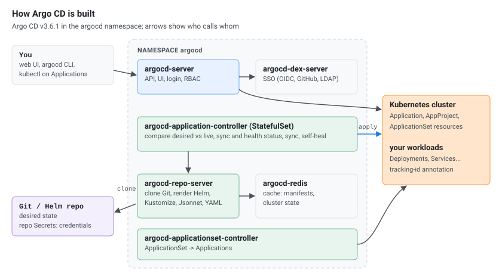
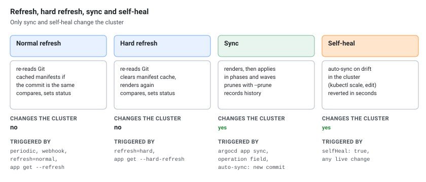
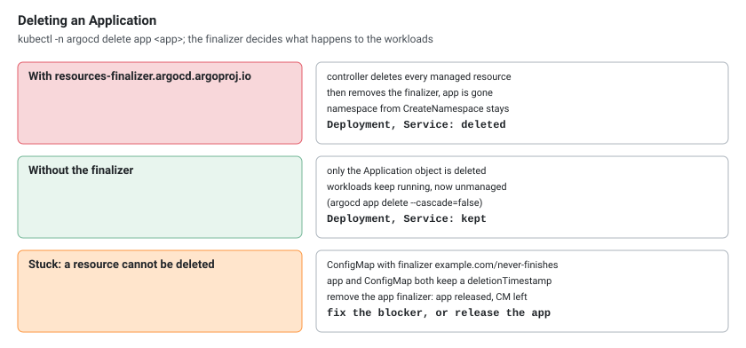
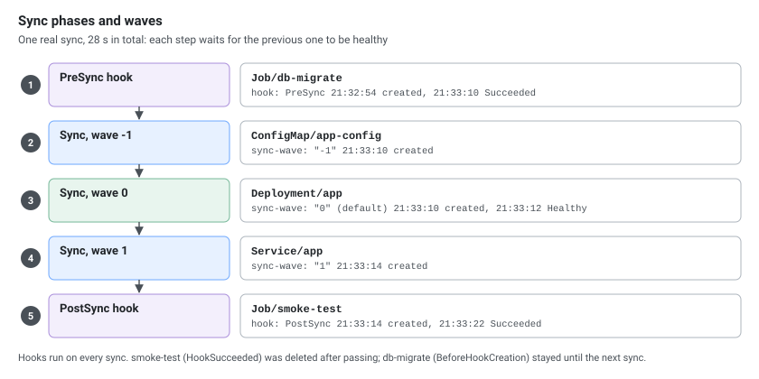

Day-to-day Argo CD commands in two flavours: plain `kubectl` against the Argo CD custom resources (no extra tool, works wherever you have cluster access) and the `argocd` CLI. All examples assume Argo CD is installed in the `argocd` namespace. Everything was checked on Argo CD v3.6.1 on a single-node k3s 1.35 cluster.

## 1. The Custom Resources

| Kind | Short names | What it is |
|------|-------------|-----------|
| `Application` | `app`, `apps` | One source (Git path, Helm chart, OCI) deployed to one destination |
| `ApplicationSet` | `appset`, `appsets` | A template that generates many Applications (per cluster, per directory, per PR) |
| `AppProject` | `appproj`, `appprojs` | Guard rails: allowed repos, destinations, resource kinds, roles |

```bash
kubectl api-resources --api-group=argoproj.io
```

Applications live in the **Argo CD namespace** (`argocd`), not in the namespace they deploy to. `kubectl get applications -A` finds them wherever they are, including apps-in-any-namespace setups.

## 2. How Argo CD Is Built

[](argocd-architecture.svg "Open the diagram full size")

| Component | Kind | Job |
|---|---|---|
| `argocd-server` | Deployment | API, web UI and the endpoint the `argocd` CLI logs in to |
| `argocd-repo-server` | Deployment | Clones Git, renders Helm, Kustomize, Jsonnet or plain YAML into manifests |
| `argocd-application-controller` | StatefulSet | Compares rendered manifests with the cluster, sets sync and health status, runs syncs and self-heal |
| `argocd-applicationset-controller` | Deployment | Turns ApplicationSets into Applications |
| `argocd-redis` | Deployment | Cache for rendered manifests and the cluster state (no persistent data) |
| `argocd-dex-server` | Deployment | SSO bridge (OIDC, GitHub, LDAP...) |
| `argocd-notifications-controller` | Deployment | Slack, email, webhook notifications on app events |

The Helm and Kustomize versions bundled in the server image decide how your apps are rendered (v3.6.1 ships Helm 4.3.1 and Kustomize 5.8.3); `argocd version` shows them.

Argo CD marks every resource it deploys with a **tracking annotation**, `argocd.argoproj.io/tracking-id: <app>:<group>/<kind>:<namespace>/<name>`, which is how it knows what it owns (and what an app delete removes):

```bash
kubectl -n <namespace> get deploy <name> -o jsonpath='{.metadata.annotations.argocd\.argoproj\.io/tracking-id}{"\n"}'
```

## 3. Listing Applications With kubectl

```bash
kubectl -n argocd get applications              # NAME, SYNC STATUS, HEALTH STATUS
kubectl -n argocd get apps -o wide              # adds REVISION and PROJECT
kubectl get applications -A                     # every namespace
kubectl -n argocd get applicationsets
kubectl -n argocd get appprojects
```

A freshly created app shows empty `SYNC STATUS` and `HEALTH STATUS` for a second or two, until the controller has compared it.

### Custom Columns

```bash
kubectl -n argocd get applications -o custom-columns=\
NAME:.metadata.name,\
SYNC:.status.sync.status,\
HEALTH:.status.health.status,\
REPO:.spec.source.repoURL,\
PATH:.spec.source.path,\
DEST:.spec.destination.namespace,\
SELFHEAL:.spec.syncPolicy.automated.selfHeal
```

### Find What Needs Attention

```bash
# Apps that are not Synced or not Healthy (needs jq)
kubectl -n argocd get applications -o json \
  | jq -r '.items[] | select(.status.sync.status!="Synced" or .status.health.status!="Healthy")
           | [.metadata.name, .status.sync.status, .status.health.status] | @tsv'

# Apps with error conditions (ComparisonError, SyncError, InvalidSpecError...)
kubectl -n argocd get applications -o json \
  | jq -r '.items[] | select(.status.conditions) | .metadata.name as $n | .status.conditions[] | "\($n)\t\(.type)\t\(.message)"'

# Apps with automated sync turned off
kubectl -n argocd get applications -o json \
  | jq -r '.items[] | select(.spec.syncPolicy.automated == null) | .metadata.name'
```

The conditions filter is the quickest way to find an app whose manifests don't render, such as a broken YAML file in Git (`ComparisonError`).

## 4. Inspecting One Application

```bash
kubectl -n argocd get app <app> -o yaml
kubectl -n argocd describe app <app>                       # events at the bottom

# Sync and health in one line
kubectl -n argocd get app <app> -o jsonpath='{.status.sync.status} {.status.health.status}{"\n"}'

# Git commit currently deployed
kubectl -n argocd get app <app> -o jsonpath='{.status.sync.revision}{"\n"}'

# Every managed resource with its sync and health status
kubectl -n argocd get app <app> -o jsonpath='{range .status.resources[*]}{.kind}{"\t"}{.namespace}/{.name}{"\t"}{.status}{"\t"}{.health.status}{"\n"}{end}'

# Only the resources that drifted
kubectl -n argocd get app <app> -o jsonpath='{range .status.resources[?(@.status=="OutOfSync")]}{.kind}/{.name}{"\n"}{end}'

# Result of the last sync
kubectl -n argocd get app <app> -o jsonpath='{.status.operationState.phase} {.status.operationState.message}{"\n"}'

# Deployment history (ID, revision, time)
kubectl -n argocd get app <app> -o jsonpath='{range .status.history[*]}{.id}{"\t"}{.revision}{"\t"}{.deployedAt}{"\n"}{end}'
```

A Service often shows an empty health column: Argo CD only assesses health for kinds it knows (Deployments, StatefulSets, Ingresses, PVCs, LoadBalancer Services and so on).

## 5. Acting on Applications With kubectl

[](argocd-refresh-sync.svg "Open the diagram full size")

### Refresh (Re-Read Git and Compare)

```bash
kubectl -n argocd annotate app <app> argocd.argoproj.io/refresh=normal --overwrite
kubectl -n argocd annotate app <app> argocd.argoproj.io/refresh=hard --overwrite   # also clears the manifest cache
```

The controller removes the annotation once the refresh is done (it was gone and `status.reconciledAt` updated within 5 seconds). A refresh only compares; it does not deploy anything.

### Sync (Deploy)

kubectl has no sync command. Writing an `operation` field into the Application asks the controller to run one:

```bash
kubectl -n argocd patch app <app> --type merge -p \
  '{"operation":{"initiatedBy":{"username":"<your-name>"},"sync":{"syncOptions":["CreateNamespace=true"]}}}'
```

Sync options in `spec.syncPolicy.syncOptions` are **not** applied to an operation written this way. On an app with `CreateNamespace=true` in its spec, a patch with an empty `sync: {}` failed because the namespace didn't exist; with the option copied into the patch, the same sync succeeded. Copy the options you need, or use `argocd app sync`, which reads them from the spec.

### Turn Automated Sync On or Off

```bash
# On, with pruning and self-heal (reverts manual changes in the cluster)
kubectl -n argocd patch app <app> --type merge -p '{"spec":{"syncPolicy":{"automated":{"prune":true,"selfHeal":true}}}}'

# Off
kubectl -n argocd patch app <app> --type json -p '[{"op":"remove","path":"/spec/syncPolicy/automated"}]'
```

With `selfHeal` on, `kubectl scale deploy guestbook-ui --replicas=3` was back to 1 replica within 8 seconds. `prune: true` deletes resources that were removed from Git: those deletions are **irreversible**.

### Point the App at Another Revision

```bash
kubectl -n argocd patch app <app> --type merge -p '{"spec":{"source":{"targetRevision":"<branch-tag-or-commit>"}}}'
```

### Delete an Application

[](argocd-delete.svg "Open the diagram full size")

```bash
# Delete the app AND everything it deployed (cascade)
kubectl -n argocd patch app <app> --type merge -p '{"metadata":{"finalizers":["resources-finalizer.argocd.argoproj.io"]}}'
kubectl -n argocd delete app <app>

# Delete only the Application object, leave the workloads running
kubectl -n argocd patch app <app> --type json -p '[{"op":"remove","path":"/metadata/finalizers"}]'
kubectl -n argocd delete app <app>
```

> **Warning:** a cascade delete removes every resource the app manages, including PVCs and therefore their data under a `Delete` reclaim policy. It cannot be undone. Check `.status.resources` before deleting.

After the cascade delete the Deployment and Service were gone, but the namespace created through `CreateNamespace=true` stayed (`Active`): Argo CD doesn't track it as an app resource.

An app **stuck in deletion** has a finalizer that can't finish. In the test, the app managed a ConfigMap with its own finalizer (`example.com/never-finishes`) that nothing removes. After `kubectl delete app`, both stayed with a `deletionTimestamp` set. To see what is holding a deletion:

```bash
kubectl -n argocd get app <app> -o jsonpath='{.metadata.deletionTimestamp} {.metadata.finalizers}{"\n"}'
kubectl -n <namespace> get <kind> <name> -o jsonpath='{.metadata.deletionTimestamp} {.metadata.finalizers}{"\n"}'
```

Removing the app's finalizer (the second patch above) released the Application immediately, and left the ConfigMap behind, still in deletion. Fix the resource that blocks first (here, its finalizer) when you want the cleanup to complete; remove the app's finalizer when the destination is gone for good.

## 6. The argocd CLI

### Install

```bash
# macOS
brew install argocd
# Linux (any distribution): pick the release that matches your server
VERSION=v3.6.1
curl -sSL -o argocd "https://github.com/argoproj/argo-cd/releases/download/${VERSION}/argocd-linux-amd64"
sudo install -m 555 argocd /usr/local/bin/argocd && rm argocd
```

Keep the CLI version close to the server version (`argocd version` shows both).

### Log In

```bash
# Initial admin password (delete this secret once you have changed it)
kubectl -n argocd get secret argocd-initial-admin-secret -o jsonpath='{.data.password}' | base64 -d; echo
argocd admin initial-password -n argocd          # same, through the CLI

# Reach the API server without an Ingress
kubectl -n argocd port-forward svc/argocd-server 8080:443

argocd login localhost:8080 --insecure --username admin
argocd account update-password
argocd context                    # list saved servers, switch with: argocd context <name>
argocd logout localhost:8080
```

`--core` mode talks to the Kubernetes API with your kubeconfig instead of logging in to argocd-server, and needs RBAC on the Argo CD resources:

```bash
argocd app list --core
```

### Without Installing the CLI

The `argocd-server` image ships the same CLI. That is handy on a jump host or in an incident:

```bash
kubectl -n argocd exec deploy/argocd-server -- argocd version --client
kubectl -n argocd exec deploy/argocd-server -- argocd login localhost:8080 --insecure --username admin --password '<password>'
kubectl -n argocd exec deploy/argocd-server -- argocd app list
```

The login token is stored inside the pod and disappears when the pod restarts. The password ends up in your shell history, so prefer the port-forward and a local CLI for regular use. `--core` doesn't work this way: the `argocd-server` service account may not list Services (`services is forbidden: User "system:serviceaccount:argocd:argocd-server" cannot list resource "services"`).

### Applications

| Command | Description |
|---------|-------------|
| `argocd app list` | All apps with cluster, namespace, project, status, health, sync policy, repo |
| `argocd app list -o name` | Names only, as `<namespace>/<app>` |
| `argocd app list -l <key>=<value>` | Filter by label |
| `argocd app list -p <project>` | Filter by project |
| `argocd app get <app>` | Summary plus every resource |
| `argocd app get <app> --refresh` | Re-read Git first (`--hard-refresh` also clears the cache) |
| `argocd app get <app> --show-params` | Also show Helm parameter overrides |
| `argocd app diff <app>` | Diff between Git and the cluster. Exit code 1 when they differ |
| `argocd app resources <app>` | Managed resources, with an ORPHANED column |
| `argocd app manifests <app>` | Rendered manifests from Git (`--source live` for the cluster copy) |
| `argocd app history <app>` | Deployment history with IDs |
| `argocd app logs <app> --kind Deployment --name <name> --tail 50` | Pod logs through Argo CD |
| `argocd app sync <app>` | Deploy now |
| `argocd app sync <app> --prune` | Deploy and delete resources removed from Git (irreversible) |
| `argocd app sync <app> --resource apps:Deployment:<name>` | Sync one resource only (`GROUP:KIND:NAME`, core group empty: `:Service:<name>`) |
| `argocd app sync <app> --dry-run` | Show what would happen, change nothing |
| `argocd app sync <app> --async` | Start the sync and return immediately |
| `argocd app sync <app> --retry-limit 5` | Retry a failing sync (`--retry-backoff-duration` sets the delay) |
| `argocd app wait <app> --sync --health --timeout 300` | Block until synced and healthy, for CI pipelines |
| `argocd app rollback <app> <history-id>` | Redeploy an earlier revision. Needs automated sync off |
| `argocd app terminate-op <app>` | Stop a running sync |
| `argocd app set <app> --sync-policy automated --auto-prune --self-heal` | Turn on auto-sync |
| `argocd app set <app> --sync-policy none` | Turn off auto-sync |
| `argocd app set <app> --revision <branch-tag-or-commit>` | Change the target revision |
| `argocd app set <app> -p image.tag=<tag>` | Override a Helm parameter |
| `argocd app delete <app>` | Delete with cascade (asks for confirmation; `--yes` skips it) |
| `argocd app delete <app> --cascade=false` | Delete the app, keep the workloads |

`--dry-run` before the first sync lists every resource as `created (dry run)` and creates nothing, not even the namespace. `rollback` with auto-sync on is refused (`rollback cannot be initiated when auto-sync is enabled`).

The overrides from `-p` are stored in the Application (`spec.source.helm.parameters`), not in Git. The next person who applies the Application manifest from Git removes them.

`--resource` only matches resources the app already knows about: right after `app create`, before the controller had compared the app, it failed with `No matching app resources found for resource filter`. The namespaced form `apps:Deployment:guestbook/guestbook-ui` works too.

`terminate-op` only works while an operation is running. On a sync that had already failed it returned `Unable to terminate operation. No operation is in progress`; on a sync that was retrying (`--retry-limit 10`) it stopped the retries, and the operation ended as `Failed: Operation terminated`.

### Create an Application

```bash
argocd app create <app> \
  --repo https://github.com/<org>/<repo>.git \
  --path <path-in-repo> \
  --revision main \
  --dest-server https://kubernetes.default.svc \
  --dest-namespace <namespace> \
  --sync-option CreateNamespace=true \
  --sync-policy automated --auto-prune --self-heal
```

The same as a manifest, which belongs in Git:

```yaml
apiVersion: argoproj.io/v1alpha1
kind: Application
metadata:
  name: <app>
  namespace: argocd
  finalizers:
    - resources-finalizer.argocd.argoproj.io    # cascade delete
spec:
  project: default
  source:
    repoURL: https://github.com/<org>/<repo>.git
    targetRevision: main
    path: <path-in-repo>
  destination:
    server: https://kubernetes.default.svc
    namespace: <namespace>
  syncPolicy:
    automated:
      prune: true
      selfHeal: true
    syncOptions:
      - CreateNamespace=true
```

`app create` validates the spec against the repo: a path that doesn't exist or a repo that can't be reached is refused right away (see Troubleshooting), and no Application is created.

### Projects, Clusters, Repositories, Accounts

| Command | Description |
|---------|-------------|
| `argocd proj list` | Projects with allowed destinations and sources |
| `argocd proj get <project>` | One project in detail |
| `argocd proj role create-token <project> <role> --expires-in 24h` | Token for a project role (CI) |
| `argocd cluster list` | Registered clusters and connection status |
| `argocd cluster add <kube-context>` | Register a cluster from your kubeconfig |
| `argocd repo list` | Registered repositories |
| `argocd repo add <url> --username <user> --password <token>` | Add a private HTTPS repo |
| `argocd repo add git@<host>:<org>/<repo>.git --ssh-private-key-path ~/.ssh/<key>` | Add a private SSH repo |
| `argocd account list` | Local accounts |
| `argocd account get-user-info` | Who you are logged in as, and your groups |
| `argocd account can-i sync applications '<project>/*'` | Check your RBAC (`yes` / `no`) |
| `argocd version` | Client and server versions |

`repo add` tests the connection before saving anything. What it stores is a Secret with the `argocd.argoproj.io/secret-type=repository` label (`kubectl -n argocd get secret -l argocd.argoproj.io/secret-type=repository`).

## 7. ApplicationSets

An ApplicationSet generates Applications from a template and a **generator**. The list generator, one app per environment:

```yaml
apiVersion: argoproj.io/v1alpha1
kind: ApplicationSet
metadata:
  name: web-envs
  namespace: argocd
spec:
  goTemplate: true
  generators:
  - list:
      elements:
      - env: dev
      - env: staging
  template:
    metadata:
      name: 'web-{{.env}}'
    spec:
      project: default
      source:
        repoURL: https://github.com/<org>/<repo>.git
        targetRevision: main
        path: apps/web
      destination:
        server: https://kubernetes.default.svc
        namespace: 'web-{{.env}}'
      syncPolicy:
        automated: {prune: true, selfHeal: true}
        syncOptions: [CreateNamespace=true]
```

The git directory generator, one app per directory under `apps/`:

```yaml
  generators:
  - git:
      repoURL: https://github.com/<org>/<repo>.git
      revision: main
      directories:
      - path: apps/*
  template:
    metadata:
      name: '{{.path.basename}}'
    spec:
      source:
        path: '{{.path.path}}'
      destination:
        namespace: '{{.path.basename}}'
      # ...
```

```bash
kubectl -n argocd get applicationsets
kubectl -n argocd get appset <appset> -o jsonpath='{range .status.conditions[*]}{.type}={.status} {.message}{"\n"}{end}'
# Which apps an ApplicationSet owns
kubectl -n argocd get apps -o custom-columns=NAME:.metadata.name,SYNC:.status.sync.status,HEALTH:.status.health.status,OWNER:.metadata.ownerReferences[0].kind
```

Generated apps get the `resources-finalizer.argocd.argoproj.io` finalizer. So when an element disappears (an entry removed from the list, a directory deleted from Git), the ApplicationSet deletes that Application **and its workloads**. Removing `staging` from the list deleted `web-staging` and its Deployment within 20 seconds; only the namespace stayed. Removing `apps/api` from Git did the same to the `api` app.

To keep workloads when apps disappear, set a sync policy on the ApplicationSet:

```yaml
spec:
  syncPolicy:
    preserveResourcesOnDeletion: true      # delete the Applications, keep their resources
```

With it set, replacing `dev` in the list deleted the `web-dev` Application, and its Deployment kept running.

Edits made directly on a generated Application are overwritten by the ApplicationSet controller: removing `automated` from `web-dev` with `kubectl patch` was undone before the next `kubectl get`. Change the ApplicationSet instead.

## 8. Sync Waves and Hooks

[](argocd-sync-waves.svg "Open the diagram full size")

Within a sync, Argo CD applies resources in **phases** (`PreSync`, `Sync`, `PostSync`) and, inside each phase, in **waves** (lowest first, default `0`). It waits for each wave to be healthy before starting the next.

```yaml
metadata:
  annotations:
    argocd.argoproj.io/sync-wave: "-1"              # ConfigMap, before the Deployment (wave 0)
---
metadata:
  annotations:
    argocd.argoproj.io/hook: PreSync                # a Job that runs before anything is applied
    argocd.argoproj.io/hook-delete-policy: BeforeHookCreation
```

| Hook | Runs |
|---|---|
| `PreSync` | Before any resource is applied (migrations, backups) |
| `Sync` | With the normal resources |
| `PostSync` | After all waves are healthy (smoke tests, notifications) |
| `SyncFail` | When the sync fails (cleanup, alerts) |
| `Skip` | Never: Argo CD doesn't apply this resource |

| `hook-delete-policy` | The hook resource is deleted |
|---|---|
| `BeforeHookCreation` (default) | Before the next run creates it again |
| `HookSucceeded` | After it succeeds |
| `HookFailed` | After it fails |

The order Argo CD recorded for a sync, phase by phase:

```bash
kubectl -n argocd get app <app> -o jsonpath='{range .status.operationState.syncResult.resources[*]}{.syncPhase}{"\t"}{.kind}/{.name}{"\t"}{.hookPhase}{"\t"}{.message}{"\n"}{end}'
```

A sync with a PreSync migration Job, a ConfigMap in wave -1, the Deployment in wave 0, a Service in wave 1 and a PostSync smoke test took 28 seconds, most of it waiting for the Jobs. A hook runs on **every** sync, not only the first one: the second sync recreated `db-migrate`, so migrations must be safe to run twice. The `smoke-test` Job (`HookSucceeded`) was gone after it passed; `db-migrate` (`BeforeHookCreation`) stayed until the next sync.

## 9. Sync Options

Set per app in `spec.syncPolicy.syncOptions` (or `--sync-option`), or per resource with the `argocd.argoproj.io/sync-options` annotation.

| Option | Effect | Use it when |
|---|---|---|
| `CreateNamespace=true` | Creates the destination namespace | The namespace isn't managed elsewhere |
| `ServerSideApply=true` | Applies with server-side apply | Large CRDs (annotation size limit), fields owned by other controllers |
| `Prune=false` (annotation) | Never prunes this resource | PVCs, Secrets you don't want deleted with the file |
| `PruneLast=true` | Prunes after all other waves are healthy | Removing things other resources still need |
| `ApplyOutOfSyncOnly=true` | Applies only resources that drifted | Apps with thousands of resources |
| `Replace=true` | `kubectl replace` / `create` instead of apply | Resources apply can't update; deletes and recreates, use with care |
| `RespectIgnoreDifferences=true` | Sync keeps the fields listed in `ignoreDifferences` | Together with `ignoreDifferences` (next section) |
| `Validate=false` | Skips kubectl schema validation | Resources with fields the schema doesn't know |

`Prune=false` in practice: two ConfigMaps, one annotated, both deleted from Git. A sync without `--prune` marked both `ignored (requires pruning)` and **exited with code 1**. With `--prune`, the plain one was pruned and the annotated one stayed (`ignored (no prune)`).

The app stays OutOfSync afterwards, because `keep-me` is in the cluster but no longer in Git.

## 10. ignoreDifferences

Some fields are changed in the cluster by something other than Argo CD, and the app is then OutOfSync forever. The classic case: an HPA (`minReplicas: 2`) scaling a Deployment that has `replicas: 1` in Git. The app stays OutOfSync and `argocd app diff` shows only the `replicas` line. With self-heal on, Argo CD and the HPA keep resetting the replica count. Tell Argo CD to ignore the field, and to leave it alone when syncing:

```yaml
spec:
  ignoreDifferences:
  - group: apps
    kind: Deployment
    jsonPointers:
    - /spec/replicas
  syncPolicy:
    syncOptions:
    - RespectIgnoreDifferences=true
```

The app then turned Synced and Healthy, the Deployment kept the 2 replicas the HPA wanted, and `argocd app diff` exited 0. The simpler fix for this case is to drop `replicas` from the Deployment in Git when an HPA manages it. `jqPathExpressions` and `managedFieldsManagers` (ignore whatever a given controller owns) cover cases a JSON pointer can't. To ignore a field in every app, put it in `argocd-cm` under `resource.customizations.ignoreDifferences.<group>_<kind>`.

## 11. AppProjects

The `default` project allows everything. A project for one team, limited to one repo, its own namespaces and no cluster-scoped resources:

```yaml
apiVersion: argoproj.io/v1alpha1
kind: AppProject
metadata:
  name: team-a
  namespace: argocd
spec:
  description: Team A, demo repo only, team-a-* namespaces
  sourceRepos:
  - https://github.com/<org>/<repo>.git
  destinations:
  - server: https://kubernetes.default.svc
    namespace: 'team-a-*'
  clusterResourceWhitelist: []            # no cluster-scoped kinds (Namespace, ClusterRole...)
  namespaceResourceBlacklist:
  - group: ''
    kind: ResourceQuota
  roles:
  - name: ci
    description: CI pipeline may sync team-a apps
    policies:
    - p, proj:team-a:ci, applications, get, team-a/*, allow
    - p, proj:team-a:ci, applications, sync, team-a/*, allow
```

What the project refuses, with the exact messages:

| Attempt | Result |
|---|---|
| App in namespace `default` | `application destination server 'https://kubernetes.default.svc' and namespace 'default' do not match any of the allowed destinations in project 'team-a'` |
| App from another repo | `application repo https://github.com/argoproj/argocd-example-apps.git is not permitted in project 'team-a'` |
| Sync with `CreateNamespace=true` | `resource :Namespace is not permitted in project team-a` (a Namespace is cluster-scoped) |
| `app delete` with the `ci` token | `permission denied: applications, delete, team-a/t-ok, sub: proj:team-a:ci` |

The first two are refused at `app create`; the third only at sync time, so create the namespaces outside the project (or allow `Namespace` in `clusterResourceWhitelist`).

A token for the role, for a CI pipeline:

```bash
argocd proj role create-token team-a ci --expires-in 24h --token-only   # prints the JWT once
argocd proj role get team-a ci                                          # lists issued tokens
argocd app sync <app> --auth-token "$ARGOCD_AUTH_TOKEN"                 # or export ARGOCD_AUTH_TOKEN
```

With that token, `app list` showed only the `team-a` apps, `app sync` was allowed and `app delete` was denied. Deleting the token entry (`argocd proj role delete-token team-a ci <iat>`) revokes it.

## 12. argocd admin

`argocd admin` commands work on the Kubernetes resources directly, without the API server.

```bash
argocd admin initial-password -n argocd

# Test an RBAC policy before you deploy it
argocd admin settings rbac can role:readonly get applications '*/*' --namespace argocd
argocd admin settings rbac can role:readonly sync applications '*/*' --namespace argocd
argocd admin settings rbac can <user-or-role> sync applications '<project>/<app>' --policy-file policy.csv

# Back up all Argo CD configuration and objects (ConfigMaps, Secrets, AppProjects, Applications, ApplicationSets)
argocd admin export -n argocd > argocd-backup.yaml
argocd admin import -n argocd - < argocd-backup.yaml
```

`rbac can` prints `Yes` or `No` and exits with 1 on `No`, so it works in a CI check. The export contains `argocd-secret` (admin password hash, server key, TLS key) and the repository Secrets with their credentials: store it like a secret.

## 13. Argo CD Components and Config With kubectl

```bash
kubectl -n argocd get pods
kubectl -n argocd get deploy,statefulset,svc

# Logs
kubectl -n argocd logs statefulset/argocd-application-controller --tail=200 | grep <app>
kubectl -n argocd logs deploy/argocd-repo-server --tail=200          # Git, Helm, Kustomize errors
kubectl -n argocd logs deploy/argocd-server --tail=200               # UI, API, login
kubectl -n argocd logs deploy/argocd-applicationset-controller --tail=200

# Restart a component (for example after changing a ConfigMap)
kubectl -n argocd rollout restart deploy/argocd-repo-server
kubectl -n argocd rollout restart statefulset/argocd-application-controller

# Configuration
kubectl -n argocd get cm argocd-cm -o yaml              # URL, SSO, resource customisations
kubectl -n argocd get cm argocd-rbac-cm -o yaml         # RBAC policy
kubectl -n argocd get cm argocd-cmd-params-cm -o yaml   # component flags (insecure mode, reconcile timeout)

# Registered repositories and clusters are Secrets with a type label
kubectl -n argocd get secret -l argocd.argoproj.io/secret-type=repository
kubectl -n argocd get secret -l argocd.argoproj.io/secret-type=cluster
```

The controller logs are JSON, one line per step, with the app name in the `application` field.

## 14. Status Values

| Sync status | Meaning |
|-------------|---------|
| `Synced` | The cluster matches Git |
| `OutOfSync` | At least one resource differs from Git, or is missing |
| `Unknown` | Argo CD couldn't compare. Look at `.status.conditions` |

| Health status | Meaning |
|---------------|---------|
| `Healthy` | Everything is running as expected |
| `Progressing` | Rolling out, not ready yet |
| `Degraded` | Failed: crash loops, failed rollout, failing probes |
| `Missing` | Defined in Git, not in the cluster (typical before the first sync) |
| `Suspended` | Paused, for example a suspended CronJob or a paused rollout |
| `Unknown` | Health can't be determined |

## 15. Troubleshooting

| Symptom | Message | Fix |
|---|---|---|
| `app create` / `repo add` refused | `unable to ls-remote HEAD on repository: ... dial tcp: lookup git.example.invalid on 10.43.0.10:53: no such host` | Check the URL and DNS from the repo-server pod; for private repos add credentials (`argocd repo add`) |
| `app create` refused | `Unable to generate manifests in does-not-exist: ... app path does not exist` | Wrong `--path` or `--revision`; paths are relative to the repo root |
| SYNC STATUS `Unknown`, condition `ComparisonError` | `Failed to unmarshal "configmap.yaml": ... error converting YAML to JSON: yaml: line 6: ...` | Fix the YAML in Git; render locally with `kubectl apply --dry-run=client -f` or `helm template` |
| Sync `Failed` | `one or more objects failed to apply, reason: namespaces "stuck-ns" not found` | Add `CreateNamespace=true` or create the namespace; with the kubectl patch, put the option in the patch |
| Sync `Failed` | `resource :Namespace is not permitted in project team-a` | The project blocks that kind; allow it or create it outside the app |
| Sync exits 1, nothing applied | `ignored (requires pruning)` | Resources were removed from Git; sync with `--prune` |
| App `Synced` but `Progressing` for minutes | Pod in `ImagePullBackOff` | Health waits for the rollout; check `kubectl get pods`, the image tag; it turns `Degraded` after the Deployment's `progressDeadlineSeconds` (600 s) |
| OutOfSync right after every sync | `argocd app diff` shows a field like `replicas` | Another controller owns the field: `ignoreDifferences` (section 10) |
| App stuck in deletion | `deletionTimestamp` set, finalizer `resources-finalizer.argocd.argoproj.io` | A managed resource can't be deleted; fix it, or remove the app's finalizer (section 5) |
| `argocd app get` / `delete` says `permission denied` | `rpc error: code = PermissionDenied desc = permission denied` | Also what you get for an app that **doesn't exist**; check the name and project with `argocd app list` before RBAC |
| `rollback` refused | `rollback cannot be initiated when auto-sync is enabled` | `argocd app set <app> --sync-policy none` first |
| `terminate-op` refused | `Unable to terminate operation. No operation is in progress` | The sync already finished or failed; check `.status.operationState` |

## 16. Gotchas

- `kubectl -n <app-namespace> get applications` returns nothing: Applications live in `argocd`, not in the namespace they deploy to.
- A sync started with `kubectl patch ... operation` ignores `spec.syncPolicy.syncOptions`. Put the options in the patch or use `argocd app sync`.
- Changes made with `kubectl edit` or `kubectl scale` on a self-healed app are reverted within seconds. Change Git instead, or turn off self-heal while debugging.
- `argocd app rollback` refuses to run while automated sync is on, because auto-sync would immediately roll forward again. After a rollback the app is OutOfSync by design: see [Argo CD Rollback: How It Works and Why the App Shows OutOfSync](/posts/argocd-rollback-out-of-sync/).
- `argocd app diff` exits with 1 when there are differences, and `argocd app sync` exits with 1 when something needs pruning and `--prune` wasn't given. In a script with `set -e` that ends the script.
- An app without the `resources-finalizer.argocd.argoproj.io` finalizer leaves its workloads behind when deleted with kubectl. The CLI's `argocd app delete` cascades by default.
- ApplicationSet-generated apps do have the finalizer: removing a list entry or a Git directory deletes the workloads.
- `CreateNamespace=true` creates the namespace but doesn't delete it on a cascade delete.
- Hooks run on every sync. A `PreSync` migration must be safe to run again.
- `argocd app set -p` overrides live in the Application, not in Git.
- A missing `HEALTH` value for a Service or ConfigMap is normal: not every kind has a health check.
- `argocd-initial-admin-secret` keeps the first password in plain base64. Delete it after changing the admin password, or disable the admin account once SSO works.

## See Also

- [Argo CD Rollback: How It Works and Why the App Shows OutOfSync](/posts/argocd-rollback-out-of-sync/)
- [Helm vs Argo CD vs Kustomize vs Flux](/posts/helm-argocd-kustomize-flux-compared/)
- [Kustomize vs Helm](/posts/kustomize-vs-helm/)
- [Helm Cheatsheet](/cheatsheet/helm/)
- [k9s Cheatsheet](/cheatsheet/k9s-cheatsheet/)
- [Argo CD documentation](https://argo-cd.readthedocs.io/en/stable/)
