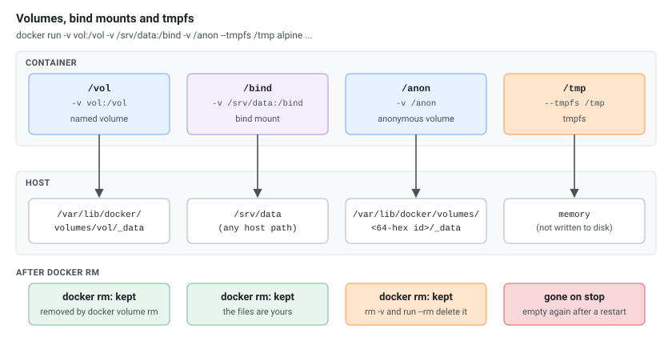

Commands checked against Docker Engine 29.9.2 (containerd image store, cgroup v2) and Buildx 0.38.1. Where a command behaves differently than you might expect, a comment or note says so. Docker Compose has its own page: [Docker Compose Cheatsheet]().

## Container Lifecycle

[](lifecycle.svg "Open the diagram full size")

| Command | Description |
|---|---|
| `docker create --name myapp nginx:latest` | Create a container (without starting) |
| `docker run -d --name myapp nginx:latest` | Run a container (create + start) |
| `docker run -d -p 8080:80 --name web nginx` | Run with port mapping |
| `docker run -d -v /host/path:/container/path nginx` | Run with volume mount |
| `docker run -d -e "DB_HOST=localhost" -e "DB_PORT=5432" myapp` | Run with environment variables |
| `docker run -it ubuntu:22.04 bash` | Run interactively |
| `docker run --rm -it alpine sh` | Run and remove on exit |
| `docker start myapp` | Start a stopped container |
| `docker stop myapp` | Stop a container (SIGTERM, then SIGKILL after timeout) |
| `docker stop -t 30 myapp` | Stop with custom timeout (seconds) |
| `docker kill myapp` | Kill a container (SIGKILL immediately) |
| `docker restart myapp` | Restart a container |
| `docker pause myapp`<br>`docker unpause myapp` | Pause / unpause |
| `docker rm myapp` | Remove a container |
| `docker rm -f myapp` | Remove a running container (force) |
| `docker container rm --force $(docker container ls --all --quiet)` | Forcefully remove all containers (including running ones) |
| `docker rename old_name new_name` | Rename a container |

[](stop-kill.svg "Open the diagram full size")

## Container Inspection

| Command | Description |
|---|---|
| `docker ps` | List running containers |
| `docker ps -a` | List all containers (including stopped) |
| `docker ps -q` | List only container IDs |
| `docker ps --no-trunc` | List without truncation (full IDs, commands) |
| `docker ps -a -n 2` | List last N created containers |
| `docker ps -a -f "status=exited"`<br>`docker ps -a -f "status=running"` | Filter containers by status |
| `docker ps --format "table {{.Names}}\t{{.Status}}\t{{.Ports}}"` | List with custom format |
| `docker inspect myapp` | Inspect container details (JSON) |
| `docker inspect -f '{{.State.Status}}' myapp` | Get specific field from inspect |
| `docker inspect -f '{{range .NetworkSettings.Networks}}{{.IPAddress}}{{end}}' myapp` | IP address, read per network (`.NetworkSettings.IPAddress` was removed in Docker 29: `map has no entry for key "IPAddress"`) |
| `docker stats` | View resource usage (live) |
| `docker stats myapp` | Stats for specific container |
| `docker stats --no-stream` | One-shot stats (no stream) |
| `docker top myapp` | View running processes inside container |
| `docker port myapp` | View port mappings |
| `docker diff myapp` | View filesystem changes |
| `docker wait myapp` | Wait for container to stop and get exit code |

## Executing Commands in Containers

| Command | Description |
|---|---|
| `docker exec myapp ls /app` | Run a command in a running container |
| `docker exec -it myapp bash` (or `sh` in Alpine-based images) | Interactive shell |
| `docker exec -u root -it myapp bash`, `docker exec -u 1000:1000 -it myapp bash` | As a specific user |
| `docker exec -e "DEBUG=true" myapp ./script.sh` | With an environment variable |
| `docker exec -w /app myapp ls` | In a working directory |
| `docker exec --privileged myapp <cmd>` | With extra privileges (no `--cap-add` on exec) |

`-it` needs a terminal: from a script or CI job, drop `-t` (`cannot attach stdin to a TTY-enabled container because stdin is not a terminal`).

## Images

| Command | Description |
|---|---|
| `docker images`<br>`docker image ls` | List local images |
| `docker images --format "table {{.Repository}}\t{{.Tag}}\t{{.Size}}"` | List with specific format |
| `docker images -f dangling=true` | List dangling images |
| `docker images --digests` | Show image digests (the immutable content hash, not just the tag) |
| `docker images --digests nginx` | Digests for one repository |
| `docker images --digests --format "table {{.Repository}}\t{{.Tag}}\t{{.Digest}}"` | Show repository, tag, and digest only |
| `docker images --digests --format '{{.Digest}}' nginx:1.27` | Get just the digest of a specific image (for pinning) |
| `docker inspect --format '{{index .RepoDigests 0}}' nginx:1.27` | Get the RepoDigest via inspect (`nginx@sha256:...`, incl. images pulled by tag; pin deployments to it instead of a mutable tag) |
| `docker pull nginx`<br>`docker pull nginx:1.25`<br>`docker pull nginx@sha256:abc123...` | Pull an image |
| `docker pull docker.io/library/redis:alpine` | Pull with full registry path |
| `docker build -t myapp:1.0 .` | Build an image |
| `docker build -f Dockerfile.prod -t myapp:prod .` | Build with specific Dockerfile |
| `docker build --build-arg VERSION=1.0 -t myapp .` | Build with build arguments |
| `docker build --no-cache -t myapp .` | Build without cache |
| `docker build --platform linux/amd64 -t myapp .` | Build for specific platform |
| `docker tag myapp:1.0 registry.example.com/myapp:1.0` | Tag an image |
| `docker build -t user/repo:tag .` | Tag at build time |
| `docker tag existing-image user/repo:tag` | Tag an existing image |
| `docker commit container-id user/repo:tag` | Image from a running container |
| `docker push registry.example.com/myapp:1.0` | Push an image |
| `docker rmi nginx:latest` | Remove an image |
| `docker save -o myapp.tar myapp:1.0` | Save image to tar |
| `docker load -i myapp.tar` | Load image from tar |
| `docker export myapp > myapp-fs.tar` | Export container filesystem to tar |
| `docker import myapp-fs.tar myapp:imported`<br>`cat myapp-fs.tar \| docker import - myapp:imported` | Import filesystem as image (from a file or stdin) |
| `docker history myapp:1.0` | View image history (layers) |
| `docker image inspect nginx:latest` | Inspect image details |

## Volumes

[](storage.svg "Open the diagram full size")

| Command | Description |
|---|---|
| `docker volume create mydata` | Create a volume |
| `docker volume ls` | List volumes |
| `docker volume inspect mydata` | Inspect a volume |
| `docker volume rm mydata` | Remove a volume |
| `docker run -d -v mydata:/app/data myapp` | Run with named volume |
| `docker run -d -v /host/path:/container/path myapp` | Run with bind mount |
| `docker run -d -v /host/path:/container/path:ro myapp` | Run with read-only mount |
| `docker run -d --tmpfs /tmp:rw,size=100m myapp` | Run with tmpfs mount |
| `docker cp file.txt myapp:/app/`<br>`docker cp myapp:/app/file.txt ./`<br>`docker cp myapp:/app/logs/ ./local-logs/` | Copy files to/from container |

## Networks

[](networking.svg "Open the diagram full size")

| Command | Description |
|---|---|
| `docker network ls` | List networks |
| `docker network create mynet` | Create a network |
| `docker network create --driver bridge mynet` | Create with specific driver |
| `docker network create --subnet=172.20.0.0/16 mynet` | Create with subnet |
| `docker network inspect mynet` | Inspect a network |
| `docker network connect mynet myapp` | Connect container to network |
| `docker network disconnect mynet myapp` | Disconnect container from network |
| `docker run -d --network mynet --name myapp nginx` | Run container on specific network |
| `docker run -d --network mynet --ip 172.20.0.10 --name myapp nginx` | Run with static IP |
| `docker run -d --network mynet --hostname myapp.local --name myapp nginx` | Run with hostname |
| `docker network rm mynet` | Remove a network |
| `docker run -d --network mynet --name db postgres`<br>`docker run -d --network mynet --name app myapp` | DNS resolution: containers on the same network resolve by name (`app` reaches `db` at hostname `db`) |

## Dockerfile Reference

```dockerfile
# Base image
FROM ubuntu:22.04

# Labels
LABEL maintainer="user@example.com"
LABEL version="1.0"

# Arguments (build-time only)
ARG DEBIAN_FRONTEND=noninteractive
ARG APP_VERSION=1.0

# Environment variables (persist at runtime)
ENV APP_HOME=/app
ENV PATH="${APP_HOME}/bin:${PATH}"

# Working directory
WORKDIR /app

# Install packages
RUN apt-get update && \
    apt-get install -y --no-install-recommends \
        curl \
        ca-certificates && \
    rm -rf /var/lib/apt/lists/*

# Copy files
COPY package.json package-lock.json ./
COPY src/ ./src/

# Add files (supports URLs and auto-extracts tarballs)
ADD https://example.com/app.tar.gz /tmp/

# Run commands (needs Node in the image; --omit=dev replaces the old --production)
RUN npm ci --omit=dev

# Expose ports (documentation only)
EXPOSE 3000

# Create non-root user
RUN useradd -r -s /bin/false appuser
USER appuser

# Health check
HEALTHCHECK --interval=30s --timeout=3s --retries=3 \
    CMD curl -f http://localhost:3000/health || exit 1

# Default command
CMD ["node", "src/index.js"]

# Alternative: entrypoint + cmd (use one or the other: with two CMD lines only the last counts,
# and the build warns "Multiple CMD instructions should not be used in the same stage")
# ENTRYPOINT ["node"]
# CMD ["src/index.js"]
```

### Multi-stage Build

```dockerfile
# Build stage
FROM node:20-alpine AS builder
WORKDIR /app
COPY package*.json ./
RUN npm ci
COPY . .
RUN npm run build

# Production stage
FROM node:20-alpine
WORKDIR /app
COPY --from=builder /app/dist ./dist
COPY --from=builder /app/node_modules ./node_modules
EXPOSE 3000
USER node
CMD ["node", "dist/index.js"]
```

## Registry and Login

| Command | Description |
|---|---|
| `docker login` | Login to Docker Hub |
| `docker login registry.example.com` | Login to private registry |
| `echo "$TOKEN" \| docker login registry.example.com -u user --password-stdin` | Login with credentials (CI/CD) |
| `docker logout`<br>`docker logout registry.example.com` | Logout |
| `docker search nginx` | Search Docker Hub |
| `docker pull registry.example.com/myapp:1.0` | Pull from private registry |

### Gitea and Forgejo Container Registry

Gitea and Forgejo include an OCI container registry in their package registry, served on the instance's own host name (no separate port or subdomain).

```bash
# Login to the container registry (username + access token)
docker login gitea.example.com
echo "$GITEA_TOKEN" | docker login gitea.example.com -u <username> --password-stdin
```

Use a **personal access token** (User Settings → Applications) rather than your password; with two-factor authentication a token is required. Scopes, on Gitea 28.0:

| Token scope | Result |
|-------------|--------|
| `write:package` | Login, pull and push |
| `read:package` | Login and pull; push fails with `401 Unauthorized` |
| Only repository scopes (`write:repository`) | Login fails: `unauthorized` |

Image naming convention: `{registry}/{owner}/{image}:{tag}`, where `{owner}` is a user or organization name:

```bash
# build an image with tag
docker build -t gitea.example.com/<owner>/<image>:<tag> .

# name an existing image with tag
docker tag <some-existing-image>:<tag> gitea.example.com/<owner>/<image>:<tag>

# Push an image
docker push gitea.example.com/<owner>/<image>:<tag>

# Pull (anonymous for public users and organizations; login needed for private ones)
docker pull gitea.example.com/<owner>/<image>:<tag>
```

Behaviour on Gitea 28.0:

- **Tags are case-insensitive**: `image:tag` and `image:Tag` are the same image. A tag pushed as `Tag` was stored and listed as `tag`, and `docker pull ...:tag` fetched it. Use lowercase tags to avoid surprises.
- **Image names must be lowercase**: the Docker client itself rejects `gitea.example.com/owner/MyImg` (`repository name ... must be lowercase`).
- **The owner part is required**: pushing to `gitea.example.com/<image>:<tag>` fails with `404 Not Found`, and pushing into another user's namespace fails with `401 Unauthorized`. For an organization, you need write access to its packages.
- The first push creates the package under the owner. It isn't linked to a repository automatically: link it under the package's settings to show it on the repository's Packages tab.
- Visibility follows the owner: images of public users and organizations can be pulled without logging in.

List an owner's container images through the API:

```bash
curl -s -u "<username>:$GITEA_TOKEN" "https://gitea.example.com/api/v1/packages/<owner>?type=container" | jq -r '.[] | "\(.name):\(.version)"'
```

Behind a reverse proxy, allow large request bodies, or pushing big layers fails with `413 Request Entity Too Large`; in nginx: `client_max_body_size 0;` in the Gitea `server` block.

In Gitea/Forgejo Actions, log in with a personal access token stored as a secret.

## System and Cleanup

```bash
docker system df          # disk usage per type
docker system df -v       # per image, container and volume
docker info               # daemon info
docker version            # client and server versions
```

| Command | Removes | Keeps |
|---------|---------|-------|
| `docker container prune` | Stopped containers | Running containers |
| `docker image prune` | Dangling images (no tag) | Tagged images |
| `docker image prune -a` | All images no container uses | Images used by a container |
| `docker image prune --filter "until=72h"` | Dangling images older than 72 hours | Newer ones |
| `docker volume prune` | Unused **anonymous** volumes | Named volumes, even unused (since Docker 23) |
| `docker volume prune -a` | All unused volumes, named ones too | Volumes used by a container |
| `docker network prune` | Unused custom networks | `bridge`, `host`, `none` |
| `docker system prune` | Stopped containers, unused networks, dangling images, build cache | Volumes |
| `docker system prune -a` | The above, plus all unused images | Volumes |
| `docker system prune --volumes` | The above, plus unused anonymous volumes | Named volumes |

All of them ask for confirmation; add `-f` to skip it in scripts.

## Run Options Reference

| Flag | Description |
|------|-------------|
| `-d` | Detached mode (background) |
| `-it` | Interactive + TTY (shell access) |
| `--rm` | Remove container on exit |
| `--name name` | Assign a name |
| `-p host:container` | Port mapping |
| `-P` | Publish all exposed ports |
| `-v host:container` | Bind mount or volume |
| `--mount type=...` | More explicit mount syntax |
| `-e KEY=VALUE` | Set environment variable |
| `--env-file file` | Load env vars from file |
| `-w /path` | Working directory |
| `-u user:group` | Run as user/group |
| `--network name` | Connect to network |
| `--hostname name` | Set container hostname |
| `--dns 8.8.8.8` | Set DNS server |
| `--restart policy` | Restart policy (no/always/unless-stopped/on-failure) |
| `--memory 512m` | Memory limit |
| `--cpus 1.5` | CPU limit |
| `--gpus all` | GPU access |
| `--privileged` | Full host access (dangerous) |
| `--cap-add SYS_ADMIN` | Add Linux capability |
| `--cap-drop ALL` | Drop all capabilities |
| `--read-only` | Read-only filesystem |
| `--pid host` | Share host PID namespace |
| `--network host` | Share host network |
| `--log-driver json-file` | Logging driver |
| `--log-opt max-size=10m` | Log options |
| `--entrypoint /bin/sh` | Override entrypoint |
| `--init` | Use tini as PID 1 |
| `--platform linux/amd64` | Target platform |

## Resource Limits

```bash
docker run -d --memory=512m --memory-swap=1g --cpus=1.5 --pids-limit 100 myapp
```

| Flag | Limits | Note on cgroup v2 (current distributions) |
|------|--------|-------------------------------------------|
| `--memory=512m` | Memory, hard limit | |
| `--memory-swap=1g` | Memory + swap together | |
| `--memory-reservation=256m` | Soft limit, reclaimed first under pressure | |
| `--cpus=1.5` | CPU time, in CPUs | |
| `--cpu-shares=512` | Relative CPU weight (default 1024) | |
| `--cpuset-cpus="0,1"` | Which CPUs it may run on | |
| `--pids-limit 100` | Number of processes | |
| `--device-read-bps /dev/sda:1mb`, `--device-write-bps` | Bytes per second on a device | The device must exist: `stat /dev/sda: no such file or directory` |
| `--device-read-iops /dev/sda:1000`, `--device-write-iops` | I/O operations per second on a device | Same |
| `--blkio-weight=200`, `--blkio-weight-device=/dev/sda:100` | Relative I/O weight (10-1000) | Accepted; only has an effect with an I/O scheduler that supports weights, such as BFQ |
| `--kernel-memory=50m` | Kernel memory | Deprecated: "no longer supported by the kernel", ignored |
| `--oom-kill-disable` | Turns off the OOM killer | cgroup v1 only: "Your kernel does not support OomKillDisable", ignored |

## Logging

| Command | Description |
|---|---|
| `docker logs myapp` | View container logs |
| `docker logs -f --tail 50 myapp` | Follow + tail |
| `docker logs -t myapp` | With timestamps |
| `docker logs --tail 100 myapp` | Last N lines |
| `docker logs --since 30m myapp`<br>`docker logs --since "2024-01-01T00:00:00" myapp` | Since a relative or absolute time |
| `docker logs --since "2024-01-01T00:00:00" --until "2024-12-31T23:59:59" myapp` | Between two times |
| `docker logs --details myapp` | With extra attributes from the logging driver |
| `docker run -d --log-driver json-file --log-opt max-size=10m --log-opt max-file=3 myapp` | Configure logging driver at run time |
| `docker inspect -f '{{.HostConfig.LogConfig}}' myapp` | View logging driver config |

## Health Checks

| Command | Description |
|---|---|
| `HEALTHCHECK --interval=30s --timeout=3s --start-period=5s --retries=3 CMD curl -f http://localhost:8080/health \|\| exit 1` | In Dockerfile |
| `docker run -d --health-cmd="curl -f http://localhost:8080/health \|\| exit 1" --health-interval=30s --health-timeout=3s --health-retries=3 --health-start-period=5s myapp` | At runtime |
| `docker run -d --no-healthcheck myapp` | Disable health check |
| `docker inspect -f '{{.State.Health.Status}}' myapp`<br>`docker inspect -f '{{json .State.Health}}' myapp \| jq` | Check health status |
| `docker inspect --format='{{ .Config.Healthcheck }}' myapp`<br>`docker inspect myapp \| grep -A 10 '"Healthcheck"'` | Check healthcheck config for a container or image |

## Multi-Platform Builds (Buildx)

| Command | Description |
|---|---|
| `docker buildx create --name mybuilder --use` | Create a builder and use it |
| `docker buildx build --platform linux/amd64,linux/arm64 -t myapp:1.0 --push .` | Build for several platforms and push |
| `docker buildx build --platform linux/amd64 -t myapp:1.0 --load .` | Build one platform into the local image store |
| `docker buildx ls` | List builders |
| `docker buildx inspect mybuilder` | Inspect a builder |
| `docker buildx use default`, `docker buildx rm mybuilder` | Switch back to the default builder, remove one |

## Security

| Command | Description |
|---|---|
| `docker run -d -u 1000:1000 myapp` | Run as non-root user |
| `docker run -d --cap-drop ALL --cap-add NET_BIND_SERVICE myapp` | Drop all capabilities and add only needed ones |
| `docker exec myapp capsh --print` | Show capabilities inside a container (image needs `capsh`) |
| `docker run -d --read-only --tmpfs /tmp myapp` | Read-only filesystem |
| `docker run -d --security-opt no-new-privileges myapp` | No new privileges |
| `docker scout cves myapp:1.0`<br>`docker scout quickview myapp:1.0` | Scan image for vulnerabilities (`docker scout` is a plugin: included with Docker Desktop, installed separately on Docker Engine, where plain Engine answers `unknown command: docker scout`) |
| `docker scout provenance myapp:1.0` | View image provenance |

Use specific image tags in production: `FROM node:20.11.0-alpine`, not `FROM node:latest`.

## Troubleshooting

| Command | Description |
|---|---|
| `docker inspect -f '{{.State.ExitCode}}' myapp` | View container exit code (137 = killed) |
| `docker inspect -f '{{.State.OOMKilled}}' myapp` | View OOM kill status |
| `docker logs myapp 2>&1 \| tail -20` | Check why a container exited |
| `docker events`<br>`docker events --filter "container=myapp"`<br>`docker events --filter "event=die"` | View events (real-time Docker daemon events) |
| `docker exec myapp ls -la /app` | Inspect container filesystem |
| `docker export myapp \| tar -tf - \| head -50` | Export filesystem for analysis |
| `docker build --progress=plain --target builder -t debug-stage .`<br>`docker run -it --rm debug-stage sh` | Debug a failed build: BuildKit keeps no intermediate images, so build up to a stage and look inside, with the full output of every step |
| `docker inspect -f '{{json .Mounts}}' myapp \| jq` | View container mounts |

## Useful One-Liners

| Command | Description |
|---|---|
| `docker stop $(docker ps -q)` | Stop all running containers |
| `docker rm $(docker ps -aq)` | Remove all containers that aren't running (running ones fail with `container is running`; `docker container prune` does the same without errors) |
| `docker rmi $(docker images -q)` | Remove all images |
| `docker kill $(docker ps -q)` | Kill all running containers |
| `docker inspect -f '{{.Id}}' myapp` | Get container ID by name |
| `docker ps -s` | List containers by size |
| `docker cp myapp:/app/. ./backup/` | Copy all files from container to host |
| `docker run --rm alpine cat /etc/os-release` | Quick one-off command (no leftover container) |
| `docker events --format '{{.Time}} {{.Actor.Attributes.name}} {{.Action}}'` | Monitor container events |
| `docker info \| grep Logging` | Find logging driver type |
| `journalctl -fu docker.service` | View Docker daemon logs (systemd) |
| `usermod -aG docker $USER` | Add user to docker group (avoids sudo) |
| `docker ps --filter volume=<volume-name-or-id>` | Find container by volume ID |
| `kill -9 $(docker inspect --format '{{.State.Pid}}' myapp)` | Kill container's PID 1 from host (force stop without `docker stop`) |
| `docker inspect -f '{{range .Config.Env}}{{println .}}{{end}}' myapp` | List all environment variables of a container |
| `docker exec myapp sh -c 'printf "%s\n" "$MY_VAR"'` | Check a specific env var in a running container |
| `docker inspect myapp \| jq '.[].Mounts'`<br>`docker inspect -f '{{range .Mounts}}{{.Type}}:{{.Source}}:{{.Destination}}{{println}}{{end}}' myapp`<br>`docker inspect myapp \| grep -A3 -e "Volumes\":"` | List volumes for a specific container |
| `docker volume ls -qf dangling=true` | List dangling volumes |
| `docker volume rm $(docker volume ls -qf dangling=true)` | Remove dangling volumes |
| `docker ps -a --format '{{ .ID }}' \| xargs -I {} docker inspect -f '{{ .Name }}{{ printf "\n" }}{{ range .Mounts }}{{ printf "\n\t" }}{{ .Type }} {{ if eq .Type "bind" }}{{ .Source }}{{ end }}{{ .Name }} => {{ .Destination }}{{ end }}{{ printf "\n" }}' {}` | List all container volumes (detailed) |
| `docker ps \| grep -E ":80\|:443"` | Find containers listening on specific ports |
| `docker ps \| grep -E "(traefik\|nginx\|caddy\|envoy\|haproxy)"` | Find reverse proxy containers |
| `docker inspect --format '{{.Config.Image}}' myapp` | Check container image name |
| `docker ps -a --format 'table {{.Names}}\t{{.ID}}\t{{.Image}}\t{{.Status}}' > containers.txt`<br>`docker images --format 'table {{.Repository}}\t{{.Tag}}\t{{.ID}}\t{{.Size}}' > images.txt`<br>`docker volume ls --format 'table {{.Name}}\t{{.Driver}}' > volumes.txt` | Export container/image lists to files |

Loops:

```bash
# Check all containers for specific labels (e.g., Traefik)
for container in $(docker ps -q); do
    name=$(docker inspect --format '{{.Name}}' $container | sed 's/\///')
    echo "=== $name ==="
    docker inspect $container | grep -i traefik | head
done

# Find images by layer hash
for I in $(docker image ls --format '{{.ID}}'); do
    F=$(docker image inspect $I | grep "<hash>")
    if [ -n "$F" ]; then echo $I; fi
done

# Find volumes by ID/hash
for I in $(docker volume ls | grep -v DRIVER | awk '{print $2}' | sort | uniq); do
    F=$(docker volume inspect $I | grep "${ID}")
    if [ -n "$F" ]; then echo $I; fi
done

# Find containers by ID/hash
for I in $(docker container ls --no-trunc | grep -v CONTAINER | awk '{print $1}' | sort | uniq); do
    F=$(docker container inspect $I | grep "${ID}")
    if [ -n "$F" ]; then echo $I; fi
done
```

## Restart Policies

| `--restart` | Restarts the container |
|-------------|------------------------|
| `no` | Never (default) |
| `on-failure` | When it exits with a non-zero code |
| `on-failure:3` | The same, at most 3 times |
| `always` | Always, also when the daemon starts; a manual `docker stop` holds until the daemon restarts |
| `unless-stopped` | Like `always`, but not after a manual `docker stop`, even across daemon restarts |

```bash
docker run -d --restart unless-stopped myapp
docker update --restart on-failure:3 myapp      # change it on an existing container
```

## Development Patterns

| Command | Description |
|---|---|
| `docker run -v $(pwd):/app -p 3000:3000 myapp:dev` | Hot reload with volume mounting (source code changes reflect immediately) |
| `docker run -it --entrypoint /bin/sh myapp` | Override the entrypoint and get a shell (ignores CMD; `/bin/bash` if the image has it) |
| `docker run --rm -d -p 5432:5432 -e POSTGRES_PASSWORD=dev postgres:16`<br>`docker run --rm -d -p 6379:6379 redis:alpine`<br>`docker run --rm -d -p 3306:3306 -e MYSQL_ROOT_PASSWORD=dev mysql:8` | Quick development database |

## Production Patterns

```bash
# Run with restart policy and health check
docker run -d \
    --restart unless-stopped \
    --health-cmd="curl -f http://localhost:8080/health || exit 1" \
    --health-interval=30s \
    -p 80:8080 \
    myapp:prod

# Resource-limited production container
docker run -d \
    --restart unless-stopped \
    --memory=512m \
    --cpus=1.0 \
    --read-only \
    --tmpfs /tmp \
    --cap-drop ALL \
    --security-opt no-new-privileges \
    -p 8080:8080 \
    myapp:prod
```

## Aliases

Add to `~/.bashrc` or `~/.zshrc`:

```bash
alias dps='docker ps'
alias dpsa='docker ps -a'
alias dimg='docker images'
alias dlog='docker logs -f'
alias dstart='docker start $(docker ps -aq)'
alias dstop='docker stop $(docker ps -aq)'
alias drm='docker rm $(docker ps -aq)'
alias dri='docker rmi $(docker images -q)'
alias dprune='docker system prune -af --volumes'
```

### dbash Function

```bash
dbash() {
    docker exec -it $(docker ps -aqf "name=$1") bash
}
# Usage: dbash mycontainer
```

## Important Files and Directories

| Path | Description |
|------|-------------|
| `/var/lib/docker/` | Docker root directory (images, containers, volumes) |
| `/var/lib/docker/containers/[ID]/[ID]-json.log` | Container log file (json-file driver) |
| `/var/lib/docker/volumes/` | Named volumes |
| `/var/lib/docker/overlay2/` | Image layers (overlay2 storage driver) |
| `/etc/docker/daemon.json` | Docker daemon configuration |
| `/lib/systemd/system/docker.service` | Docker systemd service file (Ubuntu/Debian; `/usr/lib/systemd/system/docker.service` on RHEL) |
| `~/.docker/config.json` | User Docker config (auth, plugins) |
| `/etc/sysconfig/docker` | Docker daemon startup options (RHEL/CentOS 7 `docker` package only; Docker CE uses `daemon.json`) |
| `/etc/sysconfig/docker-storage` | Storage config (RHEL/CentOS, auto-managed) |
| `/etc/sysconfig/docker-storage-setup` | Storage config override (RHEL/CentOS) |
| `/usr/share/container-storage-setup/container-storage-setup` | Default storage setup config (RHEL/CentOS) |

```bash
# Find Docker root directory
docker info --format '{{ .DockerRootDir }}'

# View daemon configuration
cat /etc/docker/daemon.json

# Example daemon.json
# {
#   "log-driver": "json-file",
#   "log-opts": { "max-size": "10m", "max-file": "3" },
#   "storage-driver": "overlay2",
#   "default-address-pools": [{ "base": "172.17.0.0/12", "size": 24 }]
# }
```

## Advanced Networking

### Network Drivers

| Command | Description |
|---|---|
| `docker network create --driver overlay my_overlay` | Overlay network (needs `docker swarm init` first, or "This node is not a swarm manager") |
| `docker network create -d macvlan --subnet=192.168.1.0/24 --gateway=192.168.1.1 -o parent=eth0 my_macvlan` | macvlan: containers get addresses on the physical network |
| `docker network create --opt com.docker.network.driver.mtu=1500 my_network` | Custom MTU |

### DNS and Service Discovery

| Command | Description |
|---|---|
| `docker run -d --dns 8.8.8.8 --dns-search example.com nginx` | Custom DNS server and search domain |
| `docker exec myapp nslookup db` | Check name resolution (image needs `nslookup`) |
| `docker run -d -h myhost --name web nginx` | Set the hostname |

Containers on the same user-defined network resolve each other by container name; the default `bridge` network doesn't.

### Port Mapping Advanced

| Command | Description |
|---|---|
| `docker run -d -P nginx` (then `docker port <container>`) | Random host ports for all exposed ports |
| `docker run -d -p 192.168.1.10:8080:80 nginx` | Bind to one interface |
| `docker run -d -p 127.0.0.1:8080:80 nginx` | Only on localhost |
| `docker run -d -p 0.0.0.0:8080:80 nginx` | All interfaces, explicitly |
| `docker run -d -p 80:80 -p 443:443 -p 8000:8000 myapp` | Several ports |
| `docker run -d --link web:web nginx`, use a network instead | Links (legacy, prints "Links on the default bridge network are deprecated") |

### Network Debugging

Most application images (nginx included) have no `ping`, `netstat`, `ip` or `nslookup` (`exec: "ping": executable file not found in $PATH`). Run a tools container in the same network namespace instead:

| Command | Description |
|---|---|
| `docker run --rm -it --network container:myapp nicolaka/netshoot` | Debug container sharing myapp's network (same IP, same ports) |
| `docker run --rm --network container:myapp nicolaka/netshoot ss -tlnp` | Listening sockets |
| `docker run --rm --network container:myapp nicolaka/netshoot ip addr` | Interfaces and addresses |
| `docker run --rm --network container:myapp nicolaka/netshoot ping -c 3 8.8.8.8` | Ping |
| `docker run --rm --network container:myapp nicolaka/netshoot nslookup google.com` | DNS lookup |
| `docker run --rm --network container:myapp nicolaka/netshoot traceroute google.com` | Traceroute |
| `docker run --rm --network container:myapp --cap-add NET_ADMIN nicolaka/netshoot iptables -L` | iptables rules (needs `NET_ADMIN`) |
| `docker exec myapp ping -c 3 8.8.8.8` | If the image has the tools |

## Volume Backup and Restore

| Command | Description |
|---|---|
| `docker run --rm -v my_volume:/data -v $(pwd):/backup alpine tar czf /backup/volume_backup.tar.gz /data` | Backup a named volume to a tar.gz |
| `docker run --rm -v my_volume:/data -v $(pwd):/backup alpine tar xzf /backup/volume_backup.tar.gz -C /` | Restore a volume from backup |
| `docker rm -v myapp` | Remove volume when removing container |
| `docker run -d -v /data nginx` | Anonymous volume (Docker-managed, no name) |

## Advanced Security

### Content Trust (Image Signing)

Docker Content Trust (Notary v1) is gone from the Docker 29 CLI: `docker trust` answers `unknown command: docker trust`, and `DOCKER_CONTENT_TRUST=1` no longer stopped a pull of an unsigned image. For signing and verifying images, use Sigstore `cosign` or Notary v2 `notation` instead.

### AppArmor and Seccomp

| Command | Description |
|---|---|
| `docker run -d --security-opt apparmor=docker-default nginx` | Default AppArmor profile (Ubuntu/Debian hosts) |
| `docker run -d --security-opt apparmor=unconfined nginx` | No AppArmor |
| `docker run -d --security-opt seccomp=unconfined nginx` | No seccomp (debugging only) |
| `docker run -d --security-opt seccomp=custom-profile.json nginx` | Custom seccomp profile (the file must exist, or "opening seccomp profile ... failed") |

### Secrets Management (Docker Swarm)

| Command | Description |
|---|---|
| `docker swarm init` (`--advertise-addr <ip>` if the host has several addresses) | Secrets need Swarm mode |
| `echo "my_secret_value" \| docker secret create my_secret -` | Create a secret |
| `docker secret create my_cert ./server.crt` | Create from file |
| `docker secret ls` | List secrets |
| `docker service create --secret my_secret nginx` | Use secret in a service |
| `docker secret rm my_secret` | Remove secret |

In Compose, secrets are mounted at `/run/secrets/<name>`.

### Registry Credentials

| Command | Description |
|---|---|
| `cat ~/.docker/config.json` | See where credentials are stored |
| `echo "$TOKEN" \| docker login registry.example.com -u user --password-stdin` | Log in with a token (CI/CD) |

Without a credential helper, `docker login` stores the credentials base64-encoded in `config.json` and warns `Your credentials are stored unencrypted`.

## Image Optimization

### Build with Multiple Tags

```bash
docker build -t myapp:latest -t myapp:v1.0 -t myapp:$(git rev-parse --short HEAD) .
```

### Layer Analysis

| Command | Description |
|---|---|
| `docker inspect --format='{{json .RootFS.Layers}}' myimage:tag \| jq` | List an image's layers (DiffIDs) |
| `docker history myimage:tag` | Layer sizes per instruction |
| `docker save myimage:tag \| gzip > myimage.tar.gz` | Save compressed |
| `docker load < myimage.tar.gz` | Load it back (gzip is detected) |

### .dockerignore

```
# .dockerignore — exclude from build context
.git
.gitignore
node_modules
npm-debug.log
.env
.DS_Store
*.md
docker-compose*.yml
Dockerfile*
```

## Advanced Container Management

### Namespace Options

| Flag | Shares with the host | Example use |
|------|----------------------|-------------|
| `--pid=host` | Process list: the container sees and can signal host processes | Monitoring agents, debugging tools |
| `--ipc=host` | Shared memory and semaphores | Apps exchanging shared memory with host processes |
| `--uts=host` | Hostname and domain name | Software that must report the host's name |
| `--network=host` | Network stack, no port mapping | Network tools, high packet rates |

```bash
docker run -d --pid=host --ipc=host --uts=host nginx
```

### Attach and Detach

| Command | Description |
|---|---|
| `docker attach myapp` | Attach to a running container's output and input |
| `Ctrl+P`, `Ctrl+Q` | Detach without stopping it |
| `docker attach --no-stdin myapp` | Attach output only, without STDIN |
| `docker attach --sig-proxy=false myapp` | Don't forward signals (Ctrl+C doesn't stop the container) |

## Advanced Debugging

### strace Inside Container

| Command | Description |
|---|---|
| `docker run -it --cap-add SYS_PTRACE --security-opt seccomp=unconfined myapp strace -c ls` | Run a command under strace |
| `docker run --rm -it --pid=container:myapp --cap-add SYS_PTRACE nicolaka/netshoot strace -p 1` | Trace a running container's PID 1 from a tools container |
| `docker exec --privileged myapp strace -p 1` | Same, from inside (image needs `strace`) |

`docker exec` has no `--cap-add` (`unknown flag: --cap-add`).

### Container Stats Formatting

| Command | Description |
|---|---|
| `docker stats --format "table {{.Container}}\t{{.CPUPerc}}\t{{.MemUsage}}"` | Table with chosen columns |
| `docker stats --format "{{.Container}}\t{{.MemUsage}}"` | Memory only |
| `docker stats --no-stream --format "{{json .}}"` | JSON, one sample |

### Containers by Exit Code

| Command | Description |
|---|---|
| `docker ps -a --filter "exited=1"` | Exited with code 1 |
| `docker ps -a --filter "exited=0"` | Exited successfully |

## Performance Tuning

### Storage Driver

| Command | Description |
|---|---|
| `docker info --format '{{.Driver}} {{.DriverStatus}}'` | Show the driver |

| Image store | `docker info` shows |
|---|---|
| containerd image store (default for new installs) | `overlayfs [[driver-type io.containerd.snapshotter.v1]]` |
| Classic store | `overlay2` (also `btrfs`, `zfs`, `vfs`, `fuse-overlayfs`; aufs and devicemapper were removed) |

### Network Performance

| Command | Description |
|---|---|
| `docker run -d --network host nginx` | Host network: no NAT, no port mapping (Linux only) |
| `docker network create --opt com.docker.network.bridge.enable_icc=false isolated_net` | Network without container-to-container traffic |

### Startup Optimization

| Do | Instead of | Why |
|---|---|---|
| `docker run -d nginx` | `docker run -dit nginx` | No TTY unless you need one |
| `ENTRYPOINT ["nginx", "-g", "daemon off;"]` | `ENTRYPOINT nginx -g "daemon off;"` | Exec form: no `/bin/sh` in between, the process gets the signals |
| `docker run -d --init myapp` | `docker run -d myapp` (for apps that don't reap children) | A tiny init as PID 1 forwards signals and reaps zombie processes |

## Production Checklist

- Use specific base image tags (not `latest`)
- Run as non-root user
- Drop unnecessary capabilities (`--cap-drop ALL`)
- Set memory limits (`--memory`)
- Set CPU limits (`--cpus`)
- Configure health checks
- Use restart policies (`--restart unless-stopped`)
- Mount volumes for persistent data
- Configure log rotation (`--log-opt max-size=10m --log-opt max-file=3`)
- Use secrets for sensitive data
- Enable read-only filesystem where possible (`--read-only`)
- Use `--init` for proper PID 1 behavior
- Scan images for vulnerabilities before deploying
- Regularly prune unused resources

## Testing Pattern

```bash
# Run tests in a disposable container
docker run --rm \
    -v $(pwd):/app \
    -w /app \
    node:20 \
    npm test

# Run with specific env
docker run --rm \
    -v $(pwd):/app \
    -w /app \
    -e CI=true \
    -e NODE_ENV=test \
    node:20 \
    npm run test:coverage
```

## Tools

- [dry](https://github.com/moncho/dry) — terminal UI for Docker containers and images
- [dockcheck](https://github.com/mag37/dockcheck) — check for Docker image updates
- [watchtower](https://github.com/containrrr/watchtower) — automatically update running containers when images change
- [lazydocker](https://github.com/jesseduffield/lazydocker) — terminal UI for Docker and Docker Compose
- [ctop](https://github.com/bcicen/ctop) — top-like interface for container metrics
- [dive](https://github.com/wagoodman/dive) — explore Docker image layers and optimize size
