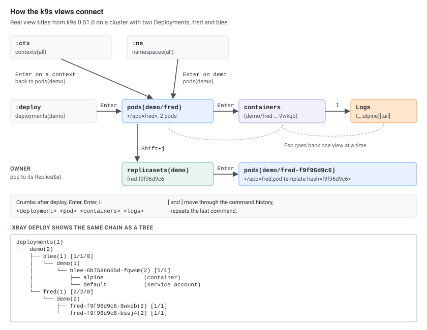

k9s is a terminal UI for Kubernetes: launch flags, resource commands, keys for pods and logs, filters, namespaces, cluster views and configuration. Everything below was checked on k9s 0.51.0 against a k3s v1.35.9 cluster. Keys can differ between versions: `?` in any view lists the keys that view really has.

## Installation

| Platform | Package Manager | Command |
|----------|----------------|---------|
| macOS / Linux | Homebrew | `brew install k9s` (or `brew install derailed/k9s/k9s` from the k9s tap) |
| Linux (Snap) | Snap | `sudo snap install k9s --devmode` |
| Arch Linux | pacman | `sudo pacman -S k9s` |
| Windows | winget / Scoop / Chocolatey | `winget install k9s`, `scoop install k9s`, `choco install k9s` |
| Go | go install | `go install github.com/derailed/k9s@latest` |
| Any | Binary | Download from [GitHub Releases](https://github.com/derailed/k9s/releases) |

### Verify Installation

```bash
k9s version
```

```text
Version              0.51.0
Commit               558caafe7ba067467de46b320cc22ef11fef9c34
Date                 n/a
```

[![The k9s pods view with numbered parts: header with context, read-write mode, cluster, user and versions; namespace shortcuts 0 all, 1 demo, 2 default; key hints; logo; view title pods(demo)[2] with the filter </fred>; sorted NAME column; crumbs; message line](k9s-screen.svg)](k9s-screen.svg "Open the diagram full size")

## Launch & General

| Command | Details |
|---------|---------|
| `k9s` | Start k9s (current context) |
| `k9s -n <namespace>` | Start in a specific namespace |
| `k9s -A` | Start in all namespaces |
| `k9s --context <ctx>` | Start with a specific kubeconfig context |
| `k9s --kubeconfig <path>` | Use a specific kubeconfig file |
| `k9s -c <resource>` | Start directly in a resource view (e.g. `k9s -c pod`) |
| `k9s --readonly` | Read-only mode: the header shows `[R]`, and delete, edit, kill, shell and attach are gone |
| `k9s --write` | Write mode, overriding `readOnly` in the config |
| `k9s --headless` | Start without the header |
| `k9s --logoless` | Start without the logo |
| `k9s --crumbsless` | Start without the crumbs |
| `k9s --splashless` | Start without the splash screen |
| `k9s -r <seconds>` | Refresh rate (default 2) |
| `k9s --screen-dump-dir <dir>` | Where `Ctrl+s` saves files |
| `k9s info` | Show the config, skins, logs and screen dump paths |
| `:q` / `Ctrl+c` | Quit k9s |
| `?` | Show help / keys of the current view |
| `Ctrl+a` / `:aliases` | Show all resource aliases (92 on a plain k3s cluster) |

## Navigation

### Resource Commands

k9s accepts the singular, plural, short name or alias of any resource:

| Command | Details |
|---------|---------|
| `:pod` | Jump to Pods view |
| `:pod ns-x` | View pods in namespace `ns-x` |
| `:pod /fred` | View pods filtered by `fred` |
| `:pod app=fred,env=dev` | View pods matching labels `app=fred` and `env=dev` |
| `:pod @ctx1` | View pods in context `ctx1` (switches context) |
| `-` | Repeat the last command |
| `[` / `]` | Back / forward in command history |

[](k9s-navigation.svg "Open the diagram full size")

### Core Resources

| Command | Details |
|---------|---------|
| `:pod` | Pods |
| `:svc` | Services |
| `:deploy` | Deployments |
| `:ns` | Namespaces |
| `:node` | Nodes |
| `:sec` | Secrets |
| `:cm` | ConfigMaps |
| `:ing` | Ingresses |
| `:ep` | Endpoints |
| `:rs` | ReplicaSets |

### Workloads

| Command | Details |
|---------|---------|
| `:cj` | CronJobs |
| `:job` | Jobs |
| `:ds` | DaemonSets |
| `:sts` | StatefulSets |
| `:rc` | ReplicationControllers |

### Storage

| Command | Details |
|---------|---------|
| `:pv` | PersistentVolumes |
| `:pvc` | PersistentVolumeClaims |
| `:sc` | StorageClasses |

### RBAC & Security

| Command | Details |
|---------|---------|
| `:sa` | ServiceAccounts |
| `:rb` | RoleBindings |
| `:crb` | ClusterRoleBindings |
| `:role` | Roles |
| `:cr` | ClusterRoles |
| `:np` | NetworkPolicies |

### Scaling & Config

| Command | Details |
|---------|---------|
| `:hpa` | HorizontalPodAutoscalers |
| `:events` | Events |
| `:limits` | LimitRanges |
| `:quota` | ResourceQuotas |

### Custom Resources

| Command | Details |
|---------|---------|
| `:crd` | CustomResourceDefinitions |
| `:<crd-short-name>` | Any custom resource by its short name or full name |

## Pod Keys

The keys of the pods view, from its `?` help:

| Key | Details |
|-----|---------|
| `Enter` | View the pod's containers |
| `d` | Describe |
| `y` | YAML |
| `e` | Edit (opens in `$EDITOR`) |
| `Ctrl+d` | Delete: a dialog with Propagation, Force, and Cancel / OK |
| `Ctrl+k` | Kill the pod at once, no confirmation |
| `l` | Logs |
| `p` | Logs of the previous container instance |
| `s` | Shell into a container |
| `a` | Attach to a container |
| `Shift+f` | Port-forward |
| `f` | Show the port-forward of the pod |
| `Shift+j` | Jump to the owner (ReplicaSet, Job, ...) |
| `o` | Show the node the pod runs on |
| `t` | Transfer files (copy to or from a container) |
| `i` | Set image |
| `w` | Warp to the pod's namespace |
| `z` | Sanitize (remove completed and failed pods) |
| `c` / `n` | Copy the name / copy the namespace |
| `Ctrl+z` | Show only pods with problems (toggle faults) |
| `Ctrl+r` | Refresh |
| `Ctrl+s` | Save the table as CSV (in the screen dump directory) |
| `Space` | Mark a row (actions apply to all marked rows) |

`Ctrl+s` in a YAML view saves the YAML instead (`demo-blee-…--yaml`). `:screendump` (`:sd`) lists the saved files.

## Logs View

| Key | Details |
|-----|---------|
| `0` | Tail (follow the log) |
| `1` | Head (from the start) |
| `2` | Last 1 minute |
| `3` | Last 5 minutes |
| `4` | Last 15 minutes |
| `5` | Last 30 minutes |
| `6` | Last 1 hour |
| `t` | Toggle timestamps |
| `w` | Toggle line wrap |
| `s` | Toggle auto-scroll |
| `f` | Toggle fullscreen |
| `Shift+l` | Toggle column lock |
| `c` | Copy |
| `m` | Mark a line |
| `Shift+c` | Clear the view |
| `Ctrl+s` | Save the logs to a file |
| `Esc` / `q` | Back to the previous view |

The status line shows the current state: `Autoscroll:On ColumnLock:Off FullScreen:Off Timestamps:Off Wrap:Off`.

## Filtering & Searching

| Key | Details |
|-----|---------|
| `/` | Filter by name (regex, e.g. `fred\|blee`) |
| `/!<term>` | Inverse filter (exclude matches) |
| `/-l <label>=<value>` | Filter by label selector |
| `/-f <term>` | Fuzzy find (`/-f frd` finds `fred`) |
| `Esc` | Clear the filter |

## Sorting & Display

| Key | Details |
|-----|---------|
| `Shift+n` / `Shift+a` / `Shift+s` | Sort by name / age / status (pods) |
| `Shift+→` / `Shift+←` then `Shift+o` | Select a column, then sort by it |
| `Ctrl+e` | Toggle the header |
| `Ctrl+g` | Toggle the crumbs |
| `Ctrl+w` | Toggle wide view |

## Namespace

| Key | Details |
|-----|---------|
| `:ns` | Namespaces view |
| `0` | All namespaces |
| `1`, `2`, ... | Recently used namespaces, shown at the top left (`<1> demo`, `<2> default`) |

## Cluster Views

| Command | Details |
|---------|---------|
| `:pulse` / `:pu` | Cluster pulse (overview dashboard) |
| `:xray <resource> [namespace]` | Resource tree, e.g. `:xray deploy`, `:xray svc ns-x`, `:xray po` |

`:popeye` is gone: k9s 0.51.0 answers ``Ruroh? `popeye` command not found``. Run the [Popeye](https://github.com/derailed/popeye) CLI on its own instead.

## Context & Cluster

| Key | Details |
|-----|---------|
| `:ctx` | Contexts view |
| `:ctx <context-name>` | Switch directly to a context |
| `:screendump` / `:sd` | Saved files (`Ctrl+s`) |
| `:aliases` | All resource aliases |
| `:dir <path>` | Browse a directory |

## Configuration

`k9s info` shows the paths on your system:

| File | macOS | Linux |
|------|-------|-------|
| `config.yaml`, `hotkeys.yaml`, `plugins.yaml`, `aliases.yaml`, `views.yaml` | `~/Library/Application Support/k9s/` | `~/.config/k9s/` (`$XDG_CONFIG_HOME/k9s`) |
| `skins/` | `~/Library/Application Support/k9s/skins/` | `~/.config/k9s/skins/` |
| `clusters/` (per-context settings) | `~/Library/Application Support/k9s/clusters/` | `~/.local/share/k9s/clusters/` (`$XDG_DATA_HOME`) |
| `k9s.log`, `benchmarks/`, `screen-dumps/` | `~/Library/Application Support/k9s/` | `~/.local/state/k9s/` (`$XDG_STATE_HOME`) |

[](k9s-paths.svg "Open the diagram full size")

`K9S_CONFIG_DIR` moves the configuration (including skins and screen dumps, but not the log) to another directory, which is handy for testing a config without touching your own.

| File | Details |
|------|---------|
| `config.yaml` | Main k9s configuration |
| `skins/` | Skin (theme) files |
| `hotkeys.yaml` | Custom hotkeys |
| `plugins.yaml` | Plugin definitions |
| `aliases.yaml` | Custom resource aliases |
| `views.yaml` | Custom columns per resource |

### Custom Hotkeys Example

`hotkeys.yaml` in the config directory:

```yaml
hotKeys:
  shift-1:
    shortCut: Shift-1
    description: View pods
    command: pods
  shift-2:
    shortCut: Shift-2
    description: View deployments
    command: deploy
  shift-3:
    shortCut: Shift-3
    description: View services
    command: svc
```

`Shift+1` then opens the pods view and `Shift+2` the deployments view from anywhere.

### Custom Alias Example

`aliases.yaml` in the config directory:

```yaml
aliases:
  pp: v1/pods
  dd: apps/v1/deployments
  ss: v1/services
```

`:dd` then opens deployments and `:ss` services.

## Themes / Skins

k9s supports color themes via skin files. The community skins are in [k9s/skins](https://github.com/derailed/k9s/tree/master/skins).

### Setup

| Step | Details |
|------|---------|
| Find the skins directory | `k9s info`, line `Skins` |
| Download a skin | Copy a `.yaml` skin file into that directory |
| Activate it | Set `skin` in `config.yaml` (below) |
| Apply | Restart k9s |

```yaml
# config.yaml
k9s:
  ui:
    skin: dracula
```

With `skins/dracula.yaml` in place, the k9s log shows `Loading global skin skin=dracula` at startup.

### Download All Community Skins

```bash
# macOS
SKINS_DIR="$HOME/Library/Application Support/k9s/skins"
# Linux
SKINS_DIR="$HOME/.config/k9s/skins"

mkdir -p "$SKINS_DIR" && curl -sL "https://api.github.com/repos/derailed/k9s/contents/skins" | grep '"download_url"' | cut -d '"' -f 4 | while read url; do curl -sL -o "$SKINS_DIR/$(basename "$url")" "$url"; done
```

### Popular Skins

| Skin | Description |
|------|-------------|
| `dracula` | Dark theme based on the Dracula palette |
| `monokai` | Monokai-inspired dark theme |
| `gruvbox-dark` | Retro groove dark color scheme |
| `gruvbox-light` | Retro groove light color scheme |
| `nord` | Arctic, north-bluish palette |
| `one-dark` | Atom One Dark inspired theme |
| `solarized-dark` | Solarized dark |
| `solarized-light` | Solarized light |
| `rose-pine` | Rosé Pine dark theme (also `rose-pine-moon`, `rose-pine-dawn`) |
| `kanagawa` | Theme inspired by Hokusai's wave painting |
| `everforest-dark` | Green-based, low-contrast dark theme |
| `transparent` | Transparent background (uses the terminal's colors) |

The repository has 44 skins; the API call above lists them all.

## Tips

| Tip | Details |
|-----|---------|
| `?` | List the keys of the current view (`Esc` to close) |
| `:xray deploy` | Deployment tree (ReplicaSets, Pods, containers) |
| `:pulse` | Quick cluster overview |
| `Ctrl+a` | All available resource aliases |
| `0` | All namespaces; `1`, `2`, ... the recent ones |
| `Shift+j` | From a pod to its owner |
| `Ctrl+z` | Only the pods with problems |
| `Ctrl+s` | Save a table (CSV) or a YAML view to the screen dump directory |
| `k9s --readonly` | Safe browsing: no delete, edit, kill or shell |
| Plugins | Extend k9s with custom commands via `plugins.yaml` |

## Resources

* [https://github.com/derailed/k9s](https://github.com/derailed/k9s)
* [https://k9scli.io](https://k9scli.io)
* [https://k9scli.io/topics/commands](https://k9scli.io/topics/commands)
