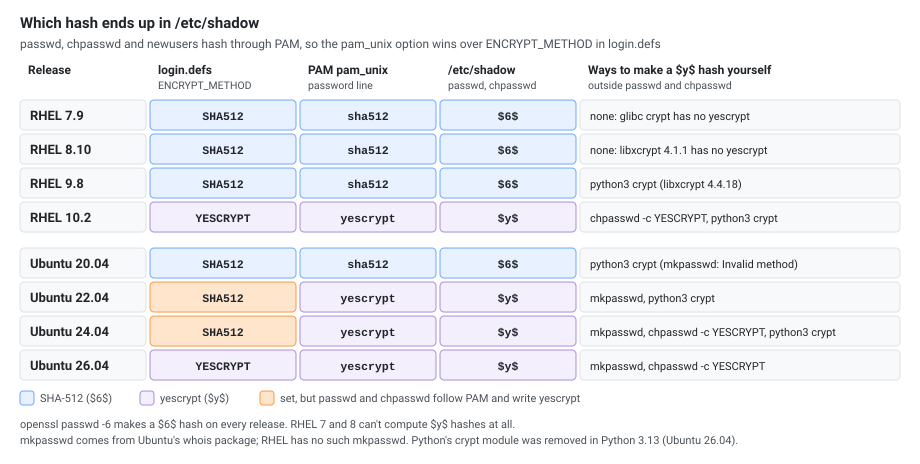
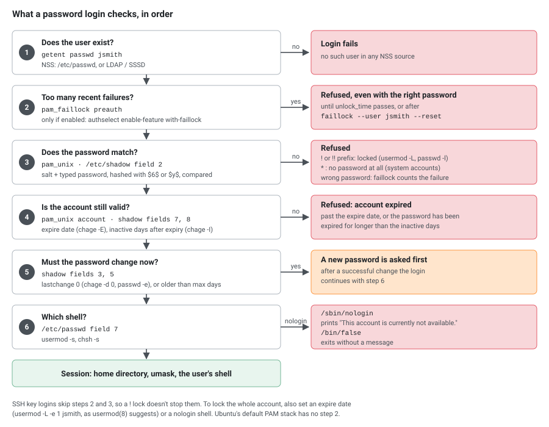
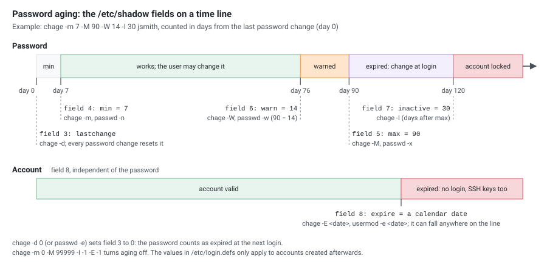

User and group administration with shadow-utils, PAM and friends on **RHEL 7, 8, 9, 10** and **Ubuntu 20.04, 22.04, 24.04, 26.04**. Every command was run on each release (see [Where the Numbers Come From](#where-the-numbers-come-from)); where the releases behave differently, the tables say so.

## UID ranges

Specific UID numbers and ranges of numbers are used for specific purposes.

* UID 0 is always assigned to the superuser account, root.
* **RHEL**: UID 1-200 is a range of "system users" assigned statically to system processes by Red Hat; UID 201-999 is for system users created dynamically when software is installed (`SYS_UID_MIN 201` in `/etc/login.defs`). Programs run as these "unprivileged" system users in order to limit their access to just the resources they need to function.
* **Ubuntu**: system users are 100-999 (`FIRST_SYSTEM_UID=100` in older `/etc/adduser.conf`), regular users start at 1000.
* UID 1000+ is the range available for assignment to regular users on both.

[](ua-uid-ranges.svg "Open the diagram full size")

Prior to Red Hat Enterprise Linux 7, the convention was that UID 1-499 was used for system users and UID 500+ for regular users. Default ranges used by useradd and groupadd can be changed in the `/etc/login.defs` file.

Given the automatic creation of user private groups (GID 1000+), it is generally recommended to set aside a range of GID numbers to be used for supplementary groups. A higher range will avoid a collision with a system group (GID 0-999).

The **-r** option will create a system group using a GID from the range of valid system GID numbers listed in the `/etc/login.defs` file.

## /etc/login.defs

> **No comments at the end of a line.** `login.defs` takes everything after the name as the value. On RHEL 8 and 9, `HOME_MODE 0750 # comment` makes `useradd` print `configuration error - cannot parse HOME_MODE value` and create the home directory as **755** instead. Put comments on their own line. (RHEL 10 and Ubuntu tolerate it.)

### Password Aging

| Parameter | Description | Default (all releases) | Typical hardened value |
|-----------|-------------|------------------------|------------------------|
| PASS_MAX_DAYS | Maximum number of days a password can be used | 99999 | 90 |
| PASS_MIN_DAYS | Minimum days allowed between password changes | 0 | 1 |
| PASS_MIN_LEN | Minimum acceptable password length (legacy, not enforced by PAM) | RHEL 7/8: 5, RHEL 10: 8, not set on RHEL 9 and Ubuntu | 8 |
| PASS_WARN_AGE | Days of warning before password expires | 7 | 14 |

> **Note:** Password length and complexity are enforced through `pam_pwquality` (`/etc/security/pwquality.conf`), not `PASS_MIN_LEN`.

### UID/GID Ranges

On RHEL 7 to 10 (RHEL 6 used `UID_MIN 500`):

```
UID_MIN                  1000
UID_MAX                 60000
SYS_UID_MIN               201
SYS_UID_MAX               999
GID_MIN                  1000
GID_MAX                 60000
SYS_GID_MIN               201
SYS_GID_MAX               999
```

Ubuntu sets only `UID_MIN 1000`, `UID_MAX 60000`, `GID_MIN 1000` and `GID_MAX 60000`; the system ranges use shadow's built-in defaults.

### Subordinate IDs (rootless containers)

These fill `/etc/subuid` and `/etc/subgid` for unprivileged (rootless) containers:

```
SUB_UID_MIN            100000
SUB_UID_MAX         600100000
SUB_UID_COUNT           65536
SUB_GID_MIN            100000
SUB_GID_MAX         600100000
SUB_GID_COUNT           65536
```

These are the values in RHEL 9 and Ubuntu 22.04 to 26.04 (RHEL 8 and Ubuntu 20.04 don't list them and use the same built-in defaults). **RHEL 10 starts at `SUB_UID_MIN 524288` / `SUB_GID_MIN 524288`.** Each new user is allocated 65536 subordinate UIDs/GIDs for user namespace mapping (used by Podman, Docker rootless).

### UMASK and HOME_MODE

`HOME_MODE` sets the permissions of new home directories; without it, `useradd` uses `UMASK`.

| Release | UMASK | HOME_MODE | New home directory |
|---------|-------|-----------|--------------------|
| RHEL 7 | 077 | not set | 700 |
| RHEL 8, 9, 10 | 022 | 0700 | 700 |
| Ubuntu 20.04 | 022 | not set | **755** (readable by everyone) |
| Ubuntu 22.04, 24.04 | 022 | 0750 | 750 |
| Ubuntu 26.04 | not set | 0750 | 750 |

| UMASK | Files created as | Directories created as |
|-------|-----------------|----------------------|
| 022 | 644 (rw-r--r--) | 755 (rwxr-xr-x) |
| 027 | 640 (rw-r-----) | 750 (rwxr-x---) |
| 077 | 600 (rw-------) | 700 (rwx------) |

### ENCRYPT_METHOD and the Real Hash

The hash actually written to `/etc/shadow` by `passwd` and `chpasswd` comes from **PAM** (`pam_unix.so` in `/etc/pam.d/system-auth` on RHEL, `/etc/pam.d/common-password` on Ubuntu). `ENCRYPT_METHOD` in `login.defs` is only used by tools that hash without PAM.

| Release | `ENCRYPT_METHOD` | PAM (`pam_unix.so`) | Hash in `/etc/shadow` |
|---------|------------------|---------------------|-----------------------|
| RHEL 7, 8, 9 | SHA512 | `sha512` | `$6$` |
| RHEL 10 | YESCRYPT | `yescrypt` | `$y$` |
| Ubuntu 20.04 | SHA512 | `sha512` | `$6$` |
| Ubuntu 22.04, 24.04 | SHA512 | `yescrypt` | `$y$` (PAM wins) |
| Ubuntu 26.04 | YESCRYPT | `yescrypt` | `$y$` |

[](ua-hash-matrix.svg "Open the diagram full size")

Other hashing settings in the shipped files:

```
# RHEL 8
SHA_CRYPT_MAX_ROUNDS 5000

# RHEL 9
SHA_CRYPT_MAX_ROUNDS 100000

# RHEL 10 and Ubuntu 26.04: only ENCRYPT_METHOD YESCRYPT
# (YESCRYPT_COST_FACTOR is optional; the default is 5)
```

### Other Useful Settings

```
# Auto-create home directories for new users (RHEL; not set on Ubuntu, see below)
CREATE_HOME      yes

# User Private Group (UPG) scheme: each user gets their own group
USERGROUPS_ENAB  yes

# Ubuntu defaults, used by login(1): log successful logins, don't log unknown user names
LOG_OK_LOGINS    no
LOG_UNKFAIL_ENAB no
LOGIN_RETRIES    5
LOGIN_TIMEOUT    60
```

### Viewing Active Configuration

```sh
# Show all active (non-comment) settings
awk 'NF && $1 !~ /^#/' /etc/login.defs

# Check a specific setting
grep -E '^ENCRYPT_METHOD' /etc/login.defs
```


## Password Hash Format

There are three pieces of information stored in a modern password hash.

**SHA-512 format** (`$6$`):

`$6$gCjLa2/Z$6Pu0EK0AzfCjxjv2hoLOB/...`

1. `$6$` — The hashing algorithm (6 = SHA-512)
2. `gCjLa2/Z` — The salt (randomly generated)
3. `6Pu0EK0AzfCjxjv2hoLOB/...` — The encrypted hash

**yescrypt format** (`$y$`):

`$y$j9T$salt$hash`

1. `$y$` — The algorithm identifier (yescrypt)
2. `j9T` — Cost parameters (CPU/memory factors encoded)
3. `salt` — The salt
4. `hash` — The encrypted hash

**All algorithm identifiers:**

| Prefix | Algorithm | Supported in |
|--------|-----------|-------------|
| `$1$` | MD5 | All (do not use) |
| `$5$` | SHA-256 | RHEL 6+, all Ubuntu |
| `$6$` | SHA-512 | RHEL 6+, all Ubuntu |
| `$y$` | yescrypt | RHEL 9+ (not RHEL 8: its libxcrypt 4.1.1 can't compute it), Ubuntu 20.04+ |

When a user logs in, the system looks up their entry in `/etc/shadow`, combines the stored salt with the typed password, hashes using the algorithm specified by the prefix, and compares the result. This allows authentication without storing the password in a reversible form.

**Changing the algorithm:**

```sh
# RHEL 6/7 (deprecated in RHEL 8+)
authconfig --passalgo sha512 --update

# RHEL 8+: the pam_unix.so password line, set through an authselect profile
# Ubuntu: the pam_unix.so line in /etc/pam.d/common-password
# Both: keep /etc/login.defs in line
ENCRYPT_METHOD YESCRYPT
```

### /etc/shadow Format

Nine colon-separated fields:

`name:password:lastchange:minage:maxage:warning:inactive:expire:blank`

| Field | Description |
|-------|-------------|
| name | Login name |
| password | Encrypted password (or `!`/`!!` if locked, `*` if no login) |
| lastchange | Days since Jan 1 1970 password was last changed |
| minage | Minimum days between password changes |
| maxage | Maximum days before password must be changed |
| warning | Days before expiry user is warned |
| inactive | Days after expiry account is disabled |
| expire | Days since Jan 1 1970 account expires |
| blank | Reserved |

[](ua-login-checks.svg "Open the diagram full size")

## Users

* Add a customized username: `useradd -u <uid> -g <gid/group> -c "Comment" -m -d </home/homedir> -s <shell> username`
* Add the user to the `users` group (GID 100) instead of a private group: `useradd -N <username>`. RHEL 7 to 9 also accept `-n`; RHEL 10 and Ubuntu reject it (`invalid option -- 'n'`).
* Display the current default values: `useradd -D`
* Change default shell (or edit /etc/default/useradd): `useradd -D -s /bin/sh`
* Display passwd file: `column -t -s : /etc/passwd` (on Ubuntu `column` is in the `bsdextrautils` package)
* Create a system account:

```sh
groupadd -r <group>
useradd -r -g <group> -c <comment> -s /sbin/nologin -d / <username>
```

* List all users with a password set: `grep -Ev ':\*|:!' /etc/shadow | awk -F: '{print $1, $2}'` (`egrep` prints "egrep is obsolescent" on RHEL 10, and `\!` in the pattern makes grep warn "stray \ before !")
* List all users > UID_MIN (RHEL 5-6): `awk -F: '($3>=500) && ($3!=65534)' /etc/passwd | cut -d ":" -f1`
* List all users > UID_MIN (RHEL 7+, Ubuntu): `awk -F: '($3>=1000)' /etc/passwd | cut -d ":" -f1`
* Show UID, GID, and group memberships: `id <username>`
* Query user from NSS (works with LDAP/SSSD): `getent passwd <username>`
* List all user accounts with details (login times, password status): `lslogins` (Ubuntu 26.04: package `util-linux-extra`)
* Delete a user and their home directory: `userdel -r <username>`
* Expire an account at a specific date: `usermod -e 2025-12-31 <username>`
* Remove account expiration: `usermod -e "" <username>`
* Find all files owned by a user: `find / -user <username>`
* Find orphaned files (no matching user): `find / -nouser -o -nogroup`
* Show last login for all users: `lastlog` (Ubuntu 26.04: `lastlog2`)
* Show login history: `last` (Ubuntu 26.04: package `wtmpdb`)
* Show failed login attempts: `lastb` (not available on Ubuntu 26.04)
* Show currently logged-in users: `w` or `who`

### Ubuntu: useradd vs adduser

On Ubuntu, `useradd` is the low-level tool and behaves differently from RHEL:

* It **doesn't create a home directory** unless you pass `-m` (Ubuntu's `login.defs` has no `CREATE_HOME yes`).
* Its default shell is **`/bin/sh`** (`SHELL=/bin/sh` in `/etc/default/useradd`).

`adduser <username>` (Debian's interactive wrapper) creates the home, copies `/etc/skel`, uses `/bin/bash` and asks for a password, so it's the usual command there. The administrators' group is `sudo` (GID 27), not `wheel`.

## Groups

The use of the -a option makes usermod function in "append" mode. Without it, the user would be removed from all other supplementary groups.

* Add the user to the group: `usermod -aG <group> <username>` or `gpasswd -a <username> <group>`
* Remove the user from the group: `gpasswd -d <username> <group>`
* Remove all secondary groups for a user: `usermod -G "" <username>`
* Set a password for a group: `gpasswd <group>`
* Change the current group ID: `newgrp <group>`
* Log out of current group ID: `newgrp`
* Show groups for a user: `groups <username>`
* List members of a group (works with LDAP/SSSD): `getent group <group>`, or `groupmems -l -g <group>` (not on Ubuntu 26.04), or `lid -g <group>` (RHEL 7 to 9, package `libuser`; not on RHEL 10 or Ubuntu)
* Delete a group: `groupdel <group>`

## Passwords

* Display the status of the password for a given account: `passwd -S <username>`. RHEL 7 to 9 print `jsmith PS 2026-10-23 0 99999 7 -1 (Password set, SHA512 crypt.)`, RHEL 10 and Ubuntu the short form `jsmith P 2026-10-23 0 99999 7 -1`.
* Lock a user's password: `usermod -L <username>` (puts `!` in front of the hash) or `passwd -l <username>` (`!!` on RHEL 7 to 9, a single `!` on RHEL 10 and Ubuntu)
* Unlock a user's password: `usermod -U <username>` or `passwd -u <username>`
* Expire password (force change on next login): `passwd -e <username>` (same as `chage -d 0`)
* Set min/max/warn days from CLI: `passwd -n <min> -x <max> -w <warn> <username>`
* Update passwords in batch mode (password in text clear): `echo "username:password" | chpasswd`
* Choose the hash for chpasswd: `chpasswd -c SHA512` or `-c YESCRYPT` (YESCRYPT only on RHEL 10 and Ubuntu 24.04+; RHEL 9 and Ubuntu 22.04 answer `unsupported crypt method: YESCRYPT`)
* Set password from standard input (password in text clear): `echo "password" | passwd --stdin <username>` (RHEL 7 to 10 and Ubuntu 26.04; Ubuntu 20.04 to 24.04 use `chpasswd`)
* Set an encrypted password: `usermod -p "<encrypted-password>" <username>`
* Delete a password for an account: `passwd -d <username>`
* Generate a random password: `</dev/urandom tr -dc A-Za-z0-9 | head -c16`
* Generate a SHA-512 password hash: `openssl passwd -6 -salt <salt> <password>`
* Generate a yescrypt password hash: on Ubuntu 22.04+ `mkpasswd --method=yescrypt <password>` (package `whois`; the 20.04 version answers `Invalid method 'yescrypt'.`). RHEL has no such `mkpasswd`; on RHEL 9 and 10 and Ubuntu 20.04 to 24.04 use Python: `python3 -c 'import crypt; print(crypt.crypt("<password>", "$y$j9T$<22 random chars from ./0-9A-Za-z>"))'` (deprecated module, removed in Python 3.13, so not on Ubuntu 26.04)
* View shadow entry for a user: `getent shadow <username>`
* List aging information for all users > UID_MIN: `awk -F':' '{ if ( $3 >= 1000 ) print $0 }' /etc/passwd | cut -d: -f1 | xargs -I {} chage -l {}`

## Shell

* Print the list of shells listed in /etc/shells: `chsh -l` (RHEL, util-linux `chsh`, package `util-linux-user`); on Ubuntu `chsh` has no `-l`, use `cat /etc/shells`
* Change your finger information: `chfn <username>` (Ubuntu stores the extra fields too: `John Smith,,,`)
* Change your login shell: `chsh -s /bin/sh <username>`
* Set the nologin shell for an account: `usermod -s /sbin/nologin <username>`

## chage

[](ua-aging-timeline.svg "Open the diagram full size")

Typically if the password is expired, users are forced to change it during their next login. You can also set an additional condition where, after the password is expired, if the user never tried to login for X days, the account is automatically locked using option `-I`.

Once an account is locked due to inactivity, only system administrators will be able to unlock it.

> **Note:** Password aging settings in `/etc/login.defs` only apply to accounts created **after** the change. Use `chage` to update existing accounts.

* Operate in interactive mode: `chage <username>`
* Show account aging information: `chage -l <username>`
* Force password change on next login: `chage -d 0 <username>`
* Set the account expiry date: `chage -E 2025-12-31 <username>`
* Lock account after X days of inactivity: `chage -I 30 <username>`
* Disable password aging: `chage -m 0 -M 99999 -I -1 -E -1 <username>`
* Set password max age (days between password change): `chage -M 90 <username>`
* Apply hardened aging to an existing user: `chage -M 90 -m 1 -W 14 <username>`
* Increase account expiry by 90 days: `chage -E $(date -d "+90 days" +%Y-%m-%d) <username>`

Bulk update all regular users:

```sh
for user in $(awk -F: '$3 >= 1000 && $3 < 60000 {print $1}' /etc/passwd); do
    chage -M 90 -m 1 -W 14 "$user"
done
```

## /bin/false vs /sbin/nologin

Use of the nologin shell prevents interactive use of the system, but does not prevent all access. A user may still be able to authenticate and upload or retrieve files through applications such as web applications, file transfer programs, or mail readers.

* `/bin/false` — returns non-zero exit code, silent
* `/sbin/nologin` — politely refuses login with a message (customizable via `/etc/nologin.txt`, which doesn't exist by default), recommended for service accounts. Some FTP servers still allow access with this shell.

```
$ ssh serviceuser@host
This account is currently not available.
```

## Creating Bulk Users

The format is the same as `/etc/passwd`. Passwords are hashed automatically. The home directories are created but files are **not** copied from `/etc/skel`.

```sh
vi list_users
```

```
jsmith:password:1002:1002:John Smith:/home/jsmith:/bin/bash
jdoe:password:1003:1003:Jane Doe:/home/jdoe:/bin/bash
```

```sh
newusers list_users
```

On **RHEL 10**, `newusers` sets passwords through PAM, and the package ships no `/etc/pam.d/newusers` service, so the accounts were created with `!` in the password field (locked) and exit code 0. Set the passwords afterwards with `chpasswd` (same `user:password` lines). RHEL 7 to 9 and Ubuntu set them directly.

## Changing UID/GID for an Account

For example, to move an account carried over from RHEL 6 (UID 500) into the 1000+ range, or to align UIDs between hosts that share NFS:

```sh
# Change UID and GID (the user must have no running processes)
usermod -u 1006 jsmith
groupmod -g 1006 jsmith

# Find and fix ownership of old UID/GID files
find / -xdev -user 1005 -exec chown -h jsmith {} \;
find / -xdev -group 1005 -exec chgrp -h jsmith {} \;

# Verify (list files still owned by the old UID/GID)
find / -xdev \( -user 1005 -o -group 1005 \) -ls
```

`usermod -u` updates the owner of the user's home directory and mailbox; files elsewhere keep the old number, which is what the `find` lines fix. `groupmod -g` changes nothing on disk: even the files in the home directory keep the old GID until the `chgrp` line runs. `-xdev` stays on one filesystem: run it once per mount point (`/`, `/home`, `/var`, ...) and skip network mounts.

## pam_tally2 (RHEL 6–7, Ubuntu 20.04)

> **Deprecated:** `pam_tally2` is removed in RHEL 8 and Ubuntu 22.04. Use `faillock` instead (see below).

* Check maximum attempts for a user: `pam_tally2 -u <username>`
* Reset the fail login counter: `pam_tally2 -r -u <username>`
* Reset using pam_tally: `pam_tally --reset --user <username>`

## faillock (RHEL 8+, Ubuntu 20.04+)

The `pam_faillock` module and the `faillock` command exist on RHEL 7.x too and on all four Ubuntu releases, but Ubuntu doesn't enable the module in its PAM configuration by default.

* View all unsuccessful login attempts: `faillock`
* View failed login attempts for a particular user: `faillock --user <username>`
* Clear a user's authentication failure logs: `faillock --user <username> --reset`
* Reset all users: `faillock --reset`

With no failures recorded yet, `faillock` prints nothing on RHEL and `Error reading tally directory: No such file or directory` on Ubuntu.

### Configuration (/etc/security/faillock.conf)

The file ships with everything commented out; the commented values are the defaults (`deny = 3`, `unlock_time = 600`, `fail_interval = 900`, `root_unlock_time = 900`). A hardened example:

```
# Number of failed attempts before lockout
deny = 5

# Time in seconds before the account is unlocked (0 = manual unlock only)
unlock_time = 900

# Time window in seconds for counting failures
fail_interval = 900

# Lock out root as well: a flag, without "= yes".
# Leave it out (or commented) to keep root exempt.
# even_deny_root

# Root unlock time (if even_deny_root is set)
root_unlock_time = 60
```

## Changes Across RHEL Versions (6 → 10)

### UID Ranges

| Version | Regular user UID start | System user range |
|---------|----------------------|-------------------|
| RHEL 6 | 500 | 1–499 |
| RHEL 7+ | 1000 | 1–999 (static: 1–200, dynamic: 201–999) |
| Ubuntu | 1000 | 100–999 |

### Password Hashing Algorithms

SHA-512 (`$6$`) is the default on RHEL 6 to 9 and Ubuntu 20.04; RHEL 10 and Ubuntu 22.04+ write yescrypt (`$y$`, also Fedora 35+). yescrypt is based on scrypt and NIST-approved primitives, and it is memory-hard, so it is much more expensive to attack with GPUs and ASICs than SHA-512. The prefixes, how to change the algorithm and the per-release defaults are in [Password Hash Format](#password-hash-format) and [ENCRYPT_METHOD and the Real Hash](#encrypt_method-and-the-real-hash).

### authconfig → authselect

| Version | Tool | Notes |
|---------|------|-------|
| RHEL 6–7 | `authconfig` | Manages PAM/NSS configuration |
| RHEL 8 | `authselect` | `authconfig` deprecated (compat package available) |
| RHEL 9 | `authselect` | `authconfig` compat package removed |
| RHEL 10 | `authselect` | Only option; profiles `local` (default), `sssd`, `winbind` |
| Ubuntu | `pam-auth-update` | No authselect |

Common `authselect` usage:

```sh
# List available profiles
authselect list

# Select sssd profile with mkhomedir (needs oddjob-mkhomedir and oddjobd running)
authselect select sssd with-mkhomedir

# Show current configuration
authselect current

# Create a custom profile (created in /etc/authselect/custom/myprofile)
authselect create-profile myprofile -b sssd
```

### Account Lockout: pam_tally2 → pam_faillock

| Version | Module | Config |
|---------|--------|--------|
| RHEL 6–7, Ubuntu 20.04 | `pam_tally2` | `/etc/pam.d/` |
| RHEL 8+, Ubuntu 22.04+ | `pam_faillock` | `/etc/security/faillock.conf` |

The `faillock` commands and `faillock.conf` settings are in [faillock](#faillock-rhel-8-ubuntu-2004).

### /usr Merge (RHEL 7+)

Starting with **RHEL 7**, `/bin`, `/sbin`, `/lib`, and `/lib64` are symlinks to their `/usr` counterparts (Ubuntu 20.04+ too):

* `/sbin/nologin` → `/usr/sbin/nologin`
* `/bin/bash` → `/usr/bin/bash`

Both paths still work (symlinked), but canonical paths are under `/usr`. RHEL 10 writes the canonical path into `/etc/passwd` for system users (`/usr/sbin/nologin`).

### SSH Key Authentication Changes (RHEL 9+)

RHEL 9 disables RSA/SHA-1 signatures by default due to the system-wide crypto policy. This affects user key-based authentication:

```sh
# Generate a modern key (preferred)
ssh-keygen -t ed25519 -C "user@host"

# RSA still works but requires SHA-2 (default on modern clients)
ssh-keygen -t rsa -b 4096 -C "user@host"
```

Without `-t`, `ssh-keygen` creates an Ed25519 key from OpenSSH 9.5 on, and an RSA 3072 key before that. RHEL 8 (OpenSSH 8.0) and RHEL 9.0 to 9.6 (8.7) create RSA; RHEL 9.7+ (rebased to 9.9 in September 2025) and RHEL 10 (9.9) create Ed25519. Ubuntu 20.04 and 22.04 create RSA, 24.04 and 26.04 Ed25519.

If old RSA/SHA-1 keys stop working after upgrading to RHEL 9+, either regenerate with ed25519 or temporarily allow SHA-1. The `SHA1` sub-policy exists **only on RHEL 9**; RHEL 8 and 10 answer `Unknown policy SHA1`:

```sh
update-crypto-policies --set DEFAULT:SHA1
```

### Crypto Policies (RHEL 8+)

System-wide cryptographic policies affect user authentication, SSH, and TLS (RHEL only; Ubuntu has no `update-crypto-policies`):

```sh
# View current policy
update-crypto-policies --show

# Available policies: LEGACY, DEFAULT, FUTURE, FIPS
update-crypto-policies --set FUTURE

# RHEL 10 stricter defaults — weaker algorithms disabled out of the box
```

### Summary Table

[](ua-release-changes.svg "Open the diagram full size")

| Feature | RHEL 6 | RHEL 7 | RHEL 8 | RHEL 9 | RHEL 10 |
|---------|--------|--------|--------|--------|---------|
| UID_MIN | 500 | 1000 | 1000 | 1000 | 1000 |
| Hash algorithm | SHA-512 | SHA-512 | SHA-512 | SHA-512 | yescrypt |
| Auth config tool | authconfig | authconfig | authselect | authselect | authselect |
| Account lockout | pam_tally2 | pam_tally2 | pam_faillock | pam_faillock | pam_faillock |
| `ssh-keygen` default | RSA | RSA | RSA | RSA (9.0–9.6), Ed25519 (9.7+) | Ed25519 |
| /usr Merge | No | Yes | Yes | Yes | Yes |
| Crypto policies | No | No | Yes | Yes | Yes (stricter) |
| `passwd` | passwd | passwd | passwd | passwd | shadow-utils |

| Feature | Ubuntu 20.04 | Ubuntu 22.04 | Ubuntu 24.04 | Ubuntu 26.04 |
|---------|--------------|--------------|--------------|--------------|
| Hash written by `passwd` | SHA-512 | yescrypt | yescrypt | yescrypt |
| New home (`useradd -m`) | 755 | 750 | 750 | 750 |
| Account lockout | pam_tally2 / pam_faillock (not enabled) | pam_faillock (not enabled) | pam_faillock (not enabled) | pam_faillock (not enabled) |
| `ssh-keygen` default | RSA | RSA | Ed25519 | Ed25519 |
| `passwd --stdin` | No | No | No | Yes |
| `lastlog`, `lastb`, `groupmems` | Yes | Yes | Yes | `lastlog2` instead; no `lastb`, no `groupmems` |

## Querying Users by UID Range

```bash
# Show all users with UID 1-499 (system users)
awk -F: '$3 >= 1 && $3 <= 499 {printf "%-15s UID: %4d Shell: %s\n", $1, $3, $7}' /etc/passwd

# Find users without home directories
awk -F: '{if(system("test -d " $6) != 0) print $1 " - missing: " $6}' /etc/passwd
```

## Batch User Creation (Script Method)

Alternative to `newusers` — create multiple users from a custom file:

```bash
# Format: username:UID:GID:comment:home:shell
cat > users.txt << EOF
appuser1:501:501:Application User 1:/opt/app1:/bin/bash
appuser2:502:502:Application User 2:/opt/app2:/bin/bash
dbuser:503:503:Database Service:/var/lib/db:/sbin/nologin
EOF

# Process the file
while IFS=: read -r user uid gid comment home shell; do
    sudo groupadd -g "$gid" "$user" 2>/dev/null
    sudo useradd -u "$uid" -g "$gid" -c "$comment" -d "$home" -s "$shell" -m "$user"
    echo "Created user: $user (UID: $uid)"
done < users.txt
```

## Password Quality (pam_pwquality)

Configure password complexity in `/etc/security/pwquality.conf`:

```bash
# RHEL 8+ / Ubuntu 20.04+
sudo vi /etc/security/pwquality.conf

# Key settings:
minlen = 12          # Minimum password length
minclass = 3         # Minimum number of character classes (upper, lower, digit, special)
maxrepeat = 2        # Maximum consecutive identical characters
dcredit = -1         # Require at least 1 digit
ucredit = -1         # Require at least 1 uppercase
lcredit = -1         # Require at least 1 lowercase
ocredit = -1         # Require at least 1 special character
```

Unlike `login.defs`, `pwquality.conf` accepts these trailing comments: with `minlen = 12   # ...`, `pwscore` still rejected a 7-character password with "The password is shorter than 12 characters". Test a password against the configuration with `echo '<password>' | pwscore` (package `libpwquality-tools` on Ubuntu).

```bash
# Install (Ubuntu)
sudo apt install libpam-pwquality

# Install (RHEL — included by default)
sudo dnf install libpwquality
```

## User Quotas

```bash
# Enable quotas on a filesystem
sudo mount -o remount,usrquota,grpquota /home

# Or add to /etc/fstab:
# /dev/sda2  /home  ext4  defaults,usrquota,grpquota  0  2

# Initialize quota database
sudo quotacheck -cum /home
sudo quotaon /home

# Set user quota (blocks: soft=1GB, hard=1.2GB; inodes: unlimited)
sudo setquota -u username 1000000 1200000 0 0 /home

# View user quota
quota -u username
sudo repquota /home

# Edit quota interactively
sudo edquota -u username

# Set grace period for soft limits
sudo edquota -t
```

## Auditing User Activity

```bash
# Check sudo access for a user
sudo -l -U username

# View login history
last username
lastlog -u username

# View failed login attempts
sudo grep "Failed password" /var/log/secure        # RHEL
sudo grep "Failed password" /var/log/auth.log      # Ubuntu

# Using auditd (RHEL)
sudo aureport --auth                    # Authentication report
sudo ausearch -ua username              # Search by user
sudo ausearch -m USER_LOGIN             # Login events

# Find files with specific permissions (e.g., world-writable)
find / -perm -o+w -type f 2>/dev/null

# Check file details
stat /path/to/file
```

## Service Account with systemd

Create a proper service account with a matching systemd unit:

```bash
# Create service account
sudo groupadd -g 300 webservice
sudo useradd -r -u 300 -g webservice -s /sbin/nologin -M -c "Web Service Account" webservice

# Set up directories
sudo mkdir -p /opt/webservice
sudo chown webservice:webservice /opt/webservice
sudo chmod 750 /opt/webservice

# Create systemd service running as the service user
sudo tee /etc/systemd/system/webservice.service > /dev/null << EOF
[Unit]
Description=Web Service
After=network.target

[Service]
Type=simple
User=webservice
Group=webservice
WorkingDirectory=/opt/webservice
ExecStart=/opt/webservice/start.sh
Restart=always

[Install]
WantedBy=multi-user.target
EOF

sudo systemctl daemon-reload
sudo systemctl enable --now webservice
```

## User Audit Script

```bash
#!/bin/bash
# user-audit.sh — comprehensive user account audit

echo "=== User Audit Report $(date) ==="

echo -e "\n--- System Users (UID 1-999) with Login Shells ---"
awk -F: '$3 >= 1 && $3 < 1000 && $7 !~ /nologin|false/ {printf "%-15s UID:%-5d Shell:%s\n", $1, $3, $7}' /etc/passwd

echo -e "\n--- Users with No Usable Password (empty or locked) ---"
sudo awk -F: '($2 == "" || $2 == "!" || $2 == "!!") {print $1}' /etc/shadow

echo -e "\n--- Users Not Logged In for 30+ Days ---"
lastlog -b 30 | grep -v "Never logged in" | tail -n +2

echo -e "\n--- Locked Accounts ---"
sudo awk -F: '$2 ~ /^!/ && $3 >= 1000 {print $1}' /etc/shadow

echo -e "\n--- Duplicate UIDs ---"
awk -F: '{count[$3]++; users[$3]=users[$3] " " $1} END {for(uid in count) if(count[uid] > 1) print "UID " uid ":" users[uid]}' /etc/passwd

echo -e "\n--- Users in sudo/wheel Group ---"
getent group sudo wheel 2>/dev/null | cut -d: -f4
```

The script repeats a few one-liners from this page on purpose, so it can be copied on its own. On Ubuntu 26.04 replace `lastlog` with `lastlog2`.

## One-Liners

### Who Can Become Root

```sh
# Accounts with UID 0 (should be root only)
awk -F: '$3 == 0 {print $1}' /etc/passwd

# Members of the admin group (wheel on RHEL, sudo on Ubuntu)
getent group wheel sudo

# Every sudo rule, without comments and Defaults
grep -rhvE '^[[:space:]]*(#|$|Defaults)' /etc/sudoers /etc/sudoers.d/
```

```
root	ALL=(ALL:ALL) ALL
%admin ALL=(ALL) ALL
%sudo	ALL=(ALL:ALL) ALL
@includedir /etc/sudoers.d
```

That's Ubuntu 22.04 to 26.04 (20.04 still writes `#includedir`, which the filter hides). RHEL shows `root ALL=(ALL) ALL` and `%wheel ALL=(ALL) ALL`. `getent group wheel sudo` returns exit code 2 when one of the two groups doesn't exist, which is normal.

### Password Report for All Users

One `awk` over `/etc/passwd` and `/etc/shadow` (run as root). It works with gawk on RHEL and mawk on Ubuntu:

```sh
awk -F: 'BEGIN {printf "%-8s %-7s %-11s %s\n", "USER", "STATUS", "CHANGED", "EXPIRES"}
NR == FNR {if ($3 >= 1000 && $3 < 60000) u[$1]; next}
$1 in u {
  st = ($2 == "") ? "empty" : ($2 ~ /^!/ ? "locked" : "set")
  ex = ($5 == "" || $5 >= 99999) ? "never" : strftime("%F", ($3 + $5) * 86400)
  printf "%-8s %-7s %-11s %s\n", $1, st, strftime("%F", $3 * 86400), ex
}' /etc/passwd /etc/shadow
```

```
USER     STATUS  CHANGED     EXPIRES
alice    empty   2026-10-23  never
bob      set     2026-10-23  2027-01-21
carol    locked  2026-10-23  never
```

(`bob` has `chage -M 90`, `alice` had `passwd -d`, `carol` had `usermod -L`.) Don't name an awk variable `exp`: it's a built-in function, and both awks stop with a syntax error.

`lslogins` gives a similar view; `--time-format=iso` avoids its default format, which shows only `00:00` for today's date:

```sh
lslogins -u --time-format=iso -o USER,PWD-CHANGE,PWD-MAX,PWD-EXPIR,LAST-LOGIN
```

`PWD-EXPIR` is the **account** expire date (field 8), not the password expiry.

### Accounts That Never Logged In

```sh
# RHEL, Ubuntu 20.04-24.04
lastlog | awk '/Never logged in/ {print $1}'

# Every release, Ubuntu 26.04 included (no lastlog there)
lslogins -u --noheadings -o USER,LAST-LOGIN | awk 'NF == 1 {print $1}'

# Not logged in for 30+ days (RHEL, Ubuntu 20.04-24.04)
lastlog -b 30
```

### Users with an Interactive Shell

```sh
getent passwd | awk -F: '$7 !~ /(nologin|false|sync|shutdown|halt)$/ {print $1, $7}'
```

Unlike `/etc/passwd`, `getent` includes LDAP/SSSD users.

### Duplicates and Empty Groups

```sh
# Duplicate user names, UIDs and GIDs (no output = none)
cut -d: -f1 /etc/passwd | sort | uniq -d
cut -d: -f3 /etc/passwd | sort -n | uniq -d
cut -d: -f3 /etc/group | sort -n | uniq -d

# Groups (GID 1000+) with no members and nobody's primary group
awk -F: 'NR == FNR {prim[$4] = 1; next}
  $4 == "" && !($3 in prim) && $3 >= 1000 {print $1}' /etc/passwd /etc/group
```

### Compare the Users on Two Hosts

```sh
diff <(ssh host1 "getent passwd | cut -d: -f1 | sort") \
     <(ssh host2 "getent passwd | cut -d: -f1 | sort")
```

Between Ubuntu 22.04 and 26.04 images, for example, it prints `< gnats` (dropped in 26.04) and `> ubuntu` (added in 24.04). Use `-f1,3` to compare UIDs too, which matters for NFS.

## Tips & Tricks

### Create a User Without Prompts

```sh
# RHEL (wheel) and Ubuntu (sudo): useradd needs -m and -s on Ubuntu
useradd -m -s /bin/bash -G wheel dave
echo 'dave:<password>' | chpasswd

# Ubuntu: adduser without the questions
adduser --disabled-password --gecos "" erin
adduser erin sudo
```

`--gecos ""` works on all four Ubuntu releases; the newer `--comment` only exists from 24.04 (20.04 and 22.04 answer `Unknown option: comment`). On RHEL, `adduser` is just a link to `useradd` and rejects `--disabled-password`. From 24.04, `adduser` also adds the user to the `users` group (`EXTRA_GROUPS`).

### Lock an Account Completely

`usermod -L` only disables the password; SSH keys still work. Expire the account too:

```sh
usermod -L -e 1 bob
passwd -S bob
chage -l bob | grep 'Account expires'
```

```
bob LK 2026-10-23 0 99999 7 -1 (Password locked.)
Account expires						: Jan 02, 1970
```

(RHEL 10 and Ubuntu print the short form `bob L 2026-10-23 0 99999 7 -1`.) Undo both:

```sh
usermod -U -e "" bob
```

### Temporary Accounts

The account stops working by itself on the date:

```sh
useradd -m -e "$(date -d '+7 days' +%F)" contractor
chage -l contractor | grep 'Account expires'
```

```
Account expires						: Oct 30, 2026
```

### Shared Team Directory

The setgid bit (`2` in `2770`) makes new files inherit the directory's group, and the default ACL keeps them group-writable whatever the user's umask:

```sh
groupadd team
usermod -aG team alice
usermod -aG team bob
mkdir -p /srv/team
chgrp team /srv/team
chmod 2770 /srv/team
setfacl -d -m g:team:rwX /srv/team
```

A file and a directory alice creates with `umask 022`:

```
-rw-rw----+ 1 alice team    0 Oct 23 08:07 a.txt
drwxrws---+ 2 alice team 4096 Oct 23 08:07 sub
```

bob can edit `a.txt`. `setfacl` is in the `acl` package. Group membership only applies to new logins (or `newgrp team`).

### A sudo Rule for One Command

```sh
printf '%s\n' 'alice ALL=(root) NOPASSWD: /usr/bin/systemctl restart nginx' > /etc/sudoers.d/alice-nginx
chmod 0440 /etc/sudoers.d/alice-nginx
visudo -cf /etc/sudoers.d/alice-nginx
sudo -l -U alice
```

```
/etc/sudoers.d/alice-nginx: parsed OK
...
    (root) NOPASSWD: /usr/bin/systemctl restart nginx
```

- Check every file with `visudo -cf` before relying on it. A missing `:` after `NOPASSWD` gives `syntax error`, and a broken sudoers file can lock everyone out of sudo.
- **File names with a dot or ending in `~` are ignored.** `alice.conf` and `alice-date~` in `/etc/sudoers.d` were silently skipped (`sudo -l` didn't list them) on every release.

### Edit /etc/passwd Safely

- `vipw` / `vigr` (and `vipw -s` / `vigr -s` for the shadow files) lock the file while you edit and check it afterwards.
- The shadow tools keep the previous version as `/etc/passwd-`, `/etc/shadow-`, `/etc/group-` and `/etc/gshadow-`. `diff /etc/passwd- /etc/passwd` shows the last change:

```
19a20
> temp1:x:1005:1005::/home/temp1:/bin/bash
```

- Check afterwards with `pwck -r` (`/etc/passwd`, `/etc/shadow`) and `grpck -r` (`/etc/group`, `/etc/gshadow`). Keep the `-r`: `pwck -s` doesn't just check, it rewrites `/etc/passwd` and `/etc/shadow` sorted by UID. `pwck -r` exits with 2 when it only finds missing home directories of system users (`user 'lp': directory '/var/spool/lpd' does not exist`), which is common and harmless.

### Rename a User

```sh
usermod -l newname -d /home/newname -m oldname
groupmod -n newname oldname
id newname
```

```
uid=1006(newname) gid=1006(newname) groups=1006(newname)
```

The UID stays the same, so files elsewhere keep working; `-m` moves the home directory. Update anything that has the old name in it: sudoers rules, crontabs (`/var/spool/cron/oldname` on RHEL, `/var/spool/cron/crontabs/oldname` on Ubuntu), the mail spool.

### Log a User Out

Lock the account first ([Lock an Account Completely](#lock-an-account-completely)) so they can't log back in, then:

```sh
pkill -KILL -u bob           # every process of the user
loginctl terminate-user bob  # systemd hosts: ends the sessions
```

## Troubleshooting

| Error | Cause and fix |
|-------|---------------|
| `user bob is currently used by process 35` | `usermod -l`, `-u`, `-d -m` and `userdel` refuse while the user has processes. Stop them (`pkill -u bob`) and retry. `userdel -f` deletes anyway (it still prints the message), leaving orphan processes. |
| `passwd: Authentication token manipulation error` | `passwd` couldn't write `/etc/shadow`: read-only root filesystem, `chattr +i` on the file, full disk, or a broken PAM `password` stack. Here `chpasswd` says `cannot lock /etc/passwd; try again later.` on RHEL and `pam_chauthtok() failed` on Ubuntu. |
| `useradd: cannot lock /etc/passwd; try again later.` | Another tool holds the lock: `useradd: lock /etc/passwd.lock already used by PID 204`. Wait for that process (often an open `vipw`). If the PID no longer exists, the lock is stale and the tools remove it themselves. |
| `useradd: group 'devs' does not exist` | `-g` or `-G` names a group that isn't there: `groupadd devs` first. |
| `useradd: UID 1002 is not unique` / `groupadd: GID '10' already exists` | Pick another number, or add `-o` if you really want two names with one UID (`useradd -o -u 1500 a2`). |
| `useradd: user 'zed' already exists` / `groupadd: group 'team' already exists` | Exit codes 9; check with `getent passwd zed` first in scripts. |
| `groupdel: cannot remove the primary group of user 'bob'` | Change bob's primary group (`usermod -g`) or delete the user first. |
| `useradd: warning: the home directory /home/alice already exists.` | A leftover home from a deleted user: files are not copied from `/etc/skel`, and the old files keep their old UID. `chown -R` it or remove it. |
| `This account is currently not available.` | The login shell is `/sbin/nologin`: `usermod -s /bin/bash <user>` if the account should log in. |

The `Authentication token manipulation error` lines come from a container started with a read-only root filesystem (`docker run --read-only`); `passwd` exits with 1 on RHEL 9 and with 10 on RHEL 10 and Ubuntu.

Inside a container the "currently used by process" check can miss processes: `usermod` and `userdel` read `/proc/<pid>/root` of the other user's processes, which needs `CAP_SYS_PTRACE`. Docker drops it by default, so there both renamed and deleted users with a running `sleep`; with `--cap-add SYS_PTRACE` they refused like on a normal host.

## Security Checklist

- [ ] No system accounts (UID < 1000) have login shells (except root)
- [ ] No accounts have empty passwords
- [ ] Password aging is configured (`chage -l`)
- [ ] Failed login lockout is enabled (faillock)
- [ ] Unused accounts are locked or removed
- [ ] Service accounts use `/sbin/nologin`
- [ ] sudo access is limited and documented
- [ ] Home directory permissions are 700 or 750 (check Ubuntu 20.04 homes: 755 by default)
- [ ] No duplicate UIDs exist
- [ ] User quotas are set where appropriate

## Where the Numbers Come From

- **RHEL**: Red Hat's UBI images, `ubi7` (RHEL 7.9), `ubi8` (8.10), `ubi9` (9.8) and `ubi10` (10.2), with `passwd`, `shadow-utils`, `util-linux`, `libpwquality`, `libuser` and `authselect` from the UBI repositories. The `login.defs` values are the files those packages ship.
- **Ubuntu**: the official `ubuntu:20.04`, `22.04`, `24.04` and `26.04` images (26.04.1).
- Each command ran against test users in a throwaway container per release, removed afterwards. Not run there, because the UBI repositories don't have the packages or a container can't do it: `authselect` on RHEL 8 and 9, `chsh`/`chfn` on RHEL 8 and 9, `ssh-keygen` on RHEL (the default key type comes from Red Hat's OpenSSH package sources), quotas, `auditd`, and logins (`faillock` counters, `lastlog` entries).
