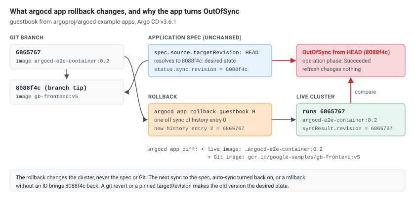
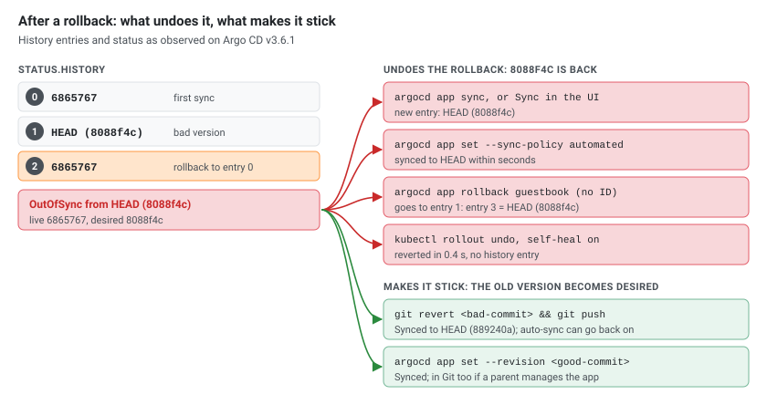

Argo CD can redeploy an earlier version of an application from its deployment history. Right after a successful rollback, the application turns **OutOfSync**, and that is by design. This article shows what a rollback does, why Argo CD reports the drift, what undoes it, how to make it permanent, and the traps around auto-sync, pruning and history.

## Scope

Everything below was run on **Argo CD v3.6.1**, installed from the upstream `install.yaml` on a single-node k3s v1.35 cluster, with the `argocd` CLI run inside the `argocd-server` pod. Three kinds of application were used:

- the `guestbook` directory of `argoproj/argocd-example-apps`, at commit `6865767` (image `argocd-e2e-container:0.2`) and at `HEAD` `8088f4c` (image `gb-frontend:v5`);
- a small repository on a git server inside the cluster, so that commits could be pushed and reverted: version 1 deploys `nginx:1.28-alpine`, version 2 `nginx:1.29-alpine` plus a ConfigMap `web-extra`;
- the `podinfo` Helm chart, versions 6.16.0 and 6.17.0, alone and as a second source of a multi-source application.

For the comparison with other tools, the same cluster ran **Flux v2.10.0** (kustomize-controller v1.10.1, helm-controller v1.7.1) and **Argo Rollouts v1.10.2**, both from their release manifests, plus **Helm 4.3.1** and plain kubectl. Everything was removed afterwards.

## 1. What a Rollback Does

Every sync is recorded in the Application's `status.history`, with an ID, the source (repo, path or chart, revision) and the commit or chart version that was deployed. A rollback takes one history entry and runs a **one-off sync of that entry's source and revision**.

What a rollback does **not** do:

- It doesn't change `spec.source.targetRevision`. The Application still tracks the same branch or tag as before.
- It doesn't touch Git. The bad commit is still on the branch.
- It doesn't delete history: it adds a new entry (with the old revision) at the end.

That is the whole explanation for the OutOfSync status: the cluster now runs an old commit, while the Application's spec still points at the branch, whose newest commit is different.

[](argocd-rollback-outofsync.svg "Open the diagram full size")

## 2. Prerequisites

- **Automated sync must be off.** The API refuses the rollback otherwise:

  ```text
  {"level":"fatal","msg":"rpc error: code = FailedPrecondition desc = rollback cannot be initiated when auto-sync is enabled"}
  ```

  The reason: auto-sync would immediately sync the app back to the branch and undo the rollback.
- The target version must still be in the history. Argo CD keeps 10 entries by default (`spec.revisionHistoryLimit`), see [History Is Limited](#history-is-limited).
- The `argocd` CLI logged in to the server, or the web UI.

## 3. Rolling Back, Step by Step

The `guestbook` application was first synced at the older commit, then moved to `HEAD`, so the history holds two different versions.

### Look at the History

```bash
argocd app history <app>
```

```text
SOURCE  https://github.com/argoproj/argocd-example-apps.git
ID      DATE                           REVISION
0       2026-11-18 12:22:46 +0000 UTC  68657670d9131dc5bc5f538b14c1de3377d74591 (6865767)
1       2026-11-18 12:22:47 +0000 UTC  HEAD (8088f4c)
```

Without the CLI:

```bash
kubectl -n argocd get app <app> -o jsonpath='{range .status.history[*]}{.id}{"\t"}{.revision}{"\t"}{.deployedAt}{"\n"}{end}'
```

```text
0	68657670d9131dc5bc5f538b14c1de3377d74591	2026-11-18T12:22:46Z
1	8088f4c0d970abb09e250248cc97e35623447cb5	2026-11-18T12:22:47Z
```

### Turn Off Auto-Sync and Roll Back

```bash
argocd app set <app> --sync-policy none
argocd app rollback <app> 0          # always give the history ID
```

| Flag | Effect |
|------|--------|
| `--prune` | Also delete resources that exist now but not in the old version. **Irreversible** |
| `--timeout <seconds>` | Stop waiting after this long |
| `-N <namespace>` | Application in another namespace (apps-in-any-namespace) |

A history ID that doesn't exist fails with `application '<app>' does not have deployment id '99' in history`.

### The Result

```text
Sync Status:        OutOfSync from HEAD (8088f4c)
Health Status:      Progressing
Operation:          Sync
Phase:              Succeeded
Message:            successfully synced (all tasks run)
```

The operation **succeeded** and the Deployment runs the old image:

```bash
kubectl -n <namespace> get deploy <deployment> -o jsonpath='{.spec.template.spec.containers[0].image}{"\n"}'
```

```text
quay.io/argoprojlabs/argocd-e2e-container:0.2
```

The history gained a third entry, with the old commit:

```text
ID      DATE                           REVISION
0       2026-11-18 12:22:46 +0000 UTC  68657670d9131dc5bc5f538b14c1de3377d74591 (6865767)
1       2026-11-18 12:22:47 +0000 UTC  HEAD (8088f4c)
2       2026-11-18 12:23:09 +0000 UTC  68657670d9131dc5bc5f538b14c1de3377d74591 (6865767)
```

### Don't Omit the ID

`argocd app rollback <app>` without an ID goes back one entry in the history. Right after a rollback, the entry before the last one is the version you rolled back **from**. With the history above, the rollback without ID did this:

```text
Sync Status:        Synced to HEAD (8088f4c)
Phase:              Succeeded
Message:            successfully synced (all tasks run)
```

```text
3       2026-11-18 12:23:17 +0000 UTC  HEAD (8088f4c)
```

and the Deployment ran `gcr.io/google-samples/gb-frontend:v5` again: the bad version was back. Always look at `argocd app history` and pass the ID you want.

## 4. Why the Status Is OutOfSync

The sync status always compares the cluster with **what the spec asks for**, resolved to a commit at the time of the comparison. The rollback changed the cluster, not the spec. The fields after the rollback:

```bash
kubectl -n argocd get app <app> -o jsonpath='spec.targetRevision={.spec.source.targetRevision}{"\n"}sync.status={.status.sync.status}{"\n"}sync.revision={.status.sync.revision}{"\n"}deployed={.status.operationState.syncResult.revision}{"\n"}'
```

```text
spec.targetRevision=HEAD
sync.status=OutOfSync
sync.revision=8088f4c0d970abb09e250248cc97e35623447cb5
deployed=68657670d9131dc5bc5f538b14c1de3377d74591
```

| Field | Value after the rollback | Meaning |
|-------|--------------------------|---------|
| `spec.source.targetRevision` | `HEAD` | What the app tracks. Unchanged by the rollback |
| `status.sync.revision` | `8088f4c...` | The commit the comparison was made against: the branch tip |
| `status.operationState.syncResult.revision` | `68657670...` | What the last sync (the rollback) actually deployed |
| `status.sync.status` | `OutOfSync` | Live (old commit) differs from desired (branch tip) |

The diff shows exactly the change the rollback undid:

```bash
argocd app diff <app>
```

```text
===== apps/Deployment guestbook-rb/guestbook-ui ======
116c116
<       - image: quay.io/argoprojlabs/argocd-e2e-container:0.2
---
>       - image: gcr.io/google-samples/gb-frontend:v5
```

`<` is the live cluster and `>` is Git; `argocd app diff` exits with code 1 when there is a difference. A refresh or a hard refresh changes nothing (`--hard-refresh` still showed `OutOfSync from HEAD (8088f4c)`): the comparison is correct, and the app stays OutOfSync until either the cluster or the spec changes again.

OutOfSync after a rollback is the warning you want. It reminds everyone that the cluster no longer matches Git, and that the next sync will bring the bad version back.

### Helm Chart Applications

For an application that installs a chart from a Helm repository, the history holds chart versions instead of commits, and a rollback works the same way:

```text
SOURCE  https://stefanprodan.github.io/podinfo
ID      DATE                           REVISION
0       2026-11-18 12:25:53 +0000 UTC  6.16.0
1       2026-11-18 12:25:54 +0000 UTC  6.17.0
```

```text
$ argocd app rollback podinfo 0
Sync Status:        OutOfSync from 6.17.0
Phase:              Succeeded
```

The Deployment ran `ghcr.io/stefanprodan/podinfo:6.16.0`, and `argocd app diff` showed the chart labels changing back (`helm.sh/chart: podinfo-6.16.0` vs `podinfo-6.17.0`).

### Multi-Source Applications

Applications with `spec.sources` can be rolled back too. The history lists every source with its own revisions, and the rollback restores all of them at once:

```text
SOURCE  git://git.gitsrv.svc.cluster.local:9418/demo.git
ID      DATE                           REVISION
0       2026-11-18 12:26:00 +0000 UTC  c56a358759a79f533ed63e62abbe621e09cbbf60 (c56a358)
1       2026-11-18 12:26:01 +0000 UTC  c56a358759a79f533ed63e62abbe621e09cbbf60 (c56a358)

SOURCE  https://stefanprodan.github.io/podinfo
ID      DATE                           REVISION
0       2026-11-18 12:26:00 +0000 UTC  6.16.0
1       2026-11-18 12:26:01 +0000 UTC  6.17.0
```

```text
$ argocd app rollback multi 0
Sync Status:        OutOfSync from c56a358759a79f533ed63e62abbe621e09cbbf60
Phase:              Succeeded
```

The status fields are lists here, one entry per source, so the jsonpath above needs the plural names:

```bash
kubectl -n argocd get app multi -o jsonpath='sync.revisions={.status.sync.revisions} deployed={.status.operationState.syncResult.revisions}{"\n"}'
```

```text
sync.revisions=["c56a358759a79f533ed63e62abbe621e09cbbf60","6.17.0"] deployed=["c56a358759a79f533ed63e62abbe621e09cbbf60","6.16.0"]
```

## 5. What Undoes a Rollback

Anything that syncs the app to its spec rolls it forward again to the branch tip, including the version you rolled back from:

[](argocd-rollback-after.svg "Open the diagram full size")

- **Turning auto-sync back on.** Re-enabling auto-sync synced to `HEAD` within seconds, and the Deployment ran the new image again.
- **A manual `argocd app sync`**, or the Sync button in the UI.
- **`argocd app rollback <app>` without an ID**, see [Don't Omit the ID](#dont-omit-the-id).
- **A sync triggered by anything else**: a CI pipeline calling `argocd app sync`, an ApplicationSet that regenerates the Application with auto-sync on, a parent "app of apps" with self-heal that resets the child's spec.

The rollback is a temporary emergency measure. It buys time to fix Git.

## 6. Making the Rollback Stick

| Method | How | When |
|--------|-----|------|
| **Revert in Git** (recommended) | `git revert <bad-commit>` and push. The branch tip now has the old content, so the app becomes Synced and auto-sync can go back on | Almost always. Git stays the source of truth and the history explains what happened |
| **Pin the target revision** | `argocd app set <app> --revision <good-commit-or-tag>` | When Git can't be changed quickly, or for an app that is meant to follow tags |
| **Lower the version in Git** | Set the Helm chart version or image tag back to the good value in the values file or kustomization | Apps whose version lives in a values file or kustomization |

The revert, step by step:

```bash
git revert <bad-commit>            # creates a new commit undoing the change
git push origin <branch>
argocd app get <app> --refresh     # should now show Synced
argocd app set <app> --sync-policy automated --self-heal   # turn auto-sync back on
```

On the test repository, after a rollback to version 1 and a revert of the version 2 commit:

```text
$ git log --oneline
889240a Revert "web: nginx 1.29 and web-extra config"
78b90e4 web: nginx 1.29 and web-extra config
c56a358 web: nginx 1.28

$ argocd app get web --refresh
Sync Status:        Synced to HEAD (889240a)
```

With auto-sync back on the app stayed `Synced` and `Healthy` on `nginx:1.28-alpine`: the branch tip now holds the good content, so nothing pulls the bad version back.

Pinning, as tested:

```bash
argocd app set <app> --revision 68657670d9131dc5bc5f538b14c1de3377d74591
kubectl -n argocd get app <app>
```

```text
NAME        SYNC STATUS   HEALTH STATUS
guestbook   Synced        Healthy
```

Pinning is a spec change too. If the Application itself is managed from Git (app of apps, ApplicationSet), make the pin there, or the parent resets it.

## 7. Rolling Back With kubectl Only

The CLI's rollback is a sync operation with the old source and revision. The same operation can be written into the Application with kubectl. Copy the source from the history entry:

```bash
kubectl -n argocd get app <app> -o jsonpath='{.status.history[?(@.id==0)].source}{"\n"}'
```

Then, with auto-sync off:

```bash
kubectl -n argocd patch app <app> --type merge -p '{
  "operation": {
    "initiatedBy": {"username": "<your-name>"},
    "sync": {
      "revision": "<old-commit>",
      "source": {"repoURL": "<repo-url>", "path": "<path>", "targetRevision": "<old-commit>"},
      "syncOptions": ["CreateNamespace=true"]
    }
  }
}'
```

This deployed the old version (`nginx:1.29-alpine` and the `web-extra` ConfigMap) and left the app `OutOfSync` with `phase=Succeeded`, exactly like `argocd app rollback`. Two differences from the CLI:

- **kubectl doesn't check whether auto-sync is on.** With auto-sync on, the patch ran, and the controller synced back to the branch in the same second. The history shows both syncs with the same timestamp:

  ```text
  10      2026-11-18 12:26:56 +0000 UTC  78b90e47e22cda8a2d8e875dc7465459e73fbc6e (78b90e4)
  11      2026-11-18 12:26:56 +0000 UTC  HEAD (889240a)
  ```

- **Sync options in the spec are not applied** to an operation written this way, so copy the ones you need into the patch. The CLI's rollback copies them (`CreateNamespace=true` appears in `.status.operationState.operation`).

## 8. Rollback Compared With Other Ways Back

Within Argo CD:

| Method | Changes Git | Argo CD status afterwards | Survives the next sync |
|--------|-------------|---------------------------|------------------------|
| `argocd app rollback <app> <id>` | No | OutOfSync | No |
| `git revert` and sync | Yes | Synced | Yes |
| Pin `targetRevision` | No (spec only) | Synced | Yes, until someone unpins it |
| `kubectl rollout undo deployment/<name>` | No | Reverted by self-heal in under a second | No |
| Argo Rollouts abort | No | Synced, health Degraded | Yes, the Rollout stays aborted; Git still holds the new version |

### Compared With Other Tools

The same "go back to the previous version" with the other tools on the cluster:

| | Argo CD | Flux | Helm (no GitOps) | `kubectl rollout undo` (no GitOps) | Argo Rollouts |
|---|---|---|---|---|---|
| Rollback command | `argocd app rollback <app> <id>` | none; `git revert`, or suspend and change by hand | `helm rollback <release> <rev>` | `kubectl rollout undo deploy/<name>` | abort during a canary |
| Where the history lives | `status.history` of the Application | Git; HelmRelease: Helm's release history | Release Secrets (`sh.helm.release.v1.<name>.v<rev>`) | Old ReplicaSets | Old ReplicaSets |
| Status right after | OutOfSync, operation Succeeded | Kustomization stays `Ready=True` | New revision `deployed`, "Rollback to 1" | New revision number | Rollout `Degraded`, "RolloutAborted" |
| Undone by | The next sync, auto-sync, rollback without ID | The next reconcile (44 s in the test, interval 1m) | A rollback without a revision ("Rollback to 2") | A second `undo` | Nothing by itself: the Rollout stays aborted |
| Automatic rollback on failure | No | HelmRelease `upgrade.remediation` | `--rollback-on-failure` flag of `helm upgrade` | No | Abort returns all pods to the stable version |
| Survives the next sync or reconcile | No | Only a revert in Git does | Yes, nothing reconciles | Yes, nothing reconciles | Yes, but Git still holds the new version |

Two patterns stand out. With GitOps (Argo CD, Flux), anything that doesn't change Git is temporary; the tools only differ in how fast they take it back and whether they warn you (Argo CD shows OutOfSync, Flux shows nothing). Without GitOps (Helm, kubectl), the rollback stays, and the trap is the opposite one: a rollback without a revision toggles back to the version you just left.

### Helm

```text
$ helm history demo -n helm-demo
REVISION  STATUS      CHART        DESCRIPTION
1         superseded  chart-0.1.0  Install complete
2         superseded  chart-0.1.0  Upgrade complete
3         deployed    chart-0.1.0  Rollback to 1
```

`helm rollback demo 1` created revision 3 with the contents of revision 1 (the Deployment ran `nginx:1.28-alpine` again), like an Argo CD rollback adds a history entry. Each revision is a Secret in the release's namespace. `helm rollback demo` without a revision went to the previous one, which after a rollback is the bad one:

```text
4         deployed    chart-0.1.0  Rollback to 2
```

and the image was `nginx:1.29-alpine` again, the same trap as [an Argo CD rollback without an ID](#dont-omit-the-id).

### kubectl rollout undo Without GitOps

```text
$ kubectl rollout undo deploy/web
deployment.apps/web rolled back
$ kubectl rollout history deploy/web
REVISION  CHANGE-CAUSE
2         <none>
3         <none>
```

Revision 1 became revision 3: undo moves the old ReplicaSet to a new revision number. A second `kubectl rollout undo` went back to `nginx:1.29-alpine`, toggling between the last two versions.

### Flux

Flux has no rollback command and no deployment history of its own: what's in Git is what runs. A change made by hand stays until the next reconcile. With `interval: 1m`, `kubectl set image` on a Deployment managed by a Kustomization lasted 44 seconds:

```text
0s nginx:1.29-alpine | True main@sha1:20baa1ad287d75647a4b651a8
44s nginx:1.28-alpine | True main@sha1:20baa1ad287d75647a4b651a8
```

The Kustomization stayed `Ready=True` on the same revision the whole time; there is no OutOfSync state to warn anyone. The ways back are:

- **Revert in Git.** After `git revert` and a reconcile the Kustomization showed `Applied revision: main@sha1:20baa1a...` and the old image.
- **Suspend, then change by hand.** With `spec.suspend: true` on the Kustomization (the field `flux suspend kustomization web` sets), a manual change survived reconcile requests; on resume Flux applied Git again and the change was gone.

A `HelmRelease` can roll back on its own when an upgrade fails. With `upgrade.remediation.retries: 1` and an upgrade to podinfo 6.17.0 whose image tag doesn't exist (`timeout: 90s`), helm-controller tried twice and rolled back each time:

```text
REVISION  STATUS      CHART           DESCRIPTION
1         superseded  podinfo-6.16.0  Install complete
2         failed      podinfo-6.17.0  Upgrade "flux-helm-podinfo" failed: timeout waiting for: [Deployment/flux-helm/flux-helm-podinfo status: 'InProgress']
3         superseded  podinfo-6.16.0  Rollback to 1
4         failed      podinfo-6.17.0  Upgrade "flux-helm-podinfo" failed: timeout waiting for: [Deployment/flux-helm/flux-helm-podinfo status: 'InProgress']
5         deployed    podinfo-6.16.0  Rollback to 3
```

The HelmRelease ended `Ready=False` with `Helm rollback to previous release flux-helm/flux-helm-podinfo.v3 with chart podinfo@6.16.0 succeeded`, and the cluster ran 6.16.0. The release history is stored in the HelmRelease's own namespace (`flux-system` here), not the target namespace: `helm history -n flux-helm` answered `release: not found`.

### Argo Rollouts Under Argo CD

A `Rollout` with a canary (`setWeight: 50`, then `pause: {}`), managed by an Argo CD app with auto-sync. After a new image in Git, the canary stopped at the pause with two pods on each version, and Argo CD showed health `Suspended`. An abort (`kubectl argo rollouts abort shop`, which sets `status.abort` on the Rollout) sent all four pods back to the stable ReplicaSet:

```text
phase=Degraded step=0 abort=true msg=RolloutAborted: Rollout aborted update to revision 2
shop-5d8cdc4cff   nginx:1.28-alpine   4
shop-9cddc54fd    nginx:1.29-alpine   <none>
Sync Status:        Synced to  (80f4305)
Health Status:      Degraded
```

The app stays `Synced`: the Rollout's spec still matches Git, only its status changed. An `argocd app rollback` to the entry before the change then made the Rollout `Healthy` on 1.28 and the app `OutOfSync`, like any other rollback. The permanent fix is the same as everywhere else: revert the image in Git.

### kubectl rollout undo Under Argo CD

`kubectl rollout undo` under Argo CD with self-heal doesn't even last long enough to see. Sampling the Deployment every 0.3 seconds:

```text
deployment.apps/guestbook-ui rolled back
0.1s quay.io/argoprojlabs/argocd-e2e-container:0.2 gen=7
0.4s gcr.io/google-samples/gb-frontend:v5 gen=8
```

The controller logged it as `Partial sync operation to 8088f4c0d970abb09e250248cc97e35623447cb5 succeeded`, and **self-heal syncs don't add history entries**: the history still ended with the previous entry. A revert like this is only visible in the Argo CD events and the Deployment's generation, not in `argocd app history`.

## 9. Gotchas

### Rollback Is Refused With Auto-Sync On

`rollback cannot be initiated when auto-sync is enabled`. Turn auto-sync off first with `argocd app set <app> --sync-policy none`, and turn it back on after fixing Git.

### OutOfSync After a Rollback Is Correct

Don't "fix" it by clicking Sync: that redeploys the version you just rolled back from. The same goes for `argocd app rollback <app>` without an ID.

### --prune Deletes What the Old Version Doesn't Have

Version 2 of the test app added a ConfigMap. A rollback to version 1 without `--prune` keeps it, and the app view says so:

```text
GROUP  KIND        NAMESPACE  NAME       STATUS     HEALTH       HOOK  MESSAGE
       ConfigMap   web        web-extra  Synced                        ignored (requires pruning)
apps   Deployment  web        web        OutOfSync  Progressing        deployment.apps/web configured
```

With `--prune` it's deleted:

```text
       ConfigMap   web        web-extra  OutOfSync  Missing            pruned
```

A pruned PersistentVolumeClaim takes its data with it under a `Delete` reclaim policy. Pruning can't be undone.

### History Is Limited

`spec.revisionHistoryLimit` (10 by default) caps the entries, and the IDs keep counting. With the limit set to 2 and two more syncs, only IDs 4 and 5 were left:

```text
ID      DATE                           REVISION
4       2026-11-18 12:25:46 +0000 UTC  HEAD (889240a)
5       2026-11-18 12:25:46 +0000 UTC  HEAD (889240a)
```

and the old version was gone: `application 'web' does not have deployment id '0' in history`. With frequent deploys, a version from two weeks ago may not be in the history any more; the rollback then has to go through Git.

### Applications Generated by an ApplicationSet

An ApplicationSet whose template has auto-sync puts it back on the Application as soon as you turn it off. `argocd app set shop-eu --sync-policy none` and a `kubectl patch` of `spec.syncPolicy.automated` to `null` were both undone before the first check 0.3 seconds later, so the rollback stayed impossible:

```text
$ argocd app set shop-eu --sync-policy none
automated={"selfHeal":true}
$ argocd app rollback shop-eu 0
{"level":"fatal","msg":"rpc error: code = FailedPrecondition desc = rollback cannot be initiated when auto-sync is enabled"}
```

Tell the ApplicationSet to leave the sync policy alone, and the change sticks:

```yaml
apiVersion: argoproj.io/v1alpha1
kind: ApplicationSet
metadata:
  name: shops
spec:
  ignoreApplicationDifferences:
  - jsonPointers:
    - /spec/syncPolicy
  # generators, template ...
```

With that, `--sync-policy none` stayed in place and the rollback succeeded. Remember the side effect: from then on, changing the sync policy in the ApplicationSet template no longer reaches existing Applications either.

### Apps Managed by a Parent (App of Apps)

A child Application defined in Git and synced by a parent with self-heal behaves the same way. After `argocd app set child --sync-policy none`, the parent restored auto-sync within 2 seconds, and the rollback was refused with the same `FailedPrecondition`. The fix is a change in Git: removing `automated` from the child's manifest (`apps/child.yaml`) and pushing let the parent apply it, and `argocd app rollback child 0` then ran (`Phase: Succeeded`).

### Permissions

With RBAC, a rollback needs the `sync` action on the application. Changing the sync policy is a change to the Application itself, which `sync` doesn't cover:

| Policy for the user | `argocd app history` | `argocd app rollback` | `argocd app set --sync-policy ...` |
|---|---|---|---|
| `role:readonly` | allowed | `PermissionDenied desc = permission denied` | `PermissionDenied` |
| `role:readonly` + `p, dev, applications, sync, default/*, allow` | allowed | `Phase: Succeeded` | `PermissionDenied` |

So an on-call user with only `sync` can roll back an app whose auto-sync is already off, but can't turn auto-sync off on an app that has it. Changing the Application is the `update` action, or have the sync policy changed in Git.

### Other Things a Rollback Doesn't Undo

- **Database migrations and other one-way changes.** A rollback redeploys manifests. It doesn't undo schema changes, data written by the new version, or deleted cloud resources.
- **The commit must still exist.** If the old commit was removed from the repository (force push, deleted branch), the rollback can't fetch it.
- **Notifications and dashboards** that alert on OutOfSync will fire during a rollback. Expect it, or silence that alert for the app while the fix goes through Git.

## See Also

- [Argo CD docs: argocd app rollback](https://argo-cd.readthedocs.io/en/stable/user-guide/commands/argocd_app_rollback/)
- [Argo CD docs: Automated sync policy](https://argo-cd.readthedocs.io/en/stable/user-guide/auto_sync/)
- [Argo CD docs: Multiple sources for an application](https://argo-cd.readthedocs.io/en/stable/user-guide/multiple_sources/)
- [Argo CD docs: ApplicationSet ignoreApplicationDifferences](https://argo-cd.readthedocs.io/en/stable/operator-manual/applicationset/Controlling-Resource-Modification/)
- [Flux docs: HelmRelease upgrade remediation](https://fluxcd.io/flux/components/helm/helmreleases/)
- [Kustomize vs Helm](/posts/kustomize-vs-helm/)
