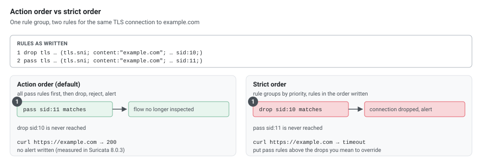

AWS Network Firewall is a managed firewall and intrusion prevention service for your VPC. Security groups and network ACLs filter by address and port; Network Firewall adds **stateful inspection**, **domain-name filtering** and **Suricata-compatible rules**, so you can say "only allow HTTPS to `*.amazonaws.com`" or "drop traffic that matches this signature". This article covers how it works, how rules are evaluated, how to route traffic through it, how to log it, what it costs, and the mistakes that bite people.

The stateful engine of Network Firewall is Suricata, and the AWS documentation refers to **Suricata 8.0.3**. Every stateful rule and domain list below was run in Suricata 8.0.3 in inline (IPS) mode, routing a client in `10.0.2.0/24` to the internet, with `curl` 8.14.1 as the client; the outputs are from those runs. Routing, default actions, quotas and prices are from the AWS documentation in November 2026.

## 1. What It Is

Network Firewall protects the **perimeter of a VPC**: traffic to and from an internet gateway, a NAT gateway, a VPN or Direct Connect, and traffic between VPCs through a transit gateway. It runs as **firewall endpoints** in dedicated subnets, and you change VPC route tables so that the traffic you want inspected passes through those endpoints.

Typical uses:

- Allow traffic only to approved domains (for example AWS service endpoints), and block known-bad domains.
- Deep packet inspection and signature matching on traffic entering or leaving the VPC.
- Detect protocols such as TLS or SSH regardless of the port.
- Central inspection of many VPCs, with a shared inspection VPC and AWS Firewall Manager.

By default it keeps the original source and destination addresses of the traffic it inspects.

### How It Compares to the Other Filters

| | Security group | Network ACL | Network Firewall | AWS WAF |
|---|----------------|-------------|------------------|---------|
| Level | Network interface | Subnet | VPC perimeter, between subnets or VPCs | HTTP requests on CloudFront, ALB, API Gateway |
| Stateful | Yes | No | Yes (plus a stateless engine) | n/a |
| Rules by domain name | No | No | Yes (TLS SNI, HTTP Host, resolved domain) | Yes (HTTP) |
| Signatures and deep inspection | No | No | Yes (Suricata) | Web rules only |
| Default | Deny inbound | Allow | Depends on the policy | Depends on the web ACL |

They work together: keep security groups as the tight, per-workload rule set, and use Network Firewall for what they can't express.

## 2. The Building Blocks

| Resource | What it is |
|----------|-----------|
| **Firewall** | The VPC it protects and one **firewall subnet** per Availability Zone (one endpoint each). Uses exactly one firewall policy |
| **Firewall policy** | The rule groups the firewall uses, the rule order and the default actions |
| **Rule group** | A set of rules, **stateless** or **stateful**, with a fixed **capacity** |
| **Firewall endpoint** | The VPC endpoint (`vpce-...`) in the firewall subnet that routes point to |
| **VPC endpoint association** | Extra endpoints of the same firewall in the same or other VPCs |
| **Firewall subnet** | A subnet used only by the endpoint. An endpoint can't filter traffic from or to its own subnet, so put nothing else there |

One policy can be used by up to 1,000 firewalls and one rule group by up to 1,000 policies, so a rule set is built once and reused.

## 3. How Rules Are Evaluated

A packet goes through two engines:

[](nfw-engines.svg "Open the diagram full size")

**Stateless engine.** Looks at each packet on its own, like a network ACL. Rules run in the **priority order** you give, and the first match wins: pass, drop, or **forward to the stateful engine** (`aws:forward_to_sfe`). The policy also has **default actions** for packets that match no stateless rule and for fragments; the usual choice is to forward everything.

**Stateful engine.** Tracks connections, knows which side is client and server, parses protocols (TLS, HTTP, DNS, SSH and more) and takes Suricata-compatible rules, domain lists and 5-tuple rules. It is the only engine that **logs**.

### Action Order and Strict Order

The stateful rule order is chosen **per policy**, and every stateful rule group in the policy must use the same one.

| | Action order (default) | Strict order (recommended by AWS) |
|---|------------------------|-----------------------------------|
| Evaluation | By action: `pass`, then `drop`, then `reject`, then `alert`; within an action by the `priority` keyword (1 to 65535) | Rule groups by priority (lowest first), rules in the order they are written |
| `priority` keyword | Used | Not supported |
| A `pass` match | Suricata stops inspecting the rest of the flow | Stops at the first matching rule |
| Default actions | None | You choose them (below) |

[](nfw-order.svg "Open the diagram full size")

Action order in practice. The rule file had the `drop` first and the `pass` second:

```text
drop tls $HOME_NET any -> $EXTERNAL_NET any (tls.sni; content:"example.com"; nocase; endswith; msg:"drop example.com"; flow:to_server, established; sid:10; rev:1;)
pass tls $HOME_NET any -> $EXTERNAL_NET any (tls.sni; content:"example.com"; nocase; endswith; msg:"pass example.com"; flow:to_server, established; sid:11; rev:1;)
```

```bash
curl -sS -o /dev/null -m 6 -w '%{http_code}\n' https://example.com
# 200
```

The connection worked and no alert was written: the `pass` ran first and Suricata stopped inspecting the flow. Under strict order the same two rules would drop it.

### Strict-Order Default Actions

These apply to traffic that matched no rule. You pick none or one drop action, and any alert actions:

- **Drop all**: drops every unmatched packet.
- **Drop established**: drops unmatched packets in **established** client-to-server connections; the handshake packets pass, so application-layer `pass` rules work without extra rules for TCP. Return traffic from the server passes. For UDP and ICMP, a connection counts as established only after traffic in both directions, and AWS notes that for these connectionless protocols *drop established* drops all packets, so write rules to allow them. AWS recommends this action with your own domain lists in strict order.
- **Application drop established** (bidirectional, or server-directed only): the same idea with better handling of a TLS client hello or HTTP request split over several packets. The bidirectional kind can drop TCP window updates, keep-alives and resets seen right after the handshake, and AWS lists pass rules for those; the server-directed kind lets server-to-client packets through.
- **Alert all**, **Alert established** and their application variants: log what the matching drop action *would* drop, without dropping.

The effect of *drop established* with a domain pass rule, built in Suricata as a `pass` for the allowed SNI and a `drop` for established client-to-server TCP:

```text
pass tls $HOME_NET any -> $EXTERNAL_NET any (ssl_state:client_hello; tls.sni; content:"example.com"; startswith; nocase; endswith; msg:"matching TLS allowlisted FQDNs"; flow:to_server, established; sid:1; rev:1;)
drop tcp $HOME_NET any -> $EXTERNAL_NET any (msg:"drop established"; flow:to_server, established; sid:100; rev:1;)
```

| Request | Result |
|---------|--------|
| `https://example.com` | `200` |
| `https://www.wikipedia.org` | Timed out after the TLS client hello |
| `http://neverssl.com` | `* Connected to neverssl.com (34.223.124.45) port 80`, then `Operation timed out` after `GET /` |

The handshake completes and the first data packet is dropped, which is why the default needs no handshake rules and why plain HTTP is blocked too: it matched no `pass` rule.

A safe rollout: start with **alert** default actions, read the alert log, add the `pass` rules you need, then switch to **drop established**.

## 4. Domain Lists

A domain list is the simplest way to filter by name:

```json
{
  "RulesSource": {
    "RulesSourceList": {
      "Targets": ["example.com"],
      "TargetTypes": ["TLS_SNI", "HTTP_HOST"],
      "GeneratedRulesType": "DENYLIST"
    }
  }
}
```

`GeneratedRulesType` is `ALLOWLIST` or `DENYLIST`; the console also offers Reject and Alert as domain list actions. Network Firewall turns the list into Suricata rules. For this deny list the AWS documentation lists:

```text
drop tls $HOME_NET any -> $EXTERNAL_NET any (ssl_state:client_hello; tls.sni; content:"example.com"; startswith; nocase; endswith; msg:"matching TLS denylisted FQDNs"; priority:1; flow:to_server, established; sid:1; rev:1;)
drop http $HOME_NET any -> $EXTERNAL_NET any (http.host; content:"example.com"; startswith; endswith; msg:"matching HTTP denylisted FQDNs"; priority:1; flow:to_server, established; sid:2; rev:1;)
```

Run inline:

| Request | Result |
|---------|--------|
| `https://example.com` | Timed out after 6 s (`curl: (28)`) |
| `http://example.com` | Timed out after 6 s |
| `https://www.example.com` | `200`: not on the list |
| `https://aws.amazon.com` | `200` |

`startswith` plus `endswith` makes `example.com` an **exact** name. A leading dot makes it a wildcard: `.example.com` generates `dotprefix; content:".example.com"; endswith` and matches `example.com` and every subdomain.

For a TLS allow list of `.amazon.com` and `example.com`, the documented rules end with a catch-all drop:

```text
pass tls $HOME_NET any -> $EXTERNAL_NET any (ssl_state:client_hello; tls.sni; dotprefix; content:".amazon.com"; nocase; endswith; msg:"matching TLS allowlisted FQDNs"; priority:1; flow:to_server, established; sid:1; rev:1;)
pass tls $HOME_NET any -> $EXTERNAL_NET any (ssl_state:client_hello; tls.sni; content:"example.com"; startswith; nocase; endswith; msg:"matching TLS allowlisted FQDNs"; priority:1; flow:to_server, established; sid:2; rev:1;)
drop tls $HOME_NET any -> $EXTERNAL_NET any (msg:"not matching any TLS allowlisted FQDNs"; priority:1; ssl_state:client_hello; flow:to_server, established; sid:3; rev:1;)
```

| Request | Result |
|---------|--------|
| `https://aws.amazon.com`, `https://www.amazon.com` | Passed (`200`, and a `503` from Amazon itself) |
| `https://example.com` | `200` |
| `https://www.example.com`, `https://www.wikipedia.org` | Timed out; alert `not matching any TLS allowlisted FQDNs` |
| `http://neverssl.com` | `200`: a `TLS_SNI` list doesn't touch HTTP |

Points that follow from these rules:

- **Target types decide the protocol.** `TLS_SNI` rules match only TLS and `HTTP_HOST` rules only HTTP. An allow list with only `TLS_SNI` leaves plain HTTP open, as the last row shows. The newer `AWS_ROUTE_53_RESOLVED_DOMAIN` target matches on the domain the destination IP address was resolved for by the VPC's Route 53 Resolver, across all protocols.
- **The catch-all drop exists only in action order.** With strict order Network Firewall doesn't generate `sid:3`; your default action (normally *drop established*) does that job.
- **In action order, avoid mixing allow lists with reject or alert lists**: the allow list's drop rule runs before them.
- **The firewall trusts the SNI and Host header.** It doesn't do its own DNS lookup. Connecting to Wikipedia's address with an allowed SNI got through the allow list:

  ```bash
  curl -sS -o /dev/null -k -w '%{http_code} %{remote_ip}\n' \
      --connect-to aws.amazon.com:443:www.wikipedia.org:443 https://aws.amazon.com
  # 400 185.15.59.224
  ```

  The `400` is Wikipedia's answer to an unknown host name: the connection itself passed. Add IP rules or the resolved-domain target where that matters.
- **`HOME_NET` limits what is filtered.** By default it is the CIDR of the firewall's VPC. With `HOME_NET` set to `10.1.0.0/16`, a range that doesn't contain the client, the same allow list let `https://www.wikipedia.org` and `https://www.example.com` through with no alert. For a central inspection VPC, set `HOME_NET` on the rule group to the spoke VPCs' ranges plus the inspection VPC's.

## 5. Drop, Reject and Alert

| Action | What the client saw | Alert log `action` |
|--------|---------------------|--------------------|
| `drop` | `curl: (28) Connection timed out after 6002 milliseconds` | `blocked` |
| `reject` | `curl: (35) Recv failure: Connection reset by peer` after 0.02 s (HTTP: `curl: (56)`) | `blocked` |
| `alert` | `200`, the traffic passed | `allowed` |

`reject` sends a TCP reset, so clients fail at once instead of waiting for a timeout; it applies only to TCP. Use it for outbound egress rules where a fast failure helps, and `drop` where you don't want to tell the other side anything.

## 6. Hardening Rules

Three rules from the AWS examples that close gaps a domain list leaves open, each run inline.

### Connections Straight to an IP Address

A client that connects to an address instead of a name skips DNS, and often skips your domain rules too. The AWS examples reject an IP address in the HTTP `Host` header or in the TLS SNI:

```text
reject http $HOME_NET any -> $EXTERNAL_NET any (http.host; content:"."; pcre:"/^(?:[0-9]{1,3}\.){3}[0-9]{1,3}$/"; msg:"IP in HTTP HOST Header (direct to IP, likely no DNS resolution first)"; flow:to_server; sid:1239847;)
reject tls $HOME_NET any -> $EXTERNAL_NET any (ssl_state:client_hello; tls.sni; content:"."; pcre:"/^(?:[0-9]{1,3}\.){3}[0-9]{1,3}$/"; msg:"IP in TLS SNI (direct to IP, likely no DNS resolution first)"; flow:to_server; sid:1239848;)
```

| Request | Result |
|---------|--------|
| `curl http://1.1.1.1` | `curl: (56) Recv failure: Connection reset by peer`, alert `IP in HTTP HOST Header` |
| `openssl s_client -connect 1.1.1.1:443 -servername 1.1.1.1` | Reset (`write:errno=104`), alert `IP in TLS SNI` |
| `curl -k https://1.1.1.1` | **`301`, passed**: the TLS log shows `"sni":null` |
| `curl https://one.one.one.one` | `200` |

curl sends **no SNI** when the URL holds an IP address (the SNI standard, RFC 6066, doesn't allow IP addresses there), so the SNI rule never sees one. What stops it is the catch-all drop of an allow list: with the TLS allow list from section 4, `curl -k https://1.1.1.1` timed out with alert `not matching any TLS allowlisted FQDNs` and `"sni":null`. A deny list alone doesn't stop direct-IP TLS.

### Outdated TLS Versions

```text
reject tls any any -> any any (msg:"TLS 1.0 or 1.1"; ssl_version:tls1.0,tls1.1; sid:2023070518;)
```

`example.com` still accepted TLS 1.1: without the rule, `curl --tlsv1.0 --tls-max 1.1 --ciphers 'DEFAULT@SECLEVEL=0' https://example.com` returned `200`. With it, the same command got `curl: (35) Recv failure: Connection reset by peer` (alert with `"version":"TLS 1.1"`), and a normal TLS 1.3 request still returned `200`. The rule protects clients that would downgrade, whatever the servers allow.

### Pin the Client by Its TLS Fingerprint

Every TLS client sends a recognisable client hello. Suricata hashes it as **JA3** (and **JA4** in Suricata 8), so a rule can allow one client build and nothing else. The fingerprints Suricata logged for two clients to the same site:

| Client | JA3 | JA4 |
|--------|-----|-----|
| `curl` 8.14.1 | `0149f47eabf9a20d0893e2a44e5a6323` | `t13d3112h2_e8f1e7e78f70_6bebaf5329ac` |
| `openssl s_client` (OpenSSL 3.3.7) | `a3afc2c46ba4a7d7fbe1cfb7a3031c2f` | `t13d311000_e8f1e7e78f70_518fb456ca59` |

With a `pass` for the curl hash and a `drop` for every other client hello:

```text
pass tls $HOME_NET any -> $EXTERNAL_NET any (msg:"Only allow this curl build"; ja3.hash; content:"0149f47eabf9a20d0893e2a44e5a6323"; flow:to_server, established; sid:12820009;)
drop tls $HOME_NET any -> $EXTERNAL_NET any (msg:"Other TLS clients"; ssl_state:client_hello; flow:to_server, established; sid:12820010;)
```

curl got `200`, openssl was dropped (alert `Other TLS clients`), and `curl --http1.1` also passed: JA3 ignores the ALPN list, while the JA4 strings above differ exactly there (`h2` vs `00`). A fingerprint changes with every TLS library or client upgrade, so use this for tightly controlled clients, not as a general allow list. AWS documents `ja3.hash` in its examples.

## 7. Create the Rule Groups, Policy and Firewall

The order is rule groups, then the policy that uses them, then the firewall that uses the policy.

A stateful **domain deny list** in strict order:

```bash
aws network-firewall create-rule-group --rule-group-name block-bad-domains --type STATEFUL --capacity 100 \
  --rule-group '{"RulesSource":{"RulesSourceList":{"Targets":[".badsite.example","malware.example.org"],"TargetTypes":["HTTP_HOST","TLS_SNI"],"GeneratedRulesType":"DENYLIST"}},"StatefulRuleOptions":{"RuleOrder":"STRICT_ORDER"}}'
```

A domain **allow list** whose `HOME_NET` also covers other VPCs:

```bash
aws network-firewall create-rule-group --rule-group-name allow-domains --type STATEFUL --capacity 100 \
  --rule-group '{"RuleVariables":{"IPSets":{"HOME_NET":{"Definition":["10.0.0.0/16","10.1.0.0/16"]}}},"RulesSource":{"RulesSourceList":{"Targets":[".amazonaws.com",".example.com"],"TargetTypes":["TLS_SNI","HTTP_HOST"],"GeneratedRulesType":"ALLOWLIST"}},"StatefulRuleOptions":{"RuleOrder":"STRICT_ORDER"}}'
```

**Suricata-compatible rules** (one string, rules separated by `\n`):

```bash
aws network-firewall create-rule-group --rule-group-name suricata-rules --type STATEFUL --capacity 50 \
  --rule-group '{"RulesSource":{"RulesString":"pass tls $HOME_NET any -> $EXTERNAL_NET any (ssl_state:client_hello; tls.sni; content:\"example.com\"; startswith; nocase; endswith; flow:to_server, established; sid:1000001; rev:1;)\nreject tls $HOME_NET any -> $EXTERNAL_NET any (msg:\"TLS 1.0 or 1.1\"; ssl_version:tls1.0,tls1.1; sid:1000002; rev:1;)"},"StatefulRuleOptions":{"RuleOrder":"STRICT_ORDER"}}'
```

A **5-tuple** rule (protocol, source, source port, direction, destination, destination port):

```bash
aws network-firewall create-rule-group --rule-group-name five-tuple --type STATEFUL --capacity 10 \
  --rule-group '{"RulesSource":{"StatefulRules":[{"Action":"DROP","Header":{"Protocol":"TCP","Source":"ANY","SourcePort":"ANY","Direction":"ANY","Destination":"10.0.5.0/24","DestinationPort":"3389"},"RuleOptions":[{"Keyword":"sid","Settings":["1"]}]}]},"StatefulRuleOptions":{"RuleOrder":"STRICT_ORDER"}}'
```

`Direction` `ANY` becomes `<>` in the generated Suricata rule, so both directions match. The same form with `1.1.1.1 443` (`drop tcp any any <> 1.1.1.1 443`) made `https://1.1.1.1` time out while `https://1.0.0.1` still answered, and Suricata loaded the one rule as two IP-only signatures (`2 signatures processed. 2 are IP-only rules`), one per direction: a 5-tuple rule is decided on addresses and ports, before any protocol parsing.

A **stateless** rule group that forwards everything to the stateful engine:

```bash
aws network-firewall create-rule-group --rule-group-name stateless-fwd --type STATELESS --capacity 10 \
  --rule-group '{"RulesSource":{"StatelessRulesAndCustomActions":{"StatelessRules":[{"RuleDefinition":{"MatchAttributes":{"Sources":[{"AddressDefinition":"0.0.0.0/0"}],"Destinations":[{"AddressDefinition":"0.0.0.0/0"}]},"Actions":["aws:forward_to_sfe"]},"Priority":1}]}}}'
```

**Capacity** is chosen at creation and reserved for the group's rules; it counts against the policy's limits and can't be changed later, so leave room to grow. To change the rules, call `update-rule-group` with the `UpdateToken` from `describe-rule-group`.

The **firewall policy**, in strict order with alert defaults for a first rollout:

```bash
aws network-firewall create-firewall-policy --firewall-policy-name lab-policy --firewall-policy '{
  "StatelessDefaultActions": ["aws:forward_to_sfe"],
  "StatelessFragmentDefaultActions": ["aws:forward_to_sfe"],
  "StatefulRuleGroupReferences": [
    { "ResourceArn": "<block-bad-domains-arn>", "Priority": 1 },
    { "ResourceArn": "<allow-domains-arn>", "Priority": 2 }
  ],
  "StatefulDefaultActions": ["aws:alert_established"],
  "StatefulEngineOptions": { "RuleOrder": "STRICT_ORDER" }
}'
```

Change `StatefulDefaultActions` to `["aws:drop_established", "aws:alert_established"]` to enforce. Add `StatelessRuleGroupReferences` for stateless groups.

The **firewall**:

```bash
aws network-firewall create-firewall --firewall-name lab-fw \
  --firewall-policy-arn <policy-arn> --vpc-id <vpc-id> \
  --subnet-mappings SubnetId=<firewall-subnet-az-a> SubnetId=<firewall-subnet-az-b> \
  --delete-protection --subnet-change-protection --firewall-policy-change-protection

aws network-firewall describe-firewall --firewall-name lab-fw \
  --query 'FirewallStatus.[Status,ConfigurationSyncStateSummary]' --output text
```

Wait for `READY` and `IN_SYNC`; the endpoint ID for each zone is in `FirewallStatus.SyncStates`. The three protection flags guard against accidental deletion and changes.

### The Same in Terraform

```hcl
resource "aws_networkfirewall_rule_group" "allow_domains" {
  name     = "allow-domains"
  type     = "STATEFUL"
  capacity = 100

  rule_group {
    rule_variables {
      ip_sets {
        key = "HOME_NET"
        ip_set { definition = var.home_net }
      }
    }
    rules_source {
      rules_source_list {
        generated_rules_type = "ALLOWLIST"
        target_types         = ["TLS_SNI", "HTTP_HOST"]
        targets              = [".amazonaws.com", ".example.com"]
      }
    }
    stateful_rule_options { rule_order = "STRICT_ORDER" }
  }
}

resource "aws_networkfirewall_rule_group" "suricata" {
  name     = "suricata-rules"
  type     = "STATEFUL"
  capacity = 50

  rule_group {
    rules_source {
      rules_string = <<-EOT
        reject tls $HOME_NET any -> $EXTERNAL_NET any (msg:"TLS 1.0 or 1.1"; ssl_version:tls1.0,tls1.1; sid:2023070518;)
        reject tls $HOME_NET any -> $EXTERNAL_NET any (ssl_state:client_hello; tls.sni; content:"."; pcre:"/^(?:[0-9]{1,3}\.){3}[0-9]{1,3}$/"; msg:"IP in TLS SNI"; flow:to_server; sid:1239848;)
      EOT
    }
    stateful_rule_options { rule_order = "STRICT_ORDER" }
  }
}

resource "aws_networkfirewall_firewall_policy" "this" {
  name = "lab-policy"

  firewall_policy {
    stateless_default_actions          = ["aws:forward_to_sfe"]
    stateless_fragment_default_actions = ["aws:forward_to_sfe"]
    stateful_default_actions           = ["aws:alert_established"]

    stateful_engine_options { rule_order = "STRICT_ORDER" }

    stateful_rule_group_reference {
      priority     = 1
      resource_arn = aws_networkfirewall_rule_group.suricata.arn
    }
    stateful_rule_group_reference {
      priority     = 2
      resource_arn = aws_networkfirewall_rule_group.allow_domains.arn
    }
  }
}

resource "aws_networkfirewall_firewall" "this" {
  name                = "lab-fw"
  firewall_policy_arn = aws_networkfirewall_firewall_policy.this.arn
  vpc_id              = var.vpc_id

  dynamic "subnet_mapping" {
    for_each = var.firewall_subnet_ids
    content { subnet_id = subnet_mapping.value }
  }

  delete_protection                 = true
  subnet_change_protection          = true
  firewall_policy_change_protection = true
}

resource "aws_cloudwatch_log_group" "alert" {
  name              = "/lab/nfw-alert"
  retention_in_days = 30
}

resource "aws_networkfirewall_logging_configuration" "this" {
  firewall_arn = aws_networkfirewall_firewall.this.arn

  logging_configuration {
    log_destination_config {
      log_type             = "ALERT"
      log_destination_type = "CloudWatchLogs"
      log_destination      = { logGroup = aws_cloudwatch_log_group.alert.name }
    }
  }
}

# One endpoint ID per Availability Zone, for the route tables
output "endpoint_ids" {
  value = {
    for s in aws_networkfirewall_firewall.this.firewall_status[0].sync_states :
    s.availability_zone => s.attachment[0].endpoint_id
  }
}
```

With `variable` blocks for `vpc_id`, `firewall_subnet_ids` and `home_net`, `terraform validate` with Terraform 1.17.1 and the AWS provider v6.72.0 printed `Success! The configuration is valid.` The `endpoint_ids` output gives the `vpce-...` ID per zone for the `aws_route` resources of section 8. With `delete_protection` on, `terraform destroy` fails until you set it to `false` and apply.

## 8. Route Traffic Through It

Creating the firewall changes nothing until **route tables** send traffic to its endpoint. For a VPC with an internet gateway, the documented single-zone pattern uses three route tables (VPC `10.0.0.0/16`, workload subnet `10.0.2.0/24`):

[](nfw-igw-routing.svg "Open the diagram full size")

| Route table | Destination | Target |
|-------------|-------------|--------|
| **Internet gateway** (edge association) | `10.0.2.0/24` | Firewall endpoint |
| **Workload subnet** | `10.0.0.0/16` | `local` |
| | `0.0.0.0/0` | Firewall endpoint |
| **Firewall subnet** | `10.0.0.0/16` | `local` |
| | `0.0.0.0/0` | Internet gateway |

```bash
# Workload subnet: default route to the firewall endpoint (replace the existing one)
aws ec2 replace-route --route-table-id <workload-rtb> --destination-cidr-block 0.0.0.0/0 --vpc-endpoint-id <firewall-endpoint-id>

# Internet gateway edge route table
aws ec2 create-route-table --vpc-id <vpc-id>
aws ec2 associate-route-table --route-table-id <edge-rtb> --gateway-id <internet-gateway-id>
aws ec2 create-route --route-table-id <edge-rtb> --destination-cidr-block 10.0.2.0/24 --vpc-endpoint-id <firewall-endpoint-id>
```

Both directions must cross **the same endpoint**, or the stateful engine sees half a connection.

### With a NAT Gateway, in Several Zones

For private workloads behind a NAT gateway, the firewall sits between the NAT gateway and the internet gateway, so it sees the NAT gateway's address, or between the workloads and the NAT gateway, so it sees the workloads' addresses. The second layout keeps the workloads' addresses in the firewall logs and in rules that match on source. Across zones it looks like this, with one endpoint and one NAT gateway per zone:

[](nfw-nat-multiaz.svg "Open the diagram full size")

| Route table (per zone) | Destination | Target |
|------------------------|-------------|--------|
| **Private workload subnet** | `0.0.0.0/0` | Firewall endpoint in the same zone |
| **Firewall subnet** | `0.0.0.0/0` | NAT gateway in the same zone |
| **Public subnet (NAT gateway)** | `0.0.0.0/0` | Internet gateway |
| | Private subnet CIDR | Firewall endpoint in the same zone |

Keep each zone on its own endpoint. Sending a zone's traffic to another zone's endpoint works, but adds cross-zone data charges and makes one zone's failure take down the other's egress.

### Central Inspection with a Transit Gateway

With many VPCs, one **inspection VPC** holds the firewall, and the transit gateway's spoke route table sends `0.0.0.0/0` (and spoke-to-spoke traffic) to the inspection VPC attachment. Two settings decide whether it works:

- **Appliance mode** on the inspection VPC's transit gateway attachment. Without it, the transit gateway may send the two directions of one flow to endpoints in different zones, and each endpoint sees half a connection:

  ```bash
  aws ec2 modify-transit-gateway-vpc-attachment --transit-gateway-attachment-id <tgw-attach-id> \
      --options ApplianceModeSupport=enable
  ```

- **`HOME_NET`** on domain list and Suricata rule groups, covering the spoke VPCs' CIDR ranges (section 4).

## 9. Logging and Metrics

Logging is set per firewall after it exists. Only traffic that reaches the **stateful engine** is logged; packets the stateless engine passes or drops on its own aren't, so forward them with `aws:forward_to_sfe` if you need a record.

| Log type | Content |
|----------|---------|
| **ALERT** | Matches of stateful rules with `drop`, `reject` or `alert` (and `pass` rules with the `alert` keyword) |
| **FLOW** | One record per direction of each flow (Suricata `netflow`) |
| **TLS** | TLS inspection events; needs a TLS inspection configuration |

Destinations: an **S3 bucket**, a **CloudWatch Logs** log group or **Amazon Data Firehose**, each type to its own if you like:

```bash
aws network-firewall update-logging-configuration --firewall-name lab-fw --logging-configuration '{
  "LogDestinationConfigs": [
    { "LogType": "ALERT", "LogDestinationType": "CloudWatchLogs", "LogDestination": { "logGroup": "/lab/nfw-alert" } },
    { "LogType": "FLOW",  "LogDestinationType": "S3", "LogDestination": { "bucketName": "<log-bucket>", "prefix": "flow" } }
  ]
}'
```

Each record is Suricata's EVE JSON wrapped with `firewall_name`, `availability_zone` and `event_timestamp`, plus an `aws_metadata.resource_arn` naming the rule group. The `event` part is what Suricata writes. The deny-list drop for `example.com`, as Suricata 8.0.3 wrote it (packet and stream fields removed):

```json
{
  "timestamp": "2026-11-07T19:23:34.182536+0000",
  "flow_id": 1841907932353230,
  "event_type": "alert",
  "src_ip": "10.0.2.10",
  "src_port": 54338,
  "dest_ip": "172.66.147.243",
  "dest_port": 443,
  "proto": "TCP",
  "alert": {
    "action": "blocked",
    "signature_id": 1,
    "rev": 1,
    "signature": "matching TLS denylisted FQDNs",
    "category": "",
    "severity": 1
  },
  "tls": { "sni": "example.com", "version": "TLS 1.3", "client_alpns": ["h2", "http/1.1"] },
  "app_proto": "tls",
  "direction": "to_server"
}
```

The flow records for an allowed `https://aws.amazon.com` request, one per direction:

```text
{"src_ip":"10.0.2.10","src_port":34300,"dest_ip":"3.160.246.122","dest_port":443,"proto":"TCP","app_proto":"tls","netflow":{"pkts":161,"bytes":9237,"age":1}}
{"src_ip":"3.160.246.122","src_port":443,"dest_ip":"10.0.2.10","dest_port":34300,"proto":"TCP","app_proto":"tls","netflow":{"pkts":387,"bytes":535255,"age":1}}
```

`signature` holds the rule's `msg`, so give every rule a meaningful one; `tls.sni` and `http.hostname` show which name triggered a domain rule. To count blocked names from an alert log file:

```bash
jq -r 'select(.event.event_type=="alert" and .event.alert.action=="blocked")
       | .event.tls.sni // .event.http.hostname // .event.dest_ip' alert.log | sort | uniq -c | sort -rn
```

Logging is billed by the destination and volume. CloudWatch metrics give counts for both engines.

### Metrics

The namespace is `AWS/NetworkFirewall`, with dimensions `FirewallName`, `AvailabilityZone` and `Engine` (`Stateful` or `Stateless`). The ones to watch:

| Metric | What it counts |
|--------|----------------|
| `ReceivedPackets`, `ReceivedBytes` | Everything that reached the endpoints |
| `PassedPackets` | Packets let through |
| `DroppedPackets` | Packets dropped by rule actions |
| `RejectedPackets` | Packets rejected by `reject` rules |
| `OtherDroppedPackets` | Drops for other reasons, **including throttling of traffic bursts** |
| `InvalidDroppedPackets` | Packets that failed validation |
| `TLSReceivedPackets`, `TLSDroppedPackets`, `TLSErrors`, `TLSTimedOutConnections` | TLS inspection; decrypted traffic isn't in the ordinary counters |

Two alarms are worth having from day one: **`OtherDroppedPackets` above zero** (the firewall is dropping traffic you didn't ask it to, often a capacity problem), and **`DroppedPackets` well above its usual level** after a rule change. Graph `DroppedPackets` by `Engine` to see whether the stateless or stateful engine is dropping.

## 10. TLS Inspection

Domain lists and TLS rules only see the client hello. To match on what is **inside** HTTPS (URLs, headers, request bodies), Network Firewall can decrypt traffic, inspect it with your stateful rules and re-encrypt it, through a **TLS inspection configuration** attached to the firewall policy (one per policy).

| | Inbound (clients reach your servers) | Outbound (your workloads reach the internet) |
|---|------------------|-------------------|
| Certificate | Your servers' certificates in AWS Certificate Manager (up to 10; self-signed not supported) | A CA certificate in ACM (one) that the firewall uses to sign certificates on the fly; your clients must trust it |
| Extra | | Optional certificate revocation checking (OCSP/CRL) |

The **scope** (sources, destinations, ports, protocols) decides which traffic is decrypted. Within the scope:

- Rules on the decrypted protocol work: HTTP keywords on HTTPS, and HTTP/2. Of the TLS keywords, only `tls.sni` still matches.
- A client hello **without an SNI** is closed with a reset, and so is an SNI that doesn't match the server certificate. That is a stricter answer to the `curl https://1.1.1.1` case of section 6.
- Not supported: TLS 1.0 and older, StartTLS, QUIC (block UDP 443 to force TCP), **Encrypted Client Hello**, and WebSockets over HTTP/2. Exclude workloads that need them from the scope.
- Adding a TLS inspection configuration interrupts existing flows that fall in its scope.
- Decrypted traffic has its own metrics (`TLS...`) and the **TLS** log type, and it is billed as advanced inspection: an extra hourly charge per endpoint.

## 11. Limits

| Limit | Value |
|-------|-------|
| Firewalls per account per Region | 5 (adjustable) |
| Firewall policies per account per Region | 20 (adjustable) |
| Stateful or stateless rule groups per account per Region | 50 each (adjustable) |
| Stateful or stateless rule groups per policy | 20 each (fixed) |
| Stateful rules per policy | 30,000 (adjustable) |
| Capacity of one rule group | 30,000 (fixed) |
| Length of one Suricata rule | 8,192 characters |
| Rules string per rule group | 2,000,000 bytes |
| IP set references per rule group | 5 |
| VPC endpoint associations | 300 per account per Region (adjustable), 50 per firewall per zone |
| Bandwidth of a firewall's endpoints in one Availability Zone | 100 Gbps; traffic over it is dropped |

## 12. Cost

You pay for **endpoint hours** and **data processed**, per Availability Zone. US East (N. Virginia):

| Item | Price |
|------|-------|
| Firewall endpoint | $0.395 per hour |
| Data processed | $0.065 per GB |
| Secondary endpoint (VPC endpoint association) | $0.158 per hour |
| Advanced inspection (TLS inspection) | An extra hourly charge per endpoint ($0.489 in Europe (Ireland) in AWS's example), no extra per-GB charge |
| Threat protection managed rule groups | Extra per GB ($0.005 in AWS's Oregon and Ireland examples) |

With a NAT gateway in the same path and Region, the NAT gateway's hourly charge is waived up to the firewall's endpoint hours and its data charge up to the firewall's processed data. Logging is billed by its destination, and cross-zone traffic is charged when one zone's traffic uses another zone's endpoint.

One firewall with endpoints in two zones for a 730-hour month, processing 1,000 GB:

| | Cost |
|---|------|
| Endpoints: 2 × $0.395 × 730 | $576.70 |
| Data: 1,000 × $0.065 | $65.00 |
| **Total** | **$641.70 a month**, before logging |

It is a fixed hourly cost even at low traffic, so it suits production and shared inspection VPCs. For a single check such as "block these domains for one workload", Route 53 Resolver DNS Firewall or a proxy can be cheaper.

## 13. Troubleshooting

| Symptom | Likely cause | Check |
|---------|--------------|-------|
| Connections hang after the handshake, only through the firewall | Asymmetric routing: one direction skips the endpoint, or uses another zone's | Route tables of both subnets and the gateway edge table; appliance mode on a transit gateway attachment |
| Nothing in the alert or flow logs | Traffic never reaches the stateful engine: stateless rule passes it, or the route doesn't point to the endpoint | `StatelessDefaultActions` is `aws:forward_to_sfe`; `ReceivedPackets` by `Engine` |
| A domain list never matches | Client outside `HOME_NET` (central VPC), or only `TLS_SNI` for HTTP traffic | Rule group `RuleVariables`; target types |
| Exact name blocked, subdomains not (or the reverse) | `example.com` is exact, `.example.com` covers subdomains | The `Targets` list |
| Everything allowed although a `drop` exists | Action order: a `pass` matches first | `StatefulEngineOptions.RuleOrder`, or move to strict order |
| Allowed domains drop under strict order | `drop established` without matching `pass` rules, or a split client hello | Alert log `signature`; try *application drop established* |
| UDP or ICMP stops working | *Drop established* drops connectionless protocols | Add explicit `pass` rules for DNS, NTP, ICMP |
| `OtherDroppedPackets` above zero | Bursts over the endpoint's capacity | Traffic per zone; spread over zones |
| New rules have no effect | Firewall not yet `IN_SYNC` | `describe-firewall` `ConfigurationSyncStateSummary` |
| Direct-IP HTTPS gets through a deny list | No SNI, so no domain rule matches | Allow list with a catch-all drop, or TLS inspection |

## 14. Tips and Gotchas

- **Nothing else in a firewall subnet.** An endpoint can't filter traffic from or to its own subnet.
- **Roll out with alert defaults**, read the alert log, then switch to *drop established*.
- **Use strict order for new policies.** Policy and rule groups must agree, and action order lets a `pass` override a `drop` written above it.
- **An exact name is exact.** `example.com` doesn't cover `www.example.com`; use `.example.com` for the domain and its subdomains.
- **Cover both protocols.** A `TLS_SNI`-only allow list leaves plain HTTP open.
- **The SNI and Host header can lie.** Add IP rules or the resolved-domain target where that matters.
- **`reject` fails fast, `drop` makes clients wait** for their timeout.
- **Both directions through the same endpoint**, one endpoint per zone, and appliance mode on a transit gateway attachment to an inspection VPC.
- **Set `HOME_NET`** for traffic from other VPCs, or domain lists silently skip it.
- **The stateless engine doesn't log.** Forward to the stateful engine for a record.
- **Clients that connect by IP send no SNI.** Only an allow list's catch-all drop or TLS inspection stops them.
- **Alarm on `OtherDroppedPackets`**: it counts drops you didn't configure, such as throttled bursts.
- **UDP and ICMP need explicit pass rules** under *drop established*.
- **Delete in order.** Restore the route tables, turn off the protections, then delete the firewall, the policy and the rule groups; a policy or rule group in use can't be deleted.

## See Also

- [AWS Route 53 Cheatsheet]()
- [What is AWS Network Firewall](https://docs.aws.amazon.com/network-firewall/latest/developerguide/what-is-aws-network-firewall.html)
- [Managing evaluation order for Suricata compatible rules](https://docs.aws.amazon.com/network-firewall/latest/developerguide/suricata-rule-evaluation-order.html)
- [Examples of stateful rules](https://docs.aws.amazon.com/network-firewall/latest/developerguide/suricata-examples.html)
- [Route table configurations for AWS Network Firewall](https://docs.aws.amazon.com/network-firewall/latest/developerguide/route-tables.html)
- [AWS Network Firewall quotas](https://docs.aws.amazon.com/network-firewall/latest/developerguide/quotas.html)
- [AWS Network Firewall pricing](https://aws.amazon.com/network-firewall/pricing/)
