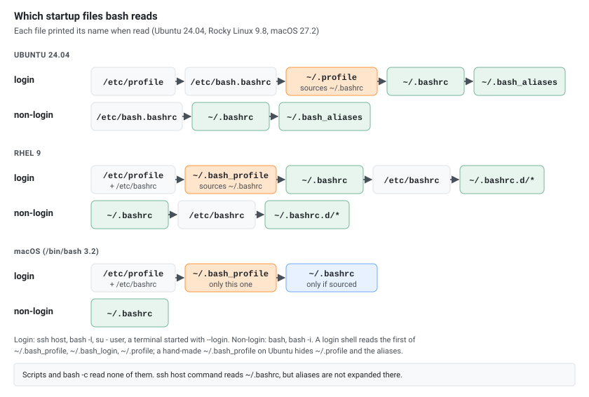

A set of practical aliases and helper functions for daily terminal work. Copy sections into `~/.bashrc` or `~/.bash_aliases` and reload with `source ~/.bashrc`.

## Scope

Every alias and function below was run on Ubuntu 24.04 (bash 5.2.21, GNU grep 3.11) and Rocky Linux 9.8 (bash 5.1.8, GNU grep 3.6, EPEL enabled). The macOS notes come from macOS 27.2 with the system `/bin/bash` 3.2.57 and Homebrew bash 5.3.

## Portability Notes

- Most of it works in any Bash on Linux. The process and network helpers (`ps --sort`, `ps auxf`, `free`, `hostname -I`, `ss`, `/proc`) are Linux only: macOS `ps` rejects `--sort` and its `hostname` has no `-I`.
- macOS `ls` accepts `--color=auto` but not `--group-directories-first`, so the `ls` aliases below detect GNU `ls` by the second option.
- macOS still ships Bash 3.2 as `/bin/bash`; it has no `autocd`, `dirspell` or `globstar`, so those options are guarded by a version check.
- Aliases that depend on external tools are wrapped in `command -v` guards.
- Aliases only work in interactive shells: scripts, `bash -c` and `su - user -c` do not expand them.

## Setup

```bash
# Option 1: Add directly to ~/.bashrc
vi ~/.bashrc

# Option 2: Use a separate aliases file (recommended)
vi ~/.bash_aliases

# Make sure ~/.bashrc sources it:
[ -f ~/.bash_aliases ] && source ~/.bash_aliases
```

Ubuntu's default `~/.bashrc` already sources `~/.bash_aliases`; on RHEL add the line yourself, or put the file in `~/.bashrc.d/`, which RHEL's default `~/.bashrc` loads (an alias in `~/.bashrc.d/aliases` was there in the next shell). Reload after changes:

```bash
source ~/.bashrc
```

## Which Startup Files Bash Reads

Most "my aliases don't load" problems come from the shell reading a different file. Each file below printed its name when read:

| How the shell starts | Ubuntu 24.04 | RHEL 9 |
|---|---|---|
| Login: `ssh host`, `bash -l` | `/etc/profile` → `/etc/bash.bashrc` → `~/.profile` → `~/.bashrc` | `/etc/profile` → `/etc/bashrc` → `~/.bash_profile` → `~/.bashrc` → `/etc/bashrc` |
| Non-login interactive: `bash`, `bash -i` | `/etc/bash.bashrc` → `~/.bashrc` | `~/.bashrc` → `/etc/bashrc` |
| `ssh host command` | `/etc/bash.bashrc` → `~/.bashrc` | `~/.bashrc` → `/etc/bashrc` |
| `su - user -c command` | `/etc/profile` → `~/.profile` → `~/.bashrc` | same as login |
| Scripts, `bash -c` | nothing | nothing |

[](startup-files.svg "Open the diagram full size")

- A login shell reads only the first of `~/.bash_profile`, `~/.bash_login` and `~/.profile` that exists. Ubuntu ships `~/.profile` and RHEL ships `~/.bash_profile`; both source `~/.bashrc`, so aliases in `~/.bashrc` reach every interactive shell.
- On Ubuntu, a hand-made `~/.bash_profile` (say, only `export EDITOR=vim`) hides `~/.profile`: after `ssh` the alias was gone (`-bash: type: ll: not found`). Adding `[ -f ~/.bashrc ] && . ~/.bashrc` to it brought it back.
- `ssh host command` is not interactive but bash still reads `~/.bashrc` (a special case for shells started by sshd). Ubuntu's `~/.bashrc` stops at its first lines (`case $- in *i*) ;; *) return;; esac`), and aliases are not expanded there anyway.
- Nothing in these files may print for non-interactive shells. With `echo "Docker aliases loaded!"` in `~/.bashrc.d/` on RHEL (which `~/.bashrc` reads for every SSH session), `scp` to that user failed with `Received message too long 1148150635` and `Ensure the remote shell produces no output for non-interactive sessions.` (exit code 255), and `scp -O` (the old protocol) failed too. `[[ $- == *i* ]] && echo …` prints only in interactive shells, and both copies worked again. Ubuntu's `~/.bashrc` returns before loading `~/.bash_aliases` in that case.
- macOS `/bin/bash` 3.2 behaves the same: `bash -l` read only `~/.bash_profile`, `bash -i` only `~/.bashrc`. When your terminal starts bash as a login shell (`/bin/bash --login`), put `[ -f ~/.bashrc ] && . ~/.bashrc` in `~/.bash_profile`.

## Alias or Function

Aliases are plain text substitution and take no parameters: the arguments are added at the end. This common attempt fails:

```bash
alias mkcd2='mkdir -p $1 && cd $1'
mkcd2 demo
```

`$1` is the shell's own (empty) first argument, so the line became `mkdir -p && cd demo`. Use an alias for a fixed command with options, and a function (like `mkcd` below) when an argument goes anywhere other than the end.

## Navigation and Quality of Life

```bash
# Safer rm/mv/cp (prompt before overwrite)
alias rm='rm -i'
alias cp='cp -i'
alias mv='mv -i'
alias ln='ln -i'

# Quick directory jumps
alias ..='cd ..'
alias ...='cd ../..'
alias ....='cd ../../..'
alias .....='cd ../../../..'
alias ~='cd ~'
alias -- -='cd -'            # "--" because the alias name starts with a dash

# Up N directories: up 3 = cd ../../..
up() {
  local n=${1:-1} d=
  case "$n" in ''|*[!0-9]*) echo "Usage: up [levels]" >&2; return 2 ;; esac
  while [ "$n" -gt 0 ]; do d="../$d"; n=$((n - 1)); done
  cd -- "${d:-.}"
}

# List variants (GNU vs BSD/macOS)
if ls --group-directories-first >/dev/null 2>&1; then
  alias l='ls -lah --color=auto --group-directories-first'
  alias ll='ls -lAh --color=auto --group-directories-first'
  alias la='ls -A --color=auto --group-directories-first'
  alias lt='ls -ltr --color=auto'
else
  alias l='ls -lahG'
  alias ll='ls -lAhG'
  alias la='ls -AG'
  alias lt='ls -ltrG'
fi

# Colored grep by default
alias grep='grep --color=auto'
alias egrep='grep -E --color=auto'
alias fgrep='grep -F --color=auto'

# Human-friendly sizes
alias df='df -h'
alias du='du -h'

# Show PATH entries one per line
alias path='printf "%s\n" "$PATH" | tr : "\n"'

# Start a fresh shell with the new config: removed aliases, functions and variables are gone
reload() {
  history -a                  # save this session's commands first
  exec "$BASH" -il
}

# Quick edit common files
alias ebash='${EDITOR:-nano} ~/.bashrc'
alias ealias='${EDITOR:-nano} ~/.bash_aliases'

# Misc
alias c='clear'
alias x='exit'
alias now='date +"%Y-%m-%d %H:%M:%S"'
alias today='date "+%Y-%m-%d"'
alias cal='cal -3'
alias count='wc -l'
alias j='jobs -l'
alias vi='vim'
alias v='vim'
alias view='vim -R'          # Read-only
alias less='less -SR'        # Don't wrap long lines (-S), show colors (-R)
command -v tree >/dev/null 2>&1 && alias tree='tree -C'
command -v colordiff >/dev/null 2>&1 && alias diff='colordiff'

# Clear the shell history (current session and ~/.bash_history)
alias ch='history -c && history -w'
```

```bash
# Run as root
alias root='sudo -i'         # Same as "sudo su -", without the extra su
```

## Prompt

```bash
# Colored prompt: green user@, yellow host, current directory
export PS1="[\[\e[1;32m\]\u@\[\e[1;33m\]\h\[\e[0m\] \W]\$ "

# Red user@ (e.g. for root's ~/.bashrc), green host
export PS1="[\[\e[1;31m\]\u@\[\e[1;32m\]\h\[\e[0m\] \W]\$ "
```

### Git Branch in the Prompt

```bash
# Branch with status marks: ● staged, ✎ modified, + untracked, ✗ deleted
git_prompt() {
  local branch st ind=""
  branch=$(git symbolic-ref --short HEAD 2>/dev/null) || return
  st=$(git status --porcelain 2>/dev/null)
  grep -q '^[MARC]' <<< "$st" && ind+="●"
  grep -q '^.M' <<< "$st" && ind+="✎"
  grep -q '^??' <<< "$st" && ind+="+"
  grep -q '^D\|^.D' <<< "$st" && ind+="✗"
  printf ' \001\e[1;36m\002(%s%s)\001\e[0m\002' "$branch" "${ind:+ $ind}"
}

export PS1='[\[\e[1;32m\]\u@\[\e[1;33m\]\h \[\e[38;5;211m\]\W\[\e[0m\]]$(git_prompt)\$ '
```

The part after the directory, in each state:

| Repository state | `git_prompt` shows |
|---|---|
| clean, or a fresh `git init` | `(main)` |
| file changed, not staged | `(main ✎)` |
| file staged, another untracked | `(main ●+)` |
| staged, then changed again | `(main ●✎)` |
| file deleted (staged or not) | `(main ✗)` |
| detached HEAD, or outside a repository | nothing |

## Less Colors for Man Pages

```bash
export LESS_TERMCAP_mb=$'\E[01;31m'      # Blink: bold red
export LESS_TERMCAP_md=$'\E[01;31m'      # Bold: bold red (headings, options)
export LESS_TERMCAP_me=$'\E[0m'
export LESS_TERMCAP_se=$'\E[0m'
export LESS_TERMCAP_so=$'\E[01;44;33m'   # Standout: yellow on blue (status line, search hits)
export LESS_TERMCAP_ue=$'\E[0m'
export LESS_TERMCAP_us=$'\E[01;32m'      # Underline: bold green (arguments)
export GROFF_NO_SGR=1                     # Needed on some distributions (Fedora, Arch) for the colors to apply
```

## History Settings

```bash
export HISTTIMEFORMAT='%Y-%m-%d %H:%M:%S - '   # Timestamps in "history" output
shopt -s histappend                            # Append to ~/.bash_history instead of overwriting it
shopt -s cmdhist                               # Save multi-line commands as one entry
HISTSIZE=100000                                # Commands kept in memory
HISTFILESIZE=100000                            # Commands kept in the file
HISTCONTROL=ignoreboth                         # Skip duplicates and commands starting with a space
#HISTCONTROL=ignoreboth:erasedups              # Also remove older duplicates
HISTIGNORE='ls:bg:fg:history'                  # Never record these

# Share history between open terminals: save each command right away (-a), read others' (-n).
# The case check keeps "source ~/.bashrc" from adding it again every time.
case "$PROMPT_COMMAND" in
  *"history -a; history -n"*) ;;
  *) PROMPT_COMMAND="history -a; history -n${PROMPT_COMMAND:+; $PROMPT_COMMAND}" ;;
esac
```

## Shell Options

```bash
shopt -s cdspell                 # Autocorrect small typos in cd arguments (cd /ect -> /etc)
if ((BASH_VERSINFO[0] >= 4)); then
  shopt -s dirspell              # Same for directory names during tab completion
  shopt -s autocd                # Type a directory name to cd into it
  shopt -s globstar              # ** matches files in all subdirectories
fi
```

## PATH

```bash
# Add a directory once: in front, or at the end with "after"
path_add() {
  case ":$PATH:" in
    *":$1:"*) ;;
    *) if [ "$2" = after ]; then PATH="$PATH:$1"; else PATH="$1:$PATH"; fi ;;
  esac
}

# Your own script directories (use $HOME: "~" isn't expanded inside double quotes)
path_add "$HOME/scripts"
path_add "$HOME/bin" after
path_add "$HOME/.local/bin" after
export PATH
```

## Sudo Helpers

```bash
# If user is not root, pass these commands via sudo
if [ "$UID" -ne 0 ]; then
  alias reboot='sudo reboot'
  command -v apt-get >/dev/null 2>&1 && alias apt-get='sudo apt-get'
  command -v yum >/dev/null 2>&1 && alias yum='sudo yum'
fi
```

## Shell Functions

### Create directory and cd into it

```bash
mkcd() { mkdir -p -- "$1" && cd -- "$1"; }
```

### Open current directory in file explorer (cross-platform)

```bash
open_here() {
  if command -v xdg-open >/dev/null 2>&1; then xdg-open . >/dev/null 2>&1 &
  elif command -v open >/dev/null 2>&1; then open .
  elif command -v explorer.exe >/dev/null 2>&1; then explorer.exe .
  else printf 'No known opener found.\n' >&2; return 1; fi
}
```

### Extract any archive format

```bash
extract() {
  if [ -f "$1" ]; then
    case "$1" in
      *.tar.bz2)  tar xjf "$1"   ;;
      *.tar.gz)   tar xzf "$1"   ;;
      *.tar.xz)   tar xJf "$1"   ;;
      *.tar.zst)  tar --use-compress-program=unzstd -xf "$1" ;;
      *.bz2)      bunzip2 "$1"   ;;
      *.rar)      if command -v unrar >/dev/null 2>&1; then unrar x "$1"; else bsdtar -xf "$1"; fi ;;
      *.gz)       gunzip "$1"    ;;
      *.tar)      tar xf "$1"    ;;
      *.tbz2)     tar xjf "$1"   ;;
      *.tgz)      tar xzf "$1"   ;;
      *.zip)      unzip "$1"     ;;
      *.7z)       7z x "$1"      ;;
      *.xz)       unxz "$1"      ;;
      *.zst)      unzstd "$1"    ;;
      *.Z)        uncompress "$1" ;;
      *)          echo "cannot extract '$1'" ;;
    esac
  else
    echo "'$1' is not a valid file"
  fi
}
```

### Find and kill process by name

```bash
killp() {
  [ -n "$1" ] || { echo "Usage: killp <pattern>" >&2; return 1; }
  pgrep -af -- "$1" || { echo "No process matches $1" >&2; return 1; }
  pkill -f -- "$1"
}
```

### Quick backup with timestamp

```bash
backup() {
  cp "$1"{,.backup-$(date +%Y%m%d_%H%M%S)}
}
```

### Find large files in current directory

```bash
bigfiles() {
  du -ah . 2>/dev/null | sort -h | tail -n 50
}
```

### Quick HTTP server with optional port

```bash
serve() {
  local port=${1:-8000} py
  py=$(command -v python3 || command -v python) || { echo "python not found" >&2; return 1; }
  "$py" -m http.server --bind 127.0.0.1 "$port"
}
```

### Stopwatch

```bash
stopwatch() {
  local date1 date2
  date1=$(date +%s)
  read -rp "Press Enter to stop"
  date2=$(date +%s)
  echo $((date2 - date1)) 'seconds'
}
```

### Decode and encode base64

```bash
decode() { echo "$1" | base64 -d; echo; }
encode() { printf '%s' "$1" | base64; }
```

## History and Sudo Helpers

```bash
# Repeat last command with sudo
alias please='sudo bash -c "$(fc -ln -1)"'

# History search
alias h='history'
alias hg='history | grep'

# fzf-powered history search (if available), newest first
if command -v fzf >/dev/null 2>&1; then
  hist() { fc -lnr 1 | fzf --no-sort --height 40% | sed 's/^[[:space:]]*//'; }
else
  hist() { history | less; }
fi
```

## Networking and Processes

```bash
alias myip='curl -s https://ifconfig.me || curl -s https://api.ipify.org'
alias whatsmyip='curl -s https://ipecho.net/plain; echo'
alias localip='hostname -I'
alias ping='ping -c 5'

# Listening ports (ss preferred over netstat); run with sudo to see other users' processes
if command -v ss >/dev/null 2>&1; then
  alias ports='ss -tulpen'
else
  alias ports='netstat -tulpen'
fi

# Top alternative
if command -v htop >/dev/null 2>&1; then
  alias top='htop'
fi

# Process search
alias psg='ps aux | grep'

# Memory and CPU
alias free='free -h'
alias meminfo='free -m -l -t'      # MB, with low/high and total lines
alias cpuinfo='cat /proc/cpuinfo'
alias load='uptime'

# Top 10 memory users
alias psmem='ps aux --sort=-%mem'
alias psmem10='ps aux --sort=-%mem | head -n 11'

# Top CPU users
alias pscpu='ps aux --sort=-%cpu'
alias pscpu10='ps aux --sort=-%cpu | head -n 11'

# Process tree (a separate name: aliasing ps itself changes every ps call)
alias psf='ps auxf'

# Process search that keeps the header line
alias psgh='ps aux | grep -v grep | grep -i -e VSZ -e'

# Open network connections with process names
alias connections='sudo lsof -n -P -i +c 15'

# Firewall rules with packet counters
alias ipt='sudo iptables -nvL'
alias nftl='sudo nft list ruleset'

# Mounted filesystems as a table (a separate name: "alias mount=..." would break mounting)
alias mnt='mount | column -t'

# 100 large pings, 5 per second
alias fastping='ping -c 100 -s 1400 -i 0.2'

# Kernel errors with readable timestamps
alias dmesg_err='sudo dmesg -T --color=always --level=emerg,alert,crit,err'

# fail2ban SSH jail status
alias fail2ban-ssh='sudo fail2ban-client status sshd'

# Show a config file without comments and empty lines
alias nocomment='grep -Ev '\''^[[:space:]]*(#|$)'\'''

# Regular (non-system) users
lsuser() {
  awk -F: -v min="$(awk '/^UID_MIN/ {print $2}' /etc/login.defs)" \
    '$3 >= min && $3 < 65534 {print $1}' /etc/passwd | sort
}

# Top 25 processes by memory: command, %MEM, RSS in MB
top25() {
  ps -A --sort=-rss -o comm,pmem,rss | head -n 26 | \
    awk 'NR==1 {printf "%-26s%-8s%s\n", $1, $2, "RSS(MB)"; next}
         {printf "%-26s%-8s%.2f\n", $1, $2, $3/1024}'
}

# Swap usage per process (kB), largest first
swapinfo() {
  for file in /proc/*/status; do
    awk '/^Name/ {n=$2} /^VmSwap/ {print n, $2}' "$file" 2>/dev/null
  done | sort -k2 -nr | head -n 20
}
```

### Ports, HTTP and TLS

```bash
# What listens on a TCP port (run with sudo to see other users' processes)
portcheck() {
  [ -n "$1" ] || { echo "Usage: portcheck <port>" >&2; return 2; }
  ss -ltnp "sport = :$1"
}

# HTTP status code only: httpstatus https://example.com (add -L to follow redirects)
httpstatus() { curl -s -o /dev/null -w '%{http_code}\n' "$@"; }

# Where the time goes in one request
curltime() {
  curl -s -o /dev/null -w '    DNS lookup:  %{time_namelookup}s
   TCP connect:  %{time_connect}s
 TLS handshake:  %{time_appconnect}s
    First byte:  %{time_starttransfer}s
         Total:  %{time_total}s
     HTTP code:  %{http_code}
' "$@"
}

# Expiry date of a server's TLS certificate: tlsexpiry example.com or example.com:8443
tlsexpiry() {
  local host=${1%%:*} port=${1##*:}
  [ "$host" = "$port" ] && port=443
  openssl s_client -servername "$host" -connect "$host:$port" </dev/null 2>/dev/null |
    openssl x509 -noout -enddate
}
```

## Search and Find

```bash
# Fast recursive search (ripgrep preferred)
if command -v rg >/dev/null 2>&1; then
  alias ag='rg -n --no-heading --color=always'
else
  alias ag='grep -Rin --color=always'
fi

# Find files by name
alias ff='find . -name'
alias ffi='find . -iname'

# Find files by name, case-insensitive, with optional extra find arguments: f conf -type f
f() { find . -iname "*$1*" "${@:2}"; }

# Recursively grep for a pattern, with optional extra grep options: r needle -l
r() { grep "$1" "${@:2}" -R .; }
```

## Git

```bash
alias gs='git status'
alias ga='git add'
alias gc='git commit'
alias gl='git pull'
alias gd='git diff'
alias gb='git branch'
alias gco='git checkout'
alias glog='git log --oneline --graph --decorate'
alias gds='git diff --staged'                        # what the next commit contains
alias gpf='git push --force-with-lease'              # force push, unless someone else pushed
alias gundo='git reset --soft HEAD~1'                # undo the last commit, keep its changes staged
alias groot='cd "$(git rev-parse --show-toplevel)"'  # cd to the top of the repository
```

```bash
# Add everything, commit with a message (default "update") and push
gp() {
  git add -A && git commit -m "${1:-update}" && git push
}
```

```bash
# Update all Git repositories in the current directory
update_all_repos() {
  echo "Updating all Git repositories in current directory..."
  for i in */.git; do
    if [[ -d "$i" ]]; then
      repo_name=$(basename "$(dirname "$i")")
      echo "Updating: $repo_name"
      (cd "$(dirname "$i")" && git pull)
    fi
  done
  echo "Done!"
}
```

```bash
# Make the working copy look like a fresh clone: the current branch is reset to its
# upstream, local commits are dropped, untracked AND ignored files are deleted.
# Other local branches and stashes stay. Asks for FRESH first.
gfresh() {
  local top up confirmation
  top=$(git rev-parse --show-toplevel) || return
  up=$(git -C "$top" rev-parse --abbrev-ref --symbolic-full-name '@{upstream}' 2>/dev/null) ||
    { echo "No upstream for the current branch" >&2; return 1; }
  git -C "$top" fetch --prune --quiet || return
  printf 'Reset to %s and delete untracked and ignored files in %s:\n' "$up" "$top"
  git -C "$top" status --short --ignored
  git -C "$top" log --oneline "$up..HEAD"
  printf 'Type FRESH to continue: '
  read -r confirmation
  [ "$confirmation" = "FRESH" ] || { printf 'Cancelled.\n'; return 1; }
  git -C "$top" reset --hard "$up" && git -C "$top" clean -fdx
}
```

```bash
# GitHub CLI
if command -v gh >/dev/null 2>&1; then
  alias ghpr='gh pr view --web'
  alias ghprs='gh pr list'
  alias ghissues='gh issue list'
  alias ghrepo='gh repo view --web'
  alias ghruns='gh run list'
  alias ghwatch='gh run watch'
fi
```

## Docker

```bash
if command -v docker >/dev/null 2>&1; then
  alias d='docker'
  alias dc='docker compose'
  alias dps='docker ps --format "table {{.Names}}\t{{.Status}}\t{{.Ports}}"'
  alias dpsa='docker ps -a'
  alias di='docker images'
  alias drm='docker rm'
  alias drmi='docker rmi'
  alias dstopall='docker stop $(docker ps -q) 2>/dev/null || true'
  alias drmfall='docker rm -f $(docker ps -aq) 2>/dev/null || true'
  alias dlogf='docker logs --follow --tail 200'
  alias dei='docker exec -it'                    # dei web sh
  alias drim='docker run --rm -it'               # throwaway container: drim alpine sh
  alias ddf='docker system df'                   # disk used by images, containers, volumes
  alias dvl='docker volume ls'
  alias dnl='docker network ls'
  alias dcu='docker compose up -d'
  alias dcd='docker compose down'
  alias dclf='docker compose logs --follow --tail 200'
  alias dcps='docker compose ps'
  alias dcstop='docker compose stop'
  alias dcstart='docker compose start'
  alias dcrestart='docker compose restart'
  alias dcpull='docker compose pull'
  alias dcbuild='docker compose build'
  alias dcls='docker compose ls -a'             # all projects, also stopped ones
  alias dce='docker compose exec'                # dce web sh
  alias dcub='docker compose up -d --build'      # rebuild, then start
fi

# Shell in a container that has no bash (Alpine, BusyBox): dsh web
dsh() { docker exec -it "$1" sh; }

# IP address of a container, one line per network: dip web
dip() {
  docker inspect --format '{{range $n, $c := .NetworkSettings.Networks}}{{$n}} {{$c.IPAddress}}{{"\n"}}{{end}}' "$@"
}
```

### All Compose Projects at Once

```bash
# Every project (also stopped ones), as one alias per command
alias dcstop-all='docker compose ls -a -q 2>/dev/null | xargs -r -I {} docker compose -p {} stop'
alias dcstart-all='docker compose ls -a -q 2>/dev/null | xargs -r -I {} docker compose -p {} start'
alias dcrestart-all='docker compose ls -a -q 2>/dev/null | xargs -r -I {} docker compose -p {} restart'
alias dcdown-all='docker compose ls -a -q 2>/dev/null | xargs -r -I {} docker compose -p {} down'

# The same as a function, with an optional name filter: dcall stop / dcall stop app
dcall() {
  [ -n "$1" ] || { echo "Usage: dcall <stop|start|restart|down|ps> [name filter]" >&2; return 2; }
  local p
  for p in $(docker compose ls -a -q ${2:+--filter name="$2"}); do
    echo "== $p"
    docker compose -p "$p" "$1"
  done
}
# Start every compose project below the current directory
dcup-all() {
  find . \( -name compose.yaml -o -name compose.yml -o -name docker-compose.yaml -o -name docker-compose.yml \) |
    while IFS= read -r f; do
      echo "== $f"
      (cd "$(dirname "$f")" && docker compose up -d)
    done
}
```

```bash
# Enter a container with bash, or sh when the image has no bash
dbash() {
  if [ $# -eq 1 ]; then
    if docker exec "$1" sh -c 'command -v bash' >/dev/null 2>&1; then
      docker exec -it "$1" bash
    else
      docker exec -it "$1" sh
    fi
  else
    echo "Usage: dbash <container_name_or_id>"
  fi
}
```

## Kubernetes

```bash
if command -v kubectl >/dev/null 2>&1; then
  alias k='kubectl'

  # Get
  alias kg='kubectl get'
  alias kgp='kubectl get pods'
  alias kgd='kubectl get deployments'
  alias kgs='kubectl get services'
  alias kgn='kubectl get nodes'
  alias kga='kubectl get all'
  alias kgpa='kubectl get pods -A'          # all namespaces
  alias kgns='kubectl get namespaces'

  # Describe, logs, exec
  alias kd='kubectl describe'
  alias kdp='kubectl describe pod'
  alias kdd='kubectl describe deployment'
  alias kl='kubectl logs'
  alias klf='kubectl logs -f'
  alias kex='kubectl exec -it'              # kex deploy/web -- sh

  # Apply and create
  alias ka='kubectl apply -f'
  alias kc='kubectl create'

  # Contexts and namespaces
  alias kgctx='kubectl config get-contexts'
  alias kctx='kubectl config use-context'
  alias kn='kubectl config set-context --current --namespace'   # kn lab

  # Rollouts, events, port forwarding
  alias kroll='kubectl rollout status'                 # kroll deploy/web
  alias krestart='kubectl rollout restart'             # krestart deploy/web
  alias kev='kubectl get events --sort-by=.metadata.creationTimestamp'
  alias kpf='kubectl port-forward'                     # kpf deploy/web 8080:80

  # Tab completion, also for the "k" alias (needs the bash-completion package)
  source <(kubectl completion bash)
  complete -o default -F __start_kubectl k
fi

# Pods that are not fine: not Running/Completed, or Running but not all containers ready
kbadpods() {
  kubectl get pods -A --no-headers |
    awk '{split($3, r, "/"); if ($4 != "Completed" && ($4 != "Running" || r[1] != r[2])) print}'
}

# Debug container in a running pod; with a container name it sees that container's processes
kdebug() {
  [ -n "$1" ] || { echo "Usage: kdebug <pod> [container] [image]" >&2; return 2; }
  kubectl debug -it "$1" --image="${3:-busybox:1.36}" ${2:+--target="$2"}
}

# kswitch: numbered list of contexts; kswitch <name>: switch directly.
# Asks again before switching to a context with "prod" in its name.
kswitch() {
  local ctx=$1 answer COLUMNS=1 PS3="Switch to (number, Ctrl+D to cancel): "   # COLUMNS=1: one per line
  if [ -z "$ctx" ]; then
    echo "Current: $(kubectl config current-context 2>/dev/null)"
    select ctx in $(kubectl config get-contexts -o name); do
      [ -n "$ctx" ] && break
      echo "Not in the list" >&2
    done
    [ -n "$ctx" ] || return 1
  fi
  case "$ctx" in
    *prod*) read -rp "Switch to $ctx? [y/N] " answer
            [ "$answer" = y ] || { echo "Cancelled"; return 1; } ;;
  esac
  kubectl config use-context "$ctx"
}
```

## Terraform

```bash
alias tfip='terraform init && terraform plan'
alias tfipa='terraform init && terraform plan && terraform apply'
alias tfipaa='terraform init && terraform plan && terraform apply -auto-approve'   # no confirmation
alias tfid='terraform init && terraform destroy'
alias tfidaa='terraform init && terraform destroy -auto-approve'                  # no confirmation
```

## Service Management (systemd)

```bash
alias sctl='sudo systemctl'
alias sstart='sudo systemctl start'
alias sstop='sudo systemctl stop'
alias srestart='sudo systemctl restart'
alias sstatus='sudo systemctl status'
alias senable='sudo systemctl enable'
alias sdisable='sudo systemctl disable'
alias failedservices='systemctl --failed'           # units that failed
alias journalerrors='journalctl -p err..alert -b'   # errors since the last boot

# List services
alias svcrun='systemctl list-units --type=service --state=running'    # running now
alias svcall='systemctl list-units --type=service --all'              # loaded, any state
alias svcfiles='systemctl list-unit-files --type=service'             # installed: enabled/disabled/static

# Services whose name contains a word, any state: svc cron
svc() {
  [ -n "$1" ] || { echo "Usage: svc <name>" >&2; return 2; }
  systemctl list-units --type=service --all "*$1*"
  systemctl list-unit-files --type=service "*$1*"
}
```

## Log Viewing

```bash
alias logs='sudo journalctl -f'
alias lognginx='sudo tail -f /var/log/nginx/error.log'

# Auth and Apache logs live in different places on Debian/Ubuntu and RHEL
if [ -d /etc/apache2 ]; then
  alias logapache='sudo tail -f /var/log/apache2/error.log'
else
  alias logapache='sudo tail -f /var/log/httpd/error_log'
fi
if [ -f /var/log/secure ]; then
  alias logauth='sudo tail -f /var/log/secure'
else
  alias logauth='sudo tail -f /var/log/auth.log'
fi

# Colorized log viewer (needs ccze: apt install ccze / dnf install ccze from EPEL)
log() { ccze -A < "$1" | less -R; }

# Follow a log and highlight a pattern: tcolor /var/log/syslog error
tcolor() { tail -f -n 5000 "$1" | perl -pe "s/$2/\e[1;31;43m$&\e[0m/g"; }
```

## Package Management

```bash
# apt (Debian/Ubuntu)
alias aptup='sudo apt update && sudo apt upgrade'
alias update='sudo apt update && sudo apt upgrade -y'   # no confirmation
alias aptin='sudo apt install'
alias aptrm='sudo apt remove'
alias aptsearch='apt search'

# yum/dnf (RHEL/CentOS)
alias yumup='sudo yum update'
alias yumin='sudo yum install'
```

## File Permissions and SSH

```bash
alias 644='chmod 644'
alias 755='chmod 755'
alias mx='chmod +x'
alias sshkey='cat ~/.ssh/id_*.pub'
alias sshgen='ssh-keygen -t ed25519'
```

## Web Servers

```bash
alias nginx-test='sudo nginx -t'
alias nginx-reload='sudo systemctl reload nginx'
alias apache-test='sudo apachectl configtest'
if [ -d /etc/apache2 ]; then
  alias apache-reload='sudo systemctl reload apache2'
else
  alias apache-reload='sudo systemctl reload httpd'
fi
```

## macOS

```bash
alias showfiles='defaults write com.apple.finder AppleShowAllFiles YES; killall Finder'
alias hidefiles='defaults write com.apple.finder AppleShowAllFiles NO; killall Finder'
alias desktop='cd ~/Desktop'
alias downloads='cd ~/Downloads'
alias documents='cd ~/Documents'
alias finder='open -a Finder'
alias flushdns='sudo dscacheutil -flushcache; sudo killall -HUP mDNSResponder'
```

## Development and Fun

```bash
alias py='python3'
alias pip='pip3'
alias npmls='npm list --depth=0'
alias weather='curl wttr.in'
alias wget='wget -c'             # Resume partial downloads
```

## Conditional Modern Replacements

```bash
# Debian/Ubuntu install bat and fd as batcat and fdfind
command -v batcat >/dev/null 2>&1 && alias bat='batcat'
command -v fdfind >/dev/null 2>&1 && alias fd='fdfind'

# Syntax highlighting, but cat-like output: no pager, no line numbers or header
if command -v bat >/dev/null 2>&1; then
  alias cat='bat --paging=never --style=plain'
fi

# eza is the maintained fork of exa
if command -v eza >/dev/null 2>&1; then
  alias ls='eza'
  alias ll='eza -la'
  alias lt='eza -l --sort=modified'   # eza's -t takes a time field, so "ls -ltr" fails
  alias tree='eza --tree'
fi
```

## Troubleshooting

```bash
type -a ls          # every meaning of a name, in the order bash uses them
\ls                 # run the command without the alias, once
command ls          # same, also skips functions
unalias ll          # remove an alias for this session
declare -f mkcd     # print a function's code
alias               # list all aliases (compgen -a: names only)
```

An alias expands only as the first word of a command: `timeout 3 klf deploy/web` failed with `timeout: exec(klf): No such file or directory`, and `echo x | xargs hi` (with `alias hi='echo hello'`) gave `xargs: hi: No such file or directory`. Those commands run a program by name and never see your aliases.

Scripts don't expand aliases: a script with `alias hi="echo hello"` and then `hi` stopped with `line 3: hi: command not found` (exit code 127). `shopt -s expand_aliases` before the alias makes it work, but a function is the better tool in scripts.

## Tips

- Place aliases in `~/.bash_aliases` and source from `~/.bashrc` to keep things organized
- Keep aliases minimal and memorable — pick 5–10 you'll actually use daily
- Prefer functions when parameters are needed; use aliases for simple expansions
- Wrap tool-specific aliases in `command -v` guards for portability
- New shells auto-load if placed in the `~/.bashrc` or `~/.bash_profile` chain
