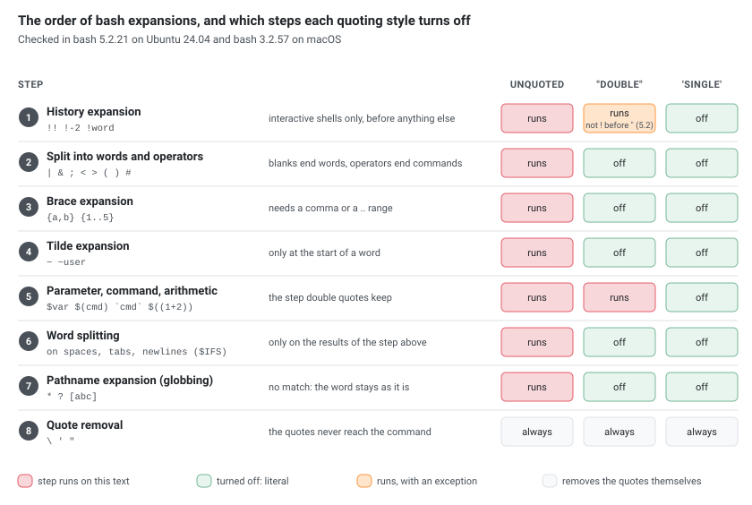
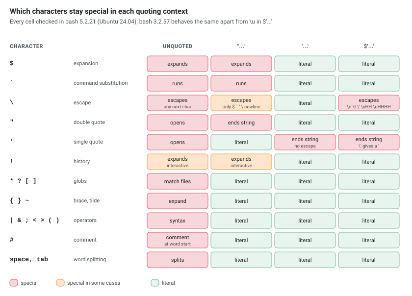

Many characters carry special meaning to bash: `$`, `*`, `|`, quotes and more. To use them literally you either **escape** them with a backslash or **quote** them. This guide walks through the characters that trip people up, shows the wrong, right and alternative form for each, and covers the pitfalls (paths with spaces, regex, variable names, heredocs).

> **The golden rule:** single quotes (`'...'`) make *everything* literal, so quoting is usually easier than escaping character by character. Reach for backslash escaping only when you're mixing literal and special meanings in the same string.

## Scope

Every example below was run in bash 5.2.21 on Ubuntu 24.04 and in the system `/bin/bash` 3.2.57 on macOS 27.2; the output shown is from bash 5.2 unless a section says otherwise. The comparisons with other shells use dash 0.5.12 (Ubuntu's `/bin/sh`) and zsh 5.9 (the default login shell on macOS).

## How Bash Reads a Command Line

Quoting makes sense once you know the order bash processes a line in. It splits the line into words and operators, then runs the expansions in a fixed order, and only at the very end removes the quotes. Each quoting style switches some of these steps off for the text it protects:

[](expansion-order.svg "Open the diagram full size")

Two consequences explain most of this article:

- Word splitting and globbing run only on **unquoted** results. `"$var"` and `"*.txt"` are never split or matched against files.
- Quote removal happens last, so quotes never reach the command. `echo "a"b'c'` gets one argument, `abc`.

## The Two Approaches

```bash
# Backslash: escape one character at a time
echo "The price is \$5"

# Single quotes: everything literal (except a single quote itself)
echo 'The price is $5 and 100% *literal*'

# Double quotes: literal EXCEPT $, `, \ and, in an interactive shell, !
name=John
echo "Hello $name, the price is \$5"
```

Inside double quotes only `$`, `` ` ``, `\` and, interactively, `!` keep a special meaning (plus `"` itself, which ends the string). Even `\` is special there only before `$`, `` ` ``, `"`, `\` and a newline; anywhere else it stays a plain backslash:

```bash
$ echo "a\$b a\`b a\"b a\\b a\nb"
a$b a`b a"b a\b a\nb
```

This table sums up which characters stay special in each context:

[](quoting-matrix.svg "Open the diagram full size")

## Characters That Need Escaping

### Dollar sign ($): variable and command expansion

```bash
echo "The price is $5"       # tries to expand $5
echo "The price is \$5"      # literal
echo 'The price is $5'       # literal
```

`$5` is the fifth positional parameter, so it is usually empty, and the price vanishes silently:

```bash
$ echo "The price is $5"
The price is 
$ set -- one two three four five; echo "The price is $5"
The price is five
```

### Backtick (\`): old command substitution

```bash
$ echo "Today is `date +%F`"
Today is 2026-11-16
$ echo "Today is \`date\`"
Today is `date`
$ echo 'Today is `date`'
Today is `date`
```

Prefer `$(...)` over backticks for actual command substitution: it nests cleanly and is easier to read.

### Double quote (") inside double quotes

The unescaped version does not raise an error. The inner quotes close and reopen the string, quote removal deletes them, and the output quietly loses them:

```bash
$ echo "He said "Hello""
He said Hello
```

With a space inside the inner quotes it gets worse: the space is now unquoted, so the command receives **two** arguments:

```bash
$ printf '[%s]\n' "He said "Hello World""
[He said Hello]
[World]
```

Escape the inner quotes, or use single quotes outside:

```bash
$ echo "He said \"Hello\""
He said "Hello"
$ echo 'He said "Hello"'
He said "Hello"
```

### Single quote ('): cannot be escaped inside single quotes

You can't put a `'` inside a `'...'` string at all; even `\'` doesn't work, because a backslash is literal there. The quote closes the string and bash keeps reading for a closing one:

```bash
$ bash -c "echo 'Don\'t do this'"
bash: -c: line 1: unexpected EOF while looking for matching `''
```

In an interactive shell you get a `>` continuation prompt instead. Switch to double quotes, use the close, escaped quote, reopen idiom, or ANSI-C quoting, where `\'` does work:

```bash
$ echo "Don't do this"
Don't do this
$ echo 'Don'\''t do this'      # close ' , escaped \' , reopen '
Don't do this
$ echo $'Don\'t do this'
Don't do this
```

### Backslash (\\) itself

A backslash before a letter inside double quotes is **not** an escape in bash, so a Windows path survives:

```bash
$ echo "Path: C:\Users"
Path: C:\Users
$ echo "Path: C:\\Users"
Path: C:\Users
$ echo 'Path: C:\Users'
Path: C:\Users
```

The trouble starts when something *else* interprets backslashes. `echo -e` turns `\n` into a newline, and zsh's `echo` interprets escapes by default, so the same line typed in the macOS default shell loses a character:

```bash
$ echo -e "Path: C:\new\Users"
Path: C:
ew\Users
$ zsh -c 'echo "Path: C:\Users"'
Path: C: sers
```

Use `printf '%s\n' "$path"` when the text is data: `%s` never interprets backslashes in the argument.

### Glob characters: *, ?, [ ]

These expand to matching file names when unquoted:

```bash
$ ls
a.txt  b.txt  report.md
$ echo Rating: *****
Rating: a.txt b.txt report.md
$ echo "Rating: *****"
Rating: *****
$ echo 'Rating: *****'
Rating: *****
```

A glob that matches nothing is passed through literally, which is why unquoted globs *seem* to work until the day a matching file exists:

```bash
$ echo What??? Array[0]
What??? Array[0]
$ touch Array0; echo What? Array[0]
What? Array0
```

Two shell options change the no-match case. `nullglob` removes the word and `failglob` makes it an error:

```bash
$ echo Rating: *.zzz
Rating: *.zzz
$ shopt -s nullglob; echo Rating: *.zzz
Rating:
$ shopt -s failglob; echo Rating: *.zzz
bash: line 1: no match: *.zzz
```

> Globbing only happens on **unquoted** words, so `"*"` and `'*'` are already literal; you rarely need `\*`. This is why "quote it" is simpler than escaping each `*`.

### Brace expansion ({ }) and parentheses (( ))

```bash
$ echo {a,b,c}
a b c
$ echo {a..e}
a b c d e
$ echo {key: value}
{key: value}
$ echo Function(parameter)
bash: -c: line 1: syntax error near unexpected token `('
```

Braces only expand when they contain a comma or a `..` range, so `{key: value}` stays as it is. An unquoted `(` is a syntax error in the middle of a command. Quote both anyway: `echo "Function(parameter)"`.

### Shell operators: |, &, ;, <, >

These are command syntax; unquoted, they pipe, background, separate or redirect:

```bash
$ echo Option A | Option B
bash: line 1: Option: command not found
$ echo Tom & Jerry
Tom
bash: line 1: Jerry: command not found
$ echo First; Second
First
bash: line 1: Second: command not found
```

Inside quotes all of them are literal:

```bash
echo "Option A | Option B"
echo "Tom & Jerry"
echo "First; Second"
echo "5 > 3 and 2 < 4"
```

> The redirection case is the dangerous one: it doesn't print anything, it writes files. `echo 5 > 3` creates a **file named `3`** containing `5`. `echo 5 > 3 and 2 < 4` creates `3`, then fails on the input redirection with `bash: line 1: 4: No such file or directory`, and the empty file stays behind.

```bash
$ echo 5 > 3; ls -l 3; cat 3
-rw-r--r-- 1 root root 2 Nov 16 13:16 3
5
```

### Hash (#): comment

`#` starts a comment only at the beginning of a word (at the start of a line or after whitespace). In the middle of a word, or inside quotes, it's literal:

```bash
$ echo Issue #123
Issue
$ echo Issue#123
Issue#123
$ echo "Issue #123"
Issue #123
$ echo Issue \#123
Issue #123
```

### Exclamation mark (!): history expansion

In an *interactive* shell, `!` triggers history expansion, and it does so inside double quotes too. Scripts and `bash -c` have history expansion off, so the same line works there, which makes it confusing to debug. Run interactively in bash 5.2:

```bash
$ echo "Hello!World"
bash: !World: event not found
$ echo "Hi !!"
echo "Hi true previous"
Hi true previous
$ echo "Hello World!"
Hello World!
```

`!!` was replaced by the previous command (`true previous`), and bash printed the expanded line before running it. A `!` right before the closing quote is left alone in bash 5.2, but not in macOS bash 3.2:

```bash
bash-3.2$ echo "Hello World!"
bash: !": event not found
```

Single quotes always work. A backslash stops the expansion inside double quotes, but the backslash itself stays in the output:

```bash
$ echo 'Hello!World'
Hello!World
$ echo "Hello\!World"
Hello\!World
```

Use single quotes for a literal `!`, or turn history expansion off with `set +H`.

## Escaping Methods Summary

| Method | Syntax | Behavior |
|--------|--------|----------|
| Backslash | `\x` | Escapes a single character's special meaning |
| Single quotes | `'...'` | Everything literal; no expansion; can't contain `'` |
| Double quotes | `"..."` | Literal except `$`, `` ` ``, `\` and interactive `!`; allows variable and command expansion |
| ANSI-C quoting | `$'...'` | Interprets escapes like `\n`, `\t`, `\'`, `\xHH`, `\uHHHH` |

```bash
$ echo $'Line 1\nLine 2\tTabbed'
Line 1
Line 2	Tabbed
```

The Unicode escapes need bash 4.2 or later **and** a UTF-8 locale. In the C locale (the default in a bare container) bash 5.2 leaves them as text, and bash 3.2 doesn't know them at all:

```bash
$ LC_ALL=C.UTF-8 bash -c "echo \$'\x41 \u00e9 \U0001F600'"
A é 😀
$ LC_ALL=C bash -c "echo \$'\x41 \u00e9 \U0001F600'"
A \u00E9 \U0001F600
bash-3.2$ echo $'\x41 \u00e9'
A \u00e9
```

## Common Pitfalls

### Literal $ vs variable expansion

```bash
$ variable=VALUE
$ echo "The $variable_name is important"
The  is important
$ echo "The \$variable_name is important"
The $variable_name is important
$ echo "The ${variable}_name is important"
The VALUE_name is important
```

Bash read `$variable_name` as one variable, which is not set, so it expanded to nothing. The `${var}` braces mark where the name ends, which is essential when a letter, digit or underscore immediately follows. `set -u` turns that silent empty string into an error:

```bash
$ set -u; echo "The $variable_name is important"
bash: line 1: variable_name: unbound variable
```

### File paths with spaces

```bash
$ cp src/with spaces/file.txt dest/
cp: cannot stat 'src/with': No such file or directory
cp: cannot stat 'spaces/file.txt': No such file or directory
$ cp "src/with spaces/file.txt" dest/     # quoted
$ cp src/with\ spaces/file.txt dest/      # escaped space
```

### Unquoted variables split too

Quoting the path when you assign it is not enough. Word splitting happens when the variable is *expanded*, so an unquoted `$f` breaks the same way:

```bash
$ f="src/with spaces/file.txt"
$ cp $f dest/
cp: cannot stat 'src/with': No such file or directory
cp: cannot stat 'spaces/file.txt': No such file or directory
$ cp "$f" dest/
```

Always write `"$f"`. The unquoted result is also globbed, so a value containing `*` would turn into a list of files.

### Regex vs globs on the command line

The shell expands globs *before* the command sees them, so quote regex and pattern arguments to let the tool (not the shell) interpret them. Here a file named `test.myfile` exists in the directory:

```bash
$ grep test.*file *.txt
$ grep 'test.*file' *.txt
notes.txt:test of file
```

The first command printed nothing and no error. `set -x` shows why: bash prints each command after expansion, as the program actually receives it:

```bash
$ set -x; grep test.*file *.txt
+ grep test.myfile a.txt b.txt notes.txt
```

The regex `test.*file` matched the file `test.myfile`, so grep searched for the fixed text `test.myfile`. The `*.txt` is left unquoted on purpose, because you *want* the shell to expand that into the file list. `set -x` is the quickest way to debug any quoting problem in this article.

## Escaping in Specific Contexts

Beyond individual characters, a few constructs have their own quoting rules worth knowing.

### Here-documents: quote the delimiter to disable expansion

Whether a heredoc expands `$variables` and `` `commands` `` depends on the **delimiter**. Quote it (`'EOF'`) for a fully literal body; leave it unquoted (`EOF`) to allow expansion:

```bash
# Quoted delimiter -> literal: no expansion, no escaping needed
cat << 'EOF'
This keeps $variables and `commands` literal.
EOF

# Unquoted delimiter -> expanded: $ and ` are live (escape to keep literal)
cat << EOF
Current user: $USER
Date: $(date +%F)
A literal dollar: \$HOME
EOF
```

Output, with `USER=demo`:

```text
This keeps $variables and `commands` literal.
Current user: demo
Date: 2026-11-16
A literal dollar: $HOME
```

Any quoting of the delimiter counts, not only single quotes. `<< "EOF"` and `<< \EOF` also produce a literal body:

```bash
$ cat << \EOF
backslash delimiter: $HOME
EOF
backslash delimiter: $HOME
```

Quoting the delimiter is the cleanest way to embed scripts or config containing `$` without escaping every one.

### Arrays with spaced elements

Always expand an array as `"${arr[@]}"` (quoted, `@`) so each element stays one word even when it contains spaces:

```bash
files=("file one.txt" "file two.txt" "report-3.txt")

for f in "${files[@]}"; do    # each element intact
    echo "Processing: $f"
done
```

```text
Processing: file one.txt
Processing: file two.txt
Processing: report-3.txt
```

Unquoted `${files[@]}` re-splits the elements on whitespace, and quoted `"${files[*]}"` joins them into a single word:

```text
# for f in ${files[@]}
Processing: file
Processing: one.txt
Processing: file
Processing: two.txt
Processing: report-3.txt

# for f in "${files[*]}"   (first two elements)
Processing: file one.txt file two.txt
```

### Conditionals: [[ ]] pattern vs regex

Inside `[[ ]]`, the right-hand side of `==` is a **glob pattern** and the right-hand side of `=~` is a **regex**, but *only when unquoted*. Quoting the right side forces a literal comparison:

```bash
[[ "$file" == *.txt ]]        # glob match: ends in .txt
[[ "$file" == "*.txt" ]]      # literal: equals the string *.txt
[[ "$n" =~ ^[0-9]+$ ]]        # regex: all digits
[[ "$n" =~ "^[0-9]+$" ]]      # literal: contains that exact string
```

With `file=notes.txt` and `n=12345`, the first and third match and the other two don't. The quoted regex matches only a string that contains the characters `^[0-9]+$` themselves. This behaves the same in bash 3.2 and 5.2.

For a regex with spaces or other special characters, put it in a variable and leave the variable unquoted:

```bash
$ re='^[0-9]+$'; n=42
$ [[ $n =~ $re ]] && echo match
match
```

So you *don't* escape glob or regex metacharacters inside `[[ ]]`; you leave the pattern unquoted. Quote the left-hand `"$var"` as always. The single-bracket `[` is an ordinary command, so its unquoted pattern is globbed against the files first:

```bash
$ ls *.txt
a.txt  b.txt
$ file=a.txt; [ "$file" == *.txt ] && echo match
bash: line 1: [: too many arguments
```

### Character classes instead of escaping

In patterns and regexes, POSIX character classes read better than escaped literals and sidestep quoting issues:

```bash
[[ "$s" =~ [[:space:]] ]]     # matches any whitespace (clearer than a literal space or tab)
grep -E '[[:digit:]]+' file   # one or more digits
```

Use `grep -E` for `+`. In a basic regex `\+` is not POSIX: GNU grep and macOS grep accept it, but `-E` with `+` works with every grep.

### printf over echo -e for escape sequences

`echo -e` interprets `\n` and `\t`, but `echo` is the least portable command in the shell. In dash, Ubuntu's `/bin/sh`, `-e` isn't an option at all, so it's printed, and the escapes are interpreted anyway. Bash with `xpg_echo` set interprets them without `-e`:

```bash
$ bash -c 'echo -e "Line1\nLine2"'
Line1
Line2
$ dash -c 'echo -e "Line1\nLine2"'
-e Line1
Line2
$ bash -c 'shopt -s xpg_echo; echo "Line1\nLine2"'
Line1
Line2
```

`printf` behaves the same everywhere:

```bash
$ printf 'Line1\nLine2\tTab\n'
Line1
Line2	Tab
$ printf 'Name: %s  Age: %d\n' "$name" "$age"
Name: Ana  Age: 31
$ echo 'Literal \n and \t'
Literal \n and \t
```

### Let bash do the escaping: printf %q and ${var@Q}

When you build a command for `ssh`, `bash -c` or `eval`, don't escape by hand; ask bash to quote the value for you. `printf %q` backslash-escapes it, and `${var@Q}` (bash 4.4+) wraps it in single quotes using the `'\''` idiom:

```bash
$ printf '%q\n' "it's \$5 & *"
it\'s\ \$5\ \&\ \*
$ x="it's"; echo "${x@Q}"
'it'\''s'
```

Both outputs can be pasted back into bash and give the original string. Bash 3.2 has `%q` but not `@Q`:

```bash
bash-3.2$ x="it's"; echo "${x@Q}"
bash: ${x@Q}: bad substitution
```

## Best Practices

1. **Use single quotes** when you want everything literal: simplest and safest.
2. **Use double quotes** when you need variable expansion but want to protect other punctuation; always quote variable references (`"$var"`).
3. **Escape individual characters** with `\` only when mixing literal and special meanings in one string.
4. **Always quote file paths** and variables that might contain spaces or special characters.
5. **Quote pattern arguments** (regex, literal globs) so the tool interprets them, not the shell, but leave real file-name globs unquoted.
6. **Debug with `set -x`** to see the arguments a command really receives.

## Quick Reference

| Character | Special meaning | Make it literal |
|-----------|-----------------|-----------------|
| `$` | Variable/command expansion | `\$` or `'...'` |
| `` ` `` | Command substitution | `` \` `` or `'...'` |
| `"` | String delimiter | `\"` or `'...'` |
| `'` | String delimiter | `'...'\''...'`, `"..."` or `$'...\'...'` |
| `\` | Escape character | `\\` or `'...'` |
| `*` `?` | Glob wildcards | `"..."`, `'...'` or `\*` `\?` |
| `[ ]` | Glob character class | `"..."`, `'...'` or `\[ \]` |
| `{ }` | Brace expansion | `"..."`, `'...'` or `\{ \}` |
| `( )` | Subshell/grouping | `"..."`, `'...'` or `\( \)` |
| `\|` | Pipe | `"..."`, `'...'` or `\\|` |
| `&` | Background | `"..."`, `'...'` or `\&` |
| `;` | Command separator | `"..."`, `'...'` or `\;` |
| `<` `>` | Redirection | `"..."`, `'...'` or `\<` `\>` |
| `#` | Comment (word start) | `"..."`, `'...'` or `\#` |
| `!` | History expansion (interactive) | `'...'` or `set +H` |
| space, tab | Word splitting | `"..."`, `'...'` or `\ ` |

Where only `'...'` is listed, double quotes don't help: `$`, `` ` ``, `\`, `"` and an interactive `!` stay special inside them.

> When in doubt, quote it out: single quotes for pure literals, double quotes when you still need `$` expansion.

## Key Takeaways

- There are two ways to get a literal special character: backslash-escape it (`\$`) or quote it (`'...'` for everything, `"..."` when you still want `$` expansion).
- Inside double quotes only `$`, `` ` ``, `\` and interactive `!` stay special, so double quotes already protect globs, pipes and most punctuation. A backslash before an ordinary letter stays a backslash.
- Globbing, redirection, backgrounding, command splitting and word splitting happen on **unquoted** text; quoting neutralizes all of them at once.
- Always quote `"$var"` and file paths with spaces; quote regex and pattern arguments but leave intended file-name globs (`*.txt`) unquoted.
- Single quotes can't contain a single quote: use the `'\''` idiom, `$'...'` or double quotes, or let `printf %q` and `${var@Q}` do it.
- `echo` differs between bash, dash and zsh; use `printf` when backslashes matter.

## Links

- [GNU Bash manual: Quoting](https://www.gnu.org/software/bash/manual/bash.html#Quoting)
- [GNU Bash manual: Shell Expansions](https://www.gnu.org/software/bash/manual/bash.html#Shell-Expansions)
- [GNU Bash manual: History Expansion](https://www.gnu.org/software/bash/manual/bash.html#History-Interaction)
- [Bash Aliases and Functions](/posts/bash-aliases-functions/)
