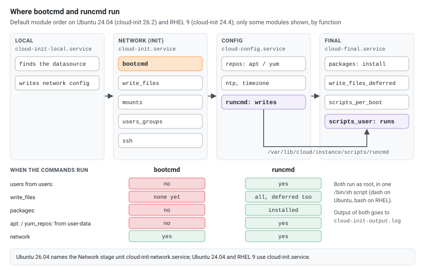
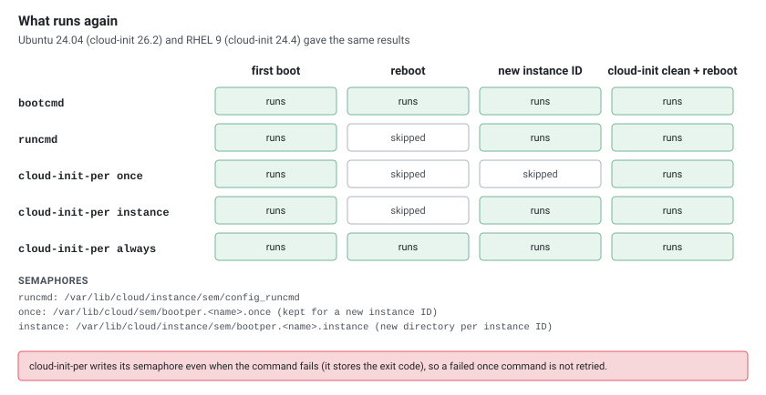

## Overview

cloud-init provides two modules for running commands during instance initialization: **bootcmd** and **runcmd**. They look similar in syntax but execute at completely different stages of the boot process, have different frequency behaviors, and serve different purposes. Confusing them is a common source of "it worked once but not after reboot" or "my filesystem wasn't ready yet" bugs.

Versions used: Ubuntu 24.04 with cloud-init 26.2 and RHEL 9 with cloud-init 24.4.

## cloud-init Boot Stages

To understand when `bootcmd` and `runcmd` execute, you need to know the cloud-init stage pipeline:

[](boot-stages.svg "Open the diagram full size")

The systemd services that drive these stages:

```
cloud-init-local.service     → Local stage
cloud-init.service           → Network (init) stage    ← bootcmd
cloud-config.service         → Config stage            ← runcmd (script written here)
cloud-final.service          → Final stage             ← runcmd (script executed here via scripts_user)
```

> **Note:** Ubuntu 24.04 and 22.04 (both on cloud-init 26.x) and RHEL 9 run the Network stage as `cloud-init.service`. Ubuntu 26.04 ships it as `cloud-init-network.service`, together with a new `cloud-init-main.service`. Check with `systemctl list-unit-files 'cloud*'`.

## bootcmd

### When It Runs

`bootcmd` executes during the **Network (init) stage**, early in the boot process. At this point:

- Network is available: `cloud-init.service` starts after `systemd-networkd-wait-online` (Ubuntu) or `NetworkManager-wait-online` (RHEL)
- The datasource has been read (metadata, userdata parsed)
- Filesystems declared in `/etc/fstab` may **not** be mounted yet on Ubuntu, where `cloud-init.service` is not ordered after `local-fs.target`. On RHEL 9, `cloud-init-local.service` waits for `sysinit.target`, so local fstab mounts are done
- Repositories and mirrors from user-data (`apt:`, `yum_repos:`) are **not** configured yet. The image's own repositories work: `apt-get install` and `dnf install` both succeed in `bootcmd`
- Users declared in `users:` do **not** exist yet
- SSH keys are **not** yet deployed
- No `write_files` entry has run yet: `write_files` is the next module after `bootcmd`, and `defer: true` entries run in the Final stage

### Frequency: Every Boot

By default, `bootcmd` runs on **every boot**, not just the first. This is by design — it's meant for commands that need to execute early on each startup, similar to rc.local-style scripts.

The module frequency is `always`; `/var/log/cloud-init.log` shows `running config-bootcmd with frequency always`. You can override it in `/etc/cloud/cloud.cfg` by changing the module entry to `[bootcmd, once]` (cloud-init then writes `/var/lib/cloud/sem/config_bootcmd.once` and skips `bootcmd` on later boots), but doing so defeats the module's intended purpose.

### Syntax

Each entry in `bootcmd` can be either a string (shell syntax) or a list (each item is quoted, so there is no shell expansion):

```yaml
#cloud-config
bootcmd:
  # String form — interpreted by /bin/sh
  - echo "Boot started at $(date)" >> /var/log/boot-times.log

  # List form — items are quoted, $VARIABLES stay literal
  - [cloud-init-per, once, fix-swap, sh, -c, "fallocate -l 1G /swapfile && chmod 600 /swapfile && mkswap /swapfile && swapon /swapfile"]

  # Modify kernel parameters before services start
  - sysctl -w vm.swappiness=10

  # Create a directory needed by a service that starts later
  - mkdir -p /run/myapp
```

Without `chmod 600`, `mkswap` and `swapon` both warn `insecure permissions 0644, fix with: chmod 0600 /swapfile`.

### cloud-init-per: Controlling Frequency Within bootcmd

Since `bootcmd` runs every boot, cloud-init provides the `cloud-init-per` helper to control how often individual commands within it execute:

```yaml
bootcmd:
  # Run only once, ever (survives reboots)
  - [cloud-init-per, once, setup-raid, mdadm, --assemble, /dev/md0, /dev/sdb1, /dev/sdc1]

  # Run once per instance (new instance ID = runs again)
  - [cloud-init-per, instance, format-ephemeral, mkfs.ext4, /dev/nvme1n1]

  # Run every boot (same as default behavior, but explicit); mount needs an existing mount point
  - mkdir -p /mnt/ramdisk
  - [cloud-init-per, always, mount-tmpfs, mount, -t, tmpfs, -o, "size=512M", tmpfs, /mnt/ramdisk]
```

`cloud-init-per` stores state in a semaphore file named `bootper.<name>.<frequency>`, with dashes in the name turned into underscores (`setup-raid` becomes `bootper.setup_raid.once`):

- `once` and `always`: `/var/lib/cloud/sem/`, kept when the instance ID changes
- `instance`: `/var/lib/cloud/instance/sem/`, which starts empty for a new instance ID

The semaphore is written even when the command fails: it holds the exit code and a timestamp, so a failed `once` command is **not** retried on the next boot. `cloud-init clean` deletes both directories, so `once` commands run again after it.

### Execution Model

- Commands run as **root**
- All entries are written to one shell script that cloud-init runs with `/bin/sh` (dash on Ubuntu, bash on RHEL)
- List entries are quoted item by item, so `[sh, -c, 'echo $0', "$HOME"]` prints the literal `$HOME`
- Commands run **sequentially** in the order listed
- A failing command does **not** stop the next ones. The script's exit code is the last command's: when the last command fails, cloud-init marks the `bootcmd` module as failed and `cloud-init status` reports `status: error` (exit code 1)
- stdout and stderr go to `/var/log/cloud-init-output.log`; `/var/log/cloud-init.log` only has the module start, finish and errors

## runcmd

### When It Runs

`runcmd` executes during the **Config stage** — but with an important nuance. The `cc_runcmd` module runs in the Config stage (`cloud-config.service`), where it writes your commands as a shell script to `/var/lib/cloud/instance/scripts/runcmd`. That script is then **executed** by the `scripts_user` module in the **Final stage** (`cloud-final.service`).

From a user's perspective, your runcmd commands run in the Final stage. At that point:

- Filesystems from `/etc/fstab` and the `mounts:` module are mounted
- Package mirrors are configured (`apt:` on Ubuntu, `yum_repos:` on RHEL)
- Packages listed in `packages:` are installed
- Users and groups from `users:` exist
- SSH keys are deployed
- `write_files` (both immediate and `defer: true`) have completed
- Network is fully operational
- All system services are starting or have started

### Frequency: Once Per Instance

`runcmd` runs **only once per instance** by default. After successful execution, a semaphore file is written to `/var/lib/cloud/instance/sem/config_runcmd`. On subsequent boots, the module is skipped entirely.

> **Note:** If the instance ID changes (e.g., the instance is rebuilt from a snapshot with new metadata), `runcmd` will run again because the semaphore is tied to the instance path.

### Syntax

Same syntax as `bootcmd` — string or list form:

```yaml
#cloud-config
runcmd:
  # String form — shell interpretation
  - echo "Instance setup complete at $(date)" >> /var/log/cloud-init-setup.log

  # List form — no shell expansion
  - [systemctl, enable, --now, nginx]

  # Multi-line block — still runs under /bin/sh, so a #!/bin/bash line here is only a comment
  - |
    apt-get update
    apt-get install -y docker.io
    systemctl enable --now docker
    usermod -aG docker ubuntu

  # Conditional execution
  - "[ -f /etc/needs-reboot ] && reboot || true"
```

All entries end up in one script that starts with `#!/bin/sh`. A block that starts with `#!/bin/bash` still runs under dash on Ubuntu; for bash syntax, call `bash -c` or write a script with `write_files` and run it.

### Execution Model

- Commands run as **root**
- All entries are written to `/var/lib/cloud/instance/scripts/runcmd` and run with `/bin/sh`
- List entries are quoted item by item (no shell expansion)
- Sequential execution
- A failing command does not stop the next ones; when the last command fails, `scripts_user` fails and `cloud-init status` reports `status: error`
- stdout/stderr → `/var/log/cloud-init-output.log` (the same log as bootcmd)

## Side-by-Side Comparison

| Aspect | bootcmd | runcmd |
|--------|---------|--------|
| Stage | Network (init) — early | Config (written) / Final (executed) — late |
| Frequency | Every boot | Once per instance |
| Filesystems mounted | Not guaranteed on Ubuntu; local fstab mounts on RHEL 9 | Yes |
| Packages installed | No | Yes (if `packages:` defined) |
| Users created | No | Yes |
| Network available | Yes | Yes |
| `write_files` completed | None (it runs right after bootcmd) | All (including `defer: true`) |
| Typical use | Kernel params, block device setup, early mounts | App install, service config, one-time setup |
| Systemd service | `cloud-init.service` (`cloud-init-network.service` on Ubuntu 26.04) | `cloud-config.service` (write) / `cloud-final.service` (execute) |
| Semaphore location | N/A (always runs, use `cloud-init-per`) | `/var/lib/cloud/instance/sem/config_runcmd` |
| Log file | `/var/log/cloud-init-output.log` | `/var/log/cloud-init-output.log` |

[](what-runs-again.svg "Open the diagram full size")

## When to Use bootcmd

Use `bootcmd` when the command must run **before other cloud-init modules** or **on every boot**:

- **Block device setup** — assembling RAID arrays, formatting ephemeral storage, creating LVM volumes
- **Kernel tuning** — sysctl parameters that must be set before services start
- **Filesystem pre-mount** — creating mount points, setting up tmpfs
- **Network workarounds** — adding static routes or iptables rules needed before SSH or cloud-config
- **Hardware initialization** — loading kernel modules, configuring device parameters

```yaml
#cloud-config
bootcmd:
  # Load a kernel module needed for NVMe devices
  - modprobe nvme

  # Set kernel parameters for a database workload
  - sysctl -w vm.dirty_ratio=15
  - sysctl -w vm.dirty_background_ratio=5
  - sysctl -w net.core.somaxconn=65535

  # Format and mount ephemeral NVMe (format once only, mount every boot)
  - [cloud-init-per, once, fmt-nvme, mkfs.xfs, /dev/nvme1n1]
  - mkdir -p /mnt/ephemeral
  - [cloud-init-per, always, mnt-nvme, mount, /dev/nvme1n1, /mnt/ephemeral]
```

## When to Use runcmd

Use `runcmd` for **one-time setup** that depends on the system being fully initialized:

- **Application installation** — installing and configuring software
- **Service enablement** — starting services that depend on config files and users being present
- **Post-provisioning** — registering with a config management tool, joining a cluster
- **File manipulation** — operations that depend on `write_files` or `packages` being complete

```yaml
#cloud-config
users:
  - default
  - name: deploy
    shell: /bin/bash

packages:
  - nginx
  - certbot
  - python3-certbot-nginx
  - git

write_files:
  - path: /etc/nginx/conf.d/myapp.conf
    content: |
      server {
          listen 80;
          server_name myapp.example.com;
          root /var/www/myapp;
      }

runcmd:
  # At this point: packages are installed, the config file is written, 'deploy' exists
  - install -d -o deploy -g deploy /var/www/myapp
  - sudo -u deploy git clone https://github.com/org/myapp.git /var/www/myapp
  - systemctl enable --now nginx
  - certbot --nginx -d myapp.example.com --non-interactive --agree-tos -m admin@example.com
```

- `certbot --nginx` needs the `python3-certbot-nginx` package; with `certbot` alone it stops with `The requested nginx plugin does not appear to be installed`.
- `deploy` cannot create directories in `/var/www`, so the directory is created and handed over first; `git clone` into an existing empty directory works.
- Ubuntu starts nginx when the package is installed, RHEL does not, and `systemctl reload nginx` on RHEL fails with `nginx.service is not active, cannot reload.` `systemctl enable --now nginx` works on both.
- On RHEL, `certbot` and `python3-certbot-nginx` come from EPEL, so add the repository with `yum_repos:` or leave them out.

## Common Mistakes

### Mistake 1: Using runcmd for Something Needed on Every Boot

```yaml
# WRONG — this only runs once, not after reboot
runcmd:
  - mount /dev/xvdf /data

# CORRECT — runs on every boot
bootcmd:
  - mkdir -p /data
  - [cloud-init-per, always, mount-data, mount, /dev/xvdf, /data]
```

Better yet, use the `mounts` module for persistent mounts:

```yaml
mounts:
  - [/dev/xvdf, /data, ext4, "defaults,nofail", "0", "2"]
```

The `mounts` module writes `/dev/xvdf	/data	ext4	defaults,nofail,comment=cloudconfig	0	2` to `/etc/fstab` and runs `mount -a`. With `nofail`, a missing device is not an error.

### Mistake 2: Using bootcmd for Package Installation

```yaml
# WRONG — runs again on every boot, and before the apt: / yum_repos: settings from user-data are applied
bootcmd:
  - apt-get update && apt-get install -y nginx

# CORRECT — packages are installed once, in the final stage
packages:
  - nginx
# or
runcmd:
  - apt-get update && apt-get install -y nginx
```

The `bootcmd` version does install nginx, because the image's own repositories already work. The problem is that `apt-get update` and the install run again on every boot, and mirrors or repositories defined in user-data are not there yet.

### Mistake 3: Assuming Users Exist in bootcmd

```yaml
users:
  - name: deploy
    shell: /bin/bash

# WRONG — 'deploy' user doesn't exist yet during bootcmd ("sudo: unknown user deploy")
bootcmd:
  - sudo -u deploy mkdir /home/deploy/app

# CORRECT — user exists by the time runcmd executes
runcmd:
  - sudo -u deploy mkdir /home/deploy/app
```

### Mistake 4: Forgetting bootcmd Runs Every Boot

```yaml
# DANGEROUS — appends a line to fstab on EVERY boot
bootcmd:
  - echo "/dev/xvdf /data ext4 defaults,nofail 0 2" >> /etc/fstab

# SAFE — only runs once
bootcmd:
  - [cloud-init-per, once, add-fstab, sh, -c, 'echo "/dev/xvdf /data ext4 defaults,nofail 0 2" >> /etc/fstab']
```

Without `nofail`, `mount -a` fails while the device is missing (`special device /dev/xvdf does not exist`), and so does the `mounts` module, which runs `mount -a`.

### Mistake 5: Relying on write_files Content in bootcmd

```yaml
write_files:
  - path: /etc/myapp/config.json
    content: '{"port": 8080}'

# WRONG — write_files runs AFTER bootcmd in the init stage
bootcmd:
  - cat /etc/myapp/config.json  # cat: /etc/myapp/config.json: No such file or directory

# CORRECT — write_files has completed by the time runcmd runs
runcmd:
  - cat /etc/myapp/config.json
```

> **Note:** Non-deferred `write_files` entries actually run in the init stage too, but the ordering relative to `bootcmd` within that stage is: bootcmd first, then write_files. Deferred (`defer: true`) entries run in the final stage, before runcmd.

### Mistake 6: Entries YAML Reads as Something Else

```yaml
# WRONG — false is a YAML boolean, and "status: ok" turns the line into a mapping
runcmd:
  - false
  - echo status: ok

# CORRECT — quote them
runcmd:
  - "false"
  - 'echo "status: ok"'
```

An unquoted `false` or `true` becomes a boolean (`Unable to shellify type 'bool'`) and `echo status: ok` becomes the mapping `{'echo status': 'ok'}`. In both cases the whole module fails with `Failed to shellify` and none of its commands run, not even the ones before the bad entry.

A second `: ` on the same line, as in `- test -f /etc/app.conf && echo "state: ready" || echo "state: missing"`, is worse: the file is no longer valid YAML (`mapping values are not allowed here`), cloud-init logs `Failed loading yaml blob` and ignores the entire user-data.

`cloud-init schema -c user-data.yaml` reports these errors and exits with 1, so run it before using a file.

## Debugging

### Check Which Stage Failed

```bash
# See the full cloud-init status
cloud-init status --long

# Check individual stage results
cat /run/cloud-init/result.json
```

### View bootcmd Output

```bash
# bootcmd output (stdout and stderr) is in the output log
cat /var/log/cloud-init-output.log

# Module start, finish and errors are in the main log
grep "bootcmd" /var/log/cloud-init.log
```

### View runcmd Output

```bash
# runcmd output goes to cloud-init-output.log
cat /var/log/cloud-init-output.log

# Module-level logging
grep "cc_runcmd" /var/log/cloud-init.log

# The script cloud-init built from your runcmd entries
cat /var/lib/cloud/instance/scripts/runcmd
```

### Check Semaphores

```bash
# See which modules have run (once-per-instance tracking)
ls /var/lib/cloud/instance/sem/

# Check cloud-init-per semaphores with "once" frequency (persists across instances)
ls /var/lib/cloud/sem/

# Check cloud-init-per semaphores with "instance" frequency
ls /var/lib/cloud/instance/sem/ | grep "bootper"
```

### Re-run cloud-init (for Testing)

```bash
# Clean all instance state, including cloud-init-per "once" semaphores (CAUTION: re-runs everything on next boot)
sudo cloud-init clean

# Also delete the logs, then reboot
sudo cloud-init clean --logs --reboot

# Run the runcmd commands again (scripts_user executes the script)
sudo cloud-init single --name scripts_user --frequency always
```

`cloud-init single --name runcmd` only writes the script again and does not run any command. `scripts_user` runs every script in `/var/lib/cloud/instance/scripts/`, not only `runcmd`.

### Analyze Module Execution Order

```bash
# Show timestamps for each module
cloud-init analyze show

# Show blame-style slowest modules
cloud-init analyze blame
```

## Module Execution Order Reference

For context, here's where `bootcmd` and `runcmd` sit relative to the other modules in the default `/etc/cloud/cloud.cfg`. The Network stage is the same on both distributions:

```
Network (init) stage — cloud-init.service (cloud_init_modules):
  seed_random, bootcmd ← runs here, write_files (non-deferred), growpart, resizefs,
  disk_setup, mounts, set_hostname, update_hostname, update_etc_hosts, ca_certs,
  rsyslog, users_groups, ssh, set_passwords

Config stage — cloud-config.service (cloud_config_modules):
  Ubuntu 24.04: wireguard, snap, ubuntu_autoinstall, ssh_import_id, keyboard, locale,
                grub_dpkg, apt_pipelining, apt_configure, ubuntu_pro, ntp, timezone,
                disable_ec2_metadata, runcmd ← script written here, byobu
  RHEL 9:       ssh_import_id, locale, rh_subscription, spacewalk, yum_add_repo, ntp,
                timezone, disable_ec2_metadata, runcmd ← script written here

Final stage — cloud-final.service (cloud_final_modules):
  package_update_upgrade_install, [Ubuntu only: fan, landscape, lxd, ubuntu_drivers,]
  write_files_deferred, puppet, chef, ansible, mcollective, salt_minion, reset_rmc,
  scripts_vendor, scripts_per_once, scripts_per_boot, scripts_per_instance,
  scripts_user ← runcmd script executes here, ssh_authkey_fingerprints,
  keys_to_console, install_hotplug, phone_home, final_message, power_state_change
```

## Examples

Minimal example using both:

```yaml
#cloud-config
bootcmd:
  # Runs early, every boot
  - [sysctl, -w, "net.ipv4.ip_forward=1"]
  - echo "tuned early at $(date)" >> /var/log/bootcmd.log

runcmd:
  # Runs once, late in first boot
  - [apt-get, update]
  - [apt-get, install, "-y", nginx]
  - systemctl enable --now nginx
```

Gate bootcmd to "once per instance" (even though `bootcmd` runs every boot by default):

```yaml
#cloud-config
bootcmd:
  - [cloud-init-per, instance, early-net, sysctl, -w, "net.ipv4.ip_forward=1"]
```

A late, every-boot script with `write_files` and the per-boot directory (it needs to be executable):

```yaml
#cloud-config
write_files:
  - path: /var/lib/cloud/scripts/per-boot/10-stamp.sh
    permissions: '0755'
    content: |
      #!/bin/sh
      echo "per-boot $(date +%T)" >> /var/log/perboot.log
```

## Notes and Gotchas

- Network IS available for `bootcmd`: `cloud-init.service` starts after `systemd-networkd-wait-online` or `NetworkManager-wait-online`, and `apt-get update` and `dnf install` resolve and download from the distribution mirrors in `bootcmd`. What is not there yet is the configuration from user-data: repositories and mirrors from `apt:` and `yum_repos:` are applied later, in the Config stage.
- Prefer absolute paths in both sections.
- For long-running daemons, create a systemd unit in `write_files` and enable it, rather than starting it in `runcmd`.
- If you need "every boot" behavior at the end of boot, use `/var/lib/cloud/scripts/per-boot` or a systemd service instead of `runcmd`.
- Quote entries such as `"false"`, `"true"` and anything with `: ` in it (see Mistake 6).

## Summary

`bootcmd` is your "early boot, every boot" primitive — use it for block device setup, kernel tuning, and anything that must happen before the system is fully configured. It has no frequency control built in, so wrap individual commands with `cloud-init-per` when you need once-only semantics.

`runcmd` is your "one-time, fully-provisioned" primitive — use it for application setup, service configuration, and post-install tasks that depend on users, packages, and files being in place. It runs once per instance and won't repeat on reboot.

The architectural decision: if your command must run before filesystems, users, and packages are ready, or must repeat on every boot — use `bootcmd`. If it's one-time setup that depends on the full system being available — use `runcmd`.
