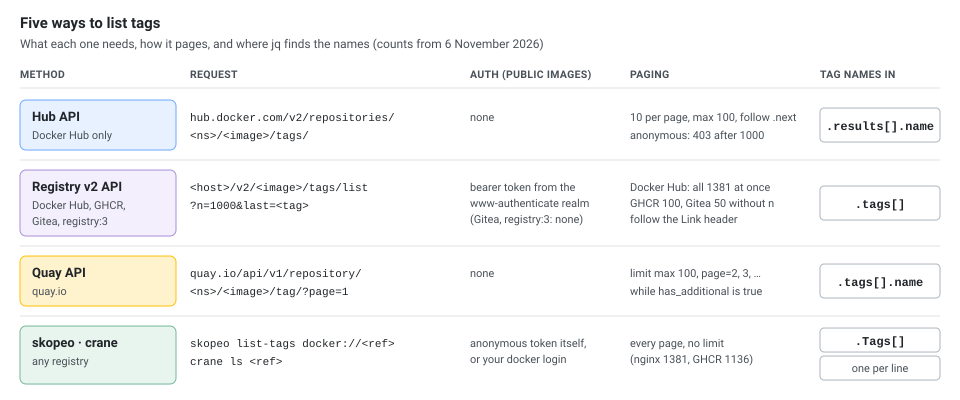
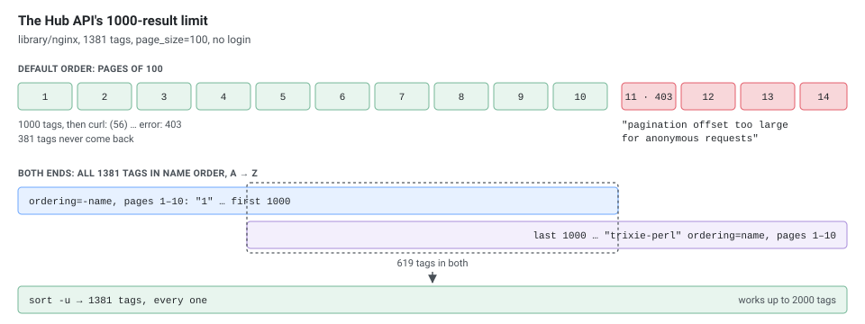

How to list the tags of a container image from the command line: the Docker Hub API, the standard Registry v2 API that other registries speak (GHCR, Gitea, Quay), and tools such as `skopeo` and `crane` that hide the differences. It covers pagination, sorting by version, filtering, the `sha256-…` tags that aren't versions, getting a tag's digest and date, and the mistakes that make `jq` fail.

Everything was run on 6 November 2026 against the live registries with `curl` 8.7.1, `jq` 1.7.1, **`skopeo` 1.22.3** and **`crane` v0.22.1**, and against a local **`registry:3`** (Distribution 3.1.2). Tag counts grow every week; the ones below are from that day.

## Which Method for Which Registry

| Registry | API | Tag list path | Authentication for public images |
|----------|-----|---------------|----------------------------------|
| Docker Hub | Hub API | `https://hub.docker.com/v2/repositories/<namespace>/<image>/tags/` | None |
| Docker Hub | Registry v2 | `https://registry-1.docker.io/v2/<namespace>/<image>/tags/list` | Bearer token (anonymous is fine) |
| GHCR (`ghcr.io`) | Registry v2 | `/v2/<owner>/<image>/tags/list` | Bearer token (anonymous) |
| `docker.gitea.com` (Gitea's images) | Registry v2 | `/v2/gitea/tags/list` | None |
| Your Gitea/Forgejo instance | Registry v2 | `/v2/<owner>/<image>/tags/list` | Basic auth for private images |
| Your own `registry:3` | Registry v2 | `/v2/<image>/tags/list` | None unless you configure it |
| Quay (`quay.io`) | Quay API | `/api/v1/repository/<namespace>/<image>/tag/` | None |
| Any of them | `skopeo`, `crane` | `skopeo list-tags docker://<ref>`, `crane ls <ref>` | Uses your Docker login |

Each API pages differently and puts the tag names in a different place in its JSON:

[](tags-methods.svg "Open the diagram full size")

## Prerequisites

```bash
# jq (JSON) and curl
brew install jq                       # macOS
sudo apt install -y jq curl           # Debian/Ubuntu
sudo dnf install -y jq curl           # RHEL (jq from EPEL on older releases)

# Optional: skopeo and crane
brew install skopeo crane             # macOS
sudo apt install -y skopeo            # Debian/Ubuntu (1.13.3 on Ubuntu 24.04)
sudo dnf install -y skopeo            # RHEL
```

`crane` is a single binary from the [go-containerregistry releases](https://github.com/google/go-containerregistry/releases) (`go-containerregistry_Linux_arm64.tar.gz` or `..._x86_64.tar.gz`, containing `crane`). Both tools also run as containers, which is how the newest releases were used here:

```bash
skopeo() { docker run --rm quay.io/skopeo/stable:v1.22.3 "$@"; }
crane()  { docker run --rm gcr.io/go-containerregistry/crane:v0.22.1 "$@"; }
```

The container versions don't see your `docker login`; mount `~/.docker/config.json` for private images.

## Docker Hub: the Hub API

```bash
curl -s "https://hub.docker.com/v2/repositories/library/nginx/tags/" | jq -r '.results[].name'
```

That prints only the first 10 tags. Ask for the maximum page size to get 100 in one request:

```bash
curl -s "https://hub.docker.com/v2/repositories/library/nginx/tags/?page_size=100" | jq -r '.results[].name'
# latest
# stable-alpine3.24-perl
# stable-alpine3.24-otel
# ...                       (100 names, newest first, down to 1.31.8)
```

It is still one page: the response's `count` was 1381 and `next` pointed to `?page=2&page_size=100`. To get all of them, follow `next` (below).

`registry.hub.docker.com` and `hub.docker.com` both answer the same API (both returned `count` 1381 for `nginx`). Rules that trip people up:

- **Official images live under `library/`**: `/repositories/library/nginx/tags/` works; `/repositories/nginx/tags/` returns `{"message":"object not found","errinfo":{}}`, and `jq` then fails with `Cannot iterate over null`.
- **The default page has only 10 tags.** For `nginx` the response said `count` 1381 and `results` 10, with a `next` link. The commonly shown one-liner therefore lists 10 of 1381 tags.
- **`page_size` is capped at 100**: `page_size=1000` returned 100 results.

### Get Tags (Follow the next Link, Up to 1000)

```bash
hub_tags() {          # usage: hub_tags library/mediawiki
    local url="https://hub.docker.com/v2/repositories/$1/tags/?page_size=100" page
    while [ -n "$url" ] && [ "$url" != "null" ]; do
        page=$(curl -fsS "$url") || return 1
        echo "$page" | jq -r '.results[].name'
        url=$(echo "$page" | jq -r '.next')
    done
}

hub_tags library/mediawiki | sort -V
```

`library/mediawiki` has 366 tags: 4 pages, about a second, no duplicates.

**Anonymous requests can't page past 1000 results.** For `library/nginx` (1381 tags) the loop printed 1000 tags and then `curl: (56) The requested URL returned error: 403`. Page 11 of 100 (and page 41 of 25, and any offset of 1000 or more) answers:

```json
{"message":"pagination offset too large for anonymous requests; sign in to page further","errinfo":{}}
```

[](tags-hub-1000.svg "Open the diagram full size")

`grafana/grafana` (2045 tags) is cut the same way, and since the default order is newest first, the first 1000 are mostly recent tags of all kinds. Options for repositories with more than 1000 tags:

- **Use the Registry v2 API, `skopeo` or `crane`** (next sections): they return **all** tags (1381 for `nginx`, 2045 for `grafana/grafana`). The v2 list had 381 `nginx` tags that the Hub API's first 1000 didn't.
- **Narrow the query** with the `name=` filter so each query returns under 1000: `?name=alpine` gave 795 tags for `nginx`, `?name=12.` gave 491 for `grafana/grafana`.
- **Read from both ends**: pages 1 to 10 of `ordering=name` plus pages 1 to 10 of `ordering=-name`, combined with `sort -u`, returned all 1381 `nginx` tags. This covers up to 2000 tags.

  ```bash
  for o in name -name; do for p in $(seq 1 10); do
      curl -fsS "https://hub.docker.com/v2/repositories/library/nginx/tags/?page_size=100&page=$p&ordering=$o" | jq -r '.results[].name'
  done; done | sort -u | wc -l
  # 1381
  ```

- Sign in: authenticated requests aren't subject to this limit (a login token for the Hub API wasn't tested here).

Docker Hub also rate-limits requests per IP address, so don't loop over many images without a pause.

### Order, Filter and Details

```bash
BASE="https://hub.docker.com/v2/repositories/library/nginx/tags/"

# Order: default (and last_updated) is newest first; -last_updated, name, -name
curl -s "$BASE?page_size=3&ordering=-last_updated" | jq -r '.results[].name'     # oldest first
# 1.7.11
# 1.7
# 1.7.12
curl -s "$BASE?page_size=3&ordering=-name" | jq -r '.results[].name'             # A to Z
# 1
# 1.10
# 1.10.0
curl -s "$BASE?page_size=3&ordering=name" | jq -r '.results[].name'              # Z to A
# trixie-perl
# trixie-otel
# trixie

# Server-side substring filter on the tag name
curl -s "$BASE?page_size=100&name=alpine" | jq -r '"\(.count) tags contain alpine"'
# 795 tags contain alpine

# Date, digest and architectures
curl -s "$BASE?page_size=3&name=1.27-alpine" | jq -r '.results[] |
    "\(.name)  \(.last_updated[0:10])  \(.digest[0:19])  \([.images[]?.architecture] | unique | join(","))"'
# 1.27-alpine3.21-perl  2025-04-16  sha256:113552fa0c0c  386,amd64,arm,arm64,ppc64le,riscv64,s390x,unknown
# 1.27-alpine3.21  2025-04-16  sha256:65645c7bb6a0  386,amd64,arm,arm64,ppc64le,riscv64,s390x,unknown
# 1.27-alpine-perl  2025-04-16  sha256:113552fa0c0c  386,amd64,arm,arm64,ppc64le,riscv64,s390x,unknown

# One tag (404 if it doesn't exist)
curl -s "${BASE}1.27-alpine" | jq -r '"\(.name) \(.full_size) bytes"'
# 1.27-alpine 20960631 bytes
```

The name order is the opposite of what the word suggests: `ordering=name` runs from Z to A and `-name` from A to Z. The `unknown` architecture is the attestation manifest Docker adds next to the images.

The **default order is "most recently updated first"**, so `... | head -10` ("get latest 10 tags") gives the 10 most recently **pushed** tags: for `nginx` they were `stable-alpine3.24-perl`, `stable-alpine3.24-otel`, `stable-alpine3.24`..., not the 10 highest versions. To find the newest **version**, list everything and sort by version (below).

### Sort and Filter by Version

```bash
hub_tags library/nginx | grep -E '^[0-9]+\.[0-9]+\.[0-9]+$' | sort -V | tail -n 3
# curl: (56) The requested URL returned error: 403
# 1.31.6
# 1.31.7
# 1.31.8

hub_tags library/nginx | grep -E '^[0-9]+\.[0-9]+$' | sort -V | tail -n 5     # 1.27 1.28 1.29 1.30 1.31
hub_tags library/nginx | grep -E '^[0-9]+\.[0-9]+\.[0-9]+-alpine$'              # One variant
```

The `curl: (56) … 403` line is the 1000-result limit again: `nginx` has 1381 tags, so `hub_tags` stops at page 11, prints the error on stderr and returns 1 (which fails the pipeline under `set -o pipefail`). The answer is still right because the newest tags are in the first 1000 (default order), but the list is incomplete. For repositories over 1000 tags use `crane ls` or `skopeo list-tags`, which gave the same `1.31.6 1.31.7 1.31.8` without an error. To keep the Hub API and only silence the message, send stderr to `/dev/null`:

```bash
hub_tags library/nginx 2>/dev/null | grep -E '^[0-9]+\.[0-9]+\.[0-9]+$' | sort -V | tail -n 1
# 1.31.8
```

That hides every error, not only the expected 403: if the output is empty, run it again without `2>/dev/null` (an undefined `hub_tags` in a new shell, or a failed first page, prints nothing otherwise). Always use **`sort -V`** (version sort) rather than plain `sort`: plain sort puts `1.10` before `1.2` and `1.9` (`1.10 1.2 1.27 1.9`), `sort -V` gives `1.2 1.9 1.10 1.27`. Anchor the regular expression (`^...$`) so variants like `1.27-alpine3.21-perl` don't match. `tail` takes the newest, `sort -Vr | head` does the same in reverse.

### Pre-releases Sort After the Release

`sort -V` knows nothing about semantic versioning: it puts `1.0.0` **before** `1.0.0-rc1`, so a release candidate looks newer than the release it leads to:

```bash
printf '1.0.0\n1.0.0-rc1\n1.0.0-beta.2\n1.0.1\n' | sort -V
# 1.0.0
# 1.0.0-beta.2
# 1.0.0-rc1
# 1.0.1
```

On a real repository (`prom/prometheus` had 136 tags with `-rc`), a regex that allows release candidates picks one as the newest:

```bash
crane ls prom/prometheus | grep -E '^v3\.1[56]\.[0-9]+(-rc\.[0-9]+)?$' | sort -V | tail -n 2
# v3.16.0
# v3.16.0-rc.4
```

Two fixes. Exclude pre-releases with the strict `^v[0-9]+\.[0-9]+\.[0-9]+$` (it gave `v3.16.0`), or, to keep them in the right place, append a character that sorts after `-` to every tag without one, sort, and strip it:

```bash
crane ls prom/prometheus | grep -E '^v3\.1[56]\.[0-9]+(-rc\.[0-9]+)?$' | sed '/-/!s/$/_/' | sort -V | sed 's/_$//' | tr '\n' ' '
# v3.15.0-rc.0 v3.15.0-rc.1 v3.15.0 v3.15.1 v3.16.0-rc.4 v3.16.0
```

The same trap catches variant suffixes: on `grafana/grafana`, `13.3.0-ubuntu` sorts after `13.3.0`, and the 13.x line had 28 or 29 tags each of `-ubuntu`, `-ubuntu-slim`, `-slim`, `-distroless` and `-distroless-slim`.

### Which Version Is latest?

`latest`, `stable` or `mainline` are tags like any other, pointing to the same image as a version tag. Tags that point to the same image share a digest, so match the digest of `latest` against the newest tags (the first page is newest first):

```bash
BASE="https://hub.docker.com/v2/repositories/library/nginx/tags/"
curl -s "$BASE?page_size=100" | jq -r --arg d "$(curl -s "${BASE}latest" | jq -r .digest)" '.results[] | select(.digest == $d) | .name'
# latest
# trixie
# mainline-trixie
# mainline
# 1.31.8-trixie
# 1.31.8
```

For `stable` the same query printed `stable-trixie stable 1.30.6-trixie 1.30.6 1.30-trixie 1.30`; for `prom/prometheus`, `latest` was `v3.16.0` (with `v3`, `v3-busybox` and `latest-busybox`), and for `grafana/grafana` it was `13.3.0` and `13.3`. On other registries compare `crane digest` of the candidates:

```bash
for t in latest 1.31.8 1.31 1 1.30.3; do echo "$t $(crane digest nginx:$t)"; done
# latest sha256:165ddde8751e75a1c907d24ef10d9f6deb08b57e0fe56caf67512486aff76d82
# 1.31.8 sha256:165ddde8751e75a1c907d24ef10d9f6deb08b57e0fe56caf67512486aff76d82
# 1.31 sha256:165ddde8751e75a1c907d24ef10d9f6deb08b57e0fe56caf67512486aff76d82
# 1 sha256:165ddde8751e75a1c907d24ef10d9f6deb08b57e0fe56caf67512486aff76d82
# 1.30.3 sha256:29f8cc6c9d0072f7a79ea4647690f561c0dff83968d7f6d5684f23c6cfe6e41b
```

The answer is only true today: the next release moves `latest`, `1.31` and `1` to a new digest.

### Which Tags Have My Platform

The Hub API lists each tag's architectures in `.images[]`; the same tag line isn't always built for the same set:

```bash
curl -s "$BASE?page_size=100&name=1.31" | jq -r '.results[] | select(.name|test("^1\\.31\\.[0-9]+$")) |
    "\(.name) \([.images[].architecture]|unique|join(","))"'
# 1.31.8 386,amd64,arm,arm64,ppc64le,riscv64,s390x,unknown
# 1.31.7 386,amd64,arm,arm64,ppc64le,riscv64,s390x,unknown
# 1.31.6 386,amd64,arm,arm64,ppc64le,s390x,unknown
# 1.31.5 386,amd64,arm,arm64,ppc64le,riscv64,s390x,unknown
# 1.31.4 386,amd64,arm,arm64,ppc64le,riscv64,s390x,unknown
# 1.31.3 386,amd64,arm,arm64,ppc64le,riscv64,s390x,unknown
```

`1.31.6` has no `riscv64` image. Add `| select([.images[].architecture]|index("arm64"))` to keep only the tags that have a platform. On other registries read the image index; `crane manifest` shows the variants too:

```bash
crane manifest nginx:1.31.8 | jq -r '.manifests[].platform | "\(.os)/\(.architecture)\(if .variant then "/"+.variant else "" end)"' | sort | uniq -c
#    1 linux/386
#    1 linux/amd64
#    1 linux/arm/v5
#    1 linux/arm/v7
#    1 linux/arm64/v8
#    1 linux/ppc64le
#    1 linux/riscv64
#    1 linux/s390x
#    8 unknown/unknown
```

The eight `unknown/unknown` entries are the attestation manifests, one per image. The oldest tags are different again: `ordering=-last_updated` starts with `1.7.11`, `1.7`, `1.7.12`, `1.9.0`, all `amd64` only, and `crane manifest nginx:1.9.0` returns a `schemaVersion: 1` manifest that Docker 29 refuses to pull:

```text
Error response from daemon: not implemented: media type "application/vnd.docker.distribution.manifest.v1+prettyjws" is no longer supported since containerd v2.1, please rebuild the image as "application/vnd.docker.distribution.manifest.v2+json" or "application/vnd.oci.image.manifest.v1+json"
```

A tag being listed doesn't mean it can still be pulled.

### User and Organization Images

```bash
hub_tags prom/prometheus | grep -E '^v[0-9]+\.[0-9]+\.[0-9]+$' | sort -V | tail -n 3     # 429 tags: under the 1000 limit
# v3.15.0
# v3.15.1
# v3.16.0
curl -s "https://hub.docker.com/v2/repositories/linuxserver/nginx/tags/?page_size=5" | jq -r '.results[].name'

# More than 1000 tags (grafana/grafana has 2045): use skopeo, or a name filter
skopeo list-tags docker://grafana/grafana | jq -r '.Tags[]' | grep -E '^[0-9]+\.[0-9]+\.[0-9]+$' | sort -V | tail -n 3
# 13.2.4
# 13.2.5
# 13.3.0
```

**The `bitnami/mediawiki` example in many guides no longer works**: `/repositories/bitnami/mediawiki/tags/` returned `{"message":"object not found","errinfo":{}}` (the repository doesn't exist on Docker Hub any more, and `bitnamilegacy/mediawiki` doesn't either). Other Bitnami repositories exist but no longer carry version tags: `bitnami/redis` listed 594 tags, and only `latest` and `latest-metadata` were not `sha256-…` tags (next section). Use the official `library/mediawiki`, or check a repository's tags on Docker Hub before relying on it.

### Handling Errors

A wrong name returns an error object, and `jq` then fails with `Cannot iterate over null`:

```bash
curl -s "https://hub.docker.com/v2/repositories/library/doesnotexist123/tags/" | jq -r '.results[].name'
# jq: error (at <stdin>:0): Cannot iterate over null (null)          (the body was {"message":"object not found","errinfo":{}})
```

Make `curl` fail on HTTP errors (`-f`), keep error messages (`-S`), and let `jq` skip a missing array (`[]?`):

```bash
set -o pipefail
curl -fsS "$URL" | jq -r '.results[]?.name'      # curl: (56) The requested URL returned error: 404, exit status 56
```

## The sha256- Tags Are Signatures, Not Versions

Some repositories have more `sha256-…` tags than real ones. They are tags that signing and attestation tools push **next to** an image, because a registry has no other place to hang extra data on a manifest. Of the 594 `bitnami/redis` tags, 592 looked like this, four per image digest:

```bash
crane ls bitnami/redis | grep "^sha256-$(crane digest bitnami/redis:latest | cut -c8-)" | sed -E 's/[0-9a-f]{64}/<digest>/'
# sha256-<digest>
# sha256-<digest>.att
# sha256-<digest>.metadata
# sha256-<digest>.sig
```

| Tag | What `crane manifest` showed | Pushed by |
|-----|------------------------------|-----------|
| `sha256-<digest>.sig` | Image manifest with a `application/vnd.dev.cosign.simplesigning.v1+json` layer | cosign signature |
| `sha256-<digest>.att` | Image manifest with a `application/vnd.dsse.envelope.v1+json` layer | cosign attestation (in-toto) |
| `sha256-<digest>` | Image index of `application/vnd.cncf.notary.signature` manifests | Notation, through the OCI referrers tag fallback |
| `sha256-<digest>.metadata` | 15 `application/vnd.vmware.tac.*` layers (SBOMs, scan results) | Bitnami's own build metadata |

`<digest>` is the image's own digest with `:` replaced by `-`, so the four tags belong to `latest` above. The Hub API sorts them by push date like any tag, which is why the newest `bitnami/redis` tags on the first page were all `sha256-…`. Filter them out before sorting versions:

```bash
crane ls bitnami/redis | grep -vE '^sha256-[0-9a-f]{64}'
# latest
# latest-metadata
```

`nginx` and `grafana/grafana` had none: Docker's own attestations are stored in the image index instead (the `unknown` architecture above), not as extra tags. The record holder here was `ghcr.io/sigstore/cosign/cosign`, cosign's own image, with 32166 `sha256-…` tags.

### The Referrers API

OCI Distribution 1.1 added a request that answers "what refers to this image?" directly, so tools no longer need the extra tags: `GET /v2/<image>/referrers/<digest>` returns an image index of the artifacts whose `subject` is that digest. On Docker Hub it found the Notation signature that the bare `sha256-<digest>` tag holds:

```bash
BD=$(crane digest bitnami/redis:latest)
BT=$(curl -s "https://auth.docker.io/token?service=registry.docker.io&scope=repository:bitnami/redis:pull" | jq -r .token)
curl -s -H "Authorization: Bearer $BT" "https://registry-1.docker.io/v2/bitnami/redis/referrers/$BD" | jq -r '.manifests[] | "\(.digest[0:19])  \(.artifactType)"'
# sha256:8a48028ac2ad  application/vnd.cncf.notary.signature
crane manifest bitnami/redis:sha256-${BD#sha256:} | jq -r '.manifests[] | "\(.digest[0:19])  \(.artifactType)"'
# sha256:8a48028ac2ad  application/vnd.cncf.notary.signature
```

`?artifactType=application/vnd.cncf.notary.signature` filters the list on the server. The cosign `.sig` and `.att` tags don't show up there: they have no `subject` and exist only as tags. Support differed by registry:

| Registry | `/v2/<image>/referrers/<digest>` |
|----------|----------------------------------|
| Docker Hub | `200`, an index (empty `manifests` for `nginx:1.31.8`) |
| Quay | `200`, empty index for `prometheus/prometheus:latest` |
| GHCR | `404` `MANIFEST_UNKNOWN`: not supported, tools fall back to `sha256-…` tags |
| `registry:3` (Distribution 3.1.2) | `404 page not found`: not supported |

Where the API answers `404`, a signing tool that follows the OCI fallback pushes a `sha256-<digest>` tag instead, which is how those tags end up in tag lists.

## The Registry v2 API (Docker Hub, GHCR, Gitea and Others)

All registries that implement the OCI/Docker Registry v2 API answer the same request:

```bash
curl -s "https://<registry-host>/v2/<image-path>/tags/list" | jq -r '.tags[]'
```

Most need a **bearer token** even for public images. The registry answers `401` and says where to get one:

[](tags-token.svg "Open the diagram full size")

On Docker Hub:

```bash
curl -si "https://registry-1.docker.io/v2/library/nginx/tags/list" | grep -iE '^HTTP|www-authenticate'
# HTTP/2 401
# www-authenticate: Bearer realm="https://auth.docker.io/token",service="registry.docker.io",scope="repository:library/nginx:pull"

TOKEN=$(curl -s "https://auth.docker.io/token?service=registry.docker.io&scope=repository:library/nginx:pull" | jq -r .token)
curl -s -H "Authorization: Bearer $TOKEN" "https://registry-1.docker.io/v2/library/nginx/tags/list" | jq -r '.tags[]'
```

Behaviour of `/tags/list`:

- **Docker Hub returns all tags in one response** by default: `library/nginx` returned all 1381 tags at once, in **alphabetical** order (not by date or version), so `sort -V` is still needed.
- **Other registries stop early**: without `n`, GHCR returned 100 tags and `docker.gitea.com` 50, each with a `Link` header to the next page. **Pagination** uses `n` and `last`: `?n=5` on Docker Hub returned 5 tags plus `link: </v2/library/nginx/tags/list?last=1-alpine-slim&n=5>; rel="next"`.
- The token is requested **per repository** (`scope=repository:<name>:pull`): the `nginx` token got `401` on `library/mediawiki`.

### Get Every Tag (Follow the Link Header)

```bash
v2_tags() {   # usage: v2_tags <registry-host> <image-path> [token]
    local url="https://$1/v2/$2/tags/list?n=1000" auth=() resp
    [ -n "$3" ] && auth=(-H "Authorization: Bearer $3")
    while [ -n "$url" ]; do
        resp=$(curl -fsS -i "${auth[@]}" "$url") || return 1
        printf '%s\n' "$resp" | awk 'body; /^\r?$/ {body=1}' | jq -r '.tags[]?'
        url=$(printf '%s\n' "$resp" | sed -nE 's/^link: *<?([^>;]*)>?;.*/\1/Ip' | tr -d '\r')
        case $url in /*) url="https://$1$url" ;; esac
    done
}

v2_tags registry-1.docker.io library/nginx "$TOKEN" | wc -l     # 1381
```

`curl -i` keeps the headers in front of the body; `awk` prints what follows the blank line, and `sed` takes the next URL from the `Link` header. It accepts both forms seen here: the standard `<path>; rel="next"` (Docker Hub, GHCR, Distribution) and Gitea's absolute URL without angle brackets (`link: https://docker.gitea.com/v2/gitea/tags/list?n=50&last=1.11.0; rel=next`). It ran unchanged with the BSD `sed` and `awk` of macOS; Docker Hub's 1381 tags came back without duplicates.

### GHCR

```bash
T=$(curl -s "https://ghcr.io/token?scope=repository:linuxserver/nginx:pull" | jq -r .token)
v2_tags ghcr.io linuxserver/nginx "$T" | grep -E '^[0-9]+\.[0-9]+\.[0-9]+$' | sort -V | tail -n 3
# 1.30.3
# 1.30.4
# 1.30.6
```

Without the token, GHCR returned `401` with `www-authenticate: Bearer realm="https://ghcr.io/token",service="ghcr.io",scope="repository:linuxserver/nginx:pull"`. It caps a page at 1000 even with `n=10000`, so `linuxserver/nginx` (1136 tags) takes two pages.

### Gitea

The Gitea project's own image registry needs no token for reading:

```bash
v2_tags docker.gitea.com gitea | grep -E '^[0-9]+\.[0-9]+\.[0-9]+$' | sort -V | tail -n 3
# 28.1.0
# 28.2.0
# 28.3.0
```

The answer's `name` was `gitea/gitea`, and it listed 914 tags (Docker Hub's `gitea/gitea` had 913). A plain `curl .../v2/gitea/tags/list | jq -r '.tags[]' | sort -V | tail` only sees the first 50, which ended at `1.11.0`. Your **own** Gitea or Forgejo instance has its container registry on the instance's host name, with the owner in the path; private images need a token with the `read:package` scope as the password:

```bash
curl -s -u "<user>:<token>" "https://gitea.example.com/v2/<owner>/<image>/tags/list?n=1000" | jq -r '.tags[]'
```

(See the [Docker Cheatsheet]() for the registry login and scopes.)

### Quay

Quay has its own JSON API, pages of at most 100 and a `has_additional` flag:

```bash
curl -s "https://quay.io/api/v1/repository/prometheus/prometheus/tag/?limit=100&onlyActiveTags=true&page=1" | jq -c '{page, has_additional, n: (.tags|length)}'
# {"page":1,"has_additional":true,"n":100}
```

`prometheus/prometheus` took 5 pages (100, 100, 100, 100, 12): 412 tags. Each tag also carries `last_modified` and `manifest_digest`.

### AWS ECR, GCR and Others

Cloud registries use their own CLIs: `aws ecr list-images --repository-name <name>`, `gcloud artifacts docker tags list`. They weren't tested here.

## Your Own Registry

A local `registry:3` speaks the same API, without a token:

```bash
docker run -d --name reg -p 5000:5000 -e REGISTRY_STORAGE_DELETE_ENABLED=true registry:3
for t in 1.0 1.1 1.2; do docker tag alpine:3.20 localhost:5000/team/app:$t; done
for t in 1.10 latest; do docker tag alpine:3.21 localhost:5000/team/app:$t; done
docker tag alpine:3.21 localhost:5000/tools:1
docker push -q --all-tags localhost:5000/team/app; docker push -q localhost:5000/tools:1

R=http://localhost:5000
curl -s $R/v2/_catalog
# {"repositories":["team/app","tools"]}
curl -s $R/v2/team/app/tags/list
# {"name":"team/app","tags":["1.0","1.1","1.10","1.2","latest"]}
curl -si "$R/v2/team/app/tags/list?n=2" | grep -iE '^link|^\{'
# Link: </v2/team/app/tags/list?last=1.1&n=2>; rel="next"
# {"name":"team/app","tags":["1.0","1.1"]}
curl -s "$R/v2/team/app/tags/list?n=2&last=1.1"
# {"name":"team/app","tags":["1.10","1.2"]}
```

`_catalog` lists the repositories (paged the same way: `?n=1` gave a `Link` with `last=team%2Fapp`); the public registries don't list theirs: Docker Hub and GHCR answered `401`, Quay `{"repositories":[]}` and `docker.gitea.com` `405` (`this registry is a read-only pull-through cache`). The tags come back in byte order, so `1.10` sorts before `1.2` here too. On macOS, port 5000 belongs to the AirPlay receiver (`ControlCenter` in `lsof -iTCP:5000`), which answers `403`; publish the registry on another port there or turn AirPlay Receiver off.

Deleting changes the list in two different ways:

```bash
curl -s -o /dev/null -w '%{http_code}\n' -X DELETE $R/v2/team/app/manifests/1.0     # 202: only the tag 1.0 is gone
curl -s $R/v2/team/app/tags/list
# {"name":"team/app","tags":["1.1","1.10","1.2","latest"]}

ACC='Accept: application/vnd.oci.image.index.v1+json,application/vnd.oci.image.manifest.v1+json,application/vnd.docker.distribution.manifest.list.v2+json,application/vnd.docker.distribution.manifest.v2+json'
D=$(curl -sI -H "$ACC" $R/v2/team/app/manifests/1.1 | grep -i '^docker-content-digest' | tr -d '\r' | cut -d' ' -f2)
curl -s -o /dev/null -w '%{http_code}\n' -X DELETE $R/v2/team/app/manifests/$D      # 202: every tag on that digest is gone
curl -s $R/v2/team/app/tags/list
# {"name":"team/app","tags":["1.10","latest"]}
```

Deleting the digest of `1.1` also removed `1.2`, because both pointed to the same manifest. After deleting the last two tags, `tags/list` answered `200` with `{"name":"team/app","tags":[]}` and `team/app` stayed in `_catalog`; a repository that never existed answers `404` with `NAME_UNKNOWN`. The blobs stay on disk until a garbage collection (see [How Docker Images Are Built](), section 14).

## skopeo and crane: One Command for Every Registry

Both talk to Docker Hub, GHCR, Quay, Gitea and private registries, get anonymous tokens themselves, follow pagination and use the credentials from `docker login`.

```bash
skopeo list-tags docker://nginx
skopeo list-tags docker://docker.io/library/mediawiki | jq -r '.Tags[]' | sort -V | tail -n 3
skopeo list-tags docker://ghcr.io/linuxserver/nginx
skopeo list-tags docker://docker.gitea.com/gitea
skopeo list-tags docker://quay.io/prometheus/prometheus

crane ls nginx                               # One tag per line
crane ls docker.gitea.com/gitea | tail -n 2
```

Counts: `nginx` 1381 (the same as the Hub API), `ghcr.io/linuxserver/nginx` 1136, `docker.gitea.com/gitea` 914, `quay.io/prometheus/prometheus` 412. `skopeo` prints JSON with a `.Tags` array (plus `Repository`); `crane ls` prints plain lines. Either replaces the pagination loops above. The `mediawiki` line shows why the version filter matters: `sort -V | tail -n 3` printed `stable`, `stable-fpm` and `stable-fpm-alpine`, because letters sort after digits.

To check **one** tag, `docker manifest inspect nginx:1.27-alpine` exits 0 if it exists; for a missing tag it prints `no such manifest: docker.io/library/nginx:no-such-tag-xyz` and exits 1, without downloading the image.

## From a Tag to Its Digest

A tag can be moved to another image at any time; the digest can't. To pin what you found, ask the registry for the digest with a `HEAD` request on the manifest:

```bash
curl -sI -H "Authorization: Bearer $TOKEN" \
  -H 'Accept: application/vnd.oci.image.index.v1+json,application/vnd.docker.distribution.manifest.list.v2+json,application/vnd.oci.image.manifest.v1+json,application/vnd.docker.distribution.manifest.v2+json' \
  "https://registry-1.docker.io/v2/library/nginx/manifests/1.27.5-alpine" | grep -iE '^HTTP|^content-type|^docker-content-digest'
# HTTP/2 200
# content-type: application/vnd.oci.image.index.v1+json
# docker-content-digest: sha256:65645c7bb6a0661892a8b03b89d0743208a18dd2f3f17a54ef4b76fb8e2f2a10

crane digest nginx:1.27.5-alpine
# sha256:65645c7bb6a0661892a8b03b89d0743208a18dd2f3f17a54ef4b76fb8e2f2a10
skopeo inspect --format '{{.Digest}}' docker://nginx:1.27.5-alpine
# sha256:65645c7bb6a0661892a8b03b89d0743208a18dd2f3f17a54ef4b76fb8e2f2a10
curl -s "https://hub.docker.com/v2/repositories/library/nginx/tags/1.27.5-alpine" | jq -r .digest
# sha256:65645c7bb6a0661892a8b03b89d0743208a18dd2f3f17a54ef4b76fb8e2f2a10
```

All four agree: it is the digest of the multi-platform **image index**, the same as `sha256:65645c7bb6a0` for `1.27-alpine3.21` above (both tags point to one image), and `skopeo inspect --raw docker://nginx:1.27.5-alpine | sha256sum` gives the same hash. Use it as `nginx:1.27.5-alpine@sha256:65645c7b…` or `nginx@sha256:65645c7b…`. The `HEAD` reply also carries Docker Hub's pull limit for your address (`ratelimit-limit: 100;w=3600` and `ratelimit-remaining`), which is a cheap way to check it.

## When Was a Tag Built?

`tags/list` has names only. The Hub API has `last_updated` (when the tag was last pushed); other registries need the image config, whose `created` field is set at build time:

```bash
crane config nginx:1.27.5-alpine --platform linux/arm64 | jq -r .created
# 2025-04-16T14:50:31Z
skopeo inspect --override-os linux --override-arch arm64 --format '{{.Created}}' docker://nginx:1.27.5-alpine
# 2025-04-16 14:50:31 +0000 UTC
curl -s "https://hub.docker.com/v2/repositories/library/nginx/tags/1.27.5-alpine" | jq -r .last_updated
# 2025-04-16T23:51:29.052075Z
```

The image was built at 14:50 and the tag pushed at 23:51. It costs one or two requests per tag, so do it for the few candidates a version filter leaves, not for 1381 tags:

```bash
for t in 1.31.6 1.31.7 1.31.8; do echo "$t $(crane config nginx:$t --platform linux/arm64 | jq -r .created)"; done
# 1.31.6 2026-10-06T01:20:04.446765524Z
# 1.31.7 2026-10-21T00:19:14.348345881Z
# 1.31.8 2026-11-05T07:17:51.635752159Z
```

Reproducible builds set `created` to a fixed date, so on such images the field says nothing: `gcr.io/distroless/static:latest` reported `1970-01-01T00:00:00Z`.

## What Counts Against Docker Hub's Limit

Docker Hub limits anonymous **pulls** to 100 per hour per IP address (`ratelimit-limit: 100;w=3600`). A manifest `HEAD` returns the counter for free:

```bash
TOKEN=$(curl -s "https://auth.docker.io/token?service=registry.docker.io&scope=repository:library/nginx:pull" | jq -r .token)
curl -sI -H "Authorization: Bearer $TOKEN" -H 'Accept: application/vnd.oci.image.index.v1+json' \
    "https://registry-1.docker.io/v2/library/nginx/manifests/1.31.8" | grep -iE '^ratelimit'
# ratelimit-limit: 100;w=3600
# ratelimit-remaining: 73;w=3600
```

Reading `ratelimit-remaining` between requests, with a pause because the counter lagged up to a minute behind:

| Request | Lowered the counter |
|---------|---------------------|
| `HEAD /v2/.../manifests/<tag>` (digest check, `crane digest`) | No, also after 3 in a row |
| Hub API tag pages | No |
| `GET /v2/.../tags/list` (`crane ls`) | No |
| `GET` of a manifest (index or platform manifest) | Yes: 3 index GETs took 72 to 70, 1 platform-manifest GET 70 to 69 |
| `skopeo inspect` (index and platform manifest) | Yes, by 1 |

Listing tags, sorting them and checking digests with `HEAD` don't use the pull quota; inspecting configs and manifests of many tags does. The Hub API has a separate limit, shown in its own headers (`x-ratelimit-limit: 180`, `x-ratelimit-remaining`, `x-ratelimit-reset` as a Unix time); the 1000-result paging limit above is a different rule again.

## Common Problems

| Symptom | Cause | Fix |
|---------|-------|-----|
| `{"message":"object not found"}`, `Cannot iterate over null` | Official image without `library/`, a typo, or a removed repository (e.g. `bitnami/mediawiki`) | `/repositories/library/<image>/tags/`, `curl -fsS`, `.results[]?`, check the name on the registry |
| Only 10 tags | Default `page_size` | `page_size=100` and follow `.next` |
| `page_size=1000` still 100 | Hub API maximum | Follow `.next` |
| `403` with `pagination offset too large for anonymous requests` | Hub API stops at 1000 results without a login | Use `skopeo`/`crane`/the v2 API, a `name=` filter, or both sort directions |
| "Latest" tags are `*-perl` variants | Default order is last updated, not version | List all, filter with a regex, `sort -V` |
| Newest tags are all `sha256-…` | Signatures and attestations stored as tags | `grep -vE '^sha256-[0-9a-f]{64}'` |
| `1.10` listed before `1.9` | Plain `sort` | `sort -V` |
| `stable` listed as the newest version | `sort -V` on unfiltered tags | Filter with an anchored regex first |
| `v3.16.0-rc.4` listed after `v3.16.0` | `sort -V` sorts pre-releases after the release | Exclude `-rc`, or the `sed '/-/!s/$/_/'` trick |
| A listed tag won't pull: `manifest.v1+prettyjws is no longer supported` | Schema 1 manifest from before 2017 | Pick a newer tag |
| `404` on `/v2/.../referrers/<digest>` | Registry without the referrers API (GHCR, `registry:3`) | Look for `sha256-<digest>` tags instead |
| `401 Unauthorized` on `/v2/.../tags/list` | Registry needs a bearer token | Request one from the `www-authenticate` realm, or use `skopeo`/`crane` |
| 50 or 100 tags from a v2 registry | Server-side page size (Gitea 50, GHCR 100) | `?n=1000` and follow the `Link` header (`v2_tags`) |
| `403` from `localhost:5000` on macOS | AirPlay receiver on port 5000 | Publish the registry on another port |
| `429` or empty replies after many requests | Rate limiting | Slow down, authenticate, check `ratelimit-remaining` |
| Private image on Docker Hub: not found | The Hub API needs a login token, or a Personal Access Token with `skopeo`/`crane` | `docker login`, then `skopeo`/`crane` (the Hub login-token API wasn't tested here) |

## Useful Recipes

```bash
# Newest version tag of an image (strict x.y.z); crane ls has every tag, without the Hub API's 1000 limit
crane ls nginx | grep -E '^[0-9]+\.[0-9]+\.[0-9]+$' | sort -V | tail -n 1                 # 1.31.8

# The same with the Hub API, for repositories under 1000 tags
hub_tags library/mediawiki | grep -E '^[0-9]+\.[0-9]+\.[0-9]+$' | sort -V | tail -n 1    # 1.46.2

# Over 1000 tags with the Hub API: hide the expected 403 (the newest tags are in the first 1000)
hub_tags library/nginx 2>/dev/null | grep -E '^[0-9]+\.[0-9]+\.[0-9]+$' | sort -V | tail -n 1   # 1.31.8

# Newest Alpine variant of a version line
crane ls nginx | grep -E '^1\.27\.[0-9]+-alpine$' | sort -V | tail -n 1                  # 1.27.5-alpine

# Does this exact tag exist?
docker manifest inspect nginx:1.27.5-alpine >/dev/null 2>&1 && echo yes || echo no      # yes

# Newest version and its digest, ready to pin
v=$(crane ls nginx | grep -E '^[0-9]+\.[0-9]+\.[0-9]+$' | sort -V | tail -n 1); echo "nginx:$v@$(crane digest nginx:$v)"
# nginx:1.31.8@sha256:165ddde8751e75a1c907d24ef10d9f6deb08b57e0fe56caf67512486aff76d82

# Tags updated in the last pages only (cheap): the default order is newest first
curl -s "https://hub.docker.com/v2/repositories/library/nginx/tags/?page_size=20" | jq -r '.results[] | "\(.last_updated[0:10]) \(.name)"'
```

To see what a pull does with the digest you found, read [How docker pull Works]().

## See Also

- [How docker pull Works: Technical Details]()
- [How Docker Images Are Built: Layers, Cache and the Container on Top]()
- [Docker Cheatsheet]()
- [OCI Distribution Specification](https://github.com/opencontainers/distribution-spec/blob/main/spec.md): `tags/list`, `n`, `last` and the referrers tag fallback
- [Docker Hub usage and rate limits](https://docs.docker.com/docker-hub/usage/)
