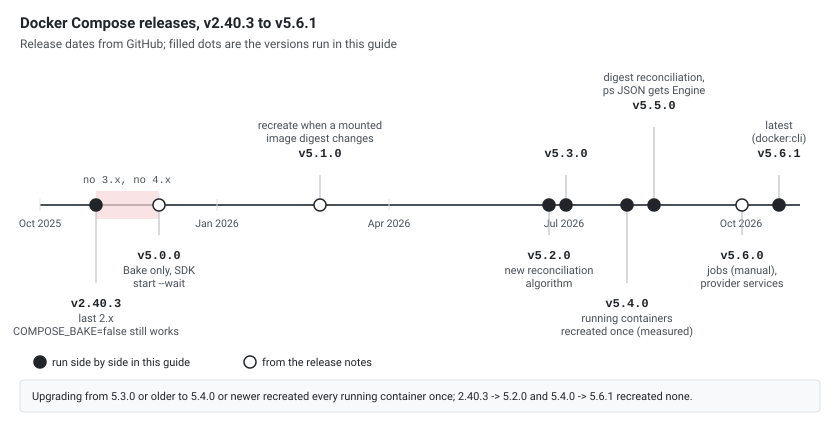

Docker Compose went from `v2.40.3` straight to `v5.0.0`. There is no 3.x or 4.x. This guide explains why, what changed between the two lines, and what did **not** change. The same Compose project was run with the last 2.x release (`v2.40.3`), `v5.2.0` and the latest release, `v5.6.1`, on one Docker 29.5.2 daemon. Release dates and change lists come from the GitHub release notes of [docker/compose](https://github.com/docker/compose/releases).

## 1. Short Answer

| | 2.x (last: v2.40.3) | 5.x (v5.2.0, v5.6.1) |
|---|---------------------|----------------------|
| Command | `docker compose` | `docker compose` (same) |
| Compose file format | The Compose Specification | The same file, no new required keys |
| Subcommands | 34 | The same 34 |
| Flags | Baseline | Only `start --wait` and `start --wait-timeout` are new |
| Image builds | Bake by default, internal builder still selectable (deprecated) | **Bake only**, the internal builder is gone |
| Use as a library | Not an official feature | Officially supported SDK |

For day-to-day use there is nothing to relearn. The major version change reflects internal work (SDK, builder removal, a new reconciliation engine), not a new command line. A few output details did change (section 5).

## 2. Version History

| Release | Date | Note |
|---------|------|------|
| v2.40.2 | 2025-10-22 | |
| v2.40.3 | 2025-10-30 | The last 2.x release |
| v5.0.0-rc.1 | 2025-11-12 | |
| v5.0.0 "Mont Blanc" | 2025-12-02 | First 5.x release |
| v5.0.1 | 2025-12-18 | |
| v5.0.2 | 2026-01-21 | |
| v5.1.0 | 2026-02-24 | Followed by 5.1.1 to 5.1.4 (2026-03-20 to 2026-05-20) |
| v5.2.0 | 2026-06-23 | New reconciliation algorithm |
| v5.3.0 | 2026-07-02 | v5.3.1 on 2026-07-07 |
| v5.4.0 | 2026-08-03 | Reconciliation for volumes and networks; recreates running containers once on upgrade (section 6) |
| v5.5.0 | 2026-08-17 | New image digest reconciliation; v5.5.1 on 2026-09-03 |
| v5.6.0 | 2026-10-02 | Partial support for jobs; provider services |
| v5.6.1 | 2026-10-21 | Latest release |

[](compose-timeline.svg "Open the diagram full size")

There are **no** `v3.0.0` and `v4.0.0` releases on GitHub. The 5.0.0 release notes explain why: the project skipped 3.0.0 to avoid more confusion with the obsolete Compose file format versions 2.x and 3.x that came from Compose V1, and skipped 4.0.0 to keep a clear separation from that legacy. So "Compose 2" (the tool) and "file format 2.x/3.x" (the old `version:` key) are different things.

## 3. What Changed (From the Release Notes)

| Release | Change |
|---------|--------|
| 5.0.0 | Compose can officially be used as an **SDK** inside other software |
| 5.0.0 | The **internal builder was removed**: builds are delegated to Docker Bake, the same engine as `docker build` |
| 5.0.0 | `docker compose start --wait` (and `--wait-timeout`) added |
| 5.0.0 | Lifecycle **hooks run on restart**; `build.no_cache_filter` supported |
| 5.1.0 | A container is **recreated when the mounted image digest changes**; `post_start` hooks also run for `docker compose run` |
| 5.2.0 | A **new reconciliation algorithm** between the observed and the expected state. The notes ask to open an issue if a previously working workload misbehaves |
| 5.4.0 | Reconciliation also plans volume recreation and network lifecycle; the image label records the platform image-manifest digest instead of the attested index |
| 5.5.0 | **Image digest reconciliation overhauled.** The notes warn: "Existing containers may be recreated the first time you run `compose up` after upgrading" |
| 5.5.0 | An `Engine` field driven by a label (in `ps --format json`, section 5) |
| 5.5.1 | Lifecycle hook output is captured and shown, also in the error when a hook fails |
| 5.6.0 | **Partial support for jobs** (only manually-triggered jobs, scheduled jobs are not available yet) and **provider services** |
| 5.6.1 | A `crypto/x509` security mitigation |

## 4. What Did Not Change

v2.40.3, v5.2.0 and v5.6.1 ran the same project (a `build:` service and an `nginx` service, both with a healthcheck) on the same daemon, each under its own project name.

| Check | Result |
|-------|--------|
| Subcommands (`docker compose --help`) | The same 34 in all three |
| Global flags | The same 11 |
| Flags of every subcommand | Identical except `start --wait` and `start --wait-timeout` (5.x only); 5.3.0 renamed the help entry `run --no-TTY` to `--no-tty` |
| `up -d` without a build, a second `up -d`, `down` | Same lines (only column spacing differs) |
| Changing a service (adding an environment variable) and `up -d` | All three: `Recreate`, `Recreated`, `Starting`, `Started` for that service only, and `Running` for the unchanged one |
| `up -d --wait` | Same: `Waiting`, then `Healthy` for both services |
| `build --print` | The same Bake definition; only the `com.docker.compose.version` label differs |
| `COMPOSE_BAKE` unset or `true` | Bake in all three |
| The obsolete `version:` key | The same warning in all three: ``the attribute `version` is obsolete, it will be ignored, please remove it to avoid potential confusion`` |
| `config --quiet`, `version --short` | Same behavior |

So an existing Compose file and your habits keep working. The Compose file format is the same specification in both lines.

## 5. Differences You Can See

### COMPOSE_BAKE=false

Bake was already the default in 2.40.3 (the first build line is `[internal] load local bake definitions`). What differs is the opt-out:

| `COMPOSE_BAKE` | 2.40.3 | 5.2.0 and 5.6.1 |
|----------------|--------|-----------------|
| unset | Bake | Bake |
| `true` | Bake | Bake |
| `false` | Warning: `COMPOSE_BAKE=false is deprecated, support for internal compose builder will be removed in next release`, and the internal builder runs | **Ignored**: Bake runs, no warning |

If a pipeline sets `COMPOSE_BAKE=false` to keep the old builder, it only works on 2.x, and 5.x ignores it silently. Remove it and make sure the build works with Bake.

### Build lines

5.x prints the image as its own resource, in `up` as well as in `build`:

```text
# 2.40.3 (up -d)
 cmp2403-app Built

# 5.2.0 and 5.6.1 (up -d)
 Image cmp520-app Building
 Image cmp520-app Built
```

With `--progress plain`, 5.x starts with ` Image <name> Building` before the BuildKit steps; 2.40.3 starts directly with `#1 [internal] load local bake definitions`.

### --dry-run Has No Marker in 5.x

The plan is the same, but 2.40.3 marks every line and 5.x does not:

```text
# 2.40.3: docker compose --dry-run up -d
 DRY-RUN MODE - Container cmp2403-app-1 Running
 DRY-RUN MODE - Container cmp2403-web-1 Recreate
 DRY-RUN MODE - Container cmp2403-web-1 Recreated
 DRY-RUN MODE - Container a340664284a4_cmp2403-web-1 Starting

# 5.2.0 and 5.6.1: the same command
 Container cmp520-app-1 Running
 Container cmp520-web-1 Recreate
 Container cmp520-web-1 Recreated
 Container ca9c5a960e99_cmp520-web-1 Starting
```

In 5.x a dry run reads like a real one; only the temporary name (`<id>_<container>`) gives it away. Nothing was changed by it in any version.

### ps --format json

2.40.3 and 5.2.0 print the same 20 keys per container, one JSON object per line. 5.6.1 adds a 21st key, `Engine` (an empty string here), from 5.5.0's label-driven engine field. A script that compares the JSON field by field sees a difference; one that reads keys by name does not. The table output of `docker compose ps` has the same columns in all three.

### start --wait

```bash
docker compose start --wait
```

On 2.40.3 this fails with `unknown flag: --wait`. On 5.2.0 and 5.6.1 it started the stopped services and waited (`Waiting`, then `Healthy`).

## 6. Upgrading a Running Project

Does a new Compose version replace containers that are already running? Each chain below started a project (two image services, `nginx` and `redis`, and one `build:` service) with the first version, then ran `up -d` with the next one on the same containers, comparing container IDs before and after:

| Upgrade | Containers recreated |
|---------|----------------------|
| 2.40.3 → 5.2.0 | 0 of 3 |
| 5.2.0 → 5.3.0 | 0 of 3 |
| 5.3.0 → 5.4.0 | **3 of 3** |
| 5.2.0 → 5.4.0 | **3 of 3** |
| 2.40.3 → 5.4.0 | **3 of 3** |
| 2.40.3 → 5.6.1 | **3 of 3** |
| 5.2.0 → 5.6.1 | **3 of 3**, then a second `up -d`: 0 |
| 5.4.0 → 5.5.0 → 5.6.1 | 0 of 3 |

So the one-time recreation comes with **5.4.0**, not with 5.5.0 as its release note suggests. The run printed `Recreate`, `Recreated`, `Starting`, `Started` for every service. The `com.docker.compose.config-hash` label stayed the same; what changed is the image digest Compose stores in `com.docker.compose.image`:

```text
# container created by 5.3.0
com.docker.compose.image = sha256:65645c7bb6a0661892a8b03b89d0743208a18dd2f3f17a54ef4b76fb8e2f2a1...
# after up -d with 5.4.0
com.docker.compose.image = sha256:63ffc0d1f14e4082b832c6a42e606e9a0384a526f16ddd720af7c1f018f2f7c...
com.docker.compose.replace = web-1
```

On Docker 29 with the containerd image store, the image ID of `nginx:1.27-alpine` is the multi-platform **index** digest (`65645c7b...`, media type `application/vnd.oci.image.index.v1+json`). Up to 5.3.0 Compose stored that; 5.4.0 stores the **platform manifest** digest, sees a different value and recreates. After that one recreation, later versions leave the containers alone.

Plan the first `up` after moving from 5.3.0 or older to 5.4.0 or newer like a restart of every service: a short interruption, and containers lose anything not kept in a volume.

## 7. Which Version Do I Have?

```bash
docker compose version            # e.g. Docker Compose version v5.2.0
docker compose version --short    # 5.2.0
docker-compose version            # the standalone binary, if installed: see below

# Which plugin file answers (section 8)
docker info --format '{{range .ClientInfo.Plugins}}{{if eq .Name "compose"}}{{.Path}}{{end}}{{end}}'
```

`docker-compose` with a hyphen is not necessarily the legacy V1 Python tool. On the test Mac it is a link to the same plugin binary (`/usr/local/bin/docker-compose -> .../cli-plugins/docker-compose`) and printed `Docker Compose version v5.2.0`; Homebrew's `docker-compose` formula installs 5.6.1. The release binaries are themselves called `docker-compose-<os>-<arch>`. Check the version instead of guessing from the name.

The version follows what your Docker installation bundles, or what you install separately:

| Image or install | Docker CLI | Compose |
|------------------|------------|---------|
| Docker Desktop on the test Mac | 29.6.1 | v5.2.0 |
| `docker:28-cli` image | 28.5.2 | v2.40.3 |
| `docker:29-cli` image | 29.9.2 | v5.6.1 |
| `docker:cli` image (floating) | 29.9.2 | v5.6.1 |

To run an older Compose next to a newer one without installing it, use a CLI image and the host's Docker socket:

```bash
docker run --rm \
  -v /var/run/docker.sock:/var/run/docker.sock \
  -v "$PWD":"$PWD" -w "$PWD" \
  docker:28-cli docker compose version
# Docker Compose version v2.40.3
```

Or download a release binary (`docker-compose-darwin-aarch64`, `docker-compose-linux-x86_64`, ...) with its `.sha256` file from the GitHub release and run it directly; that is how v2.40.3, v5.2.0 and v5.6.1 ran side by side here.

Bind-mounted paths must be visible to the Docker daemon. With Colima on macOS, the project under the home folder worked (`docker compose config --services` listed `app` and `web`), while the same project under `/tmp` showed up empty in the container: `no configuration file provided: not found`. Container names and networks are shared with the host daemon, so use a different project name (`-p`) or `down` between runs.

## 8. Install or Pin a Compose Version

Compose is a Docker CLI plugin: an executable named `docker-compose` in a plugin directory. Install a specific release next to (or instead of) the bundled one:

```bash
VERSION=5.4.0
ARCH=$(uname -m)                       # x86_64 or aarch64
BIN=docker-compose-linux-$ARCH
curl -fsSLO https://github.com/docker/compose/releases/download/v$VERSION/$BIN
curl -fsSL https://github.com/docker/compose/releases/download/v$VERSION/$BIN.sha256 | sha256sum -c -

# Only for this user
mkdir -p ~/.docker/cli-plugins
install -m 755 $BIN ~/.docker/cli-plugins/docker-compose

# Or for every user
sudo mkdir -p /usr/local/lib/docker/cli-plugins
sudo install -m 755 $BIN /usr/local/lib/docker/cli-plugins/docker-compose
```

Then check the version and the file in use with the commands in [section 7](#7-which-version-do-i-have).

In a `docker:29-cli` container (bundled v5.6.1 in `/usr/local/libexec/docker/cli-plugins/`), the checksum line printed `docker-compose-linux-aarch64: OK`, and the plugin directories won in this order:

| Installed | `docker compose version` | Path in use |
|-----------|--------------------------|-------------|
| only the bundled plugin | v5.6.1 | `/usr/local/libexec/docker/cli-plugins/docker-compose` |
| + v5.4.0 in `~/.docker/cli-plugins` | v5.4.0 | `/root/.docker/cli-plugins/docker-compose` |
| + v2.40.3 in `/usr/local/lib/docker/cli-plugins` | still v5.4.0 | the user's plugin wins |
| user plugin removed | v2.40.3 | `/usr/local/lib/docker/cli-plugins/docker-compose` |

So a per-user plugin overrides a system-wide one, which overrides the one the Docker package ships. That is also a classic source of "it works on my machine": run `docker info` to see which file answers. In CI, install a fixed version this way or use a fixed CLI image tag (`docker:28-cli` for 2.40.3), never a floating tag.

## 9. Upgrade Checklist

1. **Find the version** on laptops and CI (`docker compose version --short`).
2. **Search for `COMPOSE_BAKE=false`** in scripts, `.env` files and CI settings, and remove it (section 5).
3. **Remove the obsolete `version:` key** from Compose files. All three versions warn that it is ignored.
4. **Run `docker compose config --quiet`** on every project, then `docker compose up -d` in a test environment. Don't rely on `--dry-run` output looking different from a real run: in 5.x it has no marker.
5. **Expect every container to be recreated once** on the first `up` after moving from 5.3.0 or older to 5.4.0 or newer (section 6). The 5.5.0 notes warn about it too, but here it happened at 5.4.0. Plan it like a restart.
6. **Watch the first deployments on 5.2.0 or later**: the release notes describe a new reconciliation algorithm and ask to report regressions.
7. **Check scripts that parse `ps --format json`** strictly: 5.5.0 and later add an `Engine` key.
8. **Pin in CI** if you need identical behavior: a fixed CLI image tag such as `docker:28-cli` (2.40.3) or a specific Compose release installed as a plugin (section 8), not a floating tag.

## Gotchas

- "Compose v2" means the Go program `docker compose`, not the file `version: "2"` or `"3"`. The old file versions are obsolete in both lines.
- A floating tag such as `docker:cli` moves to whatever Compose the newest image bundles: it already gives v5.6.1, so a CI job can change from 2.x to 5.x without any change in your repository.
- The command-line surface is almost identical, so a script that works on 2.40.3 will usually work on 5.x. The exceptions are build behavior and output lines (section 5) and anything relying on the internal builder.

## Scope

- **Run side by side** (v2.40.3, v5.2.0 and v5.6.1 release binaries, checksums verified, against Docker 29.5.2): subcommand and flag lists, `up`, a second `up`, a service change, `--dry-run`, `ps` and `ps --format json`, `up --wait`, `start --wait`, `build`, `build --print`, `COMPOSE_BAKE` unset, `true` and `false`, the `version:` key, `config --quiet`, `down`. The Compose versions in `docker:28-cli`, `docker:29-cli` and `docker:cli`. Upgrades of a running project across 2.40.3, 5.2.0, 5.3.0, 5.4.0, 5.5.0 and 5.6.1, and plugin installation and precedence in `docker:29-cli`. Docker uses the containerd image store (Docker 29 default); with the classic `overlay2` store the image IDs, and so the 5.4.0 recreation, may differ.
- **From the release notes only:** the SDK, hooks on restart, `no_cache_filter`, recreate on image digest change, `post_start` in `run`, the volume/network and image digest reconciliation, hook output, jobs and provider services.
- **Not covered:** Windows, large projects with many dependencies (where the reconciliation changes would matter most), and the SDK.

## See Also

- [Docker Compose Cheatsheet]()
- [Defining Variables in Docker Compose]()
- [Docker Restart Policies]()
