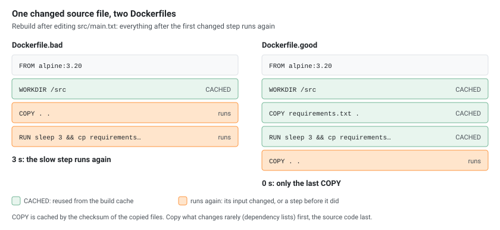

A Docker image is a stack of read-only filesystem layers plus a small JSON config. Each Dockerfile instruction either adds a layer or only changes the config, and the order of the instructions decides both the image size and how fast rebuilds are. This article builds a few small images and looks at what comes out: `docker history`, the layer tarballs, the build cache the overlay mounts of a running container and, at the end, what `docker push` sends to a registry.

Everything was built with **Docker 29.9.2** (BuildKit) in throwaway Docker-in-Docker daemons, once on the **containerd image store** (the default for new installs) and once on the **classic overlay2 store**. Sizes are from the classic store unless a table says otherwise; section 9 explains why the two report different numbers. Sections 10 to 14 use the containerd store and a local **`registry:3`** (Distribution 3.1.2) on `localhost:5000`, with `demo:1` rebuilt, so its random-data layers have new hashes there.

## 1. The Demo Image

```dockerfile
FROM alpine:3.20
LABEL org.opencontainers.image.title="layers-demo"
ENV APP_HOME=/app
WORKDIR /app
RUN head -c 20971520 /dev/urandom > /app/random.bin
COPY data.bin /app/data.bin
COPY app.sh /app/app.sh
RUN chmod +x /app/app.sh
EXPOSE 8080
USER nobody
CMD ["/app/app.sh"]
```

`data.bin` is 10 MB of random data, `app.sh` a two-line script. The build, with `docker build --progress=plain -t demo:1 .`:

```text
#4 [internal] load build context
#4 transferring context: 10.49MB 0.0s done
#5 [1/6] FROM docker.io/library/alpine:3.20@sha256:d9e853e87e55526f6b2917df91a2115c36dd7c696a35be12163d44e6e2a4b6bc
#6 [2/6] WORKDIR /app
#7 [3/6] RUN head -c 20971520 /dev/urandom > /app/random.bin
#8 [4/6] COPY data.bin /app/data.bin
#9 [5/6] COPY app.sh /app/app.sh
#10 [6/6] RUN chmod +x /app/app.sh
#11 exporting layers
#11 naming to docker.io/library/demo:1 done
```

BuildKit counts **6 steps** (`[1/6]` to `[6/6]`): `FROM` and the five instructions that touch the filesystem. `LABEL`, `ENV`, `EXPOSE`, `USER` and `CMD` don't appear as steps at all.

## 2. Which Instructions Create Layers

[](layers-instructions.svg "Open the diagram full size")

`docker history` lists every instruction, newest first, including those of the base image:

```text
$ docker history demo:1
IMAGE          CREATED                  CREATED BY                                      SIZE      COMMENT
1dd84161dfcf   Less than a second ago   CMD ["/app/app.sh"]                             0B        buildkit.dockerfile.v0
<missing>      Less than a second ago   USER nobody                                     0B        buildkit.dockerfile.v0
<missing>      Less than a second ago   EXPOSE [8080/tcp]                               0B        buildkit.dockerfile.v0
<missing>      Less than a second ago   RUN /bin/sh -c chmod +x /app/app.sh # buildk…   38B       buildkit.dockerfile.v0
<missing>      Less than a second ago   COPY app.sh /app/app.sh # buildkit              38B       buildkit.dockerfile.v0
<missing>      Less than a second ago   COPY data.bin /app/data.bin # buildkit          10.5MB    buildkit.dockerfile.v0
<missing>      Less than a second ago   RUN /bin/sh -c head -c 20971520 /dev/urandom…   21MB      buildkit.dockerfile.v0
<missing>      Less than a second ago   WORKDIR /app                                    0B        buildkit.dockerfile.v0
<missing>      Less than a second ago   ENV APP_HOME=/app                               0B        buildkit.dockerfile.v0
<missing>      Less than a second ago   LABEL org.opencontainers.image.title=layers-…   0B        buildkit.dockerfile.v0
<missing>      6 months ago             CMD ["/bin/sh"]                                 0B        buildkit.dockerfile.v0
<missing>      6 months ago             ADD alpine-minirootfs-3.20.10-aarch64.tar.gz…   8.82MB    buildkit.dockerfile.v0
```

12 history entries, but only 6 layers:

```bash
docker image inspect --format '{{len .RootFS.Layers}} layers' demo:1     # 6 layers
```

| Instruction | Creates a layer | Ends up in |
|-------------|-----------------|------------|
| `FROM` | The base image's layers | Its layers and config are the starting point |
| `RUN` | **Yes**: everything the command changed on disk | Layer |
| `COPY`, `ADD` | **Yes**: the copied files | Layer |
| `WORKDIR` | **Yes**, it creates the directory (`0B` here on the classic store, `8.19kB` on the containerd store) | Layer + `WorkingDir` |
| `ENV`, `LABEL`, `EXPOSE`, `USER`, `CMD`, `ENTRYPOINT`, `ARG`, `VOLUME`, `HEALTHCHECK`, `STOPSIGNAL`, `SHELL` | No | Config only |

`<missing>` in the IMAGE column is normal for BuildKit builds: intermediate steps are not stored as separate images. The metadata instructions all ended up in the config:

```bash
docker image inspect --format 'Env={{.Config.Env}} WorkingDir={{.Config.WorkingDir}} User={{.Config.User}} Cmd={{.Config.Cmd}} ExposedPorts={{.Config.ExposedPorts}} Labels={{.Config.Labels}}' demo:1
```

```text
Env=[PATH=/usr/local/sbin:/usr/local/bin:/usr/sbin:/usr/bin:/sbin:/bin APP_HOME=/app] WorkingDir=/app User=nobody Cmd=[/app/app.sh] ExposedPorts=map[8080/tcp:{}] Labels=map[org.opencontainers.image.title:layers-demo]
```

`docker history --no-trunc` shows the full command of each step, useful to see how an image you didn't build was made.

## 3. A Layer Is a Tarball of Changes

Each layer stores only what its instruction **changed** compared with the layers below: new and modified files, and deletions. A deletion can't be stored as "nothing", so it is a **whiteout** file. To see one, compare deleting a file in a later `RUN` with deleting it in the same `RUN`:

```dockerfile
# Dockerfile.split
FROM alpine:3.20
RUN head -c 52428800 /dev/urandom > /big
RUN rm /big
```

```dockerfile
# Dockerfile.joined
FROM alpine:3.20
RUN head -c 52428800 /dev/urandom > /big && rm /big
```

| Image | Size (classic store) | Size (containerd store) |
|-------|----------------------|-------------------------|
| `del:split` | **61.3 MB** | 118 MB |
| `del:joined` | **8.82 MB** (Alpine alone) | 13.6 MB |

In `del:split` the 50 MB file is still in the first `RUN` layer; the second layer only hides it. `docker save` writes the image as an OCI layout, and the two layers show exactly that:

```bash
docker save del:split -o del.tar && tar -xf del.tar
tar -tvf blobs/sha256/<layer>
```

```text
== f97e4e97e3af…   (RUN head -c … > /big)
-rw-r--r-- 0/0  52428800 2026-10-25 09:16:05 big
drwxr-xr-x 0/0         0 2026-10-25 09:16:05 etc/
== 5964812779921534…   (RUN rm /big)
-rw------- 0/0         0 2026-10-25 09:16:05 .wh.big
drwxr-xr-x 0/0         0 2026-10-25 09:16:05 etc/
```

`.wh.big` is the whiteout: "`big` is deleted from here up". That's why cleanup has to happen in the **same** `RUN` that created the files, as in `apt-get install … && rm -rf /var/lib/apt/lists/*`, or in a different build stage (section 6).

## 4. Changing a File Copies It Again

Changing a file from a lower layer, even only its permissions, stores the **whole file** again in the new layer. Two ways to make `data.bin` (10.5 MB) executable:

```dockerfile
FROM alpine:3.20
COPY data.bin /app/data.bin
RUN chmod 755 /app/data.bin
```

```dockerfile
FROM alpine:3.20
COPY --chmod=755 data.bin /app/data.bin
```

| Variant | Size (classic store) | Layers above Alpine |
|---------|----------------------|---------------------|
| `COPY` + `RUN chmod` | **29.8 MB** | `COPY` 10.5 MB, `RUN chmod` 10.5 MB |
| `COPY --chmod` | **19.3 MB** | `COPY` 10.5 MB |

The same applies to `chown` (use `COPY --chown=user:group`) and to any `RUN` that edits files a previous layer created. In the demo image, `chmod +x app.sh` cost only 38 bytes because the script is tiny.

## 5. The Build Cache and Instruction Order

BuildKit reuses a step from the cache when the step and **everything before it** are unchanged. For `COPY` and `ADD`, "unchanged" means the checksum of the copied files; for `RUN`, the command string. Once one step misses the cache, every step after it runs again.

Two Dockerfiles for the same small project, with a slow dependency step (`sleep 3` stands in for `pip install` or `npm ci`):

```dockerfile
# Dockerfile.bad
FROM alpine:3.20
WORKDIR /src
COPY . .
RUN sleep 3 && cp requirements.txt /installed-deps
```

```dockerfile
# Dockerfile.good
FROM alpine:3.20
WORKDIR /src
COPY requirements.txt .
RUN sleep 3 && cp requirements.txt /installed-deps
COPY . .
```

Both built once, then one source file (`src/main.txt`) changed and both rebuilt with `--progress=plain`:

```text
== Dockerfile.bad
#6 [2/4] WORKDIR /src
#6 CACHED
#7 [3/4] COPY . .
#8 [4/4] RUN sleep 3 && cp requirements.txt /installed-deps
took 3s

== Dockerfile.good
#6 [2/5] WORKDIR /src
#6 CACHED
#7 [3/5] COPY requirements.txt .
#7 CACHED
#8 [4/5] RUN sleep 3 && cp requirements.txt /installed-deps
#8 CACHED
#9 [5/5] COPY . .
took 0s
```

[](layers-cache-order.svg "Open the diagram full size")

Order instructions from what changes least to what changes most: base image, system packages, dependency list and install, then the application code. A `.dockerignore` keeps files like `.git`, build output and local secrets out of `COPY . .`, so they neither invalidate the cache nor end up in a layer.

## 6. Multi-Stage Builds

Only the **last stage** becomes the image. Earlier stages can hold compilers, package caches and test data; the final stage copies just the result:

```dockerfile
FROM alpine:3.20 AS build
RUN head -c 104857600 /dev/urandom > /toolchain.bin
RUN echo 'built artifact' > /artifact.txt

FROM alpine:3.20
COPY --from=build /artifact.txt /app/artifact.txt
CMD ["cat", "/app/artifact.txt"]
```

The same steps in one stage, for comparison:

| Image | Size (classic store) |
|-------|----------------------|
| One stage (toolchain stays) | **114 MB** |
| Multi-stage | **8.82 MB** |

```text
$ docker history multi:stage
IMAGE          CREATED                  CREATED BY                                      SIZE      COMMENT
401bcfa3aac9   Less than a second ago   CMD ["cat" "/app/artifact.txt"]                 0B        buildkit.dockerfile.v0
<missing>      Less than a second ago   COPY /artifact.txt /app/artifact.txt # build…   15B       buildkit.dockerfile.v0
<missing>      6 months ago             CMD ["/bin/sh"]                                 0B        buildkit.dockerfile.v0
<missing>      6 months ago             ADD alpine-minirootfs-3.20.10-aarch64.tar.gz…   8.82MB    buildkit.dockerfile.v0
```

The 100 MB toolchain layer of the `build` stage isn't in the final image at all, and neither is any trace of it in the history.

## 7. Layers Are Shared Between Images

Layers are identified by their content hash (the DiffID), so two images built on the same base use the **same** base layer on disk. Two images, each `FROM alpine:3.20` plus one small `RUN`:

```text
one: ["sha256:88b4fba61c4c714a2fc173ddf7e9324a257304696830bf41ad28ecc58c11c95f","sha256:51555de313b6…"]
two: ["sha256:88b4fba61c4c714a2fc173ddf7e9324a257304696830bf41ad28ecc58c11c95f","sha256:61bdb5ecb881…"]
```

`docker system df -v` shows how much of each image is shared (containerd store):

```text
REPOSITORY   TAG       IMAGE ID       CREATED                  SIZE      SHARED SIZE   UNIQUE SIZE   CONTAINERS
shared       two       a9472710a6f2   Less than a second ago   13.6MB    13.58MB       11.74kB       0
shared       one       7c2b1ded2baa   Less than a second ago   13.6MB    13.58MB       11.75kB       0
alpine       3.20      d9e853e87e55   6 months ago             13.7MB    13.58MB       81.56kB       0
```

Three images of 13.6 MB each take about 13.6 MB plus 100 kB on disk. Standardizing on a few base images across a team saves disk and pull time on every machine, because the base layers are downloaded once.

## 8. The Container on Top

A container doesn't change the image. Docker stacks one more, **writable** layer on top of the read-only image layers, and the container sees the merged result through overlayfs. To see it, start a container from `demo:1`, add a file and delete one from an image layer:

```bash
docker run -d --name c1 --user root --entrypoint sleep demo:1 600
docker exec c1 sh -c 'echo changed > /app/new.txt; rm /app/random.bin'
docker diff c1
```

```text
C /app
A /app/new.txt
D /app/random.bin
```

`A` added, `C` changed, `D` deleted. On the classic store, `docker inspect` shows the overlay directories:

```bash
docker inspect -f '{{range $k,$v := .GraphDriver.Data}}{{$k}} {{end}}' c1      # ID LowerDir MergedDir UpperDir WorkDir
ls -la $(docker inspect -f '{{.GraphDriver.Data.UpperDir}}' c1)/app
```

```text
-rw-rw-rw-    1 root     root             8 Oct 25 09:16 new.txt
c---------    2 root     root        0,   0 Oct 25 09:16 random.bin
```

The new file is in the **upper** (writable) directory. The deleted `random.bin` is there too, as a character device `0,0`: that's how overlayfs stores a whiteout on disk. `LowerDir` lists 7 directories: the 6 image layers plus an `-init` layer where Docker writes `/etc/hostname`, `/etc/hosts` and `/etc/resolv.conf` for the container.

[](layers-container.svg "Open the diagram full size")

```bash
docker ps -s --format '{{.Names}} size={{.Size}}'
```

```text
c1 size=8B (virtual 40.3MB)
```

`size` is the container's own layer (the 8-byte `new.txt`), `virtual` adds the image. Deleting `random.bin` in the container freed nothing: the 21 MB are still in the image layer. On the containerd store `docker diff` gives the same result, but `docker inspect` has no `GraphDriver` section, since snapshots are managed by containerd.

## 9. Why the Two Image Stores Report Different Sizes

The same images, as `docker images` reports them:

| Image | Classic overlay2 store | containerd image store |
|-------|------------------------|------------------------|
| `alpine:3.20` | 8.82 MB | 13.7 MB |
| `demo:1` | 40.3 MB | 76.6 MB |
| `del:split` | 61.3 MB | 118 MB |
| `multi:single` | 114 MB | 223 MB |
| `multi:stage` | 8.82 MB | 13.6 MB |

The classic store keeps only the unpacked layers. The containerd store keeps the **compressed layer blobs too** (it needs them to push, and to serve other containerd clients), and its size counts both, so random data, which doesn't compress, counts almost twice. The container in section 8 shows the unpacked size on both: `virtual 40.3MB` on the classic store, `virtual 41MB` on the containerd store. When comparing image sizes, compare on the same store.

## 10. What `docker save` Writes: Index, Manifest, Config

Section 3 opened layer tarballs from `docker save`. The other files in that directory are what turn the tarballs into an image:

```text
$ docker save demo:1 -o demo.tar && tar -xf demo.tar && ls
blobs
index.json
manifest.json
oci-layout
```

`oci-layout` and `index.json` make the directory an OCI image layout, `manifest.json` is the older Docker format kept for `docker load` compatibility, and `blobs/sha256/` holds everything else, each file named by the SHA-256 of its content. Following the digests from `index.json` down:

```json
{
  "mediaType": "application/vnd.oci.image.index.v1+json",
  "manifests": [
    {
      "mediaType": "application/vnd.oci.image.manifest.v1+json",
      "digest": "sha256:3e42f029f7db6f1617cc45c0d3b8d551c521d517adaf215bbad65144fa481ab8",
      "size": 1430,
      "platform": { "architecture": "arm64", "os": "linux" }
    },
    {
      "mediaType": "application/vnd.oci.image.manifest.v1+json",
      "digest": "sha256:f2099f3219bf7b7c8c45009f30021d1c20a267d1a734bc46eeaeefbdbde1ba28",
      "size": 837,
      "annotations": {
        "vnd.docker.reference.digest": "sha256:3e42f029f7db6f1617cc45c0d3b8d551c521d517adaf215bbad65144fa481ab8",
        "vnd.docker.reference.type": "attestation-manifest"
      },
      "platform": { "architecture": "unknown", "os": "unknown" }
    }
  ]
}
```

That is the **image index** `cc0792a79c2f…`, the blob `index.json` points to (trimmed to the fields that matter). Even a single-platform local build is an index: one manifest for `linux/arm64` and one **attestation manifest** with the build provenance BuildKit adds by default. Its digest is also what the containerd store uses as the image ID:

```text
$ docker image inspect demo:1 --format '{{.Id}}'
sha256:cc0792a79c2ff29bd72c21673b4b7c07bea78455cb9c34ff63164dc43fd8cb05
```

One level down, the **image manifest** `3e42f029f7db…` lists one config and the six layers, bottom first:

```json
{
  "schemaVersion": 2,
  "mediaType": "application/vnd.oci.image.manifest.v1+json",
  "config": {
    "mediaType": "application/vnd.oci.image.config.v1+json",
    "digest": "sha256:359d13ebd14b9bb3b00742338236bd848362631991fda6520a99166520644924",
    "size": 2507
  },
  "layers": [
    { "mediaType": "application/vnd.oci.image.layer.v1.tar+gzip", "digest": "sha256:3f26bc2dec0b515f1c2818f6e13a8f1da1f88179a008445d4e587233386bff78", "size": 4092319 },
    { "mediaType": "application/vnd.oci.image.layer.v1.tar+gzip", "digest": "sha256:852e5c2c42747922bebce7cb4f490512e624dea711b31c153bfee2c8612b1bb3", "size": 91 },
    { "mediaType": "application/vnd.oci.image.layer.v1.tar+gzip", "digest": "sha256:f2598d6c363178bad934c84300a9c39419f9d4652a8fbb5043678db6c741ab86", "size": 20978104 },
    { "mediaType": "application/vnd.oci.image.layer.v1.tar+gzip", "digest": "sha256:a154432b8f6e993cb9c7bee1ef62b0aa0a03af03501db1753301a32d5c82d676", "size": 10489146 },
    { "mediaType": "application/vnd.oci.image.layer.v1.tar+gzip", "digest": "sha256:c6790288bf70d0e977a1796fee285d1c67a5e8e1b21000111ed42dbd76879cb1", "size": 171 },
    { "mediaType": "application/vnd.oci.image.layer.v1.tar+gzip", "digest": "sha256:ffa370ca117e31e63c001678588a11d8f050d96789ddceb0507051f83f6a871a", "size": 167 }
  ]
}
```

The **config** `359d13ebd14b…` is the JSON from section 2 (`Env`, `WorkingDir`, `User`, `Cmd`, the 12 history entries) plus `rootfs.diff_ids`, one hash per layer.

[](layers-registry.svg "Open the diagram full size")

| Object | Media type | Points to |
|--------|------------|-----------|
| Image index | `application/vnd.oci.image.index.v1+json` | One manifest per platform, plus attestations |
| Image manifest | `application/vnd.oci.image.manifest.v1+json` | One config, the layers in order |
| Config | `application/vnd.oci.image.config.v1+json` | Nothing; holds the settings and `rootfs.diff_ids` |
| Layer | `application/vnd.oci.image.layer.v1.tar+gzip` | Nothing; a gzipped tar of changes |

Every reference is a digest, so changing one byte of a layer changes its digest, the manifest that lists it, and the index above that. A digest can't point to different content later.

### Digest vs DiffID

A layer has **two** hashes. The manifest's `digest` is the SHA-256 of the **compressed** blob, the file name in `blobs/sha256/`. The config's `diff_ids` (and `RootFS.Layers` in `docker image inspect`, the hashes in section 7) are the SHA-256 of the **uncompressed** tar:

```bash
cd blobs/sha256
for d in $(jq -r '.layers[].digest' 3e42f029f7db6f1617cc45c0d3b8d551c521d517adaf215bbad65144fa481ab8 | cut -c8-); do
  printf '%s  %9s  %s  %9s\n' ${d:0:12} $(wc -c < $d) $(gunzip -c $d | sha256sum | cut -c1-12) $(gunzip -c $d | wc -c)
done
```

| Layer | Digest (gzip) | Size gzipped | DiffID (tar) | Size unpacked |
|-------|---------------|--------------|--------------|---------------|
| Alpine | `3f26bc2dec0b` | 4,092,319 | `88b4fba61c4c` | 9,107,968 |
| `WORKDIR /app` | `852e5c2c4274` | 91 | `97fdd42e43c5` | 1,536 |
| `RUN head … random.bin` | `f2598d6c3631` | 20,978,104 | `c0c515e59d6a` | 20,973,568 |
| `COPY data.bin` | `a154432b8f6e` | 10,489,146 | `313d29a0cf15` | 10,487,808 |
| `COPY app.sh` | `c6790288bf70` | 171 | `0189e5ca4eb5` | 2,560 |
| `RUN chmod` | `ffa370ca117e` | 167 | `82be4c81a3f5` | 2,560 |

```text
$ docker image inspect demo:1 --format '{{range .RootFS.Layers}}{{slice . 7 19}} {{end}}'
88b4fba61c4c 97fdd42e43c5 c0c515e59d6a 313d29a0cf15 0189e5ca4eb5 82be4c81a3f5
```

Alpine shrinks from 9.1 MB to 4.1 MB; the random data **grows** slightly, because gzip can't compress it. The Alpine DiffID `88b4fba61c4c` is the same one section 7 found in two different images: it depends only on the files, while the digest also depends on how the tar was compressed. The containerd store keeps both forms, and `docker images` shows them as separate columns. `CONTENT SIZE` is the sum of the gzipped blobs (35.6 MB), what a push or pull transfers; section 9's 76.6 MB is the disk usage:

```text
$ docker images
IMAGE        ID             DISK USAGE   CONTENT SIZE   EXTRA
demo:1       cc0792a79c2f       76.6MB         35.6MB
registry:3   38907510915c       82.4MB         19.4MB   U
shared:one   f2f1cff7e579       13.6MB          4.1MB
shared:two   4dbe52d830e1       13.6MB          4.1MB
```

## 11. Pushing to a Registry

A registry is a store of the same blobs, addressed by the same digests, behind a small HTTP API (the [OCI Distribution Specification](https://github.com/opencontainers/distribution-spec/blob/main/spec.md)). A local one is a single container:

```bash
docker run -d --name registry -p 5000:5000 -e REGISTRY_STORAGE_DELETE_ENABLED=true registry:3
for t in demo:1 shared:one shared:two; do docker tag $t localhost:5000/$t; docker push localhost:5000/$t; done
```

```text
The push refers to repository [localhost:5000/demo]
ffa370ca117e: Pushed
852e5c2c4274: Pushed
3f26bc2dec0b: Pushed
7cc3635db6dd: Pushed
44136fa355b3: Pushed
f2598d6c3631: Pushed
a154432b8f6e: Pushed
c6790288bf70: Pushed
1: digest: sha256:cc0792a79c2ff29bd72c21673b4b7c07bea78455cb9c34ff63164dc43fd8cb05 size: 856
The push refers to repository [localhost:5000/shared]
c3945caab1c2: Pushed
44136fa355b3: Mounted from demo
84446407b0ef: Pushed
3f26bc2dec0b: Mounted from demo
one: digest: sha256:f2f1cff7e57934079518193a5b350de0e155b564e565bf8b448a0eef5d8ea727 size: 855
The push refers to repository [localhost:5000/shared]
0f6a81045ec6: Pushed
44136fa355b3: Already exists
3f26bc2dec0b: Layer already exists
37fc2ed5a7a1: Pushed
two: digest: sha256:4dbe52d830e19fe7066d559e45a8248182801cf55e36d49ef2c1ca2f457129a0 size: 855
```

The IDs in a push are **digests**, the compressed hashes from the table above, not DiffIDs. `demo:1` sends 8 blobs: the six layers plus the attestation's config (`44136fa355b3`) and its SLSA provenance (`7cc3635db6dd`). The pushed digest is the index's, `cc0792a79c2f…`, the same as the image ID.

The second and third pushes show section 7's sharing over the network:

- **Mounted from demo**: `shared` is a new repository, but the registry already has the Alpine blob in `demo`, so the client asks for a cross-repository mount and nothing is uploaded.
- **Already exists** / **Layer already exists**: the blob is already in `shared`, so the client checks for it and skips the upload.

The same API answers with `curl`. Tags, which the `docker` CLI can't list, are one `GET`:

```text
$ curl -s localhost:5000/v2/_catalog
{"repositories":["demo","shared"]}
$ curl -s localhost:5000/v2/shared/tags/list
{"name":"shared","tags":["one","two"]}
```

A manifest is fetched by tag or digest. The `Accept` header says which formats the client understands; the response's `Content-Type` says which one came back:

```text
$ curl -s -o /dev/null -D - localhost:5000/v2/demo/manifests/1 \
    -H 'Accept: application/vnd.oci.image.index.v1+json,application/vnd.oci.image.manifest.v1+json' \
    | grep -iE '^HTTP|^content-type|^docker-content-digest'
HTTP/1.1 200 OK
Content-Type: application/vnd.oci.image.index.v1+json
Docker-Content-Digest: sha256:cc0792a79c2ff29bd72c21673b4b7c07bea78455cb9c34ff63164dc43fd8cb05
```

A pull is that walk: tag → index → the manifest for the client's platform → config and layers, each by digest, each checked with `sha256sum` on arrival. Blobs come from `/v2/<repo>/blobs/<digest>`:

```text
$ curl -s -L localhost:5000/v2/demo/blobs/sha256:359d13ebd14b9bb3b00742338236bd848362631991fda6520a99166520644924 | sha256sum
359d13ebd14b9bb3b00742338236bd848362631991fda6520a99166520644924  -
$ curl -s -L localhost:5000/v2/demo/blobs/sha256:359d13ebd14b9bb3b00742338236bd848362631991fda6520a99166520644924 \
    | jq -c '{User: .config.User, Cmd: .config.Cmd, layers: (.rootfs.diff_ids | length)}'
{"User":"nobody","Cmd":["/app/app.sh"],"layers":6}
```

### Push an Image by Hand

`docker push` is a handful of these requests, so an image can be built and pushed with `tar`, `gzip`, `sha256sum`, `jq` and `curl` alone. Blobs first, the manifest last, because the registry rejects a manifest that refers to blobs it doesn't have:

```bash
R=http://localhost:5000
# the Alpine 3.20 arm64 layer, already in the repository "demo" (see its manifest)
ALPINE_LAYER=sha256:3f26bc2dec0b515f1c2818f6e13a8f1da1f88179a008445d4e587233386bff78
ALPINE_DIFF_ID=sha256:88b4fba61c4c714a2fc173ddf7e9324a257304696830bf41ad28ecc58c11c95f

# a one-file layer: the DiffID hashes the tar, the digest hashes the gzip
echo 'hello from a hand-pushed image' > hello.txt
tar -cf layer.tar hello.txt && gzip -k layer.tar
DIFF_ID=sha256:$(sha256sum layer.tar | cut -c1-64)
DIGEST=sha256:$(sha256sum layer.tar.gz | cut -c1-64)

# POST opens an upload session, PUT sends the bytes and their digest
push_blob() {
  loc=$(curl -s -o /dev/null -w '%header{location}' -X POST $R/v2/hand/blobs/uploads/)
  curl -s -o /dev/null -w "PUT $1: %{http_code}\n" -X PUT \
    -H 'Content-Type: application/octet-stream' --data-binary @$1 "$loc&digest=$2"
}

# 1. mount the Alpine layer from "demo" instead of uploading it
curl -s -o /dev/null -w 'mount: %{http_code}\n' -X POST \
  "$R/v2/hand/blobs/uploads/?mount=$ALPINE_LAYER&from=demo"

# 2. upload the new layer
push_blob layer.tar.gz $DIGEST

# 3. the config: diff_ids are the uncompressed hashes, bottom layer first
jq -cnj --arg a $ALPINE_DIFF_ID --arg b $DIFF_ID '{architecture: "arm64", os: "linux",
  config: {Cmd: ["cat", "/hello.txt"]}, rootfs: {type: "layers", diff_ids: [$a, $b]}}' > config.json
CONFIG=sha256:$(sha256sum config.json | cut -c1-64)
push_blob config.json $CONFIG

# 4. the manifest ties them together, pushed under the tag v1
jq -cnj --arg c $CONFIG --argjson cs $(wc -c < config.json) --arg a $ALPINE_LAYER \
  --arg d $DIGEST --argjson ds $(wc -c < layer.tar.gz) '{schemaVersion: 2,
  mediaType: "application/vnd.oci.image.manifest.v1+json",
  config: {mediaType: "application/vnd.oci.image.config.v1+json", digest: $c, size: $cs},
  layers: [{mediaType: "application/vnd.oci.image.layer.v1.tar+gzip", digest: $a, size: 4092319},
           {mediaType: "application/vnd.oci.image.layer.v1.tar+gzip", digest: $d, size: $ds}]}' > manifest.json
curl -s -o /dev/null -D - -X PUT -H 'Content-Type: application/vnd.oci.image.manifest.v1+json' \
  --data-binary @manifest.json $R/v2/hand/manifests/v1 | grep -iE '^HTTP|^docker-content-digest'
```

```text
mount: 201
PUT layer.tar.gz: 201
PUT config.json: 201
HTTP/1.1 201 Created
Docker-Content-Digest: sha256:98aabb6468a5676a55af72a1e595d980ec4cae609df4b4444ca779cb7d35f6d4
```

The `Docker-Content-Digest` the registry returns is exactly `sha256sum manifest.json`, and the image runs:

```text
$ sha256sum manifest.json layer.tar layer.tar.gz
98aabb6468a5676a55af72a1e595d980ec4cae609df4b4444ca779cb7d35f6d4  manifest.json
576539be62f56f1571e0a3a377c0216ee0654c8a75c0fc0a62ae3fc9dcf61bd0  layer.tar
bb6e0e6f091476c350e0d982c09548a76c5bd44a221ec5cef19359a7631aee28  layer.tar.gz
$ docker pull localhost:5000/hand:v1
v1: Pulling from hand
bb6e0e6f0914: Pulling fs layer
3f26bc2dec0b: Pulling fs layer
3f26bc2dec0b: Already exists
bb6e0e6f0914: Download complete
bb6e0e6f0914: Pull complete
Digest: sha256:98aabb6468a5676a55af72a1e595d980ec4cae609df4b4444ca779cb7d35f6d4
$ docker run --rm localhost:5000/hand:v1
hello from a hand-pushed image
```

The Alpine layer was never uploaded to `hand` and never downloaded again. The script hard-codes the **arm64** Alpine layer; on another platform take the first layer's digest from your own `demo` manifest and the first DiffID from `docker image inspect alpine:3.20`, and set `architecture`.

What goes wrong when a step is off:

| Mistake | Result |
|---------|--------|
| `PUT` with a digest that doesn't match the bytes | `400` `DIGEST_INVALID`: provided digest did not match uploaded content |
| `curl --data-binary` without `-H 'Content-Type: application/octet-stream'` | Also `400` `DIGEST_INVALID`: curl sends it as `application/x-www-form-urlencoded` and the registry doesn't get the bytes as they are |
| Manifest that lists a blob not in the repository | `400` `MANIFEST_BLOB_UNKNOWN`: blob unknown to registry |
| Compressed digest written into `diff_ids` | The push succeeds; the pull fails |

The last one is only caught when a client unpacks the layer and hashes the tar:

```text
$ docker pull localhost:5000/hand:bad
wrong diff id "sha256:576539be62f56f1571e0a3a377c0216ee0654c8a75c0fc0a62ae3fc9dcf61bd0" calculated on extraction "sha256:bb6e0e6f091476c350e0d982c09548a76c5bd44a221ec5cef19359a7631aee28", desc "sha256:bb6e0e6f091476c350e0d982c09548a76c5bd44a221ec5cef19359a7631aee28"
```

## 12. One Tag, Many Platforms

`alpine:3.20` is also an index, with one manifest per platform and an attestation for each:

```text
$ docker buildx imagetools inspect alpine:3.20 | head -3
Name:      docker.io/library/alpine:3.20
MediaType: application/vnd.oci.image.index.v1+json
Digest:    sha256:d9e853e87e55526f6b2917df91a2115c36dd7c696a35be12163d44e6e2a4b6bc

$ docker buildx imagetools inspect alpine:3.20 --raw | jq -r '.manifests[]
    | "\(.digest[7:19])  \(.platform.os)/\(.platform.architecture)\(if .platform.variant then "/"+.platform.variant else "" end)  \(.annotations["vnd.docker.reference.type"] // "")"'
c64c687cbea9  linux/amd64
6243dec92868  unknown/unknown  attestation-manifest
37753b296504  linux/arm/v6
91f7e880a3f5  unknown/unknown  attestation-manifest
bd05c4d38cbe  linux/arm/v7
9ba6eec5a553  unknown/unknown  attestation-manifest
45e09956dc66  linux/arm64/v8
1db32a7978ca  unknown/unknown  attestation-manifest
4ec3ead63e75  linux/386
dca9fc0bda34  unknown/unknown  attestation-manifest
80529c2d621d  linux/ppc64le
53afc103e0e4  unknown/unknown  attestation-manifest
c47cbcc0d9c7  linux/riscv64
d2e511115065  unknown/unknown  attestation-manifest
856b20bf4946  linux/s390x
ba51d5564234  unknown/unknown  attestation-manifest
```

8 platforms, 16 entries. A pull on this arm64 machine took `linux/arm64/v8`, whose single layer is `3f26bc2dec0b`, the base layer of every image in this article. The amd64 manifest has a different layer, so its DiffID differs too:

```text
$ docker buildx imagetools inspect alpine:3.20@sha256:45e09956dc667c5eff3583c9d94830261fb1ca0be10a0a7db36266edf5de9e1d --raw | jq -c '[.layers[].digest[7:19]]'
["3f26bc2dec0b"]
$ docker buildx imagetools inspect alpine:3.20@sha256:c64c687cbea9300178b30c95835354e34c4e4febc4badfe27102879de0483b5e --raw | jq -c '[.layers[].digest[7:19]]'
["25f1d6b1951a"]
```

The registry has no special API for this. An index is pushed to `/v2/<repo>/manifests/<tag>` like any manifest, and the client tells the two apart by `Content-Type`. Section 7's sharing needs the same platform: an amd64 and an arm64 image built from the same Dockerfile don't share their base layer.

## 13. Tags Move, Digests Don't

A tag is a name the registry maps to a manifest digest, and anyone who can push can point it somewhere else; `alpine:3.20` is repointed on every 3.20.x release. The digest is fixed by the content. `docker images --digests` shows which one a local tag came from:

```text
$ docker images --digests alpine
REPOSITORY   TAG       DIGEST                                                                    IMAGE ID       CREATED        SIZE
alpine       3.20      sha256:d9e853e87e55526f6b2917df91a2115c36dd7c696a35be12163d44e6e2a4b6bc   d9e853e87e55   6 months ago   13.7MB
```

That digest is the one in the build log of section 1: BuildKit resolves every `FROM` tag to a digest. Pinning it in the Dockerfile makes the build use exactly that index, whatever the tag points to later; the tag is then only for humans:

```dockerfile
FROM alpine:3.20@sha256:d9e853e87e55526f6b2917df91a2115c36dd7c696a35be12163d44e6e2a4b6bc
RUN cat /etc/alpine-release
```

```text
#4 [1/2] FROM docker.io/library/alpine:3.20@sha256:d9e853e87e55526f6b2917df91a2115c36dd7c696a35be12163d44e6e2a4b6bc
#5 [2/2] RUN cat /etc/alpine-release
#5 0.063 3.20.10
```

A digest that doesn't exist fails the build instead of picking something else:

```text
ERROR: failed to build: failed to solve: alpine:3.20@sha256:bbbbbbbbbbbbbbbbbbbbbbbbbbbbbbbbbbbbbbbbbbbbbbbbbbbbbbbbbbbbbbbb: failed to resolve source metadata for docker.io/library/alpine:3.20@sha256:bbbbbbbbbbbbbbbbbbbbbbbbbbbbbbbbbbbbbbbbbbbbbbbbbbbbbbbbbbbbbbbb: docker.io/library/alpine:3.20@sha256:bbbbbbbbbbbbbbbbbbbbbbbbbbbbbbbbbbbbbbbbbbbbbbbbbbbbbbbbbbbbbbbb: not found
```

Pin the **index** digest, as here, not one platform's manifest, so the same line works on amd64 and arm64. Updating the base is then a reviewed change of one line, which Dependabot and Renovate can open for you.

## 14. Deleting From a Registry

Deleting a tag removes the name, not the image. With deletes enabled (`REGISTRY_STORAGE_DELETE_ENABLED=true`, off by default), on `shared:two`:

```text
$ curl -s -o /dev/null -w '%{http_code}\n' -X DELETE localhost:5000/v2/shared/manifests/two
202
$ curl -s localhost:5000/v2/shared/tags/list
{"name":"shared","tags":["one"]}
$ curl -s -o /dev/null -w '%{http_code}\n' -H 'Accept: application/vnd.oci.image.index.v1+json' \
    localhost:5000/v2/shared/manifests/two
404
$ curl -s -o /dev/null -w '%{http_code}\n' -H 'Accept: application/vnd.oci.image.index.v1+json' \
    localhost:5000/v2/shared/manifests/sha256:4dbe52d830e19fe7066d559e45a8248182801cf55e36d49ef2c1ca2f457129a0
200
```

The tag is gone, the image is still there by digest, and anything pinned to it still pulls. Disk space comes back only through **garbage collection**, and the default run doesn't even count untagged manifests as garbage:

```text
$ docker exec registry registry garbage-collect --dry-run /etc/distribution/config.yml 2>&1 | grep 'blobs marked'
29 blobs marked, 0 blobs and 0 manifests eligible for deletion
$ docker exec registry registry garbage-collect --delete-untagged /etc/distribution/config.yml 2>&1 | grep 'blobs marked'
23 blobs marked, 6 blobs and 3 manifests eligible for deletion
```

The 6 blobs are `shared:two`'s index and its two manifests, its config, its `RUN` layer and its provenance: everything only that image used. The registry shrank from 34.8 MB to 34.7 MB, because the Alpine layer, 4 MB of the 4.1 MB image, is still used by `shared:one`, `demo` and `hand`. `shared:one` still pulls, and the digest of `shared:two` now returns `404`.

Deleting a blob through the API is per repository too. It removes the repository's link to the blob, not the shared data:

```text
$ A=sha256:3f26bc2dec0b515f1c2818f6e13a8f1da1f88179a008445d4e587233386bff78
$ curl -s -o /dev/null -w 'DELETE hand/blobs/3f26bc2dec0b: %{http_code}\n' -X DELETE localhost:5000/v2/hand/blobs/$A
DELETE hand/blobs/3f26bc2dec0b: 202
$ for r in hand demo shared; do
    curl -s -o /dev/null -w "HEAD $r/blobs/3f26bc2dec0b: %{http_code}\n" -I localhost:5000/v2/$r/blobs/$A; done
HEAD hand/blobs/3f26bc2dec0b: 404
HEAD demo/blobs/3f26bc2dec0b: 200
HEAD shared/blobs/3f26bc2dec0b: 200
```

Run garbage collection with the registry read-only or stopped: a push running during the mark phase can upload a blob the sweep then deletes. Hosted registries run their own collection; for removing old images ECR has lifecycle policies and Harbor tag retention rules.

## Rules of Thumb

| Do | Why |
|----|-----|
| Clean up in the same `RUN` that created the files | A later `rm` only adds a whiteout (section 3) |
| Use `COPY --chmod` / `--chown` instead of a later `chmod` / `chown` | Changing a file stores it again (section 4) |
| Copy dependency lists before the source code | A code change then doesn't rerun the install (section 5) |
| Use a `.dockerignore` | Keeps `.git` and build output out of the cache key and the layers |
| Build in one stage, ship from another | Compilers and caches stay out of the image (section 6) |
| Share base images | Their layers are stored and pulled once (section 7) |
| Don't write data into the container layer | It's lost with the container and slow on overlayfs; use volumes |
| Pin base images by index digest | A tag can move, a digest can't (section 13) |
| Push images that share a base to the same registry | Shared layers are mounted or skipped, not uploaded again (section 11) |
| Untag *and* garbage-collect to free registry space | Deleting a tag leaves the manifest and blobs (section 14) |

## See Also

- [How Container Registries Work: Pushing and Pulling Images By Hand](https://labs.iximiuz.com/tutorials/container-registry-from-scratch), Ivan Velichko's hands-on tutorial on the registry API with `curl`, which section 11 builds on
- [OCI Image Format Specification](https://github.com/opencontainers/image-spec/blob/main/spec.md) and [OCI Distribution Specification](https://github.com/opencontainers/distribution-spec/blob/main/spec.md)
