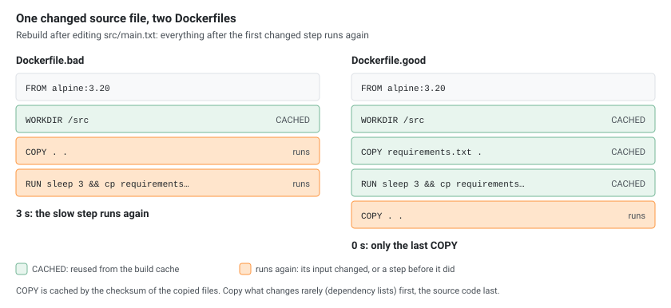

A Docker image is a stack of read-only filesystem layers plus a small JSON config. Each Dockerfile instruction either adds a layer or only changes the config, and the order of the instructions decides both the image size and how fast rebuilds are. This article builds a few small images and looks at what comes out: `docker history`, the layer tarballs, the build cache and the overlay mounts of a running container.

Everything was built with **Docker 29.9.2** (BuildKit) in throwaway Docker-in-Docker daemons, once on the **containerd image store** (the default for new installs) and once on the **classic overlay2 store**. Sizes are from the classic store unless a table says otherwise; section 9 explains why the two report different numbers.

## 1. The Demo Image

```dockerfile
FROM alpine:3.20
LABEL org.opencontainers.image.title="layers-demo"
ENV APP_HOME=/app
WORKDIR /app
RUN head -c 20971520 /dev/urandom > /app/random.bin
COPY data.bin /app/data.bin
COPY app.sh /app/app.sh
RUN chmod +x /app/app.sh
EXPOSE 8080
USER nobody
CMD ["/app/app.sh"]
```

`data.bin` is 10 MB of random data, `app.sh` a two-line script. The build, with `docker build --progress=plain -t demo:1 .`:

```text
#4 [internal] load build context
#4 transferring context: 10.49MB 0.0s done
#5 [1/6] FROM docker.io/library/alpine:3.20@sha256:d9e853e87e55526f6b2917df91a2115c36dd7c696a35be12163d44e6e2a4b6bc
#6 [2/6] WORKDIR /app
#7 [3/6] RUN head -c 20971520 /dev/urandom > /app/random.bin
#8 [4/6] COPY data.bin /app/data.bin
#9 [5/6] COPY app.sh /app/app.sh
#10 [6/6] RUN chmod +x /app/app.sh
#11 exporting layers
#11 naming to docker.io/library/demo:1 done
```

BuildKit counts **6 steps** (`[1/6]` to `[6/6]`): `FROM` and the five instructions that touch the filesystem. `LABEL`, `ENV`, `EXPOSE`, `USER` and `CMD` don't appear as steps at all.

## 2. Which Instructions Create Layers

[](layers-instructions.svg "Open the diagram full size")

`docker history` lists every instruction, newest first, including those of the base image:

```text
$ docker history demo:1
IMAGE          CREATED                  CREATED BY                                      SIZE      COMMENT
1dd84161dfcf   Less than a second ago   CMD ["/app/app.sh"]                             0B        buildkit.dockerfile.v0
<missing>      Less than a second ago   USER nobody                                     0B        buildkit.dockerfile.v0
<missing>      Less than a second ago   EXPOSE [8080/tcp]                               0B        buildkit.dockerfile.v0
<missing>      Less than a second ago   RUN /bin/sh -c chmod +x /app/app.sh # buildk…   38B       buildkit.dockerfile.v0
<missing>      Less than a second ago   COPY app.sh /app/app.sh # buildkit              38B       buildkit.dockerfile.v0
<missing>      Less than a second ago   COPY data.bin /app/data.bin # buildkit          10.5MB    buildkit.dockerfile.v0
<missing>      Less than a second ago   RUN /bin/sh -c head -c 20971520 /dev/urandom…   21MB      buildkit.dockerfile.v0
<missing>      Less than a second ago   WORKDIR /app                                    0B        buildkit.dockerfile.v0
<missing>      Less than a second ago   ENV APP_HOME=/app                               0B        buildkit.dockerfile.v0
<missing>      Less than a second ago   LABEL org.opencontainers.image.title=layers-…   0B        buildkit.dockerfile.v0
<missing>      6 months ago             CMD ["/bin/sh"]                                 0B        buildkit.dockerfile.v0
<missing>      6 months ago             ADD alpine-minirootfs-3.20.10-aarch64.tar.gz…   8.82MB    buildkit.dockerfile.v0
```

12 history entries, but only 6 layers:

```bash
docker image inspect --format '{{len .RootFS.Layers}} layers' demo:1     # 6 layers
```

| Instruction | Creates a layer | Ends up in |
|-------------|-----------------|------------|
| `FROM` | The base image's layers | Its layers and config are the starting point |
| `RUN` | **Yes**: everything the command changed on disk | Layer |
| `COPY`, `ADD` | **Yes**: the copied files | Layer |
| `WORKDIR` | **Yes**, it creates the directory (`0B` here on the classic store, `8.19kB` on the containerd store) | Layer + `WorkingDir` |
| `ENV`, `LABEL`, `EXPOSE`, `USER`, `CMD`, `ENTRYPOINT`, `ARG`, `VOLUME`, `HEALTHCHECK`, `STOPSIGNAL`, `SHELL` | No | Config only |

`<missing>` in the IMAGE column is normal for BuildKit builds: intermediate steps are not stored as separate images. The metadata instructions all ended up in the config:

```bash
docker image inspect --format 'Env={{.Config.Env}} WorkingDir={{.Config.WorkingDir}} User={{.Config.User}} Cmd={{.Config.Cmd}} ExposedPorts={{.Config.ExposedPorts}} Labels={{.Config.Labels}}' demo:1
```

```text
Env=[PATH=/usr/local/sbin:/usr/local/bin:/usr/sbin:/usr/bin:/sbin:/bin APP_HOME=/app] WorkingDir=/app User=nobody Cmd=[/app/app.sh] ExposedPorts=map[8080/tcp:{}] Labels=map[org.opencontainers.image.title:layers-demo]
```

`docker history --no-trunc` shows the full command of each step, useful to see how an image you didn't build was made.

## 3. A Layer Is a Tarball of Changes

Each layer stores only what its instruction **changed** compared with the layers below: new and modified files, and deletions. A deletion can't be stored as "nothing", so it is a **whiteout** file. To see one, compare deleting a file in a later `RUN` with deleting it in the same `RUN`:

```dockerfile
# Dockerfile.split
FROM alpine:3.20
RUN head -c 52428800 /dev/urandom > /big
RUN rm /big
```

```dockerfile
# Dockerfile.joined
FROM alpine:3.20
RUN head -c 52428800 /dev/urandom > /big && rm /big
```

| Image | Size (classic store) | Size (containerd store) |
|-------|----------------------|-------------------------|
| `del:split` | **61.3 MB** | 118 MB |
| `del:joined` | **8.82 MB** (Alpine alone) | 13.6 MB |

In `del:split` the 50 MB file is still in the first `RUN` layer; the second layer only hides it. `docker save` writes the image as an OCI layout, and the two layers show exactly that:

```bash
docker save del:split -o del.tar && tar -xf del.tar
tar -tvf blobs/sha256/<layer>
```

```text
== f97e4e97e3af…   (RUN head -c … > /big)
-rw-r--r-- 0/0  52428800 2026-10-25 09:16:05 big
drwxr-xr-x 0/0         0 2026-10-25 09:16:05 etc/
== 5964812779921534…   (RUN rm /big)
-rw------- 0/0         0 2026-10-25 09:16:05 .wh.big
drwxr-xr-x 0/0         0 2026-10-25 09:16:05 etc/
```

`.wh.big` is the whiteout: "`big` is deleted from here up". That's why cleanup has to happen in the **same** `RUN` that created the files, as in `apt-get install … && rm -rf /var/lib/apt/lists/*`, or in a different build stage (section 6).

## 4. Changing a File Copies It Again

Changing a file from a lower layer, even only its permissions, stores the **whole file** again in the new layer. Two ways to make `data.bin` (10.5 MB) executable:

```dockerfile
FROM alpine:3.20
COPY data.bin /app/data.bin
RUN chmod 755 /app/data.bin
```

```dockerfile
FROM alpine:3.20
COPY --chmod=755 data.bin /app/data.bin
```

| Variant | Size (classic store) | Layers above Alpine |
|---------|----------------------|---------------------|
| `COPY` + `RUN chmod` | **29.8 MB** | `COPY` 10.5 MB, `RUN chmod` 10.5 MB |
| `COPY --chmod` | **19.3 MB** | `COPY` 10.5 MB |

The same applies to `chown` (use `COPY --chown=user:group`) and to any `RUN` that edits files a previous layer created. In the demo image, `chmod +x app.sh` cost only 38 bytes because the script is tiny.

## 5. The Build Cache and Instruction Order

BuildKit reuses a step from the cache when the step and **everything before it** are unchanged. For `COPY` and `ADD`, "unchanged" means the checksum of the copied files; for `RUN`, the command string. Once one step misses the cache, every step after it runs again.

Two Dockerfiles for the same small project, with a slow dependency step (`sleep 3` stands in for `pip install` or `npm ci`):

```dockerfile
# Dockerfile.bad
FROM alpine:3.20
WORKDIR /src
COPY . .
RUN sleep 3 && cp requirements.txt /installed-deps
```

```dockerfile
# Dockerfile.good
FROM alpine:3.20
WORKDIR /src
COPY requirements.txt .
RUN sleep 3 && cp requirements.txt /installed-deps
COPY . .
```

Both built once, then one source file (`src/main.txt`) changed and both rebuilt with `--progress=plain`:

```text
== Dockerfile.bad
#6 [2/4] WORKDIR /src
#6 CACHED
#7 [3/4] COPY . .
#8 [4/4] RUN sleep 3 && cp requirements.txt /installed-deps
took 3s

== Dockerfile.good
#6 [2/5] WORKDIR /src
#6 CACHED
#7 [3/5] COPY requirements.txt .
#7 CACHED
#8 [4/5] RUN sleep 3 && cp requirements.txt /installed-deps
#8 CACHED
#9 [5/5] COPY . .
took 0s
```

[](layers-cache-order.svg "Open the diagram full size")

Order instructions from what changes least to what changes most: base image, system packages, dependency list and install, then the application code. A `.dockerignore` keeps files like `.git`, build output and local secrets out of `COPY . .`, so they neither invalidate the cache nor end up in a layer.

## 6. Multi-Stage Builds

Only the **last stage** becomes the image. Earlier stages can hold compilers, package caches and test data; the final stage copies just the result:

```dockerfile
FROM alpine:3.20 AS build
RUN head -c 104857600 /dev/urandom > /toolchain.bin
RUN echo 'built artifact' > /artifact.txt

FROM alpine:3.20
COPY --from=build /artifact.txt /app/artifact.txt
CMD ["cat", "/app/artifact.txt"]
```

The same steps in one stage, for comparison:

| Image | Size (classic store) |
|-------|----------------------|
| One stage (toolchain stays) | **114 MB** |
| Multi-stage | **8.82 MB** |

```text
$ docker history multi:stage
IMAGE          CREATED        CREATED BY                                      SIZE      COMMENT
5f0a943cf697   1 second ago   CMD ["cat" "/app/artifact.txt"]                 0B        buildkit.dockerfile.v0
<missing>      1 second ago   COPY /artifact.txt /app/artifact.txt # build…   12.3kB    buildkit.dockerfile.v0
<missing>      6 months ago   CMD ["/bin/sh"]                                 0B        buildkit.dockerfile.v0
<missing>      6 months ago   ADD alpine-minirootfs-3.20.10-aarch64.tar.gz…   8.82MB    buildkit.dockerfile.v0
```

The 100 MB toolchain layer of the `build` stage isn't in the final image at all, and neither is any trace of it in the history.

## 7. Layers Are Shared Between Images

Layers are identified by their content hash (the DiffID), so two images built on the same base use the **same** base layer on disk. Two images, each `FROM alpine:3.20` plus one small `RUN`:

```text
one: ["sha256:88b4fba61c4c714a2fc173ddf7e9324a257304696830bf41ad28ecc58c11c95f","sha256:51555de313b6…"]
two: ["sha256:88b4fba61c4c714a2fc173ddf7e9324a257304696830bf41ad28ecc58c11c95f","sha256:61bdb5ecb881…"]
```

`docker system df -v` shows how much of each image is shared (containerd store):

```text
REPOSITORY   TAG       IMAGE ID       CREATED                  SIZE      SHARED SIZE   UNIQUE SIZE   CONTAINERS
shared       two       a9472710a6f2   Less than a second ago   13.6MB    13.58MB       11.74kB       0
shared       one       7c2b1ded2baa   Less than a second ago   13.6MB    13.58MB       11.75kB       0
alpine       3.20      d9e853e87e55   6 months ago             13.7MB    13.58MB       81.56kB       0
```

Three images of 13.6 MB each take about 13.6 MB plus 100 kB on disk. Standardizing on a few base images across a team saves disk and pull time on every machine, because the base layers are downloaded once.

## 8. The Container on Top

A container doesn't change the image. Docker stacks one more, **writable** layer on top of the read-only image layers, and the container sees the merged result through overlayfs. To see it, start a container from `demo:1`, add a file and delete one from an image layer:

```bash
docker run -d --name c1 --user root --entrypoint sleep demo:1 600
docker exec c1 sh -c 'echo changed > /app/new.txt; rm /app/random.bin'
docker diff c1
```

```text
C /app
A /app/new.txt
D /app/random.bin
```

`A` added, `C` changed, `D` deleted. On the classic store, `docker inspect` shows the overlay directories:

```bash
docker inspect -f '{{range $k,$v := .GraphDriver.Data}}{{$k}} {{end}}' c1      # ID LowerDir MergedDir UpperDir WorkDir
ls -la $(docker inspect -f '{{.GraphDriver.Data.UpperDir}}' c1)/app
```

```text
-rw-rw-rw-    1 root     root             8 Oct 25 09:16 new.txt
c---------    2 root     root        0,   0 Oct 25 09:16 random.bin
```

The new file is in the **upper** (writable) directory. The deleted `random.bin` is there too, as a character device `0,0`: that's how overlayfs stores a whiteout on disk. `LowerDir` lists 7 directories: the 6 image layers plus an `-init` layer where Docker writes `/etc/hostname`, `/etc/hosts` and `/etc/resolv.conf` for the container.

[](layers-container.svg "Open the diagram full size")

```bash
docker ps -s --format '{{.Names}} size={{.Size}}'
```

```text
c1 size=8B (virtual 40.3MB)
```

`size` is the container's own layer (the 8-byte `new.txt`), `virtual` adds the image. Deleting `random.bin` in the container freed nothing: the 21 MB are still in the image layer. On the containerd store `docker diff` gives the same result, but `docker inspect` has no `GraphDriver` section, since snapshots are managed by containerd.

## 9. Why the Two Image Stores Report Different Sizes

The same images, as `docker images` reports them:

| Image | Classic overlay2 store | containerd image store |
|-------|------------------------|------------------------|
| `alpine:3.20` | 8.82 MB | 13.7 MB |
| `demo:1` | 40.3 MB | 76.6 MB |
| `del:split` | 61.3 MB | 118 MB |
| `multi:single` | 114 MB | 223 MB |
| `multi:stage` | 8.82 MB | 13.6 MB |

The classic store keeps only the unpacked layers. The containerd store keeps the **compressed layer blobs too** (it needs them to push, and to serve other containerd clients), and its size counts both, so random data, which doesn't compress, counts almost twice. The container in section 8 shows the unpacked size on both: `virtual 40.3MB` on the classic store, `virtual 41MB` on the containerd store. When comparing image sizes, compare on the same store.

## Rules of Thumb

| Do | Why |
|----|-----|
| Clean up in the same `RUN` that created the files | A later `rm` only adds a whiteout (section 3) |
| Use `COPY --chmod` / `--chown` instead of a later `chmod` / `chown` | Changing a file stores it again (section 4) |
| Copy dependency lists before the source code | A code change then doesn't rerun the install (section 5) |
| Use a `.dockerignore` | Keeps `.git` and build output out of the cache key and the layers |
| Build in one stage, ship from another | Compilers and caches stay out of the image (section 6) |
| Share base images | Their layers are stored and pulled once (section 7) |
| Don't write data into the container layer | It's lost with the container and slow on overlayfs; use volumes |
