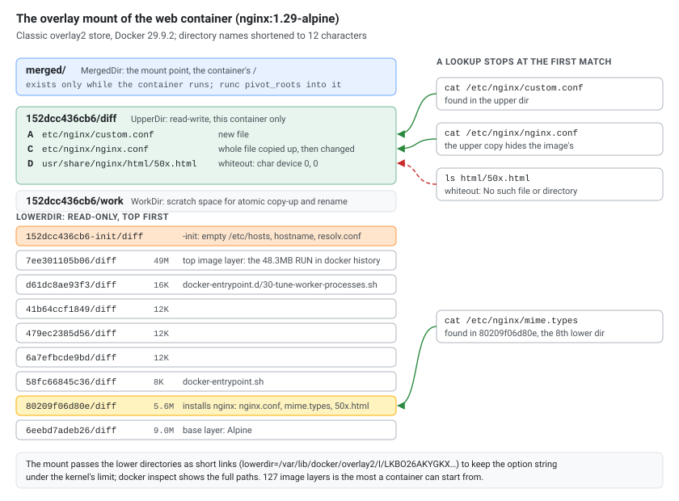
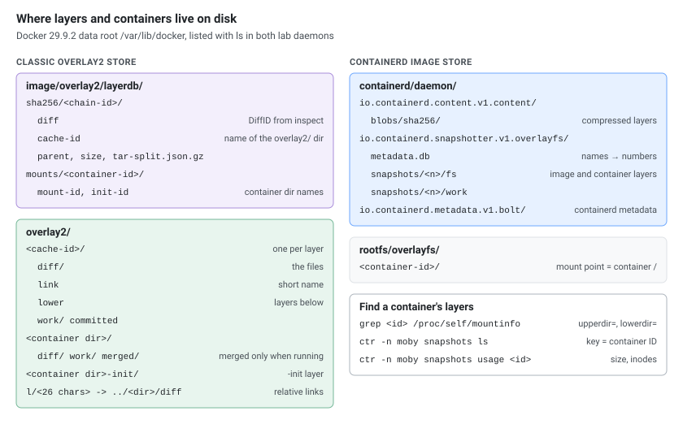

Docker keeps images and containers as stacks of directories and lets the kernel's overlay filesystem merge them into one root filesystem per container. This post looks at what's actually on disk: which directory is which, what a changed or deleted file turns into, how to map the hashes in `/var/lib/docker/overlay2` back to containers and images, and the limits and options that matter in practice.

For how layers are built in the first place (Dockerfile instructions, the build cache, what a registry stores) see [How Docker Images Are Built](/posts/docker-image-layers/).

## Scope

Everything below was run on Docker Engine 29.9.2 in throwaway Docker-in-Docker daemons on an Ubuntu 24.04 kernel (6.8.0, ext4 backing filesystem): once with the **classic overlay2 store** and once with the **containerd image store**. The demo containers are `web` and `web2` from `nginx:1.29-alpine` and `cache` from `alpine:3.22`. In `web` one file was added, one changed and one deleted:

```bash
docker run -d --name web nginx:1.29-alpine
docker exec web sh -c 'echo hi > /etc/nginx/custom.conf; echo "# x" >> /etc/nginx/nginx.conf; rm /usr/share/nginx/html/50x.html'
```

## Which Image Store Are You On?

Since Docker Engine 29, new installs use the **containerd image store**: containerd unpacks the layers with its overlayfs snapshotter, and Docker's own overlay2 driver isn't used. Hosts upgraded from older versions keep the classic overlay2 store. `docker info` tells them apart:

```text
# classic store
 Storage Driver: overlay2
  Backing Filesystem: extfs
  Supports d_type: true
  Using metacopy: false
  Native Overlay Diff: true
  userxattr: false

# containerd image store
 Storage Driver: overlayfs
  driver-type: io.containerd.snapshotter.v1
```

Both use the same kernel overlay filesystem, so copy-up, whiteouts and the four directory roles below work the same way. What differs is where the directories live and how you find them. Most of this post is about the classic store; [The containerd Image Store](#the-containerd-image-store) shows the equivalents.

Which one a daemon uses is decided by the `containerd-snapshotter` feature in `/etc/docker/daemon.json`:

```json
{
  "features": {
    "containerd-snapshotter": false
  }
}
```

Without the setting, a data root that already holds overlay2 images stays on overlay2, and an empty one starts on the containerd store. Switching doesn't convert anything. On a data root with one image on overlay2:

| Daemon started with | `Storage Driver` | Images listed |
|---|---|---|
| `containerd-snapshotter: false` | overlay2 | 1 |
| no setting | overlay2 | 1 |
| `containerd-snapshotter: true` | overlayfs | 0 |
| no setting again | overlay2 | 1 |

The overlay2 images stay on disk while the containerd store is active, and come back with the classic store. After a switch, pull or load the images again.

## How overlay2 Works

overlayfs merges several directories into one view. The image layers are the read-only **lower** directories, the container gets one writable **upper** directory, and the kernel shows the merged result, which becomes the container's `/`:

[](overlay2-mount.svg "Open the diagram full size")

| Directory | Read/Write | Purpose |
|-----------|:----------:|---------|
| LowerDir | Read-only | Image layers, plus the container's `-init` layer; the first entry is the top |
| UpperDir | Read-write | Everything the container changed: new and modified files, whiteouts for deleted ones |
| WorkDir | Internal | Scratch space overlayfs needs for atomic copy-up and rename; same filesystem as UpperDir |
| MergedDir | Unified view | The mount point; what the container sees as `/` |

The mount itself, from `/proc/self/mountinfo` on the host (the container's `MergedDir` is the mount point):

```text
overlay overlay rw
lowerdir=/var/lib/docker/overlay2/l/LKBO26AKYGKXOXTKKXPSIY2WUV:/var/lib/docker/overlay2/l/E4IT4EM757HAXG3RMYOFDUUWY2:...
upperdir=/var/lib/docker/overlay2/152dcc436cb64cf1f789d11d9455a8a8dd10b74d55460eb6b94d3ae82318c8c7/diff
workdir=/var/lib/docker/overlay2/152dcc436cb64cf1f789d11d9455a8a8dd10b74d55460eb6b94d3ae82318c8c7/work
nouserxattr
```

### LowerDir (Image Layers)

- One read-only directory per image layer, shared by every container and image that uses the layer.
- Never modified by running containers.
- Listed **top layer first**: in `LowerDir` the first entry is the container's `-init` layer, then the image's top layer, down to the base layer last.

### The -init Layer

Between the image and the container's own layer Docker adds a small `-init` layer with placeholders for the files it manages:

```text
/var/lib/docker/overlay2/152dcc43...-init/diff/.dockerenv
/var/lib/docker/overlay2/152dcc43...-init/diff/dev/console
/var/lib/docker/overlay2/152dcc43...-init/diff/dev/pts
/var/lib/docker/overlay2/152dcc43...-init/diff/dev/shm
/var/lib/docker/overlay2/152dcc43...-init/diff/etc/hostname
/var/lib/docker/overlay2/152dcc43...-init/diff/etc/hosts
/var/lib/docker/overlay2/152dcc43...-init/diff/etc/mtab -> /proc/mounts
/var/lib/docker/overlay2/152dcc43...-init/diff/etc/resolv.conf
```

The `/etc` files are empty; at run time Docker bind-mounts the real ones over them, which is why `mount` inside the container shows `/dev/vdb1 on /etc/hosts type ext4`. Changes to `/etc/hosts` in a container therefore never reach its upper directory and don't show up in `docker diff`.

### UpperDir (Container Layer)

- Read-write layer unique to each container.
- New files, modified files (copied up first) and whiteouts for deleted files.
- Survives `docker stop` and `docker start`; deleted with the container by `docker rm` (data in volumes stays).

### WorkDir

- Required by overlayfs, on the same filesystem as UpperDir.
- Used internally to prepare a copy-up or rename before moving it into place atomically.
- Never touch it.

### MergedDir

- The mount point of the overlay: what processes in the container see as `/`.
- The container runtime (runc) moves the container's root there with `pivot_root`.
- Files in UpperDir hide files with the same path in LowerDir.
- **Exists only while the container runs.** For a stopped container `ls` on it gives `No such file or directory`, while the upper `diff/` directory is still there.

## What's in /var/lib/docker/overlay2

Every layer and every container gets a directory named by a random ID:

```text
$ ls -l /var/lib/docker/overlay2/152dcc436cb6.../
drwxr-xr-x 6 root root 4096 Nov 16 14:48 diff      # the layer's files (UpperDir for a container)
-rw-r--r-- 1 root root   26 Nov 16 14:48 link      # short name of this layer, see l/
-rw-r--r-- 1 root root  260 Nov 16 14:48 lower     # the layers below, as l/ short names
drwxr-xr-x 1 root root 4096 Nov 16 14:48 merged    # mount point while running
drwx------ 3 root root 4096 Nov 16 14:48 work      # overlayfs WorkDir
```

Image layers have `diff`, `link` and `committed`, plus `lower` and `work` when they aren't the base layer. The base layer of `alpine:3.22` has no `lower` file because nothing is below it.

The `l/` directory holds one short symlink per layer:

```text
$ cat /var/lib/docker/overlay2/152dcc436cb6.../link
HBQDVTCV6X2OO2EEBICZQPKMDT
$ ls -l /var/lib/docker/overlay2/l/HBQDVTCV6X2OO2EEBICZQPKMDT
lrwxrwxrwx 1 root root 72 Nov 16 14:48 /var/lib/docker/overlay2/l/HBQDVTCV6X2OO2EEBICZQPKMDT -> ../152dcc436cb64cf1f789d11d9455a8a8dd10b74d55460eb6b94d3ae82318c8c7/diff
```

The mount options are passed to the kernel as one string with a size limit of a memory page, and nine 64-character paths add up fast. With the 26-character names from `l/` the `lowerdir=` list stays short, which is why the mount above shows `l/...` paths while `docker inspect` shows the full ones. The links are relative, so they still work after the whole data root is moved.

[](overlay2-on-disk.svg "Open the diagram full size")

## Inspecting overlay2 Layers

### Find a Container's Layers

```bash
# One directory
docker inspect web --format '{{.GraphDriver.Data.MergedDir}}'
docker inspect web --format '{{.GraphDriver.Data.UpperDir}}'
docker inspect web --format '{{.GraphDriver.Data.LowerDir}}'
docker inspect web --format '{{.GraphDriver.Data.WorkDir}}'

# All of them
docker inspect web --format '{{json .GraphDriver.Data}}' | jq .

# The lower layers one per line, top first
docker inspect web --format '{{.GraphDriver.Data.LowerDir}}' | tr ':' '\n'

# The actual overlay mount
grep " $(docker inspect web --format '{{.GraphDriver.Data.MergedDir}}') " /proc/self/mountinfo
```

```json
{
  "ID": "e97901253201712422118ad6d97ae1dfe8d19ecde9c61e49abad6e3a7ff95971",
  "LowerDir": "/var/lib/docker/overlay2/152dcc436cb64cf1f789d11d9455a8a8dd10b74d55460eb6b94d3ae82318c8c7-init/diff:/var/lib/docker/overlay2/7ee301105b069c66c4f95d6748b1020c091234fec8410d6029a6e3b84ddc00fd/diff:...",
  "MergedDir": "/var/lib/docker/overlay2/152dcc436cb64cf1f789d11d9455a8a8dd10b74d55460eb6b94d3ae82318c8c7/merged",
  "UpperDir": "/var/lib/docker/overlay2/152dcc436cb64cf1f789d11d9455a8a8dd10b74d55460eb6b94d3ae82318c8c7/diff",
  "WorkDir": "/var/lib/docker/overlay2/152dcc436cb64cf1f789d11d9455a8a8dd10b74d55460eb6b94d3ae82318c8c7/work"
}
```

`ID` is the container ID; the directory name (`152dcc43...`) is a different, random ID.

### Browse the Layers

```bash
# What the container changed (its writable layer)
ls $(docker inspect web --format '{{.GraphDriver.Data.UpperDir}}')

# What the container sees (only while it runs)
ls $(docker inspect web --format '{{.GraphDriver.Data.MergedDir}}')

# An image's own layer (UpperDir) and the ones below it (LowerDir)
docker image inspect nginx:1.29-alpine --format '{{json .GraphDriver.Data}}' | jq .
```

### Map Layer IDs to Directories

`docker image inspect` lists the layers by **DiffID** (`.RootFS.Layers`), but the directories are named by random **cache IDs**. The layer database in `/var/lib/docker/image/overlay2/layerdb/sha256/<chain-id>/` connects them: its `diff` file holds the DiffID and `cache-id` the directory name.

```bash
for l in $(docker image inspect nginx:1.29-alpine --format '{{range .RootFS.Layers}}{{.}} {{end}}'); do
  c=$(grep -l "$l" /var/lib/docker/image/overlay2/layerdb/sha256/*/diff | xargs dirname)
  echo "$(echo "$l" | cut -c8-19) -> $(cut -c1-12 "$c/cache-id")"
done
```

```text
a8d26d037006 -> 6eebd7adeb26
257e65be0ed4 -> 80209f06d80e
33a80384617d -> 58fc66845c36
331ddb8f920d -> 6a7efbcde9bd
741a05ecf745 -> 479ec2385d56
1eb24dfa6d46 -> 41b64ccf1849
e7d873bb729e -> d61dc8ae93f3
0d0ac2b1a777 -> 7ee301105b06
```

The first DiffID is the base layer (Alpine), the last the top. Containers are in `layerdb/mounts/<container-id>/mount-id`.

### Find Which Layer Holds a File

```bash
docker inspect web --format '{{.GraphDriver.Data.UpperDir}}:{{.GraphDriver.Data.LowerDir}}' |
  tr ':' '\n' | while read -r d; do [ -e "$d/etc/nginx/nginx.conf" ] && echo "$d"; done
```

```text
/var/lib/docker/overlay2/152dcc436cb64cf1f789d11d9455a8a8dd10b74d55460eb6b94d3ae82318c8c7/diff
/var/lib/docker/overlay2/80209f06d80eb550b109cc2ab0f04a0c800552e6aeb988330a91c85fdc22214f/diff
```

The first match wins: the container's copy (it appended a line) hides the image's copy in layer `80209f06d80e`, the one that installed nginx.

## Copy-on-Write (Copy-Up)

When a container modifies a file from a lower layer:

1. overlayfs copies the **whole file** from the lower layer into UpperDir (copy-up), using WorkDir to do it atomically.
2. The change is applied to the copy.
3. The container sees the copy from then on; the lower layer is untouched.

Appending a single byte to the 4.6 MB `libcrypto.so.3` in the `cache` container:

```text
$ docker exec cache ls -l /usr/lib/libcrypto.so.3
-rwxr-xr-x    1 root     root       4598680 Sep 30 07:29 /usr/lib/libcrypto.so.3
$ docker exec cache sh -c 'printf x >> /usr/lib/libcrypto.so.3'
$ ls -l $(docker inspect cache --format '{{.GraphDriver.Data.UpperDir}}')/usr/lib/
-rwxr-xr-x 1 root root 4598681 Nov 16 14:00 libcrypto.so.3
```

The upper directory grew by 4.5 MB for one byte. Metadata changes copy the whole file too, because `Using metacopy: false` is the default: after `chmod 600 /usr/lib/libssl.so.3` and `touch /usr/lib/libz.so.1` the upper directory also held the full 868240-byte `libssl.so.3` and 133008-byte `libz.so.1.3.2`. Large files that a container changes (databases, logs) belong in a volume.

`docker diff` lists what's in the upper directory:

```text
$ docker diff web
C /usr/share/nginx/html
D /usr/share/nginx/html/50x.html
C /etc/nginx
A /etc/nginx/custom.conf
C /etc/nginx/nginx.conf
A /run/nginx.pid
...
```

`A` added, `C` changed, `D` deleted. Parent directories show as `C` because they had to be created in the upper directory to hold the change.

### Whiteouts and Opaque Directories

A deleted file can't be removed from a read-only lower layer, so overlayfs hides it with a **whiteout**: a character device with device number `0, 0` and the same name, in the upper directory:

```text
$ ls -l $(docker inspect web --format '{{.GraphDriver.Data.UpperDir}}')/usr/share/nginx/html/
c--------- 2 root root 0, 0 Nov 16 14:48 50x.html
```

There are no `.wh.` files on disk. `.wh.<name>` is how whiteouts are written **inside image layer tarballs** (the OCI format); Docker converts them to character devices when it unpacks a layer, and back when it exports one.

Deleting a whole directory and creating it again marks the new directory **opaque**, so nothing from the lower layers shows through:

```text
$ docker exec cache rm -rf /etc/apk
$ ls -la .../diff/etc/
c--------- 2 root root 0, 0 Nov 16 14:00 apk
$ docker exec cache sh -c 'mkdir /etc/apk && echo new > /etc/apk/x'
$ getfattr -d -m - .../diff/etc/apk
trusted.overlay.opaque="y"
```

## Map Containers and Images to overlay2 Directories

A script that shows which directory in `/var/lib/docker/overlay2/` belongs to which container and image, with sizes. It works on the classic store only and stops on the containerd store:

```bash
#!/bin/bash
# Show which /var/lib/docker/overlay2 directory belongs to which container and image (classic overlay2 store only)
driver=$(docker info --format '{{.Driver}}')
if [ "$driver" != overlay2 ]; then
  echo "Storage driver is $driver, not overlay2 (containerd image store?)" >&2
  exit 1
fi

echo "== CONTAINERS (writable layer)"
docker ps -a --format '{{.ID}} {{.Names}} {{.Image}}' | while read -r id name image; do
  upper=$(docker inspect "$id" --format '{{.GraphDriver.Data.UpperDir}}')
  size=$(du -sh "$upper" 2>/dev/null | cut -f1)
  printf '%-16s %-22s %-8s %s\n' "$name" "$image" "$size" "$(basename "$(dirname "$upper")")"
done

echo
echo "== IMAGE LAYERS (largest first; a shared layer lists every image using it)"
docker image ls -q --no-trunc | sort -u | while read -r img; do
  tags=$(docker image inspect "$img" --format '{{join .RepoTags ","}}')
  docker image inspect "$img" --format '{{.GraphDriver.Data.UpperDir}}:{{.GraphDriver.Data.LowerDir}}' |
    tr ':' '\n' | grep '^/' | while read -r dir; do
      echo "$(basename "$(dirname "$dir")") ${tags:-<none>}"
    done
done | awk '{ img[$1] = img[$1] (img[$1] ? "," : "") $2 } END { for (d in img) print d, img[d] }' |
  while read -r dir images; do
    printf '%-8s %-14s %s\n' "$(du -sh /var/lib/docker/overlay2/$dir/diff 2>/dev/null | cut -f1)" "${dir:0:12}" "$images"
  done | sort -rh
```

With `mysite:1` built `FROM nginx:1.29-alpine` plus one `RUN`:

```text
== CONTAINERS (writable layer)
cache            alpine:3.22            4.0K     d7dfa060ecc96cc68f55ff816a76ad3655c66186e36d355192c46925d12127d6
web2             nginx:1.29-alpine      80K      f1c791cd9cd8a7924d6c8f21da4ed4af383c6afc6a7385606074190b258eb50d
web              nginx:1.29-alpine      116K     152dcc436cb64cf1f789d11d9455a8a8dd10b74d55460eb6b94d3ae82318c8c7

== IMAGE LAYERS (largest first; a shared layer lists every image using it)
49M      7ee301105b06   mysite:1,nginx:1.29-alpine
9.0M     6eebd7adeb26   mysite:1,nginx:1.29-alpine
8.8M     e373e12caaeb   alpine:3.22
5.6M     80209f06d80e   mysite:1,nginx:1.29-alpine
40K      uyqbk7smf6nb   mysite:1
16K      d61dc8ae93f3   mysite:1,nginx:1.29-alpine
...
```

The nginx layers are on disk once, used by both images. A layer built locally by BuildKit gets a non-hex name (`uyqbk7smf6nb...`). The script lists each image once even when it has several tags (`docker images -q` prints the same ID once per tag), and it covers all layers of an image, not only the top one.

## The containerd Image Store

On the containerd store `docker inspect` has no `GraphDriver` section, so every `{{.GraphDriver...}}` template fails:

```text
template parsing error: template: :1:14: executing "" at <.GraphDriver.Data.MergedDir>: map has no entry for key "GraphDriver"
```

The layers are containerd **snapshots** in `/var/lib/docker/containerd/daemon/io.containerd.snapshotter.v1.overlayfs/snapshots/<n>/fs`, and the container's root is mounted at `/var/lib/docker/rootfs/overlayfs/<container-id>`. The mount table gives the directories:

```bash
ID=$(docker inspect -f '{{.Id}}' web2)
grep "$ID" /proc/self/mountinfo | grep -o 'upperdir=[^,]*'
grep "$ID" /proc/self/mountinfo | grep -o 'lowerdir=[^,]*' | tr ':' '\n'
```

```text
upperdir=/var/lib/docker/containerd/daemon/io.containerd.snapshotter.v1.overlayfs/snapshots/417/fs
lowerdir=/var/lib/docker/containerd/daemon/io.containerd.snapshotter.v1.overlayfs/snapshots/416/fs
/var/lib/docker/containerd/daemon/io.containerd.snapshotter.v1.overlayfs/snapshots/12/fs
```

That container ran `alpine:3.22`: snapshot `12` is the Alpine layer, `416` the `-init` layer and `417` the writable one. The upper directory looks the same as on the classic store, whiteouts included (`c--------- 2 root root 0, 0 ... motd`).

`ctr` shows the snapshots by name in the `moby` namespace (on a normal install the socket is `/run/containerd/containerd.sock`):

```bash
ctr -n moby snapshots ls | grep "$ID"
ctr -n moby snapshots usage "$ID"
```

```text
KEY                                          PARENT                                                                  KIND
a8ed2aad2d7dea01f8319cb2b8ec301147ec56c4...  a8ed2aad2d7dea01f8319cb2b8ec301147ec56c48ddc39227a5f3c746c0fa4d9-init   Active
KEY                                                              SIZE     INODES
a8ed2aad2d7dea01f8319cb2b8ec301147ec56c48ddc39227a5f3c746c0fa4d9 16.0 KiB 5
```

The store also keeps the compressed layer blobs in `io.containerd.content.v1.content`, next to the unpacked snapshots: 40 MB of blobs and 88 MB of snapshots for the images in this lab.

## Disk Usage

```bash
# Overall Docker disk usage
docker system df
docker system df -v    # per image, container, volume and build cache entry

# A container's own layer (SIZE) and with the image (virtual)
docker ps -s
docker inspect -s web --format '{{.SizeRw}} {{.SizeRootFs}}'

# The overlay2 directory (classic store)
du -sh /var/lib/docker/overlay2/

# Largest layers (classic store); use diff/, never merged/, which counts the image again
du -sh /var/lib/docker/overlay2/*/diff | sort -rh | head -20
```

```text
$ docker ps -s --format "table {{.Names}}\t{{.Size}}"
NAMES     SIZE
cache     0B (virtual 8.54MB)
web2      1.09kB (virtual 61.6MB)
web       1.75kB (virtual 61.6MB)
```

The two stores report different sizes for the same images and containers:

| | Classic overlay2 store | containerd image store |
|---|---|---|
| `nginx:1.29-alpine` in `docker image ls` | 61.6MB | 92.7MB |
| `alpine:3.22` in `docker image ls` | 8.54MB | 13.4MB |
| `web2` in `docker ps -s` | 1.09kB (virtual 61.6MB) | 81.9kB (virtual 66MB) |
| Images in `docker system df` | 70.09MB | 106.1MB |

The classic store counts the unpacked files. The containerd store also counts the compressed blobs it keeps, and measures a container's layer in disk blocks (`du`) rather than file sizes. The [image layers post](/posts/docker-image-layers/#9-why-the-two-image-stores-report-different-sizes) goes into the numbers.

### Clean Up

```bash
# Stopped containers, dangling images, unused networks, dangling build cache
docker system prune

# Also images without a container (not only dangling ones) and all build cache
docker system prune -a

# Also ANONYMOUS volumes that no container uses
docker system prune -a --volumes

# Named volumes that no container uses
docker volume prune -a

# One container and its writable layer
docker rm <container>
```

`--volumes` only removes anonymous volumes (`--volumes  Prune anonymous volumes` in `docker system prune --help`). A named volume `named1` survived `docker system prune -f --volumes`; only `docker volume prune -a` removed it.

## Image Layers and the Layer Limit

```bash
# Image layers (DiffIDs), base first
docker image inspect nginx:1.29-alpine --format '{{json .RootFS.Layers}}' | jq .

# Number of layers
docker image inspect nginx:1.29-alpine --format '{{len .RootFS.Layers}}'

# Commands that created each layer, with sizes
docker history nginx:1.29-alpine
docker history --no-trunc nginx:1.29-alpine
docker history --format "{{.Size}}\t{{.CreatedBy}}" nginx:1.29-alpine
```

```text
48.3MB	RUN /bin/sh -c set -x     && apkArch="$(cat …
0B	ENV ACME_VERSION=0.3.1
0B	ENV NJS_RELEASE=1
0B	ENV NJS_VERSION=0.9.6
```

`0B` lines changed only the image config; they have no layer and no directory.

overlayfs limits how deep a stack can be. Images built `FROM alpine:3.22` with more and more `RUN` lines, on the classic store:

| Image layers | Build | `docker run` |
|---:|---|---|
| 126 | ok | ok |
| 127 | ok | ok |
| 128 | ok | `docker: Error response from daemon: max depth exceeded` |
| 129 | ok | `max depth exceeded` |
| 130 | `failed to solve: ... max depth exceeded` | |

A container stacks the `-init` layer and its upper directory on top of the image, so 127 image layers is the most a container can start from. On the containerd store an image with 128 layers still ran. Real images are far below this; the limit shows up with generated Dockerfiles or images that were committed over and over (`docker commit` adds a layer each time). Combine `RUN` lines, or squash with a multi-stage build that copies the result into a fresh stage.

## Configuration

### Daemon Storage Options

```json
{
  "storage-driver": "overlay2",
  "storage-opts": [
    "overlay2.size=20G"
  ]
}
```

`/etc/docker/daemon.json`, then `sudo systemctl restart docker`. Two options from older guides now stop the daemon from starting:

- `overlay2.override_kernel_check` was removed: `error initializing graphdriver: overlay2: unknown option overlay2.override_kernel_check: overlay2`.
- `overlay2.size` (a default size limit per container) needs XFS mounted with project quotas (`pquota`). On ext4: `Storage Option overlay2.size only supported for backingFS XFS. Found extfs: overlay2`. With it in place, `docker run --storage-opt size=...` sets the limit per container.

### Change Storage Location

```bash
sudo systemctl stop docker docker.socket
sudo rsync -aHAX /var/lib/docker/ /new/path/docker/

# /etc/docker/daemon.json
{
  "data-root": "/new/path/docker"
}

sudo systemctl start docker
docker info --format '{{.DockerRootDir}}'
```

`-H`, `-A` and `-X` keep hard links, ACLs and extended attributes (`trusted.overlay.opaque` is one). After moving a data root with a stopped container in it, `docker info` showed the new `Docker Root Dir`, the image was there, the container started and its file in the writable layer was intact. Keep the old directory until you've checked, then delete it.

The new location must not be on an overlay filesystem itself: a data root inside a container's filesystem fails with `error initializing graphdriver: driver not supported: overlay2`.

## overlay2 vs Other Storage Drivers

Starting Docker 29.9.2 with `--storage-driver` set to each one (classic store, ext4):

| Driver | Status in Docker 29 | Result in the lab |
|--------|--------|----------|
| overlay2 | Default for the classic store | Starts |
| containerd snapshotters | Default for new installs (`overlayfs`) | Starts |
| vfs | Supported; no copy-on-write, full copy per layer; for testing | Starts |
| btrfs | Needs a Btrfs data root | `prerequisites for driver not satisfied (wrong filesystem?): btrfs` |
| zfs | Needs a ZFS data root | `prerequisites for driver not satisfied (wrong filesystem?): zfs` |
| fuse-overlayfs | Rootless setups on old kernels; needs the `fuse-overlayfs` binary | `driver not supported: fuse-overlayfs` |
| overlay | **Removed** (Docker 24) | `graphdriver is explicitly enabled but "overlay" is not registered` |
| aufs | **Removed** (Docker 24) | `graphdriver is explicitly enabled but "aufs" is not registered` |
| devicemapper | **Removed** (Docker 25) | `graphdriver is explicitly enabled but "devicemapper" is not registered` |

## Kernel and Filesystem Requirements

```bash
# The kernel supports overlay
grep overlay /proc/filesystems

# The module is loaded
lsmod | grep overlay

# Load it
sudo modprobe overlay

# The backing filesystem supports d_type (required)
docker info | grep -E 'Backing Filesystem|Supports d_type'
```

```text
nodev	overlay
overlay               204800  10
  Backing Filesystem: extfs
  Supports d_type: true
```

overlay2 needs file types in directory entries (`d_type`). ext4 always has them. On XFS they come with `ftype=1`, which current `mkfs.xfs` won't let you turn off: `mkfs.xfs -n ftype=0` answers `Directory ftype field always enabled on CRC enabled filesystems`. Only very old XFS filesystems (created with `crc=0`) can be `ftype=0`; check with `xfs_info /var/lib/docker | grep ftype`.

## Troubleshooting

### "No space left on device"

```bash
df -h /var/lib/docker/
docker system df -v

# Which containers wrote the most
docker ps -as --format "table {{.Names}}\t{{.Size}}"

# Largest layers (classic store)
du -sh /var/lib/docker/overlay2/*/diff | sort -rh | head -10

# Clean up (anonymous volumes only; see Clean Up)
docker system prune -a --volumes
```

Remember copy-up: a container that changes a byte in a big image file has a copy of the whole file in its writable layer.

### Inode Exhaustion

```bash
df -i /var/lib/docker/
```

`df -h` can show free space while `df -i` shows `IUse%` at 100%: many small files in layers (`node_modules`, package caches) use up inodes. Clean up or move the data root to a filesystem with more inodes.

### max depth exceeded

The image has more than 127 layers; see [The Layer Limit](#image-layers-and-the-layer-limit).

## Quick Reference

| Action | Command |
|--------|---------|
| Which store and driver | `docker info \| grep -A6 "Storage Driver"` |
| Container's merged dir | `docker inspect <c> --format '{{.GraphDriver.Data.MergedDir}}'` |
| Container's upper dir | `docker inspect <c> --format '{{.GraphDriver.Data.UpperDir}}'` |
| Container's changes | `docker diff <container>` |
| Container's own size | `docker ps -s` |
| Upper dir, containerd store | `grep <container-id> /proc/self/mountinfo \| grep -o 'upperdir=[^,]*'` |
| Image layers | `docker image inspect  --format '{{json .RootFS.Layers}}'` |
| Layer DiffID to directory | `/var/lib/docker/image/overlay2/layerdb/sha256/*/{diff,cache-id}` |
| Image history | `docker history <image>` |
| Disk usage | `docker system df -v` |
| Clean up | `docker system prune -a --volumes`, `docker volume prune -a` |
| Verify overlay support | `grep overlay /proc/filesystems` |

## Links

- [How Docker Images Are Built: Layers, Cache and the Container on Top](/posts/docker-image-layers/)
- [Docker docs: OverlayFS storage driver](https://docs.docker.com/engine/storage/drivers/overlayfs-driver/)
- [Docker docs: containerd image store](https://docs.docker.com/engine/storage/containerd/)
- [Linux kernel: Overlay Filesystem](https://docs.kernel.org/filesystems/overlayfs.html)
