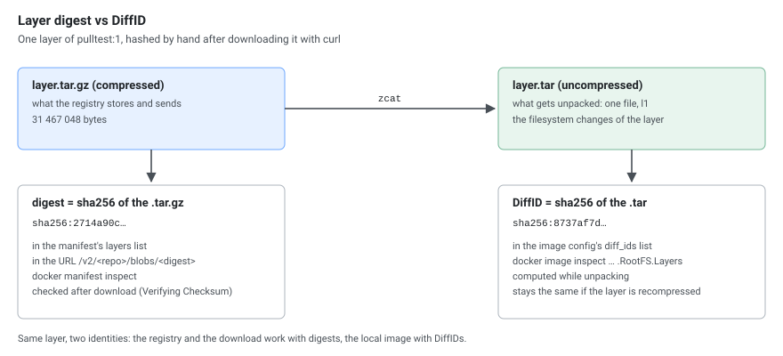
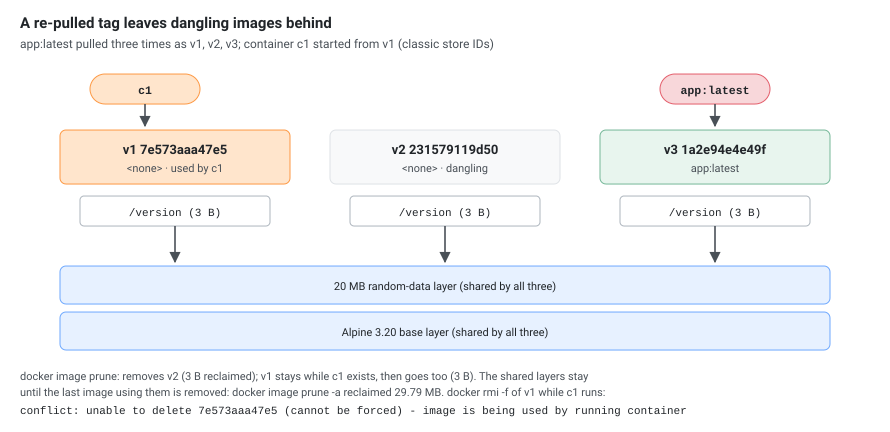

`docker pull` looks like one command, but it is a sequence of HTTP requests to a registry followed by local work: unpacking layers into the storage driver. This guide shows the **real request sequence** (read from the registry's access log), what every progress line means, how many layers download at once, why a repeat pull is nearly free, and where time goes when a pull is slow.

The setup: a local `registry:2`, a test image with 6 layers (the Alpine 3.20 base plus five layers of 30 MB of random data), and **throwaway Docker 29.9.2 daemons** running in containers (Docker in Docker, `docker:dind`), so each pull started from an empty image store. The image was pushed as a single-platform `linux/arm64` manifest (`docker build --provenance=false --sbom=false`), without the attestation index that `docker build` adds by default.

## 1. The Request Sequence

A pull of `reg:5000/pulltest:1` into an empty daemon (classic overlay2 image store, section 8) produced these registry requests, in this order:

```text
GET  /v2/                                   -> 200            ping, and where auth is negotiated
HEAD /v2/pulltest/manifests/1               -> 200            resolve the tag to a digest (no body)
GET  /v2/pulltest/manifests/sha256:8d92b95d -> 200 1446 bytes fetch the manifest by digest
GET  /v2/pulltest/blobs/sha256:66106a9a     -> 200 1793 bytes the image config
GET  /v2/pulltest/blobs/sha256:3f26bc2d     -> 200 4092319    layer 1 (Alpine, 4 MB)
GET  /v2/pulltest/blobs/sha256:20e32a94     -> 200 31467049   layer 2 (30 MB)
...                                                           the other 4 layers
```

[](pull-sequence.svg "Open the diagram full size")

| Step | What it does |
|------|--------------|
| `GET /v2/` | Checks the registry speaks the v2 API. A `401` here starts the token or basic-auth flow. |
| `HEAD .../manifests/<tag>` | Turns the tag into a **digest** from the `Docker-Content-Digest` header. Tags are mutable pointers, the digest is the immutable identity. |
| `GET .../manifests/<digest>` | The manifest: a JSON list of the config blob and the layer blobs with their sizes. For a multi-platform image this first returns an **index**, then a second manifest request fetches the one for your platform. Images built with `docker build`'s default attestations are such an index too, even for one platform. |
| `GET .../blobs/<digest>` (config) | The image config: environment, entrypoint, and the list of layer **DiffIDs** (section 6). |
| `GET .../blobs/<digest>` (layers) | The layers themselves, compressed tarballs, downloaded in parallel (section 3). |

### When the tag doesn't exist

The two image stores fail differently, in the requests and in the message:

| | Registry requests | Error |
|---|---|---|
| Classic store | `GET /v2/` 200, `HEAD .../manifests/1` 404, `GET .../manifests/1` 404 | `Error response from daemon: manifest for reg:5000/pulltest:1 not found: manifest unknown: manifest unknown` |
| containerd store | `HEAD .../manifests/1` 404 | `Error response from daemon: failed to resolve reference "reg:5000/pulltest:1": reg:5000/pulltest:1: not found` |

## 2. Reading the Progress Output

The first lines of that pull (output to a pipe, not a terminal):

```text
1: Pulling from pulltest
3f26bc2dec0b: Pulling fs layer
20e32a941933: Pulling fs layer
...
031547ada008: Waiting
4158640c038c: Waiting
a2a14372de57: Waiting
3f26bc2dec0b: Verifying Checksum
3f26bc2dec0b: Download complete
...
3f26bc2dec0b: Pull complete
20e32a941933: Pull complete
...
Digest: sha256:8d92b95df5f59051445cf7659d55d72fd2de64dd9c12af927baa62c21236099f
Status: Downloaded newer image for reg:5000/pulltest:1
reg:5000/pulltest:1
```

| Line | Meaning |
|------|---------|
| `Pulling fs layer` | The layer is known from the manifest and queued |
| `Waiting` | The download limit is reached, this layer waits for a free slot (section 3) |
| `Downloading` | Bytes are arriving (only on a terminal, with a progress bar) |
| `Verifying Checksum` | The downloaded bytes are hashed and compared with the digest in the manifest |
| `Download complete` | The compressed layer is on disk, not yet unpacked |
| `Extracting` | The tarball is being unpacked into the storage driver (only on a terminal) |
| `Pull complete` | The layer is unpacked and usable |
| `Already exists` | The layer is already in the local store, nothing was downloaded |
| `Digest: sha256:...` | The manifest digest, usable for `image@sha256:...` pulls |
| `Status: Downloaded newer image` | New data arrived |
| `Status: Image is up to date` | The local copy already matches the registry |

In a pipe or a log file (CI jobs), `Downloading` and `Extracting` are never printed; the step from `Download complete` to `Pull complete` is the extraction. On the classic store, `Pull complete` lines come out in **layer order** even when downloads finish out of order, because a layer can only be unpacked on top of its parent.

## 3. How Many Layers Download at Once

Docker's classic (overlay2) image store downloads **3 layers at a time** by default. With 6 layers, the first 3 start immediately and the other 3 print `Waiting`:

| `max-concurrent-downloads` | `Waiting` lines (6 layers) |
|----------------------------|----------------------------|
| default (3) | 3 |
| 1 | 5 |

Set the limit in `/etc/docker/daemon.json`:

```json
{
  "max-concurrent-downloads": 6,
  "max-concurrent-uploads": 5
}
```

Restart the daemon after changing it. With this file, the same 6-layer pull showed no `Waiting` line at all. `max-concurrent-uploads` is for `docker push`, and 5 is already its default: pushing the 6-layer image printed one `Waiting` line both with this file and without it.

The limit is per daemon, not per image: pulling two 6-layer images at the same time gave 5 and 3 `Waiting` lines, against 3 for each pull on its own, because they shared the same 3 slots.

Layers are **unpacked in order, one after another**, so a single huge layer cannot be sped up by this setting, and on a slow disk the extraction time adds to the total.

[](pull-slots.svg "Open the diagram full size")

## 4. Why a Second Pull Is Almost Free

```bash
docker pull reg:5000/pulltest:1
```

```text
1: Pulling from pulltest
Digest: sha256:8d92b95df5f59051445cf7659d55d72fd2de64dd9c12af927baa62c21236099f
Status: Image is up to date for reg:5000/pulltest:1
```

The registry saw only two requests: `GET /v2/` and `HEAD /v2/pulltest/manifests/1`. The HEAD returned the same digest as the local copy, so nothing else was needed.

This is also why a **layer shared between images** is downloaded once. Layers are identified by digest. If a layer is already local, the pull prints `Already exists` for it and skips it.

## 5. Pulling by Digest

```bash
docker pull reg:5000/pulltest@sha256:8d92b95df5f59051445cf7659d55d72fd2de64dd9c12af927baa62c21236099f
```

A digest never changes, so this pulls exactly the same bytes every time. With that manifest already local, the registry saw only the `GET /v2/` ping and no manifest request at all. Production manifests and Kubernetes pod specs that must not drift should use digests (`image: reg:5000/pulltest@sha256:...`).

## 6. Layer Digest vs DiffID

An image has two kinds of layer identifiers, and they do not match:

[](pull-digest-diffid.svg "Open the diagram full size")

| Identifier | What it hashes | Where you see it |
|------------|----------------|------------------|
| **Digest** | The **compressed** layer tarball | The registry manifest, `docker manifest inspect`, the `/blobs/<digest>` URL |
| **DiffID** | The **uncompressed** layer | `docker image inspect --format '{{.RootFS.Layers}}'` |

`docker manifest inspect --insecure reg:5000/pulltest:1` listed layer digests starting `3f26bc2d`, `20e32a94`, `3c87cf0a`, while `docker image inspect` on the pulled image listed DiffIDs `88b4fba6`, `1be9a879`, `5570beab`. Different lists, same layers. The pull verifies the digest after download, then the daemon computes the DiffID while unpacking.

## 7. Platform Selection

For a multi-platform image the pull picks the manifest for the daemon's platform (`linux/arm64` here). Force another one with `--platform`:

```bash
docker pull --platform linux/amd64 <image>
```

If the registry has **only** another platform, the pull does not fail. With the arm64-only test image and `--platform linux/amd64`, the classic store downloaded the arm64 image, exited with 0 and printed:

```text
WARNING: image with reference reg:5000/pulltest:1 was found but its platform (linux/arm64) does not match the specified platform (linux/amd64)
```

The containerd image store (section 8) downloaded the arm64 image too and printed **no warning at all**. In both cases `docker image inspect --format '{{.Os}}/{{.Architecture}}'` shows `linux/arm64`, so check it before relying on the platform you asked for.

## 8. The containerd Image Store Behaves Differently

A fresh Docker 29 install uses the **containerd image store** by default. `docker info` tells them apart:

```bash
docker info --format '{{.Driver}} {{.DriverStatus}}'
```

```text
overlayfs [[driver-type io.containerd.snapshotter.v1]]                       # containerd image store
overlay2 [[Backing Filesystem extfs] [Supports d_type true] [Using metacopy false] [Native Overlay Diff true] [userxattr false]]   # classic
```

The classic store is selected with `{"features": {"containerd-snapshotter": false}}` in `daemon.json`. Pulling the same image into an empty containerd store showed these differences:

| | Classic overlay2 store | containerd image store |
|---|------------------------|------------------------|
| `Waiting` lines (6 layers, default) | 3 | 0, all 6 layers started at once |
| Progress lines | `Verifying Checksum`, `Download complete`, `Pull complete` | `Download complete`, `Pull complete` |
| `Pull complete` order | Layer order | Not in layer order |
| Registry requests | `GET /v2/`, `HEAD` manifest, `GET` manifest, blobs | `HEAD` manifest, `GET` manifest, blobs, no `GET /v2/` |
| Image ID | Config digest | Manifest digest |
| Platform mismatch | Pulls, with a warning | Pulls, no warning |

So the download limit from section 3 did not limit that pull. Check which store your daemon uses before tuning. Kubernetes nodes with containerd (and `crictl pull`) use the containerd path, not Docker's.

## 9. What Happens to the Old Image: Dangling Images

When a pull brings a **new image under a tag you already have** (for example `app:latest` was updated in the registry), Docker does not delete the old image. It **moves the tag** to the new image and the old one becomes **dangling**: it has no tag, but still exists with all its layers.

The scenario: `app:latest` pulled (v1), a container `c1` started from it, then v2 and v3 pushed under the same tag and pulled again. Each version is Alpine, the same 20 MB random-data layer (cached by the build) and a small `/version` file.

```bash
docker pull reg:5000/app:latest
docker images -a
```

Classic store:

```text
reg:5000/app:<none>   231579119d50     # v2, dangling
reg:5000/app:latest   1a2e94e4e49f     # v3
reg:5000/app:<none>   7e573aaa47e5     # v1, dangling, still used by c1
```

containerd image store:

```text
reg:5000/app:latest   981f3953adc2     # v3
<none>:<none>         4197dbe5c0d1     # v2, dangling
<none>:<none>         989d6b363c9a     # v1, dangling, still used by c1
```

[](pull-dangling.svg "Open the diagram full size")

On the containerd store the old ones show as `<none>:<none>` and the **image ID is the manifest digest**, so the IDs differ from the classic store for the same image: v1 is `989d6b363c9a` (its manifest digest) there and `7e573aaa47e5` (its config digest) on the classic store. Compare images by digest across the two stores, not by ID.

List dangling images and see which container still holds one:

```bash
docker images -f dangling=true
docker ps --format '{{.Names}} image={{.Image}}'
```

```text
c1 image=7e573aaa47e5
```

`docker ps` shows the **image ID** in place of the name once the tag has moved on, which is the quickest way to spot a container running a stale image.

### What the pull does and does not do

- The pull emitted a single `image pull` event on `docker events`, and **no untag event**, on both stores. The old image simply stops being the target of the tag.
- A **running container keeps its image**: it is bound to the image ID and continues unchanged until you recreate it.
- The old image **cannot be removed while a container uses it**, even with `docker rmi -f`:

  ```text
  Error response from daemon: conflict: unable to delete 7e573aaa47e5 (cannot be forced) - image is being used by running container 0355a086d895
  ```

### Cleaning up

```bash
docker image prune -f        # removes dangling images that no container uses
```

With `c1` still running, the unused dangling v2 was removed and the v1 image used by `c1` stayed:

```text
Deleted Images:
untagged: reg:5000/app@sha256:4197dbe5c0d17a12ebbd1a3fcb09f7acfd3b368e5655a881ed6231938f350eaf
deleted: sha256:231579119d50de77d7c82e4b822759ad42334a585c42c1e5de5b571068cc9047
deleted: sha256:bc060886d5d274dc560008aaac2c2e5a22b9a69fa5c6b5906ede84552fc53a08

Total reclaimed space: 3B
```

After `docker rm -f c1`, a second `docker image prune -f` removed v1.

| Command | Removes |
|---------|---------|
| `docker image prune` | Dangling images not used by any container |
| `docker image prune -a` | **All** images not used by a container, tagged ones too (here it removed `app:latest` and reclaimed 29.79 MB on the classic store). Irreversible, the images must be pulled again |
| `docker rmi <id>` | One image, fails if a container uses it |

### Why pruning often frees almost nothing

Images share layers, and only layers **no other image references** are deleted. All three versions shared the same Alpine and 20 MB layers, so pruning v2 and then v1 reclaimed **3 bytes** each on the classic store (the `/version` file) and 10.36 kB each on the containerd store, even though three images were present. `docker system df` shows this:

| | Classic store | containerd store |
|---|---|---|
| 3 images, size | 29.79 MB | 55.56 MB |
| Reclaimable while 3 images exist | 6 B | 20.73 kB |
| `prune -a` after the last one | 29.79 MB | 55.54 MB |

The containerd store counts more for the same images because it keeps the compressed layers it downloaded as well as the unpacked snapshots. Disk use drops mainly when images with **different** base layers (a new base image, a new language runtime version) are replaced.

### In Kubernetes

A kubelet with containerd works the same way at node level: a re-pulled tag leaves the old image on the node, and pods already running keep it. The kubelet's image garbage collector removes unused images when disk use passes `imageGCHighThresholdPercent` (default 85%) until it drops below `imageGCLowThresholdPercent` (default 80%).

## 10. Pulling by Hand with curl

The same requests work with curl, which is the quickest way to tell a registry problem from a Docker problem. Against the local registry (a rebuild of the test image, so the digests differ from section 1):

```bash
R=http://reg:5000
A='application/vnd.oci.image.manifest.v1+json, application/vnd.docker.distribution.manifest.v2+json, application/vnd.oci.image.index.v1+json, application/vnd.docker.distribution.manifest.list.v2+json'

curl -si $R/v2/ | head -1                                  # 1. ping
curl -sI -H "Accept: $A" $R/v2/pulltest/manifests/1        # 2. tag -> digest
```

```text
HTTP/1.1 200 OK
HTTP/1.1 200 OK
Content-Length: 1446
Content-Type: application/vnd.oci.image.manifest.v1+json
Docker-Content-Digest: sha256:716d7deaabaa30da47e8e06577a3c31dcec0d6629a789f4f329a1026a05cc703
```

The `Accept` header lists the manifest formats the client understands, the same list Docker sends. Then the manifest and one layer, each checked against its digest:

```bash
curl -s -H "Accept: $A" $R/v2/pulltest/manifests/sha256:716d7dea... > manifest.json   # 3.
sha256sum manifest.json
curl -sL -o layer.tar.gz -w 'http=%{http_code} size=%{size_download} time=%{time_total}s\n' \
  $R/v2/pulltest/blobs/sha256:2714a90cae3b025b2f41c015ae2ba660c74d9281c2a81f9c16ea467be80cf196  # 5.
sha256sum layer.tar.gz            # = the layer digest
zcat layer.tar.gz | sha256sum     # = the DiffID
tar -tzf layer.tar.gz
```

```text
716d7deaabaa30da47e8e06577a3c31dcec0d6629a789f4f329a1026a05cc703  manifest.json
http=200 size=31467048 time=0.017408s
2714a90cae3b025b2f41c015ae2ba660c74d9281c2a81f9c16ea467be80cf196  layer.tar.gz
8737af7dc13747bd0282b5b452d6bf4a6f800ef2c33bdbf7aed7572554b87735  -
l1
```

The manifest hashes to its own digest, the layer to its layer digest, and the unpacked layer to the second entry of `diff_ids` in the image config (`sha256:8737af7d...`). That is all `docker pull` checks, and `-w '%{time_total}'` gives a download time to compare with `time docker pull`. Registries with authentication need a token first: the `401` on `GET /v2/` carries a `WWW-Authenticate` header that says where to get it.

## 11. Watching a Pull Live

Two terminals show what a pull really does: the daemon's events and the registry's access log.

```bash
docker events --filter type=image                 # terminal 1, on the Docker host
docker logs -f --tail 0 <registry-container>      # terminal 2, for registry:2: only new requests
```

```text
1792918645 image pull reg:5000/pulltest:1
```

```text
172.20.0.4 - - [25/Oct/2026:08:57:25 +0000] "GET /v2/ HTTP/1.1" 200 2 "" "docker/29.9.2 go/go1.26.10 git-commit/0367cbe kernel/6.8.0-117-generic os/linux arch/arm64 UpstreamClient(Docker-Client/29.9.2 \\(linux\\))"
172.20.0.4 - - [25/Oct/2026:08:57:25 +0000] "HEAD /v2/pulltest/manifests/1 HTTP/1.1" 200 1446 "" "docker/29.9.2 ..."
```

A whole pull is a single `image pull` event, at the end. The registry log has one line per request with the status and the bytes sent; the user agent shows the daemon and CLI version, so you can tell which node and which Docker version made a request. A `206` instead of `200` for a blob is a resumed download (next section).

## 12. Interrupted Pulls

To interrupt a pull halfway, the registry's bandwidth was limited (`tc qdisc add dev eth0 root tbf rate 24mbit ...` in the registry container) and the pull stopped after 18 seconds with `timeout 18 docker pull ...` (exit code 143). Stopping the CLI cancels the pull in the daemon. Then the same pull again:

| | Classic overlay2 store | containerd image store |
|---|---|---|
| Layers finished before the interrupt | Downloaded **again** (the Alpine layer had shown `Pull complete`) | Kept: `Already exists` |
| Layers half downloaded | Downloaded again from the start (`200`) | **Resumed** with a range request (`206`) |
| Not started | Downloaded (`200`) | Downloaded (`200`) |

The registry log of the second pull on the containerd store:

```text
HEAD /v2/pulltest/manifests/1 200 1446
GET /v2/pulltest/blobs/sha256:6bc516ed 206 19932716
GET /v2/pulltest/blobs/sha256:ff3ece08 200 31467054
GET /v2/pulltest/blobs/sha256:e5cba43d 206 28321325
GET /v2/pulltest/blobs/sha256:2714a90c 200 31467048
```

The two `206` responses resume layers of 31 467 052 and 31 467 053 bytes at exactly 11 MiB and 3 MiB, the parts containerd had already written to its content store. The classic store keeps nothing from a cancelled pull, so on a flaky connection a large image may never finish; the containerd image store makes progress with every attempt.

## 13. Where the Time Goes When a Pull Is Slow

| Phase | Typical cause of slowness | How to check |
|-------|---------------------------|--------------|
| Connection and auth | DNS, TLS, proxy, token service | Time `GET /v2/` with curl |
| Manifest | Registry or group repository lookup | Time the manifest request |
| Download | Bandwidth, registry or storage throttling, many parallel pulls | Download one layer with curl |
| Verify and extract | Slow disk, CPU, large layers | `iostat -x 1` during the pull |

Compare `time docker pull` with a plain `curl` download of the same layer. If curl is fast and the pull is slow, the problem is local (disk, extraction, concurrency limit). If both are slow, it is the registry or the network.

```bash
docker rmi reg:5000/pulltest:1
time docker pull -q reg:5000/pulltest:1

curl -s -o /dev/null -w 'GET /v2/: http=%{http_code} connect=%{time_connect}s total=%{time_total}s\n' http://reg:5000/v2/
curl -sL -o /dev/null -w 'layer: http=%{http_code} size=%{size_download} total=%{time_total}s speed=%{speed_download} B/s\n' \
  http://reg:5000/v2/pulltest/blobs/sha256:<layer-digest>
```

On the local test setup:

```text
real	0m 0.66s
GET /v2/: http=200 connect=0.000741s total=0.001346s
layer: http=200 size=31467054 total=0.009315s speed=3378831096 B/s
```

The whole 155 MB pull took 0.66 s while one 30 MB layer came over in 9 ms, so on a loopback registry nearly all the time is local work: checksums and unpacking. On a real network the ratio is usually the other way round. Run `iostat -dx 1` in a second terminal during the pull: the `wkB/s` and `%util` of the disk holding `/var/lib/docker` (or `/var/lib/containerd`) show whether extraction is waiting on the disk.

For fair timing, remove the image first with `docker rmi <image>`. Layers shared with another local image stay and are not downloaded again, so the test can look faster than a clean node: with `reg:5000/alpine:3.20` still local, the re-pull after `docker rmi` printed `3f26bc2dec0b: Already exists` for the Alpine layer.

## Gotchas

- `docker pull` with no tag pulls `:latest` (it prints `Using default tag: latest`), which is only a tag name, not the newest image.
- `docker rmi` of an image keeps layers still used by another image, so a re-pull may print `Already exists` and not measure anything.
- The registry log shows what the daemon asked for, which is the best way to see a retry or an unexpected extra request. For `registry:2`, `docker logs <container>` has it.
- Timings on a loopback registry show the request flow and concurrency, not realistic network speed.

## Scope

Everything above comes from Docker 29.9.2 daemons in containers with a local plain-HTTP `registry:2` on `linux/arm64`. Not covered: authenticated registries and the token flow, multi-platform index pulls, `--all-tags`, kubelet image garbage collection, rate-limited upstreams such as Docker Hub, and real network speeds.
