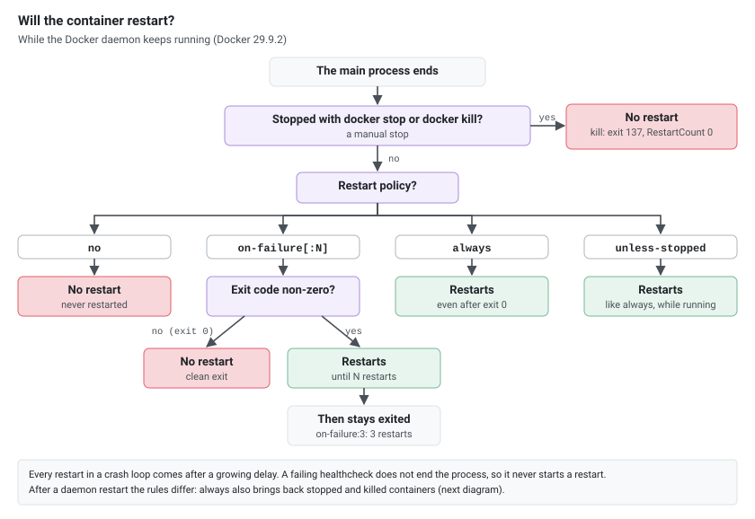
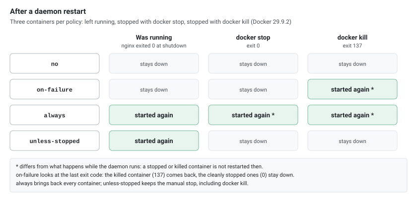
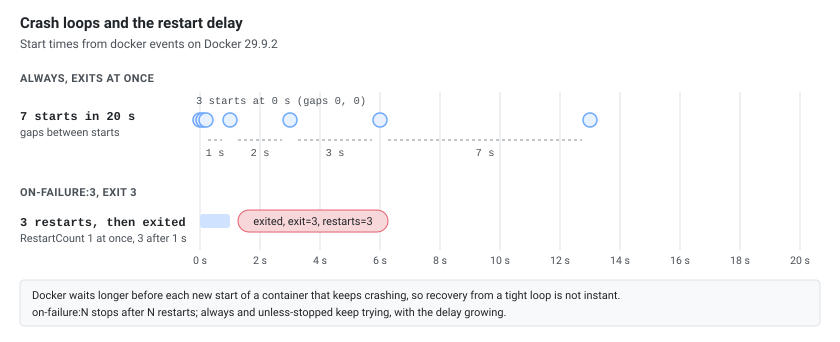

A restart policy tells the Docker daemon whether and when to automatically restart a container after it exits or after the daemon itself restarts. Choosing the right policy is key to service availability, clean debugging, and realistic failure testing. This guide covers all four policies, their differences, and how to apply, inspect, and test them. Everything below was run on Docker 29.9.2.

## Policy Overview

| Policy | Restarts on crash / non-zero exit | Restarts on clean exit (0) | Survives daemon/host reboot | Typical use |
|--------|-----------------------------------|----------------------------|-----------------------------|-------------|
| `no` (default) | No | No | No | One-off tasks, debugging |
| `on-failure[:N]` | Yes, up to `N` times if set | No | Only if its last exit code was non-zero | Batch jobs, transient failures |
| `always` | Yes | Yes | Yes | Long-running services |
| `unless-stopped` | Yes | Yes | Yes, unless it was manually stopped | Recommended for most services |

The practical difference between `always` and `unless-stopped` shows up around a reboot: if you manually `docker stop` a container, `always` will still start it again when the daemon restarts, whereas `unless-stopped` leaves it stopped because you stopped it deliberately.

[](restart-decision.svg "Open the diagram full size")

## unless-stopped: The Common Recommendation

`unless-stopped` restarts a container on crash and after a daemon or host reboot, but respects a manual stop. That makes it a good default for services you want to stay up without overriding your own deliberate shutdowns.

```bash
docker run -d --restart unless-stopped --name my-service nginx:1.27-alpine
```

For a container that already exists, `docker update --restart` sets the policy without recreating it (see [Updating and Removing a Policy](#updating-and-removing-a-policy)).

## The Policies in Detail

### no

The default. The container is never restarted automatically. Use it for one-off commands and when debugging, so a crashing container stays down for inspection.

```bash
docker run -d --restart no --name debug-run myapp:1.0.0
```

### on-failure[:max-retries]

Restarts only when the container exits with a non-zero status. An optional retry limit caps the attempts; once exhausted, Docker stops trying.

```bash
# Retry up to 5 times on non-zero exit, then give up
docker run -d --restart on-failure:5 --name batch-job myapp:1.0.0
```

A clean exit (status 0) does not trigger a restart, which suits batch jobs that should run to completion and only retry on error.

### always

Restarts the container regardless of exit status, and starts it again after a daemon restart even if it was manually stopped (the daemon restarts it when it next starts). Use with care, since it overrides a manual stop across daemon restarts.

```bash
docker run -d --restart always --name critical-service myapp:1.0.0
```

### unless-stopped

Like `always`, but a container you stopped manually stays stopped across daemon restarts. This is usually the more intuitive choice for services; the command is in the section above.

## What Happens When the Daemon Restarts

A daemon restart (or a host reboot) stops every container, and on start-up the daemon decides per policy which to bring back. Twelve nginx containers, three per policy (left running, stopped with `docker stop`, stopped with `docker kill`), then a restart of the Docker daemon:

| Policy | Was running | Stopped with `docker stop` | Stopped with `docker kill` |
|--------|-------------|----------------------------|----------------------------|
| `no` | stays down | stays down | stays down |
| `on-failure` | stays down | stays down | **started again** |
| `always` | started again | **started again** | **started again** |
| `unless-stopped` | started again | stays down | stays down |

`on-failure` looks at the last exit code. The running container stopped with exit code 0 when the daemon shut down (nginx exits cleanly on `SIGTERM`), so it stayed down. The killed one had exit code 137, so it was started again. An application that does not exit cleanly on shutdown would come back under `on-failure` too.

[](restart-after-daemon.svg "Open the diagram full size")

## Restart Policies in Docker Compose

Use the `restart` key. The values match the CLI: `no`, `on-failure`, `always`, `unless-stopped`.

```yaml
services:
  web:
    image: nginx:1.27-alpine
    restart: unless-stopped
    ports:
      - "80:80"
    healthcheck:
      test: ["CMD", "wget", "--quiet", "--tries=1", "--spider", "http://localhost:80/"]
      interval: 30s
      timeout: 10s
      retries: 3

  database:
    image: mysql:8.4
    restart: unless-stopped
    environment:
      MYSQL_ROOT_PASSWORD_FILE: /run/secrets/db_root
    volumes:
      - db-data:/var/lib/mysql
    secrets:
      - db_root
    healthcheck:
      test: ["CMD", "mysqladmin", "ping", "-h", "localhost"]
      interval: 30s
      timeout: 10s
      retries: 5

  cache:
    image: redis:7-alpine
    restart: unless-stopped
    healthcheck:
      test: ["CMD", "redis-cli", "ping"]
      interval: 15s
      timeout: 5s
      retries: 3

volumes:
  db-data:

secrets:
  db_root:
    file: ./db_root.txt
```

> Compose v2 ignores the obsolete top-level `version:` key; omit it. Prefer a Docker secret or an `_FILE` environment variable over putting a database password directly in the Compose file. See [Defining Variables in Docker Compose]().

### Restart policy vs healthcheck

A restart policy reacts to the container **exiting**. A healthcheck marks a running container `healthy` or `unhealthy` but does **not**, on its own, restart an unhealthy container under plain Docker or Compose. To act on health, use an external supervisor, an orchestrator, or a tool such as `autoheal`. Do not assume a failing healthcheck alone will trigger `restart:`. A container with `--restart unless-stopped` and a healthcheck that always fails stayed `running`, `unhealthy`, with `RestartCount` 0.

## Inspecting the Restart Policy

There is no `docker ps` format placeholder for the restart policy, so use `docker inspect`.

```bash
# Restart policy of a container
docker inspect --format '{{ .HostConfig.RestartPolicy.Name }}' my-service

# Policy name plus max retries
docker inspect --format \
  'policy={{ .HostConfig.RestartPolicy.Name }} max={{ .HostConfig.RestartPolicy.MaximumRetryCount }}' \
  my-service

# Current state, last exit code and how many times Docker has restarted it
docker inspect --format '{{ .State.Status }} exit={{ .State.ExitCode }} restarts={{ .RestartCount }}' my-service
```

With `jq`:

```bash
docker inspect my-service | jq '.[0].HostConfig.RestartPolicy, .[0].RestartCount, .[0].State.ExitCode'
```

## Updating and Removing a Policy

```bash
# Set or change the policy on running containers (applies immediately)
docker update --restart unless-stopped container1 container2

# Disable automatic restarts
docker update --restart no my-service
```

`docker stop` prevents further automatic restarts until you start the container again; `docker start` re-arms the policy.

```bash
docker stop my-service    # will not auto-restart while stopped
docker start my-service   # policy active again
```

## Testing Restart Behavior

To test a restart policy, the container's main process has to **die on its own**. `docker kill` does not work for this: Docker counts it as a manual stop, like `docker stop`, so no policy restarts the container while the daemon keeps running (with `always`, `unless-stopped` and `on-failure`: status `exited`, exit code 137, `RestartCount` 0).

Kill the main process with `SIGKILL` instead. Its PID from `docker inspect` is in the host's PID namespace, so a throwaway container with `--pid host` can kill it; this also works on Docker Desktop and colima, where the PID is inside the VM:

```bash
# crash <name>: SIGKILL the container's main process (docker kill would count as a manual stop)
crash() { docker run --rm --pid host alpine kill -9 "$(docker inspect -f '{{.State.Pid}}' "$1")"; }

# restarted <name>: true when the container is running again
restarted() { docker ps --filter "name=$1" --filter "status=running" --format '{{.Names}}' | grep -qx "$1"; }
```

On a Linux host you can also run `sudo kill -9 "$(docker inspect -f '{{.State.Pid}}' web-server)"`. `docker exec <name> kill -9 1` does nothing: PID 1 can't be killed with `SIGKILL` from inside its own namespace (the command returns 0 and the container keeps running).

A pass/fail test script, with the two functions above pasted at its top:

```bash
#!/usr/bin/env bash
set -euo pipefail
# crash() and restarted() from above go here

name="${1:-restart-test}"

docker run -d --restart unless-stopped --name "$name" -p 8080:80 nginx:1.27-alpine
sleep 5
crash "$name"
sleep 8

if restarted "$name"; then
  echo "PASS: $name restarted automatically (RestartCount=$(docker inspect --format '{{ .RestartCount }}' "$name"))"
else
  echo "FAIL: $name did not restart"
fi

docker rm -f "$name"
```

### Chaos-style loop for a group

Label the containers you want to target, then crash them at random and confirm recovery. This script uses the same two functions:

```bash
#!/usr/bin/env bash
set -euo pipefail
# crash() and restarted() from above go here

containers=( $(docker ps --filter "label=tier=app" --format '{{.Names}}') )
if [ "${#containers[@]}" -eq 0 ]; then
  echo "No containers with label tier=app"; exit 1
fi

echo "Targeting: ${containers[*]} (Ctrl+C to stop)"
while true; do
  target="${containers[RANDOM % ${#containers[@]}]}"
  echo "$(date +%T) crashing $target"
  crash "$target"
  sleep 15
  if restarted "$target"; then
    echo "$(date +%T) $target recovered"
  else
    echo "$(date +%T) $target did NOT recover"
  fi
  sleep $(( 30 + RANDOM % 60 ))
done
```

The array assignment works in any bash, including the bash 3.2 that macOS ships (`mapfile` needs bash 4). Container names cannot contain spaces, so splitting on whitespace is safe here.

Start the target services with a matching label and `unless-stopped`:

```bash
for n in app1 app2 app3; do
  docker run -d --name "$n" --label tier=app --restart unless-stopped nginx:1.27-alpine
done
```

## Monitoring Restarts

```bash
# Watch status changes
watch -n 2 'docker ps --format "table {{.Names}}\t{{.Status}}"'

# Stream die and start events for a container (a policy restart is "die" then "start")
docker events --filter container=my-service --filter event=die --filter event=start

# Follow logs across restarts
docker logs -f my-service
```

A restart by the policy shows up as a `die` event followed by a `start` event. The `restart` event belongs to the `docker restart` command, so filtering on `event=restart` alone misses crashes.

A climbing `RestartCount` combined with a crash loop usually points to a failing command or a config error inside the container; check `docker logs` and the last `State.ExitCode`.

## When a Container Will Not Restart

- It was stopped manually with `docker stop` **or `docker kill`** (both count as manual stops for every policy while the daemon keeps running; after a daemon restart, see the table above).
- It exited cleanly (status 0) under `no` or `on-failure`.
- `on-failure:N` exhausted its retry budget.
- The Docker daemon is not running; containers restart only once the daemon is back.
- Docker applies an increasing delay between rapid restarts, so recovery from a tight crash loop is not instantaneous. A container under `always` that exits at once was started 7 times in 20 seconds, with gaps of 0, 0, 1, 2, 3 and 7 seconds.

[](restart-backoff.svg "Open the diagram full size")

Diagnose with the state line from [Inspecting the Restart Policy](#inspecting-the-restart-policy), then the last log lines:

```bash
docker logs --tail 50 my-service
```

## Choosing a Policy

| Scenario | Recommended policy |
|----------|--------------------|
| Production or long-running service | `unless-stopped` |
| Service that must return even after a deliberate stop across reboots | `always` |
| Batch or one-shot job that should retry only on error | `on-failure:N` |
| Debugging a crash | `no` |
| Failure/chaos testing of recovery | `unless-stopped` |

For related material, see the [Docker Cheatsheet](), [Docker Compose Cheatsheet](), and [Defining Variables in Docker Compose]().
