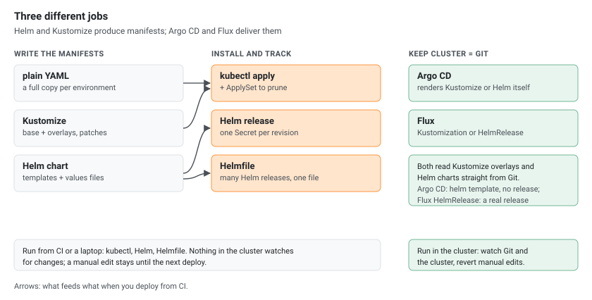
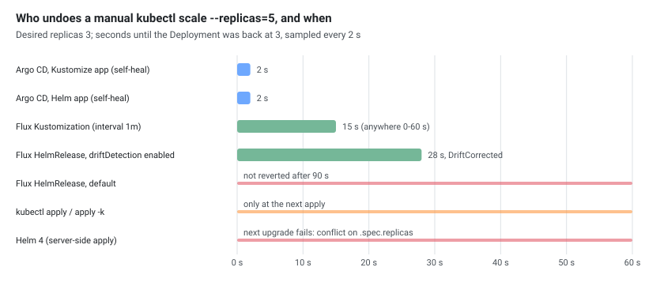
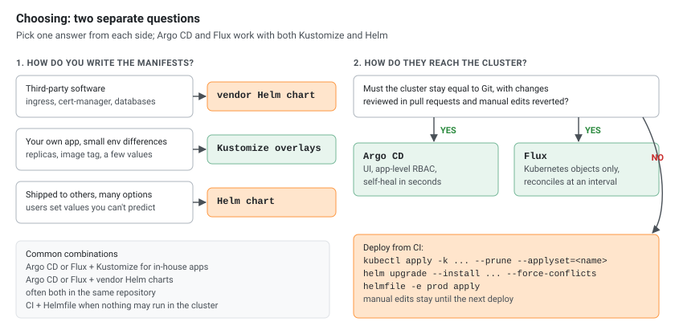

"Helm or Argo CD?" and "Kustomize or Flux?" come up all the time, and they compare tools that do different jobs. Helm and Kustomize **produce** Kubernetes manifests. Argo CD and Flux **keep a cluster equal to Git**, and use Helm or Kustomize to produce what's in Git. This article puts them side by side on the same small app, and measures what each one does when a resource is removed, when someone changes the cluster by hand, and when you need to go back.

For the details of Kustomize and Helm themselves (overlays, merge rules, Helm in production) see [Kustomize vs Helm](/posts/kustomize-vs-helm/); for Argo CD's rollback see [Argo CD Rollback](/posts/argocd-rollback-out-of-sync/).

## Scope

Everything was run on a single-node **k3s v1.35** cluster with:

- **kubectl 1.37.2**, which includes **Kustomize v5.8.1**
- **Helm 4.3.1**
- **Helmfile v1.8.4**, run from its official container image inside the cluster
- **Argo CD v3.6.1** and **Flux v2.10.0** (kustomize-controller v1.10.1, helm-controller v1.7.1), installed from their release manifests

Argo CD and Flux read the app from a git server running inside the same cluster. Everything was removed afterwards.

## 1. Three Different Jobs

[](tools-layers.svg "Open the diagram full size")

| Job | Question it answers | Tools |
|-----|---------------------|-------|
| **Write the manifests** | How do I get dev and prod YAML without copying everything? | plain YAML, Kustomize, Helm charts |
| **Install and track** | What did I install, and how do I update, remove or roll it back? | `kubectl apply` (with ApplySets), Helm releases, Helmfile |
| **Keep the cluster equal to Git** | Who notices and fixes a difference between Git and the cluster? | Argo CD, Flux |

So the realistic choices are combinations: Kustomize or Helm for writing, plus `kubectl`/Helm from CI **or** Argo CD/Flux for delivery. Argo CD and Flux both understand Kustomize and Helm natively.

## 2. The Test App

One app, `shop`: a Deployment, a Service and a ConfigMap, in two environments:

| | dev | prod |
|---|---|---|
| replicas | 1 | 3 |
| image | `nginx:1.28-alpine` | `nginx:1.29-alpine` |
| `ENVIRONMENT` in the ConfigMap | `dev` | `prod` |

Written four ways (non-empty lines, both environments):

| Format | Files | Lines | What changes per environment |
|--------|------:|------:|------------------------------|
| Plain YAML | 2 | 76 | A full copy of everything |
| Kustomize | 4 | 68 | An overlay with `replicas`, `images` and a patch |
| Helm chart | 6 | 49 | One values file |
| Helmfile (on top of the chart) | 1 | 13 | The environment list |

The Kustomize prod overlay:

```yaml
resources:
- ../../base
replicas:
- name: shop
  count: 3
images:
- name: nginx
  newTag: 1.29-alpine
patches:
- target: {kind: ConfigMap, name: shop-config}
  patch: |-
    - op: replace
      path: /data/ENVIRONMENT
      value: prod
```

The Helm prod values (`values-prod.yaml`), on top of the chart's `values.yaml`:

```yaml
environment: prod
replicas: 3
image:
  tag: 1.29-alpine
```

And Helmfile, which installs that chart once per environment:

```yaml
environments:
  dev: {}
  prod:
    values:
    - ../helm/values-prod.yaml
---
releases:
- name: shop
  namespace: hf-{{ .Environment.Name }}
  createNamespace: true
  chart: ../helm/shop
  values:
  - {{ toYaml .Values | nindent 4 }}
```

All of them render the same objects for prod:

```bash
kubectl kustomize kustomize/overlays/prod
helm template shop helm/shop -f helm/values-prod.yaml
helmfile -e prod template
```

```text
  ENVIRONMENT: prod
  replicas: 3
        image: nginx:1.29-alpine
```

(Helm and Helmfile quote the strings: `"prod"`, `"nginx:1.29-alpine"`.) The difference between the tools isn't the output, it's everything around it.

## 3. The Comparison

| | `kubectl apply` | Kustomize (`kubectl apply -k`) | Helm | Helmfile | Argo CD | Flux |
|---|---|---|---|---|---|---|
| **Job** | install | write + install | write + install + track | install many Helm releases | keep cluster = Git | keep cluster = Git |
| **Preview** | `kubectl diff -f` | `kubectl diff -k` | `helm template` | `helmfile apply` diffs before upgrading | `argocd app diff` | Review the change in Git |
| **Where it keeps state** | `last-applied` annotation; an ApplySet Secret with `--applyset` | same as kubectl | One Secret per revision in the release namespace | Helm's Secrets | `status` of the Application | `status.inventory` of the Kustomization; Helm Secrets for a HelmRelease |
| **Resource removed from the source** | Stays | Stays | Deleted on `helm upgrade` | Deleted (Helm) | Deleted with auto-prune | Deleted with `prune: true` |
| **Same, with an ApplySet** | Pruned | Pruned | | | | |
| **Manual change in the cluster** | Reset only on the next `apply` | Reset only on the next `apply` | **Helm 4: next `upgrade` fails** with a conflict | Same as Helm | Reverted in **2 s** (self-heal) | Kustomization: **15 s**; HelmRelease: **never** by default |
| **Going back** | Apply the old files | Apply the old files | `helm rollback` | `helm rollback` (they are Helm releases) | `argocd app rollback` or `git revert` | `git revert` |
| **Runs where** | CI or a laptop | CI or a laptop | CI or a laptop | CI or a laptop | In the cluster | In the cluster |

The rows come from the tests in the next sections.

## 4. kubectl apply and Kustomize

`kubectl apply -f` and `kubectl apply -k` send what's in the files. A manual change is reset the next time someone applies, and not before:

```text
replicas=5 image=nginx:1.29-alpine        # after kubectl scale --replicas=5
deployment.apps/shop configured
replicas=3 image=nginx:1.29-alpine        # after kubectl apply -f again
```

`kubectl diff` shows it beforehand, and exits with 1 when something differs:

```text
$ kubectl diff -k kustomize/overlays/prod
-  replicas: 5
+  replicas: 3
kubectl diff -k exit=1
```

### Removed Resources Stay, Unless You Use an ApplySet

Version 2 of the app drops the ConfigMap. A plain `kubectl apply` of version 2 updated the Deployment and **left the ConfigMap in the cluster**: `apply` only knows the objects in the files it's given now.

An **ApplySet** fixes that. `kubectl` records which objects belong to the set in a parent object (a Secret here) and labels them; `--prune` then deletes members that are no longer in the files:

```bash
KUBECTL_APPLYSET=true kubectl apply -n yaml-as -f shop.yaml --prune --applyset=shop
```

```text
deployment.apps/shop configured
service/shop unchanged
configmap/shop-config pruned
```

The parent Secret describes the set:

```text
{"applyset.kubernetes.io/id":"applyset-ip_P7OTgBFurV0riLZn8tHWfZWs7RH5R00q3EiRy8mA-v1"}
{"applyset.kubernetes.io/contains-group-kinds":"ConfigMap,Deployment.apps,Service","applyset.kubernetes.io/tooling":"kubectl/v1.37.2"}
```

The same works with `-k`. One catch: an ApplySet only prunes **objects it applied itself**. In a namespace first deployed without `--applyset`, switching to it later pruned nothing; the ConfigMap had never been labelled as a member. Start with the ApplySet from the first deploy. ApplySets still have to be switched on with `KUBECTL_APPLYSET=true`.

## 5. Helm

Helm renders the chart and installs it as a **release**: every install, upgrade and rollback is a revision, stored as a Secret in the release namespace (`sh.helm.release.v1.shop.v1`, `.v2`, ...). Each one holds the rendered manifest, the values and, new in Helm 4, the apply method:

```text
release secret holds: ['apply_method', 'chart', 'config', 'info', 'manifest', 'name', 'namespace', 'version']
config: {'environment': 'prod', 'image': {'tag': '1.29-alpine'}, 'replicas': 3}
```

Because Helm knows the previous manifest, an upgrade deletes what the chart no longer contains, and a rollback brings it back:

```text
REVISION: 1   cm=configmap/shop-config
REVISION: 2   cm=gone                      # helm upgrade with the ConfigMap template removed
Rollback was a success! Happy Helming!
              cm=configmap/shop-config     # helm rollback shop 1
```

### Helm 4 and Manual Changes: Server-Side Apply Conflicts

Helm 4 applies resources **server-side** by default. After `kubectl scale deploy shop --replicas=5`, the next `helm upgrade` with unchanged values didn't reset the replicas. It failed:

```text
Error: UPGRADE FAILED: conflict occurred while applying object helm-prod/shop apps/v1, Kind=Deployment: Apply failed with 1 conflict: conflict with "kubectl" with subresource "scale" using apps/v1: .spec.replicas
```

The API server tracks who owns each field. `kubectl scale` took over `.spec.replicas`, and server-side apply refuses to take a field back without being told to. `kubectl patch` gave the same error, with `conflict with "kubectl-patch"`. Even `helm rollback` failed the same way, leaving failed revisions in the history.

| Upgrade after a manual `kubectl scale` | Result |
|---|---|
| `helm upgrade` | `UPGRADE FAILED: conflict ... .spec.replicas` |
| `helm upgrade --force-conflicts` | `deployed`, replicas back to 3 |
| `helm upgrade --server-side=false` | `deployed`, replicas back to 3 (client-side three-way merge) |

`--server-side=false` changes the release's apply method for good: `--server-side` defaults to `auto`, which reuses the previous release's method. After that switch, `--force-conflicts` is refused:

```text
Error: UPGRADE FAILED: invalid client update option(s): forceConflicts enabled when serverSideApply disabled
```

So under Helm 4, manual changes no longer get silently overwritten by the next deploy: the deploy fails until someone decides. Add `--force-conflicts` to CI pipelines that should win, and keep HorizontalPodAutoscaler-managed fields like `replicas` out of the chart.

## 6. Helmfile

Helmfile doesn't render anything itself: it runs Helm for a list of releases and environments, from one file. Its container image comes with Helm 4.3.1 and kubectl, and `helmfile apply` (a diff, then the upgrade) worked in it without installing anything:

```text
$ helmfile -e prod apply
================= Updated Releases =================
NAME   NAMESPACE   CHART          VERSION   DURATION
shop   hf-prod     ../helm/shop   0.1.0           0s
```

`helmfile -e dev sync` installed the dev release (`replicas=1 image=nginx:1.28-alpine`). The result is ordinary Helm releases, visible with `helm list -A`, so everything in the Helm section applies, including the server-side apply conflicts.

## 7. Argo CD and Flux

Both run in the cluster, watch Git, and apply what they find, using Kustomize or Helm to render it. The same repository was deployed four times:

| | Source | Renders with | Helm release Secrets |
|---|---|---|---|
| `argo-kz` | `kustomize/overlays/prod` | Kustomize | none |
| `argo-helm` | `helm/shop` with `../values-prod.yaml` | `helm template` | **none** |
| `flux-kz` | `./kustomize/overlays/prod` | Kustomize | none |
| `flux-helm` | `./helm/shop` with both values files | Helm (a real release) | `flux-helm-shop`, stored in `flux-system` |

That difference matters: **Argo CD renders Helm charts and applies the YAML itself**, so `helm list` doesn't show its apps and `helm rollback` doesn't apply to them; history and rollback live in the Application. **Flux's HelmRelease runs a real Helm install**: `helm list -A` showed `flux-helm-shop` with chart version `0.1.0+9a31ffc429aa.1` (the chart version plus the Git commit).

Where each one records what it deployed:

```text
--- Argo CD: application status
ConfigMap/shop-config Synced
Service/shop Synced
Deployment/shop Synced
--- Flux Kustomization inventory
flux-kz_shop-config__ConfigMap
flux-kz_shop__Service
flux-kz_shop_apps_Deployment
```

### Manual Changes

`kubectl scale deploy shop --replicas=5` in all four namespaces at once, then sampled every 2 seconds:

```text
0s argo-kz=5 argo-helm=5 flux-kz=5 flux-helm=5
2s argo-kz=3 argo-helm=3 flux-kz=5 flux-helm=5
15s argo-kz=3 argo-helm=3 flux-kz=3 flux-helm=5
```

[](tools-drift.svg "Open the diagram full size")

- **Argo CD** with self-heal reverted both apps within 2 seconds: it watches the resources.
- **Flux Kustomization** reverted at 15 seconds: it re-applies at its interval (`interval: 1m`), so anything between 0 and 60 seconds.
- **Flux HelmRelease** didn't revert it at all in 90 seconds: helm-controller's **drift detection is off by default** (`spec.driftDetection.mode` empty). With `driftDetection: {mode: enabled}`, a new scale to 5 was reverted after 28 seconds, with the event `DriftCorrected` and no new Helm revision.

### Removed Resources

After a commit that removed the ConfigMap, all four deleted it: Argo CD with auto-prune, the Kustomization with `prune: true`, and the HelmRelease through a Helm upgrade (revision 3, chart `0.1.0+78f5cf5d912a.1`). Without `--auto-prune` (Argo CD) or `prune: true` (Flux), removed resources stay in the cluster, like with `kubectl apply`.

### Going Back

Argo CD has `argocd app rollback` (temporary, see [Argo CD Rollback](/posts/argocd-rollback-out-of-sync/)); Flux has no rollback command, only `git revert`. A HelmRelease can roll back on its own when an upgrade fails (`upgrade.remediation`). The [rollback comparison](/posts/argocd-rollback-out-of-sync/#compared-with-other-tools) has the measured details for both.

## 8. Choosing

[](tools-choose.svg "Open the diagram full size")

| Situation | A good fit |
|-----------|-----------|
| Your own app, a few environments, small differences | Kustomize overlays |
| Software you ship to others, or many configurable options | A Helm chart |
| Third-party software (ingress controllers, cert-manager, databases) | The vendor's Helm chart |
| Deploys from CI, nothing running in the cluster | `kubectl apply -k --prune --applyset` or `helm upgrade --install` (with `--force-conflicts` in Helm 4) |
| Many Helm releases across environments, from CI | Helmfile |
| The cluster must match Git, changes reviewed in pull requests | Argo CD or Flux, with Kustomize or Helm inside |
| A UI for app owners, sync windows, app-level RBAC | Argo CD |
| Everything as Kubernetes objects, no UI needed, many clusters pulling the same repo | Flux |

The combinations used most: **Argo CD or Flux + Kustomize** for in-house apps, and **Argo CD or Flux + Helm** for third-party charts, often in the same repository. The Kustomize vs Helm decision is about how you write manifests; the Argo CD vs Flux decision is about how they reach the cluster.

## 9. Gotchas Found Along the Way

- **`kubectl apply` never deletes.** A resource removed from the files stays until you delete it or use an ApplySet.
- **ApplySets only prune their own members.** Adopting one in an existing namespace pruned nothing.
- **Helm 4's server-side apply refuses to overwrite manual changes.** The next `helm upgrade` and even `helm rollback` fail with `conflict with "kubectl" ... .spec.replicas` until you use `--force-conflicts`.
- **`--server-side=false` sticks** to the release, and `--force-conflicts` then fails.
- **Argo CD's Helm apps aren't Helm releases.** `helm list` is empty for them; use `argocd app history`.
- **Flux's HelmRelease ignores drift by default.** Enable `driftDetection` if manual changes should be reverted.
- **A HelmRelease stores its release history in its own namespace**, not the target namespace.
- **Flux only reverts at the next interval**, Argo CD with self-heal right away; neither replaces RBAC that stops manual changes in the first place.

## See Also

- [Kustomize vs Helm: Overlays, Charts, Merge Rules and Using Both](/posts/kustomize-vs-helm/)
- [Argo CD Rollback: How It Works and Why the App Shows OutOfSync](/posts/argocd-rollback-out-of-sync/)
- [Kubernetes docs: Declarative management with kubectl (ApplySets)](https://kubernetes.io/docs/tasks/manage-kubernetes-objects/declarative-config/)
- [Helm docs: helm upgrade](https://helm.sh/docs/helm/helm_upgrade/)
- [Flux docs: HelmRelease drift detection](https://fluxcd.io/flux/components/helm/helmreleases/)
- [Argo CD docs: Automated sync policy](https://argo-cd.readthedocs.io/en/stable/user-guide/auto_sync/)
