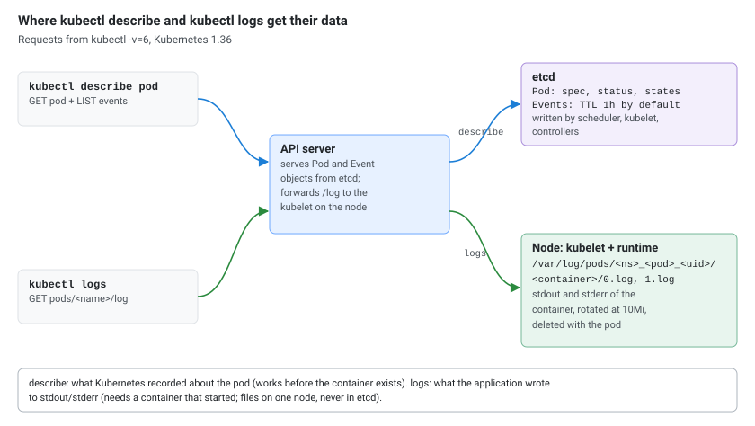
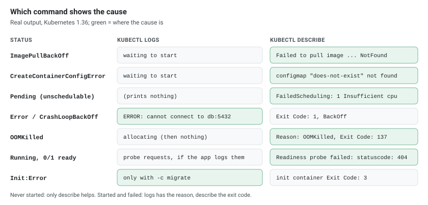
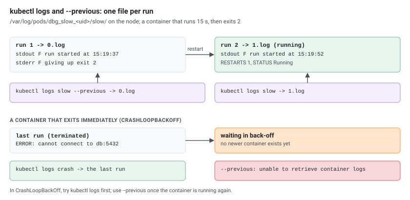
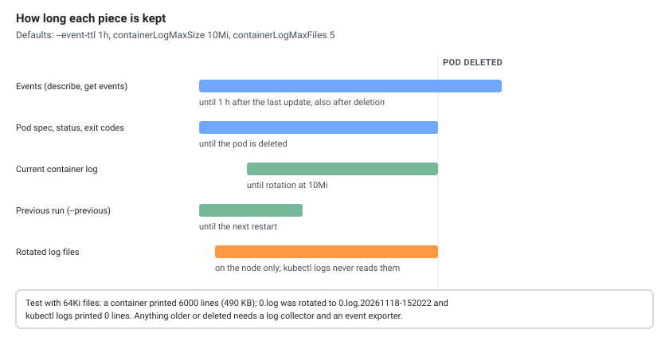
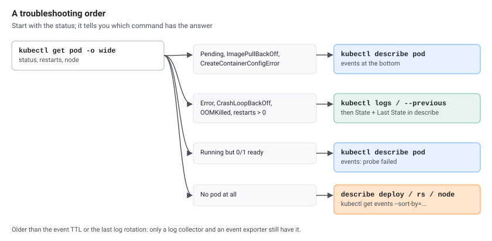

`kubectl describe` and `kubectl logs` are the first two commands for a pod that doesn't work, and they answer different questions. `describe` tells you what **Kubernetes** thinks of the pod: its spec, its state, and the events the scheduler and kubelet recorded about it. `logs` shows what **your application** wrote to stdout and stderr. Many failures show up in only one of them, and both lose information after a while. This article shows which is which, with the real output of common failures.

## Scope

Everything was run with **kubectl 1.37.2** on a throwaway kind cluster (**Kubernetes 1.36.4**, containerd 2.3.4). To make retention visible in minutes instead of hours, that cluster ran the API server with `--event-ttl=2m` (default `1h0m0s`) and the kubelet with `containerLogMaxSize: 64Ki` and `containerLogMaxFiles: 2` (defaults `10Mi` and `5`). The failure scenarios were also run on k3s 1.35 with the Docker runtime, with the same results.

## 1. Where Each Command Gets Its Data

[](describe-logs-sources.svg "Open the diagram full size")

With `-v=6`, kubectl prints the API requests it makes. `describe pod` reads the Pod object and then lists **Event** objects that point at it:

```text
"Response" verb="GET" url=".../api/v1/namespaces/dbg/pods/web" status="200 OK"
"Response" verb="GET" url=".../api/v1/namespaces/dbg/events?fieldSelector=involvedObject.name%3Dweb%2CinvolvedObject.namespace%3Ddbg%2CinvolvedObject.uid%3D849451e6-..." status="200 OK"
```

`logs` reads the Pod (to find the container) and then the pod's `log` subresource:

```text
"Response" verb="GET" url=".../api/v1/namespaces/dbg/pods/web" status="200 OK"
"Response" verb="GET" url=".../api/v1/namespaces/dbg/pods/web/log?container=web&tailLines=1" status="200 OK"
```

The API server doesn't store logs. It forwards the `log` request to the **kubelet** on the pod's node, which reads the container's log file from disk. Everything `describe` shows lives in the API server (etcd); everything `logs` shows lives on one node.

| | `kubectl describe pod` | `kubectl logs` |
|---|---|---|
| Shows | Spec, status, container states, conditions, events | stdout and stderr of one container |
| Written by | Scheduler, kubelet, controllers | Your application |
| Stored in | The API server (Pod and Event objects) | Files under `/var/log/pods/` on the node |
| Works before the container starts | Yes | No: `waiting to start` |
| Exit code and reason (`OOMKilled`) | Yes, under `State` and `Last State` | No |
| What the app printed before it died | No | Yes, with `--previous` while it runs again |
| Kept for | Events: 1 hour by default; the rest while the object exists | Until rotation, or until the pod is deleted |
| Other object kinds | Any: deployments, nodes, PVCs, services... | Pods (or a workload, which picks one pod) |

## 2. Which One Answers Which Failure

[](describe-logs-failures.svg "Open the diagram full size")

| Symptom in `kubectl get pod` | `kubectl logs` | `kubectl describe` |
|---|---|---|
| `ImagePullBackOff` | `is waiting to start: trying and failing to pull image` | Events: `Failed to pull image "nginx:9.99-does-not-exist": ... NotFound` |
| `CreateContainerConfigError` | `is waiting to start: CreateContainerConfigError` | Events: `Error: configmap "does-not-exist" not found` |
| `Pending` (unschedulable) | Nothing at all | Events: `FailedScheduling ... 1 Insufficient cpu` |
| `Error` / `CrashLoopBackOff` | **The application's error message** | `Exit Code: 1`, restart count, `BackOff` events |
| `OOMKilled` | What it printed before the kill (`allocating`) | `Reason: OOMKilled`, `Exit Code: 137` |
| `Running` but `0/1` ready | The probe requests, if the app logs them | Events: `Readiness probe failed: HTTP probe failed with statuscode: 404` |
| `Init:Error` | Only with `-c <init-container>` | Init container `Exit Code: 3` |

Rule of thumb: if the container **never started**, only `describe` can help. If it **started and failed**, `logs` usually has the reason, and `describe` has the exit code.

### The Container Never Started

An image that doesn't exist:

```text
$ kubectl logs badimg
Error from server (BadRequest): container "badimg" in pod "badimg" is waiting to start: trying and failing to pull image

$ kubectl describe pod badimg
    State:          Waiting
      Reason:       ImagePullBackOff
...
Events:
  Type     Reason     Age                From               Message
  ----     ------     ----               ----               -------
  Normal   Scheduled  25s                default-scheduler  Successfully assigned dbg/badimg to dbg-control-plane
  Normal   BackOff    23s                kubelet            spec.containers{badimg}: Back-off pulling image "nginx:9.99-does-not-exist"
  Warning  Failed     23s                kubelet            spec.containers{badimg}: Error: ImagePullBackOff
  Normal   Pulling    11s (x2 over 25s)  kubelet            spec.containers{badimg}: Pulling image "nginx:9.99-does-not-exist"
  Warning  Failed     11s (x2 over 24s)  kubelet            spec.containers{badimg}: Failed to pull image "nginx:9.99-does-not-exist": rpc error: code = NotFound desc = failed to pull and unpack image ...
  Warning  Failed     11s (x2 over 24s)  kubelet            spec.containers{badimg}: Error: ErrImagePull
```

A missing ConfigMap in `envFrom` stops the container from being created, and only the event names the ConfigMap:

```text
  Warning  Failed     1s (x3 over 15s)  kubelet            spec.containers{nocfg}: Error: configmap "does-not-exist" not found
```

A pod that can't be scheduled has no container and no node; `kubectl logs huge` printed **nothing**, not even an error. The scheduler's event is the only clue:

```text
  Warning  FailedScheduling  10s   default-scheduler  0/1 nodes are available: 1 Insufficient cpu. no new claims to deallocate, preemption: 0/1 nodes are available: 1 Preemption is not helpful for scheduling.
```

### The Container Started and Failed

A container that prints an error and exits:

```text
$ kubectl get pod crash
NAME    READY   STATUS   RESTARTS      AGE
crash   0/1     Error    2 (36s ago)   40s

$ kubectl logs crash
starting app v2
ERROR: cannot connect to db:5432
```

`describe` doesn't know why, only how it ended:

```text
    State:          Terminated
      Reason:       Error
      Exit Code:    1
      Started:      Wed, 18 Nov 2026 17:15:58 +0200
      Finished:     Wed, 18 Nov 2026 17:15:58 +0200
    Last State:     Terminated
      Reason:       Error
      Exit Code:    1
    Ready:          False
    Restart Count:  2
...
  Warning  BackOff    26s (x3 over 36s)  kubelet  spec.containers{crash}: Back-off restarting failed container crash in pod crash_dbg(...)
```

An OOM kill is the reverse: the log stops mid-way with no error, and only `describe` says what happened:

```text
$ kubectl logs oom
allocating

$ kubectl describe pod oom
    State:          Terminated
      Reason:       OOMKilled
      Exit Code:    137
```

`137` is 128 + 9: the process got `SIGKILL` from the kernel when it passed its 64Mi memory limit. It had no chance to log anything.

### Probes

A readiness probe on a path that doesn't exist leaves the pod `Running` but `0/1`. `describe` has the probe definition, the `Ready False` condition and the reason:

```text
    Readiness:      http-get http://:80/healthz delay=0s timeout=1s period=5s successThreshold=1 failureThreshold=3
Conditions:
  Type                        Status
  Ready                       False
  ContainersReady             False
...
  Warning  Unhealthy  4s (x6 over 29s)  kubelet  spec.containers{web}: Readiness probe failed: HTTP probe failed with statuscode: 404
```

The application's log shows the same requests from its side, because nginx logs them:

```text
10.244.0.1 - - [18/Nov/2026:15:18:21 +0000] "GET /healthz HTTP/1.1" 404 153 "-" "kube-probe/1.36" "-"
```

An application that doesn't log requests would show nothing; the probe result is only in the events.

### Init Containers

`kubectl logs` picks the main container by default, which hasn't started:

```text
$ kubectl logs initfail
Defaulted container "app" out of: app, migrate (init)
Error from server (BadRequest): container "app" in pod "initfail" is waiting to start: PodInitializing

$ kubectl logs initfail -c migrate
running migrations
migration 0042 failed: column exists
```

`describe` lists the init container separately, with `Exit Code: 3` and its restart count.

### Logs That Aren't There

`kubectl logs` only sees **stdout and stderr**. An application that writes to a file inside the container shows nothing:

```text
$ kubectl logs filelog
$ kubectl exec filelog -- tail -2 /tmp/app.log
Wed Nov 18 15:19:02 UTC 2026 request served
Wed Nov 18 15:19:04 UTC 2026 request served
```

Configure the app to log to stdout, or add a sidecar that tails the file to its own stdout.

## 3. --previous: The Run Before This One

[](describe-logs-previous.svg "Open the diagram full size")

Each run of a container writes its own log file on the node: `0.log` for the first run, `1.log` after the first restart. `kubectl logs` reads the current run, `kubectl logs --previous` the one before.

A container that runs for 15 seconds and then exits with code 2, checked while its second run was going:

```text
$ kubectl get pod slow
NAME   READY   STATUS    RESTARTS     AGE
slow   1/1     Running   1 (6s ago)   22s

$ kubectl logs slow
run started at 15:19:52

$ kubectl logs slow --previous
run started at 15:19:37
giving up
```

On the node:

```text
/var/log/pods/dbg_slow_1bcbd120-.../slow/
-rw-r----- 1 root root 114 Nov 18 15:19 0.log
-rw-r----- 1 root root  64 Nov 18 15:19 1.log

/var/log/containers/slow_dbg_slow-2ef82290....log -> /var/log/pods/dbg_slow_1bcbd120-.../slow/1.log
/var/log/containers/slow_dbg_slow-6d26e147....log -> /var/log/pods/dbg_slow_1bcbd120-.../slow/0.log
```

The files are in the CRI log format, one line per write, with a timestamp and the stream:

```text
2026-11-18T15:19:37.063693155Z stdout F run started at 15:19:37
2026-11-18T15:19:52.066143762Z stderr F giving up
```

The catch is timing. A container that crashes **immediately** spends most of its time waiting in back-off, not running. In that state the last run is the "current" container, so plain `kubectl logs` shows its output, and `--previous` failed:

```text
$ kubectl logs crash
starting app v2
ERROR: cannot connect to db:5432

$ kubectl logs crash --previous
unable to retrieve container logs for containerd://696daeb997fe...
```

So for a pod in `CrashLoopBackOff`, try `kubectl logs` first; use `--previous` when the container is running again and you want the run that failed.

## 4. Useful kubectl logs Options

```bash
kubectl logs <pod>                         # the only container, or the default one
kubectl logs <pod> -c <container>          # a specific container, init containers too
kubectl logs <pod> --all-containers --prefix
kubectl logs <pod> --previous              # the run before the current one
kubectl logs <pod> --tail=100              # last 100 lines
kubectl logs <pod> --since=10m             # only recent lines (also --since-time)
kubectl logs <pod> --timestamps            # prefix each line with the time it was written
kubectl logs <pod> -f                      # follow
kubectl logs deploy/<name>                 # one pod of the Deployment
kubectl logs -l app=api --prefix           # every pod with the label
```

What they did with a three-replica Deployment that has an `api` and a `sidecar` container:

```text
$ kubectl logs deploy/api | tail -2
Found 3 pods, using pod/api-549bd6cd64-bvvls
Defaulted container "api" out of: api, sidecar
api-549bd6cd64-bvvls request 3
api-549bd6cd64-bvvls request 4

$ kubectl logs deploy/api --all-containers --tail=1 --prefix
Found 3 pods, using pod/api-549bd6cd64-bvvls
[pod/api-549bd6cd64-bvvls/api] api-549bd6cd64-bvvls request 4
[pod/api-549bd6cd64-bvvls/sidecar] sidecar tick

$ kubectl logs -l app=api -c api --tail=1 --prefix
[pod/api-549bd6cd64-bvvls/api] api-549bd6cd64-bvvls request 4
[pod/api-549bd6cd64-x2zj7/api] api-549bd6cd64-x2zj7 request 4
[pod/api-549bd6cd64-x7tcd/api] api-549bd6cd64-x7tcd request 4

$ kubectl logs deploy/api -c api --timestamps --tail=2
2026-11-18T15:20:05.712910062Z api-549bd6cd64-bvvls request 3
2026-11-18T15:20:08.714990684Z api-549bd6cd64-bvvls request 4
```

- `deploy/<name>` reads **one** pod, picked by kubectl. Use `-l` with the Deployment's labels for all of them.
- Following many pods at once is capped. With six replicas:

  ```text
  error: you are attempting to follow 6 log streams, but maximum allowed concurrency is 5, use --max-log-requests to increase the limit
  ```

  `--max-log-requests=6` lifted it.

## 5. How Long Each One Is Kept

[](describe-logs-retention.svg "Open the diagram full size")

### Events: 1 Hour by Default

Events are API objects with a time to live, set by the API server's `--event-ttl`:

```text
$ kube-apiserver --help | grep event-ttl
      --event-ttl duration                               Amount of time to retain events. (default 1h0m0s)
```

With the TTL at 2 minutes on the test cluster, the healthy `web` pod, five minutes old, had nothing left:

```text
$ kubectl describe pod web
...
Events:                      <none>
```

`Events: <none>` doesn't mean nothing happened; it means nothing happened **recently**. On a default cluster, a pod that failed to pull its image yesterday and started fine an hour later shows no trace of it.

Repeated events don't pile up as separate objects. The kubelet updates one event with a counter, and every update keeps it alive, so a failure that still repeats always shows:

```text
  Warning  BackOff  29s (x10 over 7m24s)  kubelet  spec.containers{crash}: Back-off restarting failed container crash in pod crash_dbg(...)
```

Events also **outlive the pod** they're about, until the TTL:

```text
$ kubectl delete pod badimg
$ kubectl describe pod badimg
Error from server (NotFound): pods "badimg" not found

$ kubectl get events --field-selector involvedObject.name=badimg | tail -2
8s          Normal    BackOff   pod/badimg   Back-off pulling image "nginx:9.99-does-not-exist"
22s         Warning   Failed    pod/badimg   Error: ImagePullBackOff
```

Two minutes later: `No resources found in dbg namespace.` `describe` filters events by the object's UID (`involvedObject.uid=...` in the request above), so a new pod with the same name doesn't show the old pod's events; `kubectl get events` does.

Other ways to read events:

```bash
kubectl events --for pod/<name>                                  # one object, oldest first
kubectl get events --field-selector type=Warning --sort-by=.lastTimestamp
```

```text
$ kubectl events --for pod/badimg | tail -3
88s (x5 over 4m16s)    Warning   Failed    Pod/badimg   Error: ErrImagePull
21s (x15 over 4m15s)   Warning   Failed    Pod/badimg   Error: ImagePullBackOff
7s (x16 over 4m15s)    Normal    BackOff   Pod/badimg   Back-off pulling image "nginx:9.99-does-not-exist"
```

To keep events longer than an hour, ship them somewhere: an event exporter to your logging system, or raise `--event-ttl` (more objects in etcd).

### Logs: Until Rotation or Deletion

Container logs live on the node, so they go away with the pod:

```text
$ kubectl logs badimg
error: error from server (NotFound): pods "badimg" not found in namespace "dbg"
```

While the pod exists, the kubelet rotates each container's log file. The defaults:

```text
$ kubelet --help
      --container-log-max-files int32   ... The number must be >= 2. (default 5)
      --container-log-max-size string   ... Set the maximum size (e.g. 10Mi) of container log file before it is rotated. (default "10Mi")
```

The catch: **`kubectl logs` reads only the current file**. A container that printed 6000 lines (about 490 KB) and then went quiet, with 64Ki files:

```text
/var/log/pods/dbg_chatty_.../chatty/
-rw-r----- 1 root root      0 Nov 18 15:20 0.log
-rw-r----- 1 root root 490199 Nov 18 15:20 0.log.20261118-152022

$ kubectl logs chatty | wc -l
0
```

All 6000 lines were still on the node, in the rotated file, and `kubectl logs` showed none of them. With the defaults the same happens to a container that wrote more than 10Mi since its last rotation. Older lines are only on the node (`/var/log/pods/...`) or in a log collector.

| | Kept until | Default |
|---|---|---|
| Events | TTL after their last update, even after the object is deleted | 1 hour (`--event-ttl`) |
| Pod spec and status in `describe` | The pod is deleted | |
| Current container log | Rotation, or the pod is deleted | 10Mi per file |
| Previous container log | The next restart, or the pod is deleted | One run back |
| Rotated log files | On the node until there are more than `containerLogMaxFiles` | 5 files |

For anything older or deleted, use a log collector (Fluent Bit, Vector, Promtail and so on) reading `/var/log/containers/` on every node, and an event exporter.

## 6. A Troubleshooting Order

[](describe-logs-order.svg "Open the diagram full size")

```bash
kubectl get pod <pod> -o wide              # status, restarts, node
kubectl describe pod <pod>                 # events at the bottom, then State and Last State
kubectl logs <pod> [-c <container>]        # what the app said
kubectl logs <pod> --previous              # the failed run, once it restarted
kubectl get events --sort-by=.lastTimestamp   # also for things that aren't pods
```

`describe` works on any object, which helps when the pod never got created: `kubectl describe deploy <name>`, `kubectl describe rs <name>` (quota or admission errors), `kubectl describe node <name>` (pressure conditions, taints, allocated resources), `kubectl describe pvc <name>` (binding problems).

## Quick Reference

| Question | Command |
|---|---|
| Why is it Pending? | `kubectl describe pod` (events: `FailedScheduling`) |
| Why can't it pull the image? | `kubectl describe pod` (events: `Failed to pull image`) |
| Why did it crash? | `kubectl logs`; `kubectl logs --previous` once it runs again |
| How did it end? | `kubectl describe pod` (`State`, `Last State`, `Exit Code`, `Reason`) |
| Was it OOM-killed? | `kubectl describe pod` (`Reason: OOMKilled`, `Exit Code: 137`) |
| Why isn't it Ready? | `kubectl describe pod` (events: `Readiness probe failed`) |
| What did an init container say? | `kubectl logs <pod> -c <init-container>` |
| What happened more than an hour ago? | Neither: a log collector and an event exporter |

## See Also

- [Kubernetes Health Checks: Liveness, Readiness and Startup Probes](/posts/kubernetes-health-checks-probes/)
- [Kubernetes Pod Lifecycle Management](/posts/kubernetes-pod-lifecycle-management/)
- [Kubernetes CPU and Memory Requests and Limits](/posts/kubernetes-cpu-memory-requests-limits/)
- [Kubernetes docs: Logging architecture](https://kubernetes.io/docs/concepts/cluster-administration/logging/)
- [Kubernetes docs: kubectl logs](https://kubernetes.io/docs/reference/kubectl/generated/kubectl_logs/)
