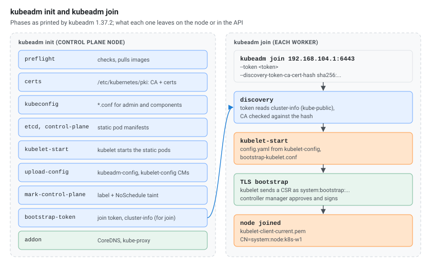
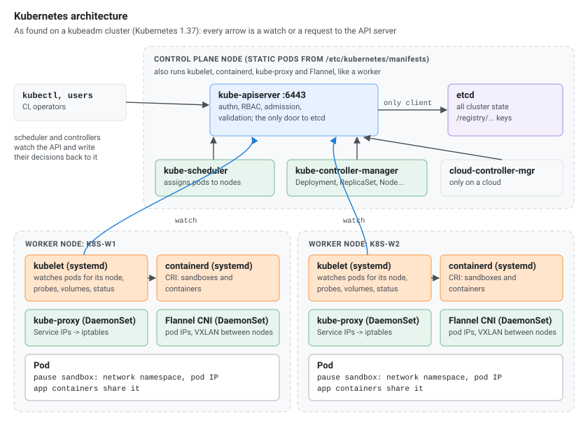
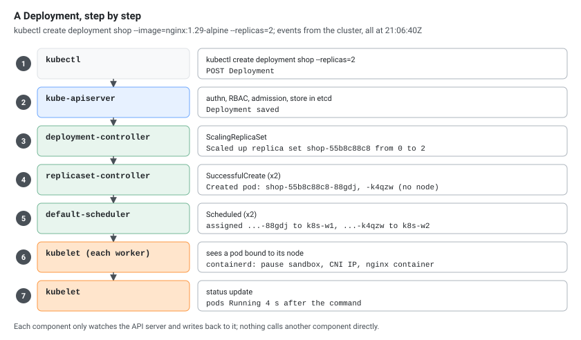
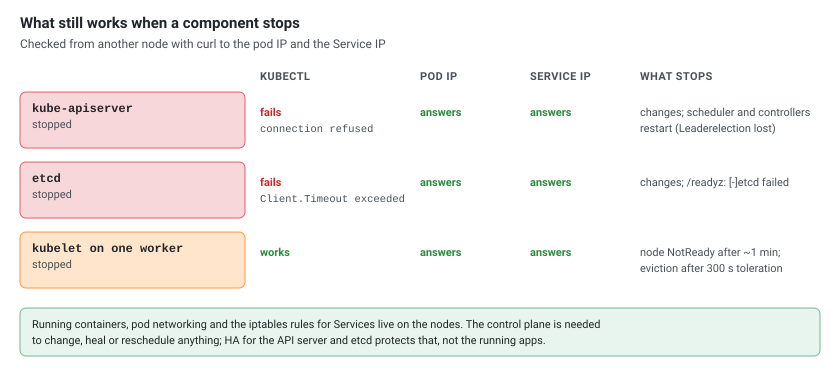

A Kubernetes cluster is a handful of programs that talk to one central API. This article builds a cluster with **kubeadm**, walks through each component on it, shows where it runs and what it does, follows a Deployment from `kubectl` to a running container, and then stops components one by one to see what breaks and what keeps working.

## 1. Building the Cluster With kubeadm

[](k8s-kubeadm-join.svg "Open the diagram full size")

### Node Prerequisites

Every node, control plane and workers alike, gets the same preparation: kernel modules and sysctls for bridged pod traffic, swap off, containerd with the systemd cgroup driver, and the packages:

```bash
printf 'overlay\nbr_netfilter\n' > /etc/modules-load.d/k8s.conf
modprobe overlay; modprobe br_netfilter
printf 'net.bridge.bridge-nf-call-iptables=1\nnet.bridge.bridge-nf-call-ip6tables=1\nnet.ipv4.ip_forward=1\n' > /etc/sysctl.d/k8s.conf
sysctl --system
swapoff -a

apt-get install -y containerd
containerd config default > /etc/containerd/config.toml
sed -i 's/SystemdCgroup = false/SystemdCgroup = true/' /etc/containerd/config.toml
systemctl restart containerd

curl -fsSL https://pkgs.k8s.io/core:/stable:/v1.37/deb/Release.key | gpg --dearmor -o /etc/apt/keyrings/kubernetes-apt-keyring.gpg
echo 'deb [signed-by=/etc/apt/keyrings/kubernetes-apt-keyring.gpg] https://pkgs.k8s.io/core:/stable:/v1.37/deb/ /' > /etc/apt/sources.list.d/kubernetes.list
apt-get update && apt-get install -y kubelet kubeadm kubectl cri-tools
apt-mark hold kubelet kubeadm kubectl
```

`cri-tools` (which provides `crictl`) is no longer pulled in by the kubeadm package, so install it explicitly. The kubelet's cgroup driver (`systemd`, kubeadm's default) must match containerd's `SystemdCgroup = true`.

### kubeadm init

On the control plane node:

```bash
sudo kubeadm init --pod-network-cidr=10.244.0.0/16 --apiserver-advertise-address=192.168.104.1
```

`init` works through a series of **phases**, each printed as a bracketed prefix in its log: `[preflight]`, `[certs]`, `[kubeconfig]`, `[etcd]`, `[control-plane]`, `[kubelet-start]`, `[upload-config]`, `[mark-control-plane]`, `[bootstrap-token]`, `[addons]` and a few more. It generates the certificates in `/etc/kubernetes/pki`, writes the kubeconfig files (`admin.conf`, `super-admin.conf`, `kubelet.conf`, `controller-manager.conf`, `scheduler.conf`), creates the static pod manifests for etcd and the control plane, starts the kubelet, and finally applies CoreDNS and kube-proxy. Each phase can be run on its own (`kubeadm init phase certs all`, `kubeadm init phase upload-config kubeadm`, ...), which is how you redo one step without rebuilding the cluster. To list them:

```bash
kubeadm init phase --help
```

kubeadm itself is not a component: it doesn't run after `init` finishes. Everything it set up is files on the node and objects in the API. The configuration it used is stored in the cluster, and `kubeadm upgrade` and `kubeadm join` read it back from there:

```bash
kubectl -n kube-system get cm kubeadm-config -o jsonpath='{.data.ClusterConfiguration}'
```

It holds the version (`kubernetesVersion: v1.37.2`), the networks (`podSubnet: 10.244.0.0/16`, `serviceSubnet: 10.96.0.0/12`), the etcd data directory and the certificate lifetimes. To customize the cluster (API server flags, extra certificate SANs, a `controlPlaneEndpoint` for HA, an external etcd), pass a `ClusterConfiguration` file with `kubeadm init --config` instead of flags; the sections a default install leaves empty (`apiServer: {}`, `controllerManager: {}`, `scheduler: {}`, ...) are where those settings go.

Right after `init`, the node is `NotReady` and CoreDNS can't start: there's no pod network yet, and the kubelet reports `container runtime network not ready: NetworkReady=false`. To see it:

```bash
kubectl get nodes
kubectl describe node k8s-cp | grep KubeletNotReady
```

kubeadm deliberately doesn't install a CNI plugin; you choose one. Here, Flannel (its default network is the `10.244.0.0/16` passed as `--pod-network-cidr`):

```bash
kubectl apply -f https://github.com/flannel-io/flannel/releases/latest/download/kube-flannel.yml
```

### kubeadm join

`init` ends by printing a join command; `kubeadm token create --print-join-command` prints a new one later (tokens expire after 24 hours). On each worker:

```bash
sudo kubeadm join 192.168.104.1:6443 --token <token> \
    --discovery-token-ca-cert-hash sha256:890227ed22b4349c304eed0ca68846e1976711bbc17d6a15b41a601b15edfb8a
```

What happens there:

1. **Discovery.** The token gives the worker read access to the `cluster-info` ConfigMap in `kube-public`, which holds the API server address and the cluster CA. The worker hashes that CA and compares it with `--discovery-token-ca-cert-hash`, so a fake API server can't pose as the cluster.
2. **TLS bootstrap.** The kubelet starts with a temporary `bootstrap-kubelet.conf` (the token) and sends a **certificate signing request**. The controller manager approves it automatically for bootstrap tokens and signs it with the cluster CA. The requests of the joined nodes show up as `Approved,Issued`:

```bash
kubectl get csr
```

3. From then on the kubelet uses its own certificate. The bootstrap file is gone, and a worker keeps very little under `/etc/kubernetes`: `kubelet.conf`, an empty `manifests` directory and `pki/ca.crt`. Its kubeconfig points at the API server (`https://192.168.104.1:6443`) and at the client certificate in `/var/lib/kubelet/pki/kubelet-client-current.pem`:

```bash
ls -R /etc/kubernetes            # on k8s-w1
grep -E 'server|client-certificate' /etc/kubernetes/kubelet.conf
```

About 10 seconds after the Flannel manifest was applied, all three nodes were `Ready`.

## 2. The Big Picture

[](k8s-architecture.svg "Open the diagram full size")

The **control plane** decides what should run where and stores that decision. The **worker nodes** run the containers. Every component talks to the **API server**, and only the API server talks to **etcd**. Nothing pushes work to a node; the kubelet on each node **watches** the API server for pods assigned to it.

The cluster here is one control plane node (`k8s-cp`) and two workers (`k8s-w1`, `k8s-w2`), all on Kubernetes v1.37.2 with containerd 2.2.1. The nodes, and where the system pods run:

```bash
kubectl get nodes -o wide
kubectl get pods -A -o wide --sort-by=.spec.nodeName
```

Most of the system pods use the node's own IP (`hostNetwork`); only CoreDNS gets a pod IP from the `10.244.0.0/16` range. They fall into four kinds:

| Kind | Components | Runs as |
|---|---|---|
| Control plane | kube-apiserver, etcd, kube-scheduler, kube-controller-manager | Static pods on the control plane node |
| On every node | kube-proxy, the CNI plugin (Flannel here) | DaemonSets: one pod per node |
| Add-ons | CoreDNS | A Deployment |
| On every node, outside Kubernetes | kubelet, containerd | systemd services |

The kubelet and the container runtime don't show up in `kubectl get pods`: they're the programs that **run** pods, so they can't be pods themselves. The control plane node is a node like the others: it runs a kubelet, containerd, kube-proxy and Flannel too, and the `node-role.kubernetes.io/control-plane:NoSchedule` taint added by `kubeadm init` keeps ordinary pods off it.

### The Control Plane Runs as Static Pods

The control plane components are pods, but nothing in the API created them. The kubelet on the control plane node reads them from a directory (`staticPodPath` in its config), where `kubeadm init` wrote `etcd.yaml`, `kube-apiserver.yaml`, `kube-controller-manager.yaml` and `kube-scheduler.yaml`:

```bash
ls /etc/kubernetes/manifests/
grep staticPodPath /var/lib/kubelet/config.yaml
```

What `kubectl get pods` shows for them are **mirror pods**: read-only copies the kubelet creates in the API, owned by the Node (`Node/k8s-cp`) and annotated with their source (`file`):

```bash
kubectl get pod -n kube-system kube-apiserver-k8s-cp \
    -o jsonpath='{.metadata.annotations.kubernetes\.io/config\.source} {.metadata.ownerReferences[0].kind}/{.metadata.ownerReferences[0].name}'
```

Any node can have static pods. A manifest dropped into `/etc/kubernetes/manifests/` on a **worker** started a pod named `static-web-k8s-w1`; `kubectl delete pod` on it only deleted the mirror, which came straight back (`AGE 5s`), and deleting the file stopped the pod for good. That's also how the control plane can start before there is any API server to ask.

To change a control plane component's flags on a kubeadm cluster, you edit its manifest in that directory; the kubelet notices and restarts the pod. Put the same change in the `kubeadm-config` ConfigMap too, or the next `kubeadm upgrade` regenerates the manifest without it.

## 3. Control Plane Components

### kube-apiserver

The API server is the front door and the only component that reads and writes etcd. It authenticates every request, checks it with RBAC, runs admission plugins, validates it and stores it. Everything else, including the scheduler and the controllers, is just a client of it. Its flags, as kubeadm wrote them, are in its static pod manifest:

```bash
grep -- '- --' /etc/kubernetes/manifests/kube-apiserver.yaml
```

The key ones:

- `--etcd-servers=https://127.0.0.1:2379`: where the state lives; kubeadm's stacked etcd is on the same node, so `127.0.0.1`.
- `--authorization-mode=Node,RBAC`: kubelets are limited to their own node's objects (`Node`), everyone else gets RBAC.
- `--service-cluster-ip-range=10.96.0.0/12`: the range Service IPs come from (`10.96.0.1` for `kubernetes`, `10.96.0.10` for DNS).

Its health endpoint lists every internal check (`etcd`, `informer-sync`, `shutdown`, ...) with its result:

```bash
kubectl get --raw '/readyz?verbose'
```

The cluster served 71 resource types (`kubectl api-resources`), from Pods to Leases; custom resources add more.

### etcd

etcd is a consistent key-value store and holds **all** cluster state: every object you can `kubectl get`. kubeadm runs it **stacked**: a static pod on the control plane node, with its data in `/var/lib/etcd` on that node. Here it's a single member; production clusters run 3 or 5 for quorum, either stacked on three control plane nodes or as a separate etcd cluster.

```bash
kubectl -n kube-system exec etcd-k8s-cp -- etcdctl \
  --endpoints=https://127.0.0.1:2379 \
  --cacert=/etc/kubernetes/pki/etcd/ca.crt \
  --cert=/etc/kubernetes/pki/etcd/server.crt \
  --key=/etc/kubernetes/pki/etcd/server.key \
  endpoint status -w table
```

It reported etcd 3.7.0, a 1.6 MB database and the single member as leader.

Objects are keys under `/registry/<resource>/<namespace>/<name>`. A fresh cluster had 441 of them; counting them by resource shows where they go:

```bash
etcdctl get /registry --prefix --keys-only | cut -d/ -f3 | sort | uniq -c | sort -rn | head
```

Events are the largest group (123 keys) even on an idle cluster, ahead of ClusterRoles, ClusterRoleBindings and ServiceAccounts, which is why they have a short time to live (1 hour by default).

**Secrets are stored in plain text** unless you configure encryption at rest. A Secret created with `kubectl create secret generic demo-secret --from-literal=password=s3cr3t-in-etcd`, read through the API and straight from etcd:

```bash
kubectl get secret demo-secret -o jsonpath='{.data.password}'
etcdctl get /registry/secrets/default/demo-secret --print-value-only | strings | grep -E 'password|s3cr3t'
```

The API returns base64 (`czNjcjN0LWluLWV0Y2Q=`), which is only an encoding; etcd holds the value itself, and the second command printed `s3cr3t-in-etcd` in plain text. Anyone with access to etcd, `/var/lib/etcd` on the control plane node or an unencrypted backup can read every Secret. Use the API server's `--encryption-provider-config` (ideally with a KMS provider) and protect etcd backups.

### kube-scheduler

The scheduler watches for pods with no `nodeName`, filters out nodes that can't run them (resources, taints, node selectors and affinity), scores the rest, and writes the chosen node into the pod. It doesn't start anything; it only assigns.

A pod that asks for a label no node has:

```bash
kubectl run picky --image=nginx:1.29-alpine --overrides='{"spec":{"nodeSelector":{"disk":"ssd"}}}'
kubectl get events --field-selector involvedObject.name=picky
```

The scheduler records a `FailedScheduling` event: `0/3 nodes are available: 1 node(s) had untolerated taint(s), 2 node(s) didn't match Pod's node affinity/selector`. The reasons count per node: the control plane node is excluded by kubeadm's `NoSchedule` taint, the two workers by the selector. After `kubectl label node k8s-w2 disk=ssd`, the scheduler retried on its own, and the pod ran on `k8s-w2`.

### kube-controller-manager

The controller manager runs the built-in **controllers**: control loops that compare the desired state in the API with the actual state and act on the difference. The Deployment controller creates ReplicaSets, the ReplicaSet controller creates pods, the Node controller marks unresponsive nodes, the Endpoints controller tracks which pods back a Service, the CSR controllers approve and sign kubelet certificates during `kubeadm join`, and many more, all in one binary. kubeadm starts it with `--controllers=*,bootstrapsigner,tokencleaner`, `--kubeconfig=/etc/kubernetes/controller-manager.conf` and `--leader-elect=true`:

```bash
grep -- '- --' /etc/kubernetes/manifests/kube-controller-manager.yaml
```

`bootstrapsigner` and `tokencleaner` are off by default and enabled by kubeadm: the first signs the `cluster-info` ConfigMap that joining nodes read, the second deletes expired bootstrap tokens.

Deleting a pod of a Deployment shows a controller at work:

```bash
kubectl delete pod/shop-55b8c88c8-88gdj --wait=false
kubectl get pods -l app=shop
kubectl get events --field-selector reason=SuccessfulCreate
```

Within seconds the Deployment had two running pods again, and the `SuccessfulCreate` event for the replacement came from `replicaset-controller`.

### Leader Election

With several control plane nodes, every node runs a scheduler and a controller manager, but only one of each may act. They agree through **Lease** objects in the API:

```bash
kubectl get lease -n kube-system
```

Here the `kube-controller-manager` and `kube-scheduler` leases were both held by `k8s-cp`. The holder renews its lease regularly; if it can't, it stops and another instance takes over. API servers don't need a leader: they're stateless and all serve requests, each with its own lease (`apiserver-...`) used to track which API servers are alive.

### cloud-controller-manager

On a cloud, a **cloud-controller-manager** runs the controllers that talk to the provider's API: it fills in node details and removes nodes whose VM is gone, creates load balancers for `type: LoadBalancer` Services, and sets up routes. A plain kubeadm cluster has none, and nothing sets a provider ID on the nodes:

```bash
kubectl get pods -A | grep -i cloud-controller || echo 'no cloud-controller-manager pod'
kubectl get nodes -o custom-columns=NAME:.metadata.name,PROVIDERID:.spec.providerID,PODCIDR:.spec.podCIDR
```

The first finds no pod, and the second shows `<none>` as the provider ID of all three nodes.

That's why a `type: LoadBalancer` Service stays `<pending>` on bare-metal kubeadm clusters until you add something like MetalLB. To run kubeadm on a cloud with its integration, you start the kubelets with `--cloud-provider=external` and deploy the provider's cloud-controller-manager yourself. On EKS, GKE and AKS the provider runs it for you.

## 4. Worker Node Components

### kubelet

The kubelet is the node agent: a systemd service, not a pod. It registers the node, watches the API server for pods bound to it, asks the container runtime to start them, runs their probes, mounts their volumes, and reports their status and the node's back. The kubeadm package adds a systemd drop-in that wires its flags together:

```bash
systemctl cat kubelet | grep -E '^(ExecStart|EnvironmentFile|Environment)'
```

- `/var/lib/kubelet/config.yaml`: the settings, downloaded from the `kubelet-config` ConfigMap during `init` and `join`, so all nodes get the same ones.
- `/var/lib/kubelet/kubeadm-flags.env`: per-node flags kubeadm detected (`KUBELET_KUBEADM_ARGS=""` here: nothing needed).
- `/etc/default/kubelet`: `KUBELET_EXTRA_ARGS` for your own per-node flags, such as `--node-ip` on a node with several interfaces.

The relevant settings in the config file are `cgroupDriver: systemd`, `clusterDNS` (`10.96.0.10`), `containerRuntimeEndpoint: unix:///var/run/containerd/containerd.sock`, `rotateCertificates: true` and `staticPodPath: /etc/kubernetes/manifests`:

```bash
cat /var/lib/kubelet/config.yaml
```

`rotateCertificates: true` makes the kubelet renew its own client certificate before it expires, through the same CSR flow as the join. The kubelet also serves an API on port 10250, which the API server uses for `kubectl logs`, `exec`, `port-forward` and metrics, and a health endpoint on 10248, bound to `127.0.0.1` only. Through the API server's node proxy, a worker's `healthz` answers `ok`:

```bash
ss -ltnp | grep kubelet
kubectl get --raw /api/v1/nodes/k8s-w1/proxy/healthz
```

### Container Runtime

The kubelet doesn't run containers itself; it talks to a runtime through the **Container Runtime Interface** (CRI) over a Unix socket. containerd is the most common; CRI-O is the other one. `crictl` speaks CRI directly, so it shows what the kubelet sees:

```bash
crictl version
crictl pods
crictl ps
```

On a worker that's containerd 2.2.1 (CRI API `v1`) and three pods, each with one container: CoreDNS, Flannel and kube-proxy.

Every pod is a **sandbox** plus its containers. The sandbox is a tiny `pause` container that holds the pod's network namespace, so all containers of the pod share one IP:

```bash
ctr -n k8s.io containers ls | grep -c pause
ctr -n k8s.io images ls -q | grep pause
```

Three pods on the worker, three pause containers, all from `registry.k8s.io/pause:3.10.1`.

### kube-proxy

kube-proxy makes **Services** work. It watches Services and their endpoints and programs the node's packet filter, so traffic to a Service IP lands on one of the pods behind it. kubeadm installs it as a DaemonSet, configured from a ConfigMap; here it runs in `iptables` mode with `clusterCIDR: 10.244.0.0/16`:

```bash
kubectl -n kube-system get cm kube-proxy -o jsonpath='{.data.config\.conf}' | grep -E '^mode|clusterCIDR'
kubectl -n kube-system logs ds/kube-proxy | grep -i proxier
```

On a worker, with only the `kubernetes` and `kube-dns` Services, there were already 80 `KUBE-` rules, among them one that sends TCP traffic for `10.96.0.1:443` (the API's own Service) to its `KUBE-SVC-` chain:

```bash
iptables-save | grep -c KUBE-
iptables-save | grep 'default/kubernetes:https'
```

kube-proxy doesn't carry traffic itself; the kernel does, following the rules it wrote. That's why Services kept working while the control plane was down, as section 8 shows. Some CNI plugins replace kube-proxy with their own implementation (eBPF, for example); with kubeadm you then leave it out with `kubeadm init --skip-phases=addon/kube-proxy`.

## 5. Add-Ons: Networking and DNS

### CNI Plugin

Kubernetes requires that every pod can reach every other pod by IP, but doesn't implement it. A **CNI plugin** does: it assigns pod IPs and connects them across nodes. Flannel, used here, gives each node a `/24` from the pod network and tunnels traffic between nodes with VXLAN; Calico and Cilium are the other common choices with kubeadm.

Each node's slice is its `podCIDR` (`10.244.1.0/24` for `k8s-w1`), assigned by the controller manager: kubeadm turned `--pod-network-cidr` into its `--allocate-node-cidrs=true --cluster-cidr=10.244.0.0/16` flags. The kubelet finds the plugin through a config file (`10-flannel.conflist`, which chains the `flannel` and `portmap` plugins), the plugin binaries live in `/opt/cni/bin` (installed by the `kubernetes-cni` package, plus Flannel's own binary), and Flannel keeps the node's subnet in `subnet.env`:

```bash
ls /etc/cni/net.d/
cat /etc/cni/net.d/10-flannel.conflist
cat /run/flannel/subnet.env
```

On `k8s-w1` that file sets `FLANNEL_SUBNET=10.244.1.1/24` and `FLANNEL_MTU=1450`: the node's 1500 minus the 50-byte VXLAN header. Without a CNI plugin, nodes stay `NotReady` (section 1).

### CoreDNS

CoreDNS gives Services DNS names. kubeadm installs it as a Deployment behind the `kube-dns` Service (`10.96.0.10`), and the kubelet writes that address into every pod's `/etc/resolv.conf` (`clusterDNS` in its config):

```bash
kubectl run dnstest --image=busybox:1.37 --restart=Never --command -- sh -c 'cat /etc/resolv.conf; nslookup kubernetes.default.svc.cluster.local'
kubectl logs dnstest
```

The pod's `resolv.conf` has `nameserver 10.96.0.10`, the search domains `default.svc.cluster.local svc.cluster.local cluster.local localdomain` and `ndots:5`, and `kubernetes.default.svc.cluster.local` resolves to `10.96.0.1`. The last search domain, `localdomain`, comes from the node's own `/etc/resolv.conf`.

## 6. A Deployment, Step by Step

[](k8s-deployment-flow.svg "Open the diagram full size")

Create a Deployment, then read the events each component wrote:

```bash
kubectl create deployment shop --image=nginx:1.29-alpine --replicas=2
kubectl get events --sort-by=.metadata.creationTimestamp
```

1. **kubectl** sends the Deployment to the **API server**, which authenticates, authorizes, admits and stores it in **etcd**.
2. The **Deployment controller** (in kube-controller-manager) sees a Deployment without a ReplicaSet and creates one.
3. The **ReplicaSet controller** sees a ReplicaSet with 0 of 2 pods and creates two Pods, with no node yet.
4. The **scheduler** sees two unassigned pods and binds one to each worker.
5. The **kubelet** on each worker sees a pod bound to its node, asks **containerd** to create the sandbox (pause container), the **CNI plugin** gives it an IP, and the nginx container starts.
6. The kubelet reports the pod `Running` back to the API server.

The events show steps 2 to 4: `ScalingReplicaSet` from `deployment-controller`, two `SuccessfulCreate` from `replicaset-controller` and two `Scheduled` from `default-scheduler`. All five have the same second (`21:06:40Z`), and both pods were `Running` 4 seconds after the command. No component called another directly: each one only watched the API and wrote back to it. The ownership chain stays visible afterwards, with both pods owned by ReplicaSet `shop-55b8c88c8`, one on each worker:

```bash
kubectl get pods -l app=shop -o custom-columns='NAME:.metadata.name,OWNER:.metadata.ownerReferences[0].name,NODE:.spec.nodeName'
```

## 7. How the Components Trust Each Other

Every connection uses TLS with client certificates. `kubeadm init` created three CAs (`ca`, `etcd/ca` and `front-proxy-ca`) and the certificates signed by them, plus the `sa.key`/`sa.pub` pair for ServiceAccount tokens:

```bash
ls /etc/kubernetes/pki/ /etc/kubernetes/pki/etcd/
```

| Connection | Certificate |
|---|---|
| Clients → API server | `apiserver.crt` (SANs: `kubernetes`, `k8s-cp`, `10.96.0.1`, `192.168.104.1`), checked against `ca.crt` |
| API server → etcd | `apiserver-etcd-client.crt`, against a separate etcd CA (`etcd/ca.crt`) |
| etcd ↔ etcd | `etcd/peer.crt` (between members of a multi-node etcd) |
| API server → kubelet | `apiserver-kubelet-client.crt` |
| Controller manager, scheduler, admin → API server | Client certificates embedded in `controller-manager.conf`, `scheduler.conf`, `admin.conf` |
| kubelet → API server | `kubelet-client-current.pem`: `O=system:nodes, CN=system:node:k8s-w1`, from the join CSR |
| Pods → API server | ServiceAccount tokens signed with `sa.key` |

The kubelet's certificate names its node, which is what `--authorization-mode=Node` uses to limit each kubelet to its own pods and node. The two admin kubeconfigs differ in their certificate's group: `admin.conf` has `O=kubeadm:cluster-admins, CN=kubernetes-admin`, `super-admin.conf` has `O=system:masters, CN=kubernetes-super-admin`. To check them:

```bash
for f in admin.conf super-admin.conf; do
  kubectl config view --raw --kubeconfig /etc/kubernetes/$f -o jsonpath='{.users[0].user.client-certificate-data}' \
    | base64 -d | openssl x509 -noout -subject
done
```

`kubeadm:cluster-admins` is bound to the `cluster-admin` ClusterRole, so `admin.conf` goes through RBAC and can be cut off by deleting that binding. `system:masters` bypasses RBAC entirely; keep `super-admin.conf` for emergencies and don't hand it out.

kubeadm issues the component certificates for one year and the CAs for ten; `kubeadm certs check-expiration` lists every certificate with its expiry date and signing CA:

```bash
kubeadm certs check-expiration
```

The kubelets renew their own certificates (`rotateCertificates: true`). The control plane certificates are renewed by `kubeadm upgrade apply`, or by `kubeadm certs renew all` followed by a restart of the control plane static pods. A cluster that is neither upgraded nor renewed for a year stops working when they expire. `kubeadm upgrade plan` shows where you stand on versions (here cluster, kubeadm and latest v1.37 release were all v1.37.2):

```bash
kubeadm upgrade plan
```

## 8. What Keeps Running When a Component Stops

[](k8s-failures.svg "Open the diagram full size")

Each test stopped one component by moving its static pod manifest out of `/etc/kubernetes/manifests/` (or stopping the kubelet's systemd service), then checked `kubectl`, the app's pod IP and its Service IP from a worker.

| Stopped | `kubectl` | App via pod IP | App via Service IP | Other effects |
|---|---|---|---|---|
| kube-apiserver | `The connection to the server 192.168.104.1:6443 was refused` | Works | Works | Scheduler and controller manager restart (`Leaderelection lost`) |
| etcd | `Client.Timeout exceeded`; `/readyz`: `[-]etcd failed` | Works | Works | No changes possible |
| kubelet on one worker | Works | Works | Works | Node `NotReady` after about a minute, tainted `unreachable` |

**The API server or etcd down** freezes the cluster's **configuration**, not its workloads. Running containers, their networking and the iptables rules for Services are all on the nodes and need nothing from the control plane. What stops: deploys, scaling, rescheduling, and the self-healing of controllers. The scheduler and controller manager couldn't renew their leases, logged `Leaderelection lost` and restarted; on the control plane node, `crictl` shows the exited containers next to their replacements:

```bash
crictl ps -a | grep -E 'scheduler|controller'
```

`crictl` still works with the API server gone: it talks to containerd on the node, not to Kubernetes, which makes it the tool for debugging a broken control plane. Both components recovered when the API server came back.

**A kubelet down** leaves its containers running (`crictl ps` still showed the nginx container `Running`, and it still answered on its pod IP and through the Service), but the node stops reporting:

```bash
sudo systemctl stop kubelet          # on the worker
kubectl describe node <worker>
```

After 61 seconds the node was `NotReady`, with the taints `node.kubernetes.io/unreachable:NoExecute` and `node.kubernetes.io/unreachable:NoSchedule`, and its memory, disk, PID and `Ready` conditions all `Unknown`: `Kubelet stopped posting node status`.

The `NoExecute` taint starts a clock: every pod gets default tolerations of 300 seconds for `not-ready` and `unreachable`:

```bash
kubectl get pod -l app=shop -o jsonpath='{.items[0].spec.tolerations}'
```

After that, the controllers replace the pods on other nodes. The kubelet was back before that, and the node returned to `Ready` without moving anything.

So for the control plane, **high availability protects your ability to change things**. With kubeadm that means three control plane nodes joined with `kubeadm join --control-plane`, a load balancer in front of their API servers set as `controlPlaneEndpoint` at `init` time (it ends up in every certificate and kubeconfig, so it's hard to add later), and three or five etcd members (a majority must be up). Running apps survive a short control plane outage either way; long ones are dangerous because nothing heals or reschedules in the meantime.

## 9. Quick Reference

| Component | Job | Where it runs on kubeadm | Talks to | Look at it with |
|---|---|---|---|---|
| kube-apiserver | The API: authn, authz, admission, storage | Static pod, control plane | etcd; everyone talks to it | `kubectl get --raw '/readyz?verbose'` |
| etcd | All cluster state | Static pod, control plane (stacked) | API server only | `etcdctl endpoint status` |
| kube-scheduler | Assigns pods to nodes | Static pod, control plane | API server | `FailedScheduling` events |
| kube-controller-manager | Desired vs actual state loops | Static pod, control plane | API server | Events from `*-controller` |
| cloud-controller-manager | Nodes, load balancers, routes in the cloud | Not installed; you add it | API server, cloud API | Provider docs |
| kubelet | Runs pods on its node | systemd service, every node | API server, runtime | `systemctl status kubelet`, `journalctl -u kubelet` |
| Container runtime | Runs containers (CRI) | systemd service, every node | kubelet | `crictl ps`, `crictl pods` |
| kube-proxy | Service IPs → pods | DaemonSet (kubeadm addon) | API server, kernel | `iptables-save \| grep KUBE-` |
| CNI plugin | Pod IPs and pod-to-pod network | DaemonSet you install | API server, kernel | `/etc/cni/net.d/` |
| CoreDNS | Service DNS names | Deployment (kubeadm addon) | API server | `nslookup` in a pod |

And the kubeadm files worth knowing:

| Path | What it is |
|---|---|
| `/etc/kubernetes/manifests/` | Static pod manifests of the control plane |
| `/etc/kubernetes/pki/` | CAs and certificates (control plane only; workers have just `ca.crt`) |
| `/etc/kubernetes/admin.conf` | Admin kubeconfig (RBAC `cluster-admin`) |
| `/etc/kubernetes/super-admin.conf` | Break-glass kubeconfig (`system:masters`) |
| `/etc/kubernetes/kubelet.conf` | The kubelet's kubeconfig |
| `/var/lib/kubelet/config.yaml` | Kubelet settings, from the `kubelet-config` ConfigMap |
| `/var/lib/kubelet/kubeadm-flags.env`, `/etc/default/kubelet` | Per-node kubelet flags |
| `/var/lib/etcd/` | etcd data (back it up) |
| ConfigMap `kube-system/kubeadm-config` | The cluster configuration `upgrade` and `join` read |

## See Also

- [kubectl describe vs kubectl logs](/posts/kubectl-describe-vs-logs/)
- [Kubernetes Pod Lifecycle Management](/posts/kubernetes-pod-lifecycle-management/)
- [Kubernetes Cluster Autoscaler Guide](/posts/kubernetes-cluster-autoscaler-guide/)
- [Kubernetes docs: Cluster Architecture](https://kubernetes.io/docs/concepts/architecture/)
- [Kubernetes docs: Creating a cluster with kubeadm](https://kubernetes.io/docs/setup/production-environment/tools/kubeadm/create-cluster-kubeadm/)
- [Kubernetes docs: Encrypting Confidential Data at Rest](https://kubernetes.io/docs/tasks/administer-cluster/encrypt-data/)
