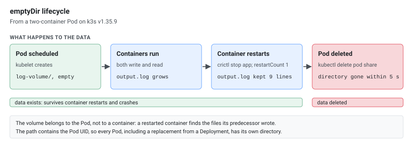

An `emptyDir` is the simplest Kubernetes volume: an empty directory that the kubelet creates when a Pod starts on a node and removes when the Pod goes away. Everything below was run on a k3s v1.35.9 node with 1960 MiB of RAM.

## The Basics

```yaml
volumes:
- name: log-volume
  emptyDir: {}
```

An `emptyDir` volume is a temporary, empty directory created when a Pod is scheduled to a node. It exists for the lifetime of the Pod and is deleted when the Pod is removed.

## Why emptyDir?

It's the lightest-weight volume type. Ideal for transient data that only needs to exist while the Pod is running — like logs being shipped by a sidecar, scratch space for processing, or shared config between containers.

| Volume Type | Why Not (for transient data) |
|---|---|
| `hostPath` | Ties to a specific node, security concerns |
| `PersistentVolumeClaim` | Overkill for throwaway data, costs storage |
| `configMap` / `secret` | Read-only (`touch` in a mounted ConfigMap: `Read-only file system`), not for runtime data |

## Properties

- Automatically created when the Pod is scheduled.
- Shared across all containers in the Pod that mount it.
- Survives container restarts, but not Pod deletion.
- Removed when the Pod is deleted: the Pod's directory on the node was gone within 5 seconds of `kubectl delete pod`.
- Lives on the node's disk by default (here an `ext4` filesystem, as `/proc/mounts` in the container shows), or in RAM with `medium: Memory`.

## Sharing Files Between Containers

Containers in a Pod have isolated filesystems by default. They share the network (same `localhost`, same IP) but not the disk. There's no implicit shared directory — you need a volume.

The volume name is what links containers, not the mount path. Each container can mount the same volume at a different path:

```yaml
apiVersion: v1
kind: Pod
metadata:
  name: share
spec:
  containers:
  - name: app
    image: alpine
    command: ["sh", "-c", "i=0; while true; do echo \"line $i\" >> /app/logs/output.log; i=$((i+1)); sleep 2; done"]
    volumeMounts:
    - name: log-volume
      mountPath: /app/logs        # app writes here
  - name: log-agent
    image: alpine
    command: ["sleep", "100000"]
    volumeMounts:
    - name: log-volume
      mountPath: /fluentd/input   # the agent reads from here
  volumes:
  - name: log-volume
    emptyDir: {}
```

```bash
$ kubectl exec share -c log-agent -- ls -l /fluentd/input
total 4
-rw-r--r--    1 root     root            21 Oct 26 09:41 output.log

$ kubectl exec share -c log-agent -- tail -n 2 /fluentd/input/output.log
line 1
line 2
```

## How Different Paths Share the Same Data

The `emptyDir` volume is a folder on the node, outside of both containers. Each container mounts that same folder to a different location inside its own filesystem:

[](emptydir-two-paths.svg "Open the diagram full size")

When the app writes `/app/logs/output.log`, it's actually writing to the node-level `log-volume/output.log`. The log-agent sees that same file as `/fluentd/input/output.log`.

The `mountPath` is just an alias — where the volume appears inside that container's filesystem. The underlying data is the same.

## Actual Path on the Node

The `emptyDir` lives on the node at:

```
/var/lib/kubelet/pods/<pod-uid>/volumes/kubernetes.io~empty-dir/<volume-name>/
```

For the Pod above:

```bash
$ ls -l /var/lib/kubelet/pods/dcf45ff6-0987-44b0-8859-12622d910cd7/volumes/kubernetes.io~empty-dir/log-volume/
total 4
-rw-r--r-- 1 root root 21 Oct 26 09:41 output.log
```

You don't control this path — kubelet manages it automatically. It creates it when the Pod starts and deletes it when the Pod is removed. `/var/lib/kubelet` is the kubelet's default root directory; a node configured with a different `--root-dir` uses that instead.

### Finding the Pod UID

```bash
# most direct way
kubectl get pod <pod-name> -o jsonpath='{.metadata.uid}'

# or from the yaml output, under metadata.uid
kubectl get pod <pod-name> -o yaml
```

```bash
$ kubectl get pod share -o jsonpath='{.metadata.uid}'
dcf45ff6-0987-44b0-8859-12622d910cd7
```

## Container Restarts and Pod Deletion

The volume belongs to the Pod, not to a container. After the `app` container was stopped (`crictl stop` on the node) and restarted by the kubelet (`restartCount` 1), `output.log` still had its 9 earlier lines, and the new container kept appending to it.

Deleting the Pod removes the volume: within 5 seconds of `kubectl delete pod share`, `/var/lib/kubelet/pods/<pod-uid>` no longer existed on the node.

[](emptydir-lifecycle.svg "Open the diagram full size")

## Filling an emptyDir with an Init Container

A common use: an init container prepares files (downloads, renders a config) before the app starts, and the app mounts the same volume, here read-only:

```yaml
apiVersion: v1
kind: Pod
metadata:
  name: init-demo
spec:
  initContainers:
  - name: fetch-config
    image: alpine
    command: ["sh", "-c", "sleep 5; echo \"generated at $(date -u +%H:%M:%S) by $HOSTNAME\" > /work/app.conf"]
    volumeMounts:
    - name: workdir
      mountPath: /work
  containers:
  - name: app
    image: alpine
    command: ["sh", "-c", "cat /config/app.conf; sleep 100000"]
    volumeMounts:
    - name: workdir
      mountPath: /config
      readOnly: true
  volumes:
  - name: workdir
    emptyDir: {}
```

The Pod shows `Init:0/1` while the init container runs, then `PodInitializing`, then `Running`. The app finds the file:

```bash
$ kubectl logs init-demo -c app
generated at 09:52:28 by init-demo

$ kubectl exec init-demo -c app -- touch /config/x
touch: /config/x: Read-only file system
```

`readOnly: true` on the mount keeps the app from changing what the init container prepared; the init container itself mounts it read-write.

## Memory-Backed emptyDir

By default, `emptyDir` uses the node's disk. You can switch to RAM by setting `medium: "Memory"`:

```yaml
volumes:
- name: log-volume
  emptyDir:
    medium: "Memory"
```

This creates a `tmpfs` mount: faster, but the files are memory, and they count against the container's memory limit.

### How Big Is the tmpfs?

`df -h` inside the containers on the 1960 MiB node:

| Pod | Mount | Size |
|-----|-------|------|
| No volume, the container's default | `/dev/shm` | 64.0M |
| `medium: Memory`, no `sizeLimit`, no memory limit | `/data` | 1.9G (the node's RAM) |
| `medium: Memory`, `sizeLimit: 50Mi` | `/data` | 50.0M |
| `medium: Memory`, no `sizeLimit`, container `limits.memory: 64Mi` | `/data` | 64.0M |

Without `sizeLimit` and without a memory limit, a memory-backed emptyDir can grow to all the node's RAM. With a limit, the tmpfs is sized to it; `sizeLimit` sets it directly (`size=51200k` in `/proc/mounts`).

### What sizeLimit Does

`sizeLimit` behaves differently on disk and in memory. Writing 80 MiB into a volume with `sizeLimit: 50Mi`:

| Volume | What happened |
|--------|---------------|
| `medium: Memory`, `sizeLimit: 50Mi` | The write stopped at 50 MiB: `dd: error writing '/data/f': No space left on device`. The Pod kept running. |
| Disk (default), `sizeLimit: 50Mi` | The write succeeded. About a minute later the kubelet evicted the Pod: `Usage of EmptyDir volume "ramdisk" exceeds the limit "50Mi".` |

On disk, `sizeLimit` is checked by the kubelet's eviction manager after the fact. In memory, the tmpfs is simply full.

[](emptydir-sizelimit.svg "Open the diagram full size")

```yaml
volumes:
- name: ramdisk
  emptyDir:
    medium: Memory
    sizeLimit: 50Mi
```

### Memory Limits and OOM Kills

Files in a memory-backed emptyDir count against the container's memory limit. With `limits.memory: 64Mi` and no `sizeLimit`, writing 100 MiB into the volume got the process killed with exit code 137.

Worse, the data stays in the volume across the restart, still counting against the limit, so the container can't start again:

```text
failed to create containerd task: failed to create shim task: OCI runtime create failed:
runc create failed: unable to start container process: container init was OOM-killed (memory limit too low?)
```

The Pod stayed in `RunContainerError` with growing back-off until it was deleted. Give a memory-backed emptyDir a `sizeLimit` well below the container's memory limit, so a full volume means `No space left on device` instead of an OOM kill loop.

### Enlarging /dev/shm

Containers get a 64 MiB `/dev/shm` by default (`64.0M` in `df -h`). Some databases, browsers (Chromium) and ML/data libraries need more, so mounting a memory-backed emptyDir at `/dev/shm` is a frequent pattern. The tmpfs size is the `sizeLimit`, so pick one **above** 64Mi; with `sizeLimit: 50Mi`, `/dev/shm` became 50.0M, smaller than without the volume.

```yaml
containers:
- name: app
  image: myapp
  volumeMounts:
  - name: dshm
    mountPath: /dev/shm        # POSIX shared memory
  resources:
    requests:
      memory: 512Mi
    limits:
      memory: 1Gi              # sizeLimit must fit in here, next to the app's own memory
volumes:
- name: dshm
  emptyDir:
    medium: Memory
    sizeLimit: 256Mi
```

## What Happens Without a Matching Volume?

If a `volumeMounts` entry references a volume name that doesn't exist in the `volumes:` list, the API server rejects the Pod. It is never created:

```bash
$ kubectl apply -f novolume.yaml
The Pod "novolume" is invalid: spec.containers[0].volumeMounts[0].name: Not found: "log-volume"
```

The volume name in `volumeMounts.name` must match a `volumes.name` entry in the same Pod spec. No match, no Pod.

## The Two Steps

1. **Define the volume** at the Pod level under `volumes:` — give it a name and a type.
2. **Mount it in each container** under `volumeMounts:` — reference the same volume name and pick whatever `mountPath` you want.

That's it. The volume name is the glue.
