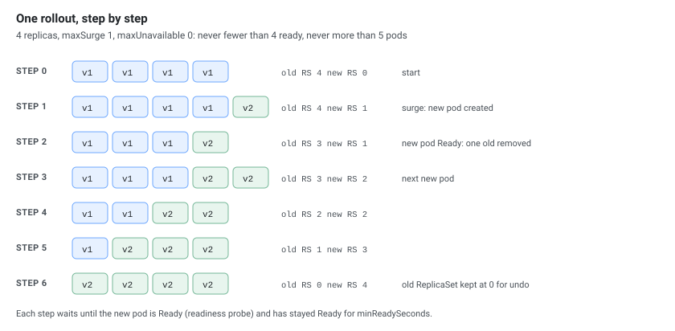
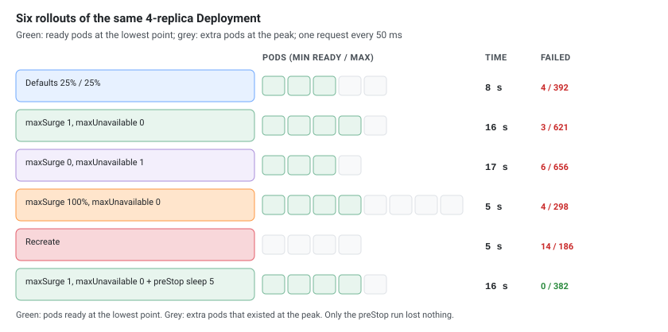
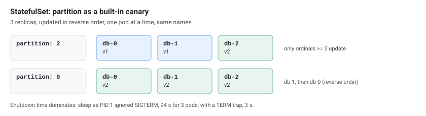

Every change to a Deployment's pod template starts a rolling update: Kubernetes replaces the old pods with new ones a few at a time, so the application keeps running. It's the default, and it mostly works. This article measures what "mostly" means: how many pods are ready at each step, how many requests fail during the rollout, what happens when the new version is broken, and which settings change that. Everything was run on a three-node Kubernetes 1.37 cluster, with a test client sending a request every 50 ms through the Service during each rollout.

## 1. How a Rolling Update Works

[](rolling-steps.svg "Open the diagram full size")

A Deployment doesn't manage pods directly. It owns **ReplicaSets**, one per version of the pod template, and each ReplicaSet keeps its number of pods running. When the template changes (image, env, resources, labels, annotations), the Deployment creates a new ReplicaSet and then, step by step, scales the new one up and the old one down. Two numbers decide the size of each step:

- **`maxSurge`**: how many pods may exist **above** `replicas` during the rollout.
- **`maxUnavailable`**: how many pods may be **missing** from `replicas` (not available) during the rollout.

A new pod counts as available once it's Ready (its readiness probe passes) and has stayed Ready for `minReadySeconds`. Only then does the old ReplicaSet shrink further. Changing `replicas` alone doesn't start a rollout; it just scales the current ReplicaSet.

```bash
kubectl get deploy web -o jsonpath='{.spec.strategy}{"\n"}'
kubectl get rs -l app=web                      # one ReplicaSet per template version
kubectl rollout status deploy/web              # waits; exit code 1 on timeout or a stalled rollout
```

An empty `strategy` gets these defaults: `type: RollingUpdate`, `maxSurge: 25%`, `maxUnavailable: 25%`, plus `progressDeadlineSeconds: 600` and `revisionHistoryLimit: 10` on the Deployment.

## 2. What maxSurge and maxUnavailable Really Do

The test app is nginx serving its version string, with a readiness probe and a 3-second startup. Each rollout changed the version from `v1` to `v2`, while the pods were sampled every 0.3 seconds:

| Strategy (4 replicas unless noted) | Max pods | Min ready | Duration | Failed requests (no preStop) |
|---|---|---|---|---|
| Defaults (`25%` / `25%`) | 5 | **3** | 8 s | 4 of 392 |
| Defaults, 3 replicas | 4 | 3 | 12 s | 5 of 475 |
| `maxSurge: 1`, `maxUnavailable: 0` | 5 | 4 | 16 s | 3 of 621 |
| `maxSurge: 0`, `maxUnavailable: 1` | 4 | 3 | 17 s | 6 of 656 |
| `maxSurge: 100%`, `maxUnavailable: 0` | 8 | 4 | 5 s | 4 of 298 |
| `type: Recreate` | 4 | **0** | 5 s | 14 of 186 |

[](rolling-strategies.svg "Open the diagram full size")

What the table shows:

- **The defaults do reduce capacity.** With 4 replicas, `maxUnavailable: 25%` is 1 pod, and the ready count went from 4 to 3 during the rollout. Claims that a default rolling update keeps full capacity are wrong for any replica count of 4 or more.
- **Percentages are rounded:** `maxSurge` rounds **up**, `maxUnavailable` rounds **down**. With 3 replicas, 25% gives `maxSurge` 1 and `maxUnavailable` 0, which is why the 3-replica rollout never dropped below 3 ready. With 1 replica the defaults are surge 1, unavailable 0. Both can't be 0 at the same time: `maxUnavailable ... may not be 0 when maxSurge is 0`.
- **`maxSurge: 1, maxUnavailable: 0`** keeps full capacity and needs room for exactly one extra pod. It's the safe choice for most services, at the cost of speed: one pod at a time.
- **`maxSurge: 0, maxUnavailable: 1`** needs no extra room, but runs one pod short the whole time.
- **`maxSurge: 100%`** starts all new pods at once, then removes all old ones: the fastest, with double the pods (and resource requests) for a moment. It's the closest a plain Deployment gets to blue-green.
- **`Recreate`** deletes every old pod first. The cluster had **zero ready pods** until the new ones passed their readiness probe (several consecutive samples), and that's where its 14 failures came from. Use it only when two versions can't run at the same time (a single-writer database, a schema change that breaks the old version).

During every rolling update **both versions served traffic at the same time**: the test client got both `v1` and `v2` answers, interleaved, for the length of the rollout. A new version must work alongside the old one: database schema, API and message formats included.

## 3. Zero Downtime Needs a preStop Hook

Every rolling strategy above lost a few requests, as connection refused (`curl` exit code 7) or timeouts (exit code 28). The reason is a race when a pod is deleted:

1. The pod gets a deletion timestamp; the kubelet sends SIGTERM to the container, and nginx stops at once.
2. **At the same time**, the endpoint controller removes the pod from the Service's EndpointSlice, and kube-proxy on each node updates its rules.

Requests that arrive between 1 and 2 go to a pod that's already gone. The fix is to delay the shutdown until the endpoint is removed everywhere:

```yaml
spec:
  terminationGracePeriodSeconds: 30
  containers:
  - name: web
    lifecycle:
      preStop:
        sleep:
          seconds: 5
```

With the same `maxSurge: 1, maxUnavailable: 0` rollout plus `preStop` `sleep: 5`, **all 382 requests succeeded**. The `sleep` action is built into the kubelet, so it works in images without a `sleep` binary. The grace period must cover the preStop time plus the app's own shutdown; the kubelet kills the container when it runs out.

Two more parts of a clean shutdown are in the app itself: handle SIGTERM (finish in-flight requests, stop accepting new ones), and for long-lived connections (WebSockets, gRPC streams) close them so clients reconnect to a new pod. A process that ignores SIGTERM (a shell script, `sleep` as PID 1) waits out the full grace period on every update: see section 9.

## 4. When the New Version Is Broken

```bash
kubectl rollout status deploy/web --timeout=60s
kubectl get rs -l app=web
kubectl get deploy web -o jsonpath='{range .status.conditions[*]}{.type}={.status} {.reason}: {.message}{"\n"}{end}'
```

The test changed the readiness path to one that returns 404, so the new pods never became Ready. The rollout created **2 new pods** (1 surge + 1 replacing an old pod, from the 25% defaults), stopped, and stayed there: `READY 3/4`, `UP-TO-DATE 2`, the old ReplicaSet at 3 ready pods. The test client got **1435 responses, all `v1` and all successful**: the broken pods never received traffic because they never became Ready.

Without a readiness probe the same broken version would have been "Running", counted as available, and rolled out completely. **The readiness probe is what makes a rolling update safe.** Probe setup is in [Kubernetes Health Checks](/posts/kubernetes-health-checks-probes/).

After `progressDeadlineSeconds` (set to 60 for the test; the default is 600), the condition changed to `Progressing=False ProgressDeadlineExceeded: ReplicaSet "web-79d95dd85f" has timed out progressing`, and `kubectl rollout status` exited with `deployment "web" exceeded its progress deadline` (exit code 1). Use that exit code to fail a CI pipeline.

**Kubernetes doesn't roll back on its own.** The deadline only marks the rollout as failed; the broken pods and the reduced capacity stay until you act:

```bash
kubectl rollout undo deploy/web
```

That rolled out the previous template again, as a new rolling update.

## 5. minReadySeconds: Wait Before Trusting a Pod

```yaml
spec:
  minReadySeconds: 10
```

A pod has to stay Ready for 10 seconds before it counts as available and the rollout moves on. With `maxSurge: 1, maxUnavailable: 0` and 4 replicas, the rollout took **55 seconds** instead of 16. Use it for apps that pass their readiness probe and then fail shortly after (a cache that fills, a connection pool that runs out): the rollout stops while 3 old pods are still running, instead of after replacing them all.

## 6. History, change-cause and Undo

```bash
kubectl rollout history deploy/web
kubectl rollout history deploy/web --revision=19        # the pod template of one revision
kubectl rollout undo deploy/web                         # to the previous revision
kubectl rollout undo deploy/web --to-revision=19
```

What the history showed after a few dozen rollouts:

- **Revision numbers aren't 1, 2, 3.** Every rollout gets the next number, and rolling back to an old template **reuses its ReplicaSet** and gives it a new number. After the tests the history listed revisions 12, 15, 16, 18, 19..., and `--to-revision=3` failed with `unable to find specified revision 3 in history`. Always look the number up first.
- **Only `revisionHistoryLimit` old ReplicaSets are kept** (default 10). Older revisions are gone for good.
- **`CHANGE-CAUSE` is just an annotation.** `kubernetes.io/change-cause` on the Deployment is copied onto the new ReplicaSet at each rollout. It isn't cleared afterwards, so the **next** rollout shows the same text: after setting `"v4: bump"` once, the following rollout and a `rollout restart` were listed with the same cause. Set it in the same step as every change:

```bash
kubectl annotate deploy/web kubernetes.io/change-cause="v3: new index page" --overwrite
kubectl set env deploy/web VERSION=v3
```

The old `--record` flag still works but prints `Flag --record has been deprecated`; it writes the whole kubectl command line into the same annotation.

- **`undo` on a Deployment managed with `kubectl apply`** warns that it won't update the `last-applied-configuration` annotation: the next `kubectl apply` of your file rolls forward again. In a GitOps setup, roll back in Git; [Argo CD Rollback](/posts/argocd-rollback-out-of-sync/) shows the same effect with Argo CD.

## 7. Pause, Resume and Restart

```bash
kubectl rollout pause deploy/web
kubectl set env deploy/web VERSION=v5
kubectl set resources deploy/web -c web --limits=memory=64Mi
kubectl rollout resume deploy/web          # one rollout with both changes
kubectl rollout restart deploy/web         # new pods, same spec
```

While paused, template changes are stored but don't start a rollout: no new ReplicaSet was created, `rollout status` waited (`0 out of 6 new replicas have been updated`), and the condition was `Progressing=Unknown DeploymentPaused`. Changes **are** still applied in one way: **scaling**. `kubectl scale --replicas=6` on the paused Deployment scaled the old ReplicaSet to 6 immediately. `kubectl rollout undo` is refused while paused (`you cannot rollback a paused deployment; resume it first`). After `resume`, both changes went out as a **single** revision.

`kubectl rollout restart` sets a `kubectl.kubernetes.io/restartedAt` annotation on the pod template, which is a template change, so it's a normal rolling update with the same strategy, probes and history entry. Use it to pick up a changed ConfigMap or Secret that's read only at startup.

## 8. Capacity: When the Surge Pod Doesn't Fit

`maxSurge` pods need room. With 4 pods requesting 800m CPU on two 2-CPU workers, the surge pod of a `maxSurge: 1, maxUnavailable: 0` rollout stayed `Pending` (`0/3 nodes are available: ... 2 Insufficient cpu`), and since no old pod may be removed before a new one is available, **the rollout stopped**: `UP-TO-DATE 1`, `AVAILABLE 4`, no progress until the deadline.

Switching the same Deployment to `maxSurge: 0, maxUnavailable: 1` finished the rollout: each old pod was removed first, which freed the CPU for its replacement.

```bash
kubectl patch deploy web -p '{"spec":{"strategy":{"rollingUpdate":{"maxSurge":0,"maxUnavailable":1}}}}'
```

On a cluster with an autoscaler, a `Pending` surge pod triggers a new node, so the rollout continues once that node is up: the first steps of a rollout can take minutes longer than the rest.

**A PodDisruptionBudget doesn't protect a rolling update.** With a PDB of `minAvailable: 4` on 4 replicas (`ALLOWED DISRUPTIONS 0`), a rollout with `maxUnavailable: 2` went ahead and dropped to **2 ready pods**. PDBs only limit **evictions** (node drains, the cluster autoscaler): `kubectl drain` on the same node was blocked with `Cannot evict pod as it would violate the pod's disruption budget`. Rollout safety comes from `maxUnavailable`, not from the PDB.

## 9. StatefulSets and DaemonSets

[](rolling-partition.svg "Open the diagram full size")

**StatefulSets** update one pod at a time, in **reverse ordinal order** (`db-2`, then `db-1`, then `db-0`), each only after the previous one is Ready. There's no surge: a StatefulSet pod is deleted and recreated under the same name. `partition` holds part of the set back:

```yaml
spec:
  updateStrategy:
    type: RollingUpdate
    rollingUpdate:
      partition: 2
```

```bash
kubectl set env sts/db VERSION=v2
kubectl get pods -l app=db -o custom-columns=NAME:.metadata.name,VERSION:.spec.containers[0].env[0].value
kubectl patch sts db -p '{"spec":{"updateStrategy":{"rollingUpdate":{"partition":0}}}}'
```

With `partition: 2`, only `db-2` got `v2`; `db-0` and `db-1` stayed on `v1`, and `rollout status` reported `partitioned roll out complete: 1 new pods have been updated`. That's a built-in canary for stateful apps. Setting the partition to 0 updated the rest, in the order `db-2`, `db-1`, `db-0`, visible in the events. `kubectl rollout undo sts/db` works as for Deployments.

The same update of 3 pods took **94 seconds** when the container was `sleep` as PID 1: it ignores SIGTERM, so each pod waited out the full 30-second grace period. With a shell that traps TERM and exits, the next update of all 3 pods took **3 seconds**. Slow rollouts are often a shutdown problem, not a startup problem.

**DaemonSets** default to `maxSurge: 0, maxUnavailable: 1`: one node at a time, the old pod removed before the new one starts, so that node runs without the agent for a moment. For an agent that must not have gaps (a CNI or a log shipper), set `maxSurge: 1, maxUnavailable: 0`, if the pod can run twice on a node (no host port conflicts).

## 10. Beyond Rolling Updates

A rolling update shifts traffic in proportion to pod counts and has no traffic split of its own, no automatic analysis and no automatic rollback.

| Strategy | How | Traffic during the change | Rollback |
|---|---|---|---|
| Rolling update | Deployment default | Both versions, by pod count | `rollout undo`, another rollout |
| Recreate | `strategy.type: Recreate` | None for a moment | Another rollout, with downtime |
| Fast swap | `maxSurge: 100%, maxUnavailable: 0` | Both versions briefly, double resources | `rollout undo` |
| Blue-green | Two Deployments, switch the Service selector | One version at a time | Switch the selector back |
| Canary | A second Deployment with few replicas, or Argo Rollouts / Flagger | A chosen share to the new version | Scale the canary to 0 |
| Staged StatefulSet | `partition` | Only the pods above the partition | Raise the partition, `undo` |

Argo Rollouts and Flagger add weighted traffic splitting through an ingress controller or service mesh, and roll back automatically when metrics (error rate, latency) cross a threshold. That's the missing piece of a plain rolling update: Kubernetes only knows whether pods are Ready, not whether the new version works for users.

## Quick Reference

```bash
kubectl rollout status deploy/<name> --timeout=5m        # exit 1 on timeout or ProgressDeadlineExceeded
kubectl rollout history deploy/<name>
kubectl rollout undo deploy/<name> [--to-revision=N]
kubectl rollout pause deploy/<name>
kubectl rollout resume deploy/<name>
kubectl rollout restart deploy/<name>
kubectl get rs -l app=<name>                             # old and new ReplicaSets
kubectl annotate deploy/<name> kubernetes.io/change-cause="<text>" --overwrite
```

| Setting | Default | Effect |
|---|---|---|
| `strategy.rollingUpdate.maxSurge` | 25% (rounded up) | Extra pods during the rollout |
| `strategy.rollingUpdate.maxUnavailable` | 25% (rounded down) | Pods that may be missing |
| `minReadySeconds` | 0 | How long a new pod must stay Ready to count |
| `progressDeadlineSeconds` | 600 | When the rollout is marked failed (no rollback) |
| `revisionHistoryLimit` | 10 | Old ReplicaSets kept for undo |
| `terminationGracePeriodSeconds` | 30 | Time for preStop plus shutdown |
| `lifecycle.preStop.sleep.seconds` | none | Keeps the pod serving until endpoints are updated |

## Gotchas

- **The default strategy reduces capacity** for 4 or more replicas (`maxUnavailable: 25%`).
- **Without a preStop delay, rolling updates drop requests.** 3 to 6 per rollout in the test; zero with `preStop: sleep 5`.
- **Without a readiness probe, a broken version rolls out completely.**
- **`ProgressDeadlineExceeded` doesn't roll back.** Run `kubectl rollout undo`, or let your pipeline do it on the non-zero exit code.
- **Both versions serve traffic during the rollout.** Keep them compatible.
- **`maxUnavailable: 0` needs room for the surge pod**, or the rollout stops with a `Pending` pod.
- **PodDisruptionBudgets don't apply to rollouts**, only to evictions.
- **Revision numbers jump**, and `change-cause` sticks to the next rollouts unless you set it again.
- **`kubectl rollout undo` and `kubectl apply` fight.** Roll back in the source of truth.
- **Scaling works on a paused Deployment**; template changes wait for `resume`.
- **A process that ignores SIGTERM** makes every rollout wait out the grace period.

## See Also

- [Kubernetes Health Checks: Liveness, Readiness, and Startup Probes](/posts/kubernetes-health-checks-probes/)
- [Kubernetes Pod Lifecycle Management](/posts/kubernetes-pod-lifecycle-management/)
- [Kubernetes Troubleshooting: 10 Failures, Reproduced and Fixed](/posts/kubernetes-troubleshooting-techniques/)
- [Argo CD Rollback: How It Works and Why the App Shows OutOfSync](/posts/argocd-rollback-out-of-sync/)
- [Helm vs Argo CD vs Kustomize vs Flux](/posts/helm-argocd-kustomize-flux-compared/)
- [Kubernetes docs: Deployments](https://kubernetes.io/docs/concepts/workloads/controllers/deployment/)
