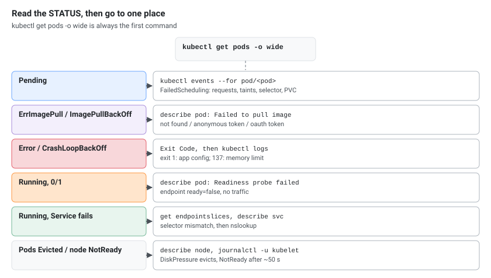
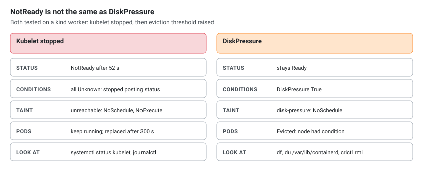
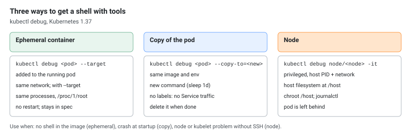

Most Kubernetes problems announce themselves in the `STATUS` column of `kubectl get pods`, and the cause is almost always one or two commands away. This article reproduces ten common failures on a three-node Kubernetes 1.37 cluster, shows where each one leaves its traces, and how it was fixed. Some popular advice turned out to be wrong along the way; those cases are pointed out.

## 1. Start Here: Status First, Then Events, Then Logs

[](trouble-triage.svg "Open the diagram full size")

```bash
kubectl get pods -o wide                     # STATUS, RESTARTS, node
kubectl describe pod <pod>                   # State, Last State, Exit Code, Events at the bottom
kubectl logs <pod>                           # what the app printed
kubectl events --for pod/<pod>               # only this pod's events
```

| STATUS | Meaning | Look at |
|---|---|---|
| `Pending` | Not scheduled yet, or waiting for a volume | Events (`FailedScheduling`), the PVC |
| `ContainerCreating` | Scheduled, waiting for image, volume or network | Events (`FailedMount` for a missing ConfigMap or Secret volume) |
| `CreateContainerConfigError` | A referenced ConfigMap, Secret or key doesn't exist | The `message` in `describe` (section 2) |
| `ErrImagePull` / `ImagePullBackOff` | The image can't be pulled | Events (`Failed to pull image`) |
| `StartError` | The runtime couldn't start the command | Events (`exec: ...`), section 2 |
| `Error` / `CrashLoopBackOff` | The container starts and exits | `Exit Code`, logs |
| `Running` but `0/1` | Started, but the readiness probe fails | Events (`Unhealthy`) |
| `Running`, Service doesn't answer | Selector or port mismatch | EndpointSlices |

`describe` and `logs` read different sources, and they keep their data for different times; [kubectl describe vs kubectl logs](/posts/kubectl-describe-vs-logs/) covers that in detail. `kubectl get pod <pod> -o yaml` shows everything the API knows, including the defaults and the full `status.containerStatuses`.

With more than one container in the pod, `logs` and `exec` pick the first one (`Defaulted container "web" out of: web, sidecar`). Name the one you want:

```bash
kubectl logs <pod> -c <container>
kubectl logs <pod> --all-containers --prefix      # every container, lines prefixed with [pod/<pod>/<container>]
kubectl exec -it <pod> -c <container> -- sh
```

## 2. CrashLoopBackOff: The Container Keeps Exiting

The test app exits with code 1 when `DATABASE_URL` isn't set:

```bash
kubectl get pods -l app=webapp
kubectl describe pod <pod> | sed -n '/State:/,/Restart Count/p'
kubectl logs <pod>
kubectl logs <pod> --previous
kubectl get pod <pod> -o jsonpath='{.status.containerStatuses[0].lastState.terminated.exitCode} {.status.containerStatuses[0].lastState.terminated.reason}{"\n"}'
```

Within a minute the pod had 3 restarts, alternating between `Error` and `CrashLoopBackOff`. `describe` showed `Exit Code: 1` for both the current and the last run, and a `BackOff` event (`Back-off restarting failed container`). `kubectl logs` printed the reason: `Error: DATABASE_URL environment variable is not set`.

`kubectl logs --previous`, often recommended for exactly this case, failed with `unable to retrieve container logs`: with restarts seconds apart, the previous container was already gone. Plain `kubectl logs` showed the latest crash, which is usually the same message.

Read the exit code before the logs:

| Exit code | Usually means |
|---|---|
| `1` (or another small number) | The app decided to exit: missing config, failed connection, bad argument |
| `126` | A **shell** found the file but couldn't execute it (`Permission denied`) |
| `127` | A **shell** couldn't find the command (`sh: sleeep: not found`) |
| `128` with `StartError` | The runtime couldn't start the container's own `command` (see below) |
| `137` | Killed with SIGKILL: usually the memory limit (section 6), or an app that didn't stop within its grace period |
| `143` | SIGTERM: stopped normally, for example by a rollout |
| `255` | Often an exec failure inside the container, such as a script whose interpreter doesn't exist |

The fix here, and the rollout it triggers:

```bash
kubectl set env deploy/webapp DATABASE_URL=postgres://db:5432/app
kubectl rollout status deploy/webapp
```

### "Command Not Found": Exit Code 127, 128 or 255

Exit code 127 is usually described as "command not found". On Kubernetes 1.37 with containerd, a wrong `command` almost never produced it. What each mistake actually gave:

| Mistake in the pod spec | STATUS | Exit code | Message |
|---|---|---|---|
| `command: ["/bin/sleeep"]` (typo, absolute path) | `StartError` | 128 | `exec: "/bin/sleeep": stat /bin/sleeep: no such file or directory` |
| `command: ["sleeep"]` (typo, looked up in `PATH`) | `StartError` | 128 | `exec: "sleeep": executable file not found in $PATH` |
| `command: ["sh", "-c", "sleeep 1d"]` | `Error` | **127** | `sh: sleeep: not found` (in the logs) |
| Script with `#!/bin/bash` in a busybox image | `Error` | 255 | `exec /scripts/bash.sh: no such file or directory` |
| Script without the execute bit, run directly | `StartError` | 128 | `exec: "/scripts/ok.sh": permission denied` |
| The same script via `sh -c /scripts/ok.sh` | `Error` | **126** | `sh: /scripts/ok.sh: Permission denied` |
| Script calling a missing tool, no `set -e` | `Completed` | **0** | `nosuchtool: not found` in the logs, and the script went on |

So 126 and 127 come from a shell inside the container; when the runtime itself can't start the command, the pod shows `StartError`, exit code 128, and the reason is in the events and in the `message` of `describe`. Three traps from the table:

- **`no such file or directory` for a file that exists** means its interpreter (the `#!` line) is missing: `/bin/bash` doesn't exist in busybox or Alpine images. Use `#!/bin/sh`, or add bash to the image.
- **A script can hide a missing command.** Without `set -e` it continues and can still exit 0. Start scripts with `set -eu`.
- **A ConfigMap mounted as a volume isn't executable** by default (`defaultMode: 0644`). Set `defaultMode: 0755` for scripts, or run them with `sh <script>`.

To see what's actually in the image when it has no shell, add a debug container with `--target` (section 11) and look under `/proc/1/root/`, or use a copy of the pod with a shell as the command.

An image built for another CPU architecture normally fails with `exec format error`. In this lab, though, an amd64-only image **ran** on an arm64 node: the colima VM had QEMU registered for x86_64 (`/proc/sys/fs/binfmt_misc/qemu-x86_64`), and `uname -m` inside the container said `x86_64`. Emulation hides the mismatch and makes the app much slower. Check what you run with `kubectl get node -o jsonpath='{.items[*].status.nodeInfo.architecture}'` and publish multi-arch images.

### CreateContainerConfigError: Missing ConfigMap or Secret

```bash
kubectl get pod <pod> -o jsonpath='{.status.containerStatuses[0].state.waiting.message}{"\n"}'
```

| Reference in the pod | STATUS | Message |
|---|---|---|
| `configMapKeyRef` to a key that doesn't exist | `CreateContainerConfigError` | `couldn't find key DATABASE_URL in ConfigMap ec/app-config` |
| `envFrom.secretRef` to a missing Secret | `CreateContainerConfigError` | `secret "db-credentials" not found` |
| A `configMap` **volume** that doesn't exist | `ContainerCreating` | Event `FailedMount`: `configmap "does-not-exist" not found` |

No restart and no rollout is needed: after the missing key and Secret were created, both pods went to `Running` on their own within 20 seconds. Mark a reference `optional: true` when the app can start without it.

`subPath` mounts fail more quietly. A `subPath` that names a key the ConfigMap doesn't have **didn't fail**: the container started, and `/etc/app.conf` was an empty **directory** instead of a file. The same happened with an `emptyDir` and a path that didn't exist. An app reading that path gets "is a directory" or an empty config, not a mount error. Also, files mounted with `subPath` don't receive ConfigMap updates.

## 3. ImagePullBackOff: The Image Can't Be Pulled

```bash
kubectl get deploy
kubectl describe pod <pod> | sed -n '/^Events:/,$p'
kubectl rollout status deploy/<name> --timeout=60s
kubectl rollout history deploy/<name>
```

The `Failed to pull image` event says which of the three usual causes it is:

| Event message contains | Cause | Fix |
|---|---|---|
| `...:1.29-doesnotexist: not found` | Wrong tag or name | Fix the image, `kubectl set image` |
| `failed to fetch anonymous token ... 403 Forbidden` | Private registry, **no** credentials sent | Add an `imagePullSecret` |
| `failed to fetch oauth token ... 403 Forbidden` | Credentials sent, but **wrong** | Fix the Secret's username or token |

The status goes `ErrImagePull` first, then `ImagePullBackOff` while the kubelet waits longer between attempts. The Deployment showed `READY 0/1`, the condition `Available False MinimumReplicasUnavailable`, and `rollout status` timed out. A fixed tag rolled out cleanly and became revision 2 in `rollout history`.

For a private registry:

```bash
kubectl create secret docker-registry regcred \
  --docker-server=ghcr.io --docker-username=<user> --docker-password=<token>
kubectl patch deploy <name> -p '{"spec":{"template":{"spec":{"imagePullSecrets":[{"name":"regcred"}]}}}}'
kubectl rollout status deploy/<name>
```

The switch from `anonymous token` to `oauth token` in the error is how you know the Secret is being used. With wrong credentials the error stays `403 Forbidden`, so check the token's scope (for GitHub, `read:packages`) and that the Secret is in the **same namespace** as the pod. To avoid patching every Deployment, add the Secret to the namespace's ServiceAccount:

```bash
kubectl patch serviceaccount default -p '{"imagePullSecrets":[{"name":"regcred"}]}'
```

## 4. Pending: The Pod Isn't Scheduled

```bash
kubectl get events --field-selector reason=FailedScheduling
kubectl describe node <node> | sed -n '/Allocated resources:/,/Events:/p'
```

A pod requesting 50 CPUs stayed `Pending` with:

`0/3 nodes are available: 1 node(s) had untolerated taint(s), 2 Insufficient cpu.`

The message counts nodes per reason: the control plane is excluded by its taint, the two workers by CPU. Each worker had 2 CPUs allocatable and only 100m requested. The scheduler compares **requests** with what's allocatable, not actual usage, so a "Pending, Insufficient cpu" on an idle cluster means the requests are too high. Other messages you'll see in the same event:

| Message part | Fix |
|---|---|
| `Insufficient cpu` / `Insufficient memory` | Lower the requests, or add nodes |
| `had untolerated taint(s)` | Add a toleration, or it's a node that shouldn't run it |
| `didn't match Pod's node affinity/selector` | Fix the `nodeSelector` / affinity, or label a node |
| `pod has unbound immediate PersistentVolumeClaims` | The PVC is Pending (section 7) |
| `persistentvolumeclaim "<name>" not found` | The PVC doesn't exist in this namespace |

## 5. The Service Doesn't Answer

A Service whose selector matches no pod is valid, gets a ClusterIP, resolves in DNS, and refuses every connection:

```bash
kubectl get endpointslices -l kubernetes.io/service-name=<svc>
kubectl describe svc <svc> | grep -E 'Selector|Endpoints'
kubectl get pods --show-labels -l app=<app>
```

The test Service had `Selector: app=api-v2` while the pods were labelled `app=api`. Its EndpointSlice had no endpoints. From a test pod, `nslookup api` returned the ClusterIP and `wget http://api` failed with `Connection refused`. Fixing the selector filled the EndpointSlice with both pod IPs, and the same `wget` returned the nginx page.

`kubectl get endpoints` still works but prints `v1 Endpoints is deprecated in v1.33+; use discovery.k8s.io/v1 EndpointSlice`. The columns of `get endpointslices` list not-ready pods too; to see which endpoints actually receive traffic:

```bash
kubectl get endpointslices -l kubernetes.io/service-name=<svc> \
  -o jsonpath='{range .items[*].endpoints[*]}{.addresses[0]} ready={.conditions.ready}{"\n"}{end}'
```

DNS and HTTP from inside the cluster, with a throwaway pod:

```bash
kubectl run client --image=busybox:1.37 --restart=Never --rm -i -- \
  sh -c 'nslookup <svc>.<namespace>.svc.cluster.local; wget -qO- -T 3 http://<svc>'
kubectl -n kube-system get pods -l k8s-app=kube-dns
```

`nslookup` with a short name prints `NXDOMAIN` lines for the search domains it tried (`api.cluster.local`, `api.svc.cluster.local`) even when the real name resolved; look for the `Name:` / `Address:` lines. A name that doesn't exist at all returns only `NXDOMAIN` lines and exit code 1.

| Symptom | Cause |
|---|---|
| Name doesn't resolve | Wrong name or namespace, or CoreDNS down |
| Resolves, `Connection refused` | No ready endpoints: selector mismatch or readiness failing |
| Resolves, timeout | NetworkPolicy, or the `targetPort` isn't where the app listens |

## 6. OOM Kills: Exit Code 137

A container that allocates memory in a loop with `limits.memory: 128Mi`:

```bash
kubectl describe pod <pod> | sed -n '/Last State/,/Restart Count/p'
kubectl describe pod <pod> | grep -A 3 -E 'Limits|Requests'
kubectl top pods -A --sort-by=memory
kubectl top pod <pod> --containers
```

It was killed about 2 seconds after each start and went into `CrashLoopBackOff`. The kernel log on the node confirmed it: `Memory cgroup out of memory: Killed process ... (python)`. **But Kubernetes reported `Reason: Error` with `Exit Code: 137`, not `OOMKilled`**, both on kind with containerd and on k3s with Docker. Many guides tell you to grep for `OOMKilled`; don't rely on it alone. Exit code 137 with a memory limit is the signal, and the node's kernel log is the proof:

```bash
kubectl debug node/<node> -i --image=busybox:1.37 --profile=sysadmin -- chroot /host sh -c 'dmesg | grep -i "out of memory" | tail -3'
```

`kubectl get events --field-selector reason=OOMKilling` found nothing: that event comes from node-problem-detector, which isn't installed by default.

`kubectl top` needs metrics-server (on kind I added `--kubelet-insecure-tls` to it, because kind's kubelets serve self-signed certificates). It shows usage at the moment of sampling, so a container that dies in 2 seconds may never appear in it.

What fixes an OOM kill is a **higher memory limit** or a fix in the app. A HorizontalPodAutoscaler, often suggested here, adds pods; it doesn't give one pod more memory, and each new pod gets the same limit and dies the same way. If you need it to follow usage, the VerticalPodAutoscaler changes requests and limits. Check also whether a namespace quota caps what you can set:

```bash
kubectl describe quota -A
```

## 7. PVC Pending

```bash
kubectl get pvc,pv
kubectl describe pvc <pvc> | sed -n '/^Events:/,$p'
kubectl get storageclass
```

Two claims, both `Pending`, for very different reasons:

- `storageClassName: fast-ssd`, a class that doesn't exist: `ProvisioningFailed ... storageclass.storage.k8s.io "fast-ssd" not found`. The pod using it stayed `Pending` with `pod has unbound immediate PersistentVolumeClaims`.
- The default class (`standard`, local-path, `VolumeBindingMode: WaitForFirstConsumer`): event `WaitForFirstConsumer ... waiting for first consumer to be created before binding`. That's **normal**: the volume is created only when a pod uses the claim, so it can be placed on that pod's node. As soon as a pod mounted it, the claim was `Bound` and the pod `Running`.

A claim's StorageClass **can't be changed**: `kubectl patch pvc ... storageClassName` failed with `spec is immutable after creation`. Delete the claim and create it again with a valid class (once nothing uses it, and after checking it holds no data you need).

## 8. Node NotReady and Node Pressure

[](trouble-node.svg "Open the diagram full size")

```bash
kubectl get nodes -o wide
kubectl describe node <node> | sed -n '/^Taints:/,/^Unschedulable/p;/^Conditions:/,/^Addresses:/p'
```

**NotReady** means the node stopped reporting. With the kubelet stopped on one worker, the node was `NotReady` after 52 seconds, every condition went `Unknown` with `Kubelet stopped posting node status`, and the node got the `unreachable` taints. Pods there are replaced on other nodes after 300 seconds (the default toleration). On the node itself:

```bash
systemctl status kubelet
journalctl -u kubelet --no-pager -n 50
```

**DiskPressure is not NotReady.** With the kubelet's eviction threshold raised until the disk counted as full, the node stayed `Ready`, reported `DiskPressure True` (`kubelet has disk pressure`), got the `node.kubernetes.io/disk-pressure:NoSchedule` taint, and started **evicting** its pods: event `EvictionThresholdMet: Attempting to reclaim ephemeral-storage`, then `Evicted: The node had condition: [DiskPressure]` on each pod. MemoryPressure and PIDPressure behave the same way. Find what fills the disk before deleting anything:

```bash
df -h /
du -sh /var/log /var/lib/containerd /var/lib/kubelet
crictl rmi --prune             # unused images
journalctl --vacuum-time=3d    # if the system journal is the problem
```

On the test node, all of `/var/log` used 180 KB and `/var/lib/containerd` 1.4 GB: deleting old journal entries is rarely the fix. Images, container logs and `emptyDir` volumes usually are.

No SSH to the node? `kubectl debug node` starts a privileged pod there with the host filesystem under `/host` (section 11).

## 9. Events and Audit Logs

### Events

```bash
kubectl get events -A --sort-by=.metadata.creationTimestamp
kubectl get events -A --field-selector type=Warning
kubectl get events --field-selector involvedObject.name=<pod>
kubectl get events --field-selector reason=FailedScheduling
kubectl get events -w
kubectl events --for pod/<pod>              # newer command, sorted, with "(x5 over 4m)" counts
kubectl events -A --types=Warning
```

Field selectors only support **equality** (`=`, `==`, `!=`). The often-quoted `--field-selector 'lastTimestamp>2023-...'` fails with `invalid selector ... can't understand 'lastTimestamp>...'`. Filter by time with `--sort-by` and `tail`, or with jq. Events are kept for 1 hour by default.

### Audit Logs

Events show what happened; the audit log shows **who** did it. It's off by default and is configured on the API server with a policy file:

```yaml
apiVersion: audit.k8s.io/v1
kind: Policy
omitStages: ["RequestReceived"]
rules:
- level: None                      # skip the noise from system components
  users: ["system:kube-proxy", "system:kube-scheduler", "system:kube-controller-manager"]
- level: None
  userGroups: ["system:nodes"]
- level: None
  verbs: ["get", "list", "watch"]
- level: Metadata                  # never log Secret contents
  resources:
  - group: ""
    resources: ["secrets", "configmaps"]
- level: RequestResponse
  resources:
  - group: ""
    resources: ["pods"]
  - group: "apps"
    resources: ["deployments"]
- level: Metadata
```

```bash
# kube-apiserver flags (in its static pod manifest)
--audit-policy-file=/etc/kubernetes/audit/policy.yaml
--audit-log-path=/var/log/kubernetes/audit.log
--audit-log-maxage=7
```

The policy file and the log directory must also be mounted into the API server pod. Who deleted a pod:

```bash
grep '"verb":"delete"' /var/log/kubernetes/audit.log | grep '"name":"victim"' \
  | jq -c '{verb, user: .user.username, groups: .user.groups, sourceIPs, userAgent, code: .responseStatus.code, time: .requestReceivedTimestamp}'
```

That returned the user (`kubernetes-admin`), its groups, the source IP, the user agent (`kubectl/v1.37.2 (darwin/arm64)`), status code 200 and the time. Rule order matters: the first matching rule wins, so put the `None` rules first. Even with reads excluded, the log reached 765 lines after about ten minutes of lab work on three nodes; set `--audit-log-maxage`, `--audit-log-maxbackup` and `--audit-log-maxsize` so it can't fill the disk.

## 10. Probes: Running But Not Ready, or Restarting

```bash
kubectl describe pod <pod> | grep -E 'probe failed|failed liveness'
```

With a readiness probe on a file that didn't exist yet, both pods were `Running` but `0/1`, every endpoint was `ready=false`, and the Service sent them nothing. Creating the file made them `1/1` within one probe period; deleting it on one pod brought back `Readiness probe failed: HTTP probe failed with statuscode: 404` and took only that pod out of rotation, **without restarting it**. Breaking the liveness probe instead restarted the container after two failures: `Container web failed liveness probe, will be restarted`, and `RESTARTS` went to 1.

So `0/1 Running` with no restarts points at readiness, and a climbing restart count with `Liveness probe failed` events points at liveness. How to set the probes, and the startup probe for slow apps: [Kubernetes Health Checks: Liveness, Readiness, and Startup Probes](/posts/kubernetes-health-checks-probes/).

## 11. kubectl debug: When exec Isn't Enough

[](trouble-debug.svg "Open the diagram full size")

### A Container Without a Shell

Minimal images have no shell, so `kubectl exec` fails (`OCI runtime exec failed`, `executable file not found`). An **ephemeral container** adds tools to the running pod without restarting it:

```bash
kubectl debug <pod> -it --image=busybox:1.37 --target=<container> --profile=general -- sh
```

`--target` puts the debug container in the target container's process namespace: `ps` showed the app's process as PID 1, and its filesystem was readable under `/proc/1/root/`. Without `--target`, `ps` showed only the debug shell itself. Ephemeral containers stay in the pod spec (`.spec.ephemeralContainers`) until the pod is deleted, and they can't be removed.

### Network Tools in the Pod's Network Namespace

```bash
kubectl debug <pod> -it --image=nicolaka/netshoot:v0.14 --target=<container> --profile=general
# inside: dig +short <svc>.<ns>.svc.cluster.local; ss -tlnp; curl -s http://<svc>; nc -zv <svc> 80
```

Every container in a pod shares its network namespace, so `ss -tlnp` listed the app's listening sockets (nginx on port 80) and `curl` used the pod's own network path and DNS.

### A Copy of the Pod

```bash
kubectl debug <pod> --copy-to=<pod>-debug --container=<container> --share-processes -- sleep 1d
kubectl exec -it <pod>-debug -- sh
```

The copy had the same image and environment (`DATABASE_URL` was there), the command replaced with `sleep 1d`, and process sharing on. Use it for an app that crashes at startup: you get a shell with the same config and can start the app by hand. The copy has **no labels**, so no Service sends it traffic and its Deployment doesn't manage it. Delete it when you're done. `--container` matters: without it, the command goes to a new container instead of replacing the app's.

Two more ways to copy:

```bash
# Same pod, every container's image replaced (container=image, * for all)
kubectl debug <pod> --copy-to=<pod>-debug --set-image='*=alpine:3.22'

# Same pod plus a tools container that sees the app's processes
kubectl debug <pod> --copy-to=<pod>-debug --image=alpine:3.22 --share-processes --attach=false -- sleep 1d
kubectl exec -it <pod>-debug -c <debugger-name> -- sh
```

The second copy had two containers, the app (`busybox:1.37`) and a generated `debugger-*` (`alpine:3.22`), with `shareProcessNamespace: true`: `ps` in the tools container listed the app's `sleep` next to its own.

### Start Now, Attach Later

`-it` attaches to the debug container right away. `--attach=false` only starts it, which is useful in scripts and when the connection is unreliable:

```bash
kubectl debug <pod> --image=busybox:1.37 --target=<container> --attach=false -- sh -c 'echo started; sleep 600'
kubectl get pod <pod> -o jsonpath='{.spec.ephemeralContainers[*].name}{"\n"}'
kubectl attach <pod> -c <debugger-name> -it      # reattach after a dropped session
kubectl logs <pod> -c <debugger-name>            # its output
```

Every `kubectl debug` on a pod adds one more ephemeral container: after this lab, one test pod carried 9 of them, all still in its spec.

### The Node

```bash
kubectl debug node/<node> -it --image=busybox:1.37 --profile=sysadmin
# inside:
chroot /host
systemctl status kubelet containerd
journalctl -u kubelet -n 50
crictl ps
```

The pod runs privileged, with the node's PID and network namespaces and its filesystem at `/host`. `kubelet` and `containerd` showed `active`, and `crictl ps` listed the node's containers. The `node-debugger-*` pods are **not deleted** when you exit: they stayed in `Completed` until removed by hand.

```bash
kubectl get pods -A | grep node-debugger
```

Even with `--profile=general` the node pod had the host's PID and network namespaces and `/host`, and `chroot /host` worked on kind; `sysadmin` adds `privileged: true` on top. Anyone allowed to run `kubectl debug node` effectively has root on that node, so keep it out of everyday RBAC roles.

### Debug Profiles

`--profile` sets the debug container's `securityContext`. What each one set on kubectl 1.37, and the effective capabilities (`CapEff` in `/proc/self/status`) of a root process in it:

| Profile | securityContext set | CapEff |
|---|---|---|
| `general` (default) | `capabilities.add: [SYS_PTRACE]` | `a80c25fb` |
| `baseline` | nothing | `a80425fb` (container defaults) |
| `restricted` | `runAsNonRoot`, `allowPrivilegeEscalation: false`, drop `ALL`, seccomp `RuntimeDefault` | none |
| `netadmin` | `capabilities.add: [NET_ADMIN, NET_RAW]` | `a80435fb` |
| `sysadmin` | `privileged: true` | `1ffffffffff` (all) |
| `legacy` | as before 1.25 | Warns: `--profile=legacy is deprecated and planned to be removed in v1.39` |

`general` is already the default; older documentation still says `legacy` is.

**Pod Security matters here.** In a namespace with `pod-security.kubernetes.io/enforce=restricted`, both the default debug container and `--profile=baseline` were rejected: `violates PodSecurity "restricted:latest": allowPrivilegeEscalation != false ...`. A plain `--copy-to` was rejected too, because `general` adds `SYS_PTRACE`. `--profile=restricted` worked for both, and the debug container ran as the pod's user (`uid=1000`). On a pod without a non-root user, the same profile left the debug container stuck with `CreateContainerConfigError: container has runAsNonRoot and image will run as root`.

### Custom Profiles

For anything the built-in profiles don't set, `--custom` takes a partial container spec (YAML or JSON) and merges it into the debug container:

```yaml
# custom-profile.yaml
env:
- name: ENV_VAR_1
  value: value_1
securityContext:
  runAsUser: 1000          # for example, to match a restricted namespace
  capabilities:
    add: [NET_ADMIN]
```

```bash
kubectl debug <pod> -it --image=busybox:1.37 --target=<container> --profile=general --custom=custom-profile.yaml
```

The env variable and the capability were there in the ephemeral container. Changing the image or the command that way is refused: `name, command, image, lifecycle and volume devices are not modifiable via custom profile`.

## 12. Visual Tools

A terminal UI shows the same data as the commands above, live: [k9s](/cheatsheet/k9s-cheatsheet/) lists pods with their status and restarts, opens `describe`, logs and events with one key, and works over the same kubeconfig. For history (memory over the last week, which deploy the errors started after), you need metrics and logs stored outside the cluster, in Prometheus and Grafana, Loki or a hosted monitoring service; `kubectl top` and events only show the present and the last hour.

## Quick Reference

| Symptom | First command | Usual cause |
|---|---|---|
| `CrashLoopBackOff`, exit 1 | `kubectl logs <pod>` | Missing config, failed dependency |
| `CrashLoopBackOff`, exit 137 | `describe pod` (limits), kernel log on the node | Memory limit |
| `StartError`, exit 128 | `describe pod` events (`exec: ...`) | Wrong `command`, file not executable |
| Exit 127 / 126 | `kubectl logs` | A shell can't find / execute a command |
| `CreateContainerConfigError` | `describe pod` (`message`) | Missing ConfigMap, Secret or key |
| `ImagePullBackOff` | `describe pod` events | Wrong tag, missing or wrong pull secret |
| `Pending` | `kubectl events --for pod/<pod>` | Requests too high, taints, selector, PVC |
| `0/1 Running` | `describe pod` (`Readiness probe failed`) | Readiness probe |
| Service refuses connections | `get endpointslices -l kubernetes.io/service-name=<svc>` | Selector mismatch, no ready pods |
| Name doesn't resolve | `nslookup` from a pod | Wrong name or namespace, CoreDNS |
| PVC `Pending` | `describe pvc` | StorageClass missing, or `WaitForFirstConsumer` (normal) |
| Node `NotReady` | `describe node`, `journalctl -u kubelet` | Kubelet or runtime down, network |
| Pods `Evicted` | `describe node` conditions | Disk, memory or PID pressure |
| "Who changed this?" | Audit log | Needs an audit policy |
| No shell in the image | `kubectl debug --target` | Minimal image |

## Gotchas

- **`kubectl logs --previous` often fails on a crash-looping pod** (`unable to retrieve container logs`). Plain `kubectl logs` shows the latest crash.
- **`OOMKilled` may never appear.** The test pods were OOM-killed by the kernel and reported as `Error`, exit code 137.
- **DiskPressure doesn't make a node NotReady.** It taints the node and evicts pods while staying Ready.
- **Event field selectors can't compare times.** `lastTimestamp>...` is rejected.
- **`kubectl get endpoints` is deprecated** since 1.33. Use EndpointSlices, and check `conditions.ready`.
- **An HPA doesn't fix OOM kills.** More pods with the same limit die the same way.
- **A PVC's StorageClass is immutable.** Recreate the claim.
- **`WaitForFirstConsumer` PVCs are Pending until a pod uses them.** That's not an error.
- **Pull-secret errors are per namespace.** A Secret in `default` doesn't help a pod in `shop`.
- **`node-debugger-*` pods are left behind**, privileged, until you delete them.
- **Ephemeral containers can't be removed** from a pod; only deleting the pod removes them.
- **A wrong `command` gives `StartError` and exit code 128, not 127.** 127 and 126 come from a shell.
- **`#!/bin/bash` in an image without bash** fails with `no such file or directory` for a file that exists.
- **A `subPath` to a missing key mounts an empty directory**, without any error.
- **In a `restricted` Pod Security namespace**, use `kubectl debug --profile=restricted`; the default profile is rejected.
- **RBAC has nothing to do with exit code 127.** RBAC decides what a pod may do through the API, not which binaries exist in its image.
- **Don't add a permanent debug container to the pod spec** for troubleshooting. `kubectl debug` adds one temporarily, without a rollout.

## See Also

- [kubectl describe vs kubectl logs](/posts/kubectl-describe-vs-logs/)
- [Kubernetes Health Checks: Liveness, Readiness, and Startup Probes](/posts/kubernetes-health-checks-probes/)
- [Kubernetes Pod Lifecycle Management](/posts/kubernetes-pod-lifecycle-management/)
- [Kubernetes Architecture on a kubeadm Cluster](/posts/kubernetes-architecture-components/)
- [k9s Cheatsheet](/cheatsheet/k9s-cheatsheet/)
- [Kubernetes docs: Debug Running Pods](https://kubernetes.io/docs/tasks/debug/debug-application/debug-running-pod/)
- [Kubernetes docs: Auditing](https://kubernetes.io/docs/tasks/debug/debug-cluster/audit/)
