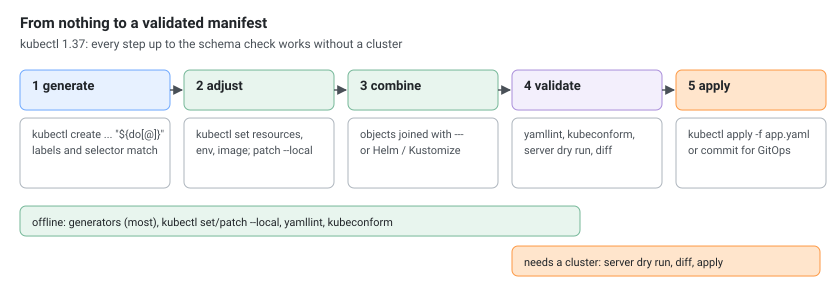
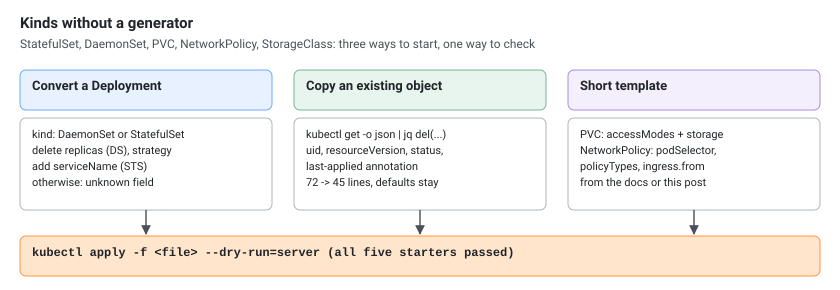
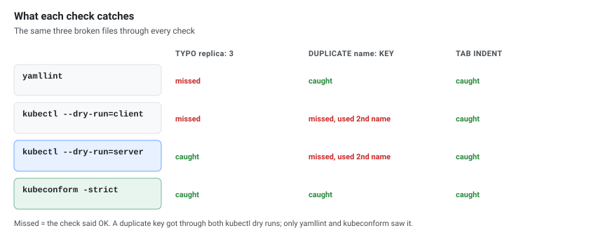

Writing manifests from memory is slow and error-prone: one wrong indent or field name and the apply fails, or worse, silently ignores the field. kubectl can generate almost every common object for you, fill in resources, environment variables and probes, document every field, and validate the result against the real API. This guide shows the fast workflow, which generators work without a cluster, and the traps found while testing them with kubectl 1.37.2, against a k3s 1.35 cluster and against no cluster at all.

[](yaml-workflow.svg "Open the diagram full size")

## 1. The Core Trick: Generate, Don't Type

Every `kubectl create` and `kubectl run` command can print the object instead of creating it:

```bash
kubectl create deployment web --image=nginx:1.29-alpine --replicas=3 --port=80 --dry-run=client -o yaml > deploy.yaml
```

The result is a complete Deployment where the labels, the selector and the template labels already match, which is the part people most often get wrong by hand. It also contains empty `strategy: {}`, `resources: {}` and `status: {}` lines: delete them or leave them, the API ignores them.

### A Shortcut That Works in bash and zsh

The popular shortcut is a plain variable:

```bash
export do="--dry-run=client -o yaml"
kubectl create deployment web --image=nginx:1.29-alpine $do
```

That works in **bash only**. zsh doesn't split an unquoted variable into words, so kubectl receives `--dry-run=client -o yaml` as one argument and fails with `Invalid dry-run value (client -o yaml)`. zsh is the default shell on macOS.

An alias works in both shells, because kubectl accepts these flags before the subcommand too:

```bash
alias k=kubectl                                  # in ~/.bashrc or ~/.zshrc
alias kdr='kubectl --dry-run=client -o yaml'

kdr create deployment web --image=nginx:1.29-alpine > deploy.yaml
kdr run debug --image=busybox:1.37 -- sleep 3600 > pod.yaml
```

Aliases aren't expanded in bash scripts (only after `shopt -s expand_aliases`). In scripts, or to add the flags to a command you've already typed, use an array, which also works in both shells:

```bash
do=(--dry-run=client -o yaml)                 # in ~/.bashrc or ~/.zshrc
kubectl create deployment web --image=nginx:1.29-alpine "${do[@]}"
```

In zsh only, `${=do}` forces the split of the plain variable. The examples below use the array.

Most generators also have **short names**: `create deploy`, `cm`, `sa`, `ns`, `cj`, `pdb`, `pc`, `quota`, `svc` and `ing` all worked. `rb` and `crb` don't exist (`unknown flag: --role`): spell out `rolebinding` and `clusterrolebinding`.

## 2. Generators for Common Objects

**Offline** means the command worked with a kubeconfig whose server didn't exist. The others ask the API server for its resource list first, so they need a reachable cluster even with `--dry-run=client` (they fail with `Couldn't get current server API group list`).

| Object | Command | Offline |
|--------|---------|---------|
| Deployment | `kubectl create deployment web --image=nginx:1.29-alpine --replicas=3 --port=80 "${do[@]}"` | Yes |
| Service (ClusterIP) | `kubectl create service clusterip web --tcp=80:8080 "${do[@]}"` | Yes |
| Service (NodePort) | `kubectl create service nodeport web --tcp=80:8080 --node-port=30080 "${do[@]}"` | Yes |
| Service (LoadBalancer) | `kubectl create service loadbalancer web --tcp=80:8080 "${do[@]}"` | Yes |
| Headless Service | `kubectl create service clusterip db --clusterip=None --tcp=5432:5432 "${do[@]}"` | Yes |
| Service from a Deployment file | `kubectl expose -f deploy.yaml --port=80 --target-port=8080 --name=web "${do[@]}"` | No |
| Service from a running Deployment | `kubectl expose deployment web --type=NodePort --port=8080 --target-port=80 "${do[@]}"` | No |
| Service from a running Pod | `kubectl expose pod mypod --type=NodePort --port=80 --name=mypod-service "${do[@]}"` | No |
| Pod | `kubectl run debug --image=busybox:1.37 --restart=Never "${do[@]}" -- sleep 3600` | No |
| Pod with labels | `kubectl run web --image=nginx:1.29-alpine --labels=type=web,tier=front "${do[@]}"` | No |
| ConfigMap | `kubectl create configmap app-config --from-literal=LOG_LEVEL=info --from-file=app.properties "${do[@]}"` | Yes |
| Secret | `kubectl create secret generic db --from-literal=password=<password> "${do[@]}"` | Yes |
| TLS Secret | `kubectl create secret tls web-tls --cert=tls.crt --key=tls.key "${do[@]}"` | Yes |
| Docker registry Secret | `kubectl create secret docker-registry regcred --docker-server=<registry> --docker-username=<user> --docker-password=<token> "${do[@]}"` | Yes |
| Job | `kubectl create job once --image=busybox:1.37 "${do[@]}" -- echo hi` | Yes |
| CronJob | `kubectl create cronjob nightly --image=busybox:1.37 --schedule="0 2 * * *" "${do[@]}" -- echo hi` | Yes |
| Ingress | `kubectl create ingress web --class=nginx --rule="app.example.com/*=web:80" "${do[@]}"` | Yes |
| Namespace | `kubectl create namespace demo "${do[@]}"` | Yes |
| ServiceAccount | `kubectl create serviceaccount app "${do[@]}"` | Yes |
| Role | `kubectl create role pod-reader --verb=get,list,watch --resource=pods "${do[@]}"` | No |
| ClusterRole | `kubectl create clusterrole node-reader --verb=get,list --resource=nodes "${do[@]}"` | No |
| RoleBinding | `kubectl create rolebinding pod-reader --role=pod-reader --serviceaccount=<namespace>:app "${do[@]}"` | Yes |
| ClusterRoleBinding | `kubectl create clusterrolebinding node-reader --clusterrole=node-reader --serviceaccount=<namespace>:app "${do[@]}"` | Yes |
| ResourceQuota | `kubectl create quota team --hard=pods=20,requests.cpu=4,limits.memory=8Gi "${do[@]}"` | Yes |
| PodDisruptionBudget | `kubectl create poddisruptionbudget web --selector=app=web --min-available=2 "${do[@]}"` | Yes |
| PriorityClass | `kubectl create priorityclass high --value=1000 --description="critical apps" "${do[@]}"` | Yes |
| HorizontalPodAutoscaler | `kubectl autoscale -f deploy.yaml --min=2 --max=5 --cpu=70% "${do[@]}"` | No |

Notes:

- Add `-n <namespace>` to put `metadata.namespace` in the output.
- `kubectl run` and `kubectl create job` take the command after `--`. `kubectl run` puts it in `args`, so the image's entrypoint still runs. Use `--command --` to set `command` instead.
- `kubectl expose deployment web` or `expose pod mypod` copies the selector from the **live** object: the Deployment's selector, or the Pod's labels. The object must exist (`deployments.apps "nothere" not found` otherwise). `expose -f` reads the file instead, so the object doesn't need to exist yet.
- `kubectl run` labels the Pod `run=<name>`. `--labels` replaces that label with yours, so a Service you generate with `expose pod` selects on your labels instead.
- `kubectl autoscale --cpu-percent=70` still works but prints a deprecation warning. Use `--cpu=70%`.
- `--from-file=app.properties` uses the **file name** as the key (`app.properties: |` followed by the content). `--from-file=settings=app.properties` sets the key to `settings`.
- `create secret tls` produces a `kubernetes.io/tls` Secret with `tls.crt` and `tls.key`; `create secret docker-registry` produces a `kubernetes.io/dockerconfigjson` Secret with one `.dockerconfigjson` key. Reference that one from a pod with `imagePullSecrets` (section 3).
- Secrets come out base64-encoded, which is **not encryption**. Don't commit them to Git. Use Sealed Secrets, SOPS or an external secret store.
- `kubectl create --help` lists every generator. Objects with no generator (StatefulSet, DaemonSet, PersistentVolumeClaim, NetworkPolicy, StorageClass) need a starting point from section 6.

## 3. Add Resources, Env Vars, Images and Probes Without Editing

`kubectl set` with `--local` edits a manifest file (or stdin) and prints the result, without touching a cluster:

```bash
# Requests and limits
kubectl set resources -f deploy.yaml --local \
  --requests=cpu=100m,memory=128Mi --limits=memory=256Mi -o yaml > tmp.yaml && mv tmp.yaml deploy.yaml

# Environment variables
kubectl set env -f deploy.yaml --local LOG_LEVEL=info -o yaml > tmp.yaml && mv tmp.yaml deploy.yaml

# Image (the container is named after the image: nginx)
kubectl set image -f deploy.yaml --local nginx=nginx:1.30-alpine -o yaml > tmp.yaml && mv tmp.yaml deploy.yaml
```

Never redirect into the file you're reading (`-f deploy.yaml ... > deploy.yaml`): the shell empties the file before kubectl reads it, kubectl finds nothing to do, and the command still **exits with 0**. You're left with an empty file and no error.

They also chain, so one line builds a finished Deployment:

```bash
kubectl create deployment web --image=nginx:1.29-alpine --replicas=2 --port=80 "${do[@]}" \
  | kubectl set resources -f - --local --requests=cpu=50m,memory=64Mi --limits=memory=128Mi -o yaml \
  | kubectl set env -f - --local LOG_LEVEL=info -o yaml > deploy.yaml
```

### Anything Else: kubectl patch --local

`kubectl set` has no option for probes, a `securityContext` or `imagePullSecrets`. `kubectl patch --local` adds any field, also offline:

```bash
# Readiness probe on the nginx container (strategic merge: containers are matched by name)
kubectl patch -f deploy.yaml --local --type strategic -o yaml -p \
  '{"spec":{"template":{"spec":{"containers":[{"name":"nginx","readinessProbe":{"httpGet":{"path":"/","port":80}}}]}}}}'

# Pod securityContext
kubectl patch -f deploy.yaml --local --type merge -o yaml -p \
  '{"spec":{"template":{"spec":{"securityContext":{"runAsNonRoot":true}}}}}'

# imagePullSecrets for a private registry
kubectl patch -f deploy.yaml --local --type json -o yaml -p \
  '[{"op":"add","path":"/spec/template/spec/imagePullSecrets","value":[{"name":"regcred"}]}]'
```

Use `--type strategic` (the default) for anything inside `containers`. A `--type merge` patch **replaces the whole list**: the same probe patch with `merge` produced a container with a probe and no `image`.

## 4. One File for the Whole App

Join the generated objects with `---` lines:

```bash
NS=shop
{
  kubectl create namespace $NS "${do[@]}"
  echo ---
  kubectl create configmap web-config -n $NS --from-literal=LOG_LEVEL=info "${do[@]}"
  echo ---
  kubectl create deployment web -n $NS --image=nginx:1.29-alpine --replicas=2 --port=80 "${do[@]}" \
    | kubectl set resources -f - --local --requests=cpu=50m,memory=64Mi --limits=memory=128Mi -o yaml
  echo ---
  kubectl create service clusterip web -n $NS --tcp=80:80 "${do[@]}"
} > app.yaml

kubectl apply -f app.yaml
```

The result held four objects and deployed cleanly.

## 5. Update a Secret or ConfigMap From Files

`kubectl create` only creates: run it again and it fails with `secrets "app-creds" already exists`. To create **or update** from files, generate and pipe into `apply`:

```bash
kubectl -n shop create secret generic app-creds --from-file=creds.txt "${do[@]}" | kubectl apply -f -
kubectl -n shop create configmap web-config --from-literal=LOG_LEVEL=debug "${do[@]}" | kubectl apply -f -
```

The new values were live after one command. If the object was first made with plain `kubectl create`, the first `apply` warns that the `kubectl.kubernetes.io/last-applied-configuration` annotation is missing (and adds it). Create with `--save-config`, or use `apply` from the start, to avoid that.

## 6. Starting Points for Objects Without a Generator

[](yaml-no-generator.svg "Open the diagram full size")

### Convert a Deployment Into a DaemonSet or StatefulSet

Generate a Deployment, then change the kind and drop what the new kind doesn't have:

```bash
# DaemonSet: no replicas, no strategy
kubectl create deployment agent --image=busybox:1.37 "${do[@]}" -- sleep 3600 \
  | sed -e 's/^kind: Deployment/kind: DaemonSet/' -e '/^  replicas:/d' -e '/^  strategy:/d' > ds.yaml

# StatefulSet: no strategy, plus serviceName pointing at a headless Service
kubectl create deployment db --image=postgres:18-alpine "${do[@]}" \
  | sed -e 's/^kind: Deployment/kind: StatefulSet/' -e '/^  strategy:/d' -e 's/^spec:/spec:\n  serviceName: db/' > sts.yaml
kubectl create service clusterip db --clusterip=None --tcp=5432:5432 "${do[@]}" > db-svc.yaml
```

Both passed the server-side dry run. Changing only the kind fails it: `strict decoding error: unknown field "spec.replicas", unknown field "spec.strategy"`. Add `volumeClaimTemplates` to the StatefulSet when each pod needs its own volume.
### Short Templates: PVC and NetworkPolicy

```yaml
apiVersion: v1
kind: PersistentVolumeClaim
metadata:
  name: data
spec:
  accessModes: [ReadWriteOnce]
  resources:
    requests:
      storage: 1Gi
---
apiVersion: networking.k8s.io/v1
kind: NetworkPolicy
metadata:
  name: web-allow-frontend
spec:
  podSelector:
    matchLabels:
      app: web
  policyTypes: [Ingress]
  ingress:
  - from:
    - podSelector:
        matchLabels:
          role: frontend
    ports:
    - port: 80
```

Both passed `kubectl apply --dry-run=server`. Leaving out `storageClassName` uses the cluster's default StorageClass.

### Copy an Existing Object

```bash
kubectl get deploy <name> -n <namespace> -o yaml > copy.yaml
```

The copy carries server-side fields you must remove before reusing it: `uid`, `resourceVersion`, `generation`, `creationTimestamp`, `status`, and annotations such as `kubectl.kubernetes.io/last-applied-configuration` and `deployment.kubernetes.io/revision`. (`managedFields` is hidden by default.) jq removes them, and `kubectl create --dry-run=client -o yaml` turns the JSON back into YAML:

```bash
kubectl get deploy <name> -n <namespace> -o json \
  | jq 'del(.metadata.uid, .metadata.resourceVersion, .metadata.generation,
            .metadata.creationTimestamp, .metadata.managedFields, .status,
            .metadata.annotations."kubectl.kubernetes.io/last-applied-configuration",
            .metadata.annotations."deployment.kubernetes.io/revision")' \
  | kubectl create -f - --dry-run=client -o yaml > clean.yaml
```

For a small Deployment that cut the file from 72 to 45 lines. What's left still includes every **default** the API server filled in (`progressDeadlineSeconds`, `revisionHistoryLimit`, `terminationMessagePath`, `dnsPolicy`...). That's harmless, but it makes the file long. The `kubectl neat` plugin (installed with Krew) removes the defaults as well.

### Copy From the Documentation

The Kubernetes documentation (kubernetes.io/docs) has a complete example for every kind. In VS Code, the Kubernetes and Red Hat YAML extensions offer snippets and autocomplete from the API schema.

## 7. See the Defaults Before You Apply

A server-side dry run returns the object exactly as the API server would store it, with every default filled in, and creates nothing:

```bash
kubectl apply -f deploy.yaml --dry-run=server -o yaml
```

For the generated Deployment that added, among others, `progressDeadlineSeconds: 600`, `revisionHistoryLimit: 10`, `maxSurge: 25%`, `imagePullPolicy: IfNotPresent`, `dnsPolicy: ClusterFirst`, `restartPolicy: Always` and `schedulerName: default-scheduler`. It also runs admission webhooks, so you see what a mutating webhook (a sidecar injector, a policy engine) would change.

## 8. Look Up Fields With kubectl explain

`kubectl explain` prints the documentation of any field, from the cluster's own API (so it also covers CRDs):

```bash
kubectl explain deployment.spec.strategy.rollingUpdate
kubectl explain pod.spec.containers.resources --recursive     # the whole subtree, field names only
kubectl explain networkpolicy.spec --recursive
kubectl explain application.spec --api-version=argoproj.io/v1alpha1   # a CRD
```

It needs a reachable cluster.

## 9. Helm and Kustomize Skeletons

For an app with several environments, start from a tool's skeleton instead of loose files:

```bash
# Helm: a chart with a Deployment, Service, ServiceAccount, Ingress, HTTPRoute and HPA template
helm create <chart>
helm template <release> ./<chart> --set replicaCount=2 > rendered.yaml

# Kustomize: one base, patched per environment
kubectl kustomize <dir>          # render
kubectl apply -k <dir>           # apply
```

With the default values (Helm 4.3.1), `helm template` renders a ServiceAccount, a Service, a Deployment and a test Pod; Ingress, HTTPRoute and HPA are off until you enable them in `values.yaml`.

A minimal `kustomization.yaml` around the `app.yaml` from section 4:

```yaml
resources:
  - app.yaml
namePrefix: dev-
labels:
  - pairs:
      env: dev
images:
  - name: nginx
    newTag: "1.30-alpine"
```

It renamed the ConfigMap, Deployment and Service to `dev-*`, added the `env: dev` label everywhere and changed the image tag. The Namespace kept its name: `namePrefix` doesn't rename Namespace objects.

## 10. Validate Before You Apply

[](yaml-validation.svg "Open the diagram full size")

| Check | Command | Needs a cluster | Catches |
|-------|---------|-----------------|---------|
| YAML style and syntax | `yamllint app.yaml` | No | Tabs, duplicate keys, trailing spaces, indentation |
| Client-side dry run | `kubectl apply -f app.yaml --dry-run=client` | No | Almost nothing: broken YAML only |
| Schema | `kubeconform -strict -summary app.yaml` | No | Unknown fields, wrong types, duplicate keys |
| Server-side dry run | `kubectl apply -f app.yaml --dry-run=server` | Yes | Unknown fields, wrong types, admission webhooks, quotas, missing namespaces |
| Diff against the cluster | `kubectl diff -f app.yaml` | Yes | What would change. Exit code 1 means there are changes |

What each one did with three broken files:

| | `replica: 3` (typo) | Duplicate `name:` key | Tab indentation |
|---|---|---|---|
| `yamllint` | Passed | `duplication of key "name" in mapping` | `found character '\t' that cannot start any token` |
| `--dry-run=client` | Passed (`created (dry run)`) | Passed, silently used the **second** name | Failed (YAML error) |
| `--dry-run=server` | `strict decoding error: unknown field "spec.replica"` | Passed, silently used the second name | Failed (YAML error) |
| `kubeconform -strict` | `additional properties 'replica' not allowed` | `key "name" already set in map` | Failed (YAML error) |

The client-side dry run is **not** a validation. A duplicate key got through both kubectl dry runs: the object would have been created under the second name. Use `yamllint` or `kubeconform` to catch that one, and a server dry run (or `kubeconform -strict`) for typos.

Without `-strict`, kubeconform also passed the `replica` typo. Pin the schema version with `-kubernetes-version 1.35.0` to match your cluster. Both tools run without installing anything:

```bash
docker run --rm -i ghcr.io/yannh/kubeconform:v0.7.0 -strict -summary - < app.yaml
docker run --rm -i pipelinecomponents/yamllint:0.35.1 yamllint - < app.yaml
```

yamllint's **default** rules reject YAML that kubectl itself generates: it wants `---` at the top and list items indented under their key, so the generated `app.yaml` got four errors. A config that accepts kubectl's style and still catches the real problems:

```yaml
# .yamllint
extends: default
rules:
  document-start: disable
  indentation:
    indent-sequences: whatever
```

## 11. Gotchas

- **`$do` doesn't work in zsh.** zsh passes the unquoted variable as one argument (`Invalid dry-run value (client -o yaml)`). Use the `kdr` alias or the array from section 1, or `${=do}`.
- **`:latest` or no tag means `imagePullPolicy: Always`.** The server-side dry run set `Always` for `nginx:latest` and for plain `nginx`, and `IfNotPresent` for `nginx:1.29-alpine`. `latest` also changes under you between deploys. Pin a tag (or a digest) in everything you generate.
- **Redirecting into the input file empties it**, and kubectl still exits 0.
- **`--type merge` replaces lists.** Patching one container field with a merge patch drops the rest of the container. Use the strategic patch.
- **Duplicate keys pass kubectl.** Both dry runs accepted a manifest with `name:` twice and used the last one.
- **Server dry run and new namespaces.** A file that creates a namespace and objects inside it fails `--dry-run=server` with `namespaces "shop" not found`, because the dry run never really creates the namespace. Create the namespace first, or validate it separately. `kubectl apply` without the dry run worked on the same file.
- **Some generators need a cluster** even with `--dry-run=client`: `run`, `expose`, `autoscale`, `create role` and `create clusterrole`. Run them against a local cluster (kind, k3s, colima, minikube) when your real cluster is out of reach.
- **Don't run generators against production by accident.** `--dry-run=client` doesn't change anything, but a forgotten `"${do[@]}"` does. Keep a local context as the current one, or always pass `--context`.
- **A kubeconfig user with no credentials makes kubectl prompt for a username**, which hangs scripts. Use a real local context.
- **The container name comes from the image** (`nginx` for `nginx:1.29-alpine`). `kubectl set image`, `kubectl set resources -c` and strategic patches need that name.
- **`kubectl create` fails on objects that exist** (`already exists`). Pipe the generator into `kubectl apply -f -` to update.
- **`--port` on `create deployment` only sets `containerPort`.** It doesn't create a Service. Use `create service` or `expose`.
- **Version skew.** kubectl 1.37 against a 1.35 server printed `version difference between client (1.37) and server (1.35) exceeds the supported minor version skew of +/-1`. Generators still worked, but keep kubectl within one minor version of the cluster.

## See Also

- [Kubernetes Architecture on a kubeadm Cluster](/posts/kubernetes-architecture-components/)
- [Kustomize vs Helm](/posts/kustomize-vs-helm/)
- [Helm vs Argo CD vs Kustomize vs Flux](/posts/helm-argocd-kustomize-flux-compared/)
- [Helm Cheatsheet](/cheatsheet/helm/)
- [Argo CD Cheatsheet](/cheatsheet/argocd-cheatsheet/)
- [Kubernetes docs: kubectl create](https://kubernetes.io/docs/reference/kubectl/generated/kubectl_create/)
