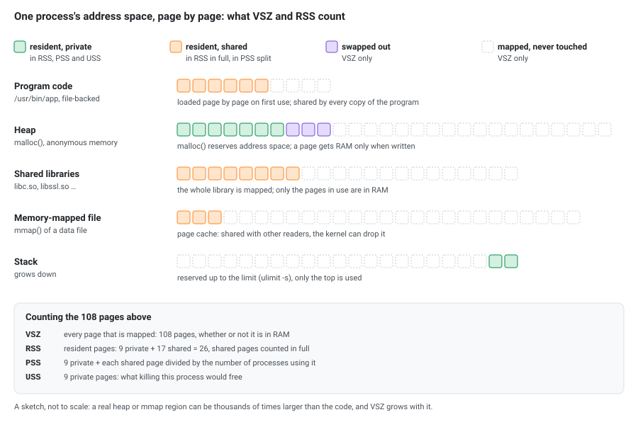
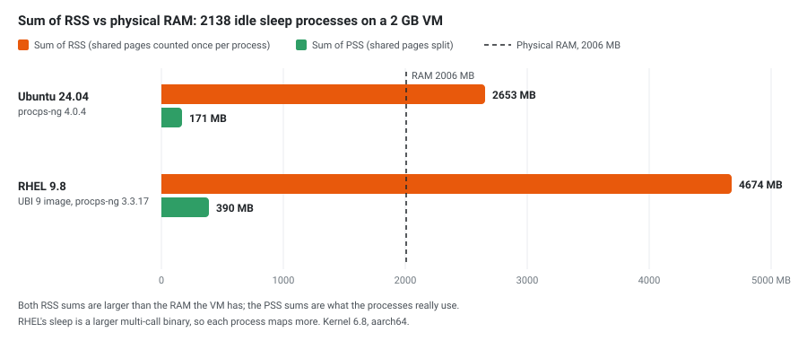
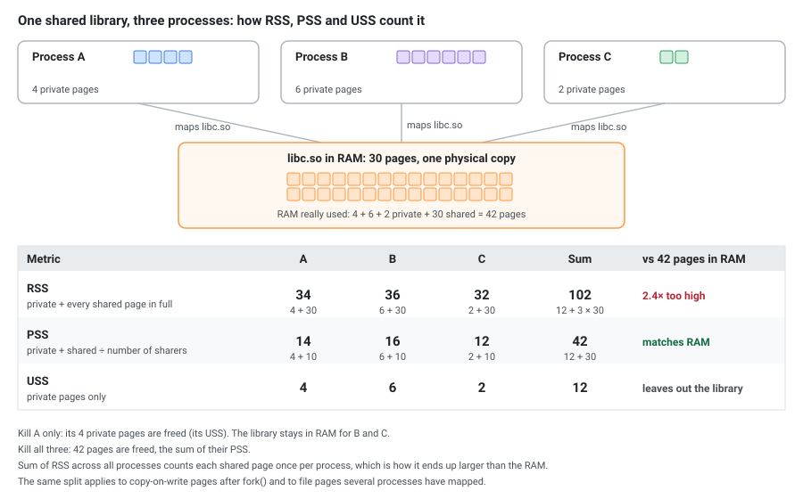

## Virtual Memory Basics

Every Linux process operates within its own virtual address space. The kernel, via the MMU (Memory Management Unit), translates virtual addresses to physical page frames. This abstraction allows:

- Processes to have isolated address spaces
- Memory to be allocated without being physically backed immediately (lazy allocation)
- Pages to be shared across processes (shared libraries, copy-on-write after fork)
- Unused pages to be swapped to disk

The key takeaway: **what a process thinks it has (virtual) and what it actually uses (physical) are two very different things**.

## VSZ — Virtual Memory Size

VSZ (also shown as VIRT in `top`) represents the total virtual address space of a process. It includes:

- The process binary (text segment)
- All linked shared libraries (entire library, not just what's loaded)
- Stack and heap allocations (including memory allocated but never touched)
- Memory-mapped files
- Memory that has been swapped out

```bash
# View VSZ for all processes
ps -eo pid,vsz,cmd --sort=-vsz | head
```

**VSZ is not a measure of physical memory usage.** A process can have a VSZ of several gigabytes while using only a few megabytes of actual RAM. This happens because:

1. `malloc()` can reserve address space without the kernel backing it with physical pages until the memory is actually written to (demand paging)
2. Shared libraries are mapped entirely into the virtual space but only the used pages are loaded
3. Memory-mapped files (e.g. via `mmap`) add to VSZ even if only a few pages are accessed

## RSS — Resident Set Size

RSS represents the amount of physical memory (RAM) currently held by a process. It includes:

- Pages from the process's own code and data that are in RAM
- Pages from shared libraries that are in RAM
- Stack and heap pages that are in RAM

It does **not** include:

- Swapped out pages
- Pages that are allocated but never accessed (not yet faulted in)

```bash
# View RSS for all processes
ps -eo pid,rss,cmd --sort=-rss | head

# RSS from /proc
cat /proc/<pid>/status | grep VmRSS
```

[](memory-vsz-rss.svg "Open the diagram full size")

### What RSS Is Made Of

`/proc/<pid>/status` splits RSS into three parts that always add up to `VmRSS`:

| Field | What it is |
|-------|------------|
| `RssAnon` | Anonymous memory: heap, stack, `malloc`. Belongs to the process; can only go to swap |
| `RssFile` | Pages of files mapped into the process: the binary, shared libraries, `mmap`'d files. The kernel can drop them and read them again |
| `RssShmem` | Shared memory: `MAP_SHARED` anonymous mappings, System V / POSIX shared memory, files on `tmpfs` |
| `VmSwap` | Anonymous pages that are in swap now. Not part of RSS |

```bash
grep -E '^(VmSize|VmRSS|RssAnon|RssFile|RssShmem|VmPTE|VmSwap):' /proc/<pid>/status
```

For the Python process from the next section, holding 512 MiB it wrote itself:

```
VmSize:	 1064852 kB
VmRSS:	  534964 kB
RssAnon:	  529028 kB
RssFile:	    5936 kB
RssShmem:	       0 kB
VmPTE:	    1100 kB
VmSwap:	       0 kB
```

529028 + 5936 + 0 = 534964 kB: almost all of it is the process's own data, so this RSS is real. A large `RssFile` instead means libraries and mapped files, mostly shared and reclaimable. `VmSwap` is 0 because this VM has no swap.

One trap: Python's `mmap.mmap(-1, size)` and any `MAP_SHARED` anonymous mapping count as **`RssShmem`**, not `RssAnon`. With the default flags the same 512 MiB showed `RssAnon: 4740 kB` and `RssShmem: 524288 kB`.

## Watching VSZ and RSS Grow

Demand paging is easy to see. This script reserves 1 GiB of anonymous memory, the way `malloc` does for large blocks (glibc uses `mmap` above 128 KiB), then writes one byte per 4 KiB page, a quarter of the block at a time, and runs `ps` after each step:

```python
import mmap, os, subprocess

pid = str(os.getpid())
def ps(label):
    print(f"# {label}")
    print(subprocess.run(["ps", "-o", "pid,vsz,rss,cmd", "-p", pid],
                         capture_output=True, text=True).stdout, end="")

size = 1024 * 1024 * 1024
ps("start")
m = mmap.mmap(-1, size, flags=mmap.MAP_PRIVATE | mmap.MAP_ANONYMOUS)
ps("after reserving 1 GiB")
for i in range(0, size // 4, 4096):
    m[i] = 1
ps("after writing 256 MiB")
for i in range(size // 4, size // 2, 4096):
    m[i] = 1
ps("after writing 512 MiB")
```

On Ubuntu 24.04 (Python 3.12.3, procps-ng 4.0.4), values in KiB:

```
# start
    PID    VSZ   RSS CMD
   2507  16276 10672 python3 /tmp/alloc.py
# after reserving 1 GiB
    PID    VSZ   RSS CMD
   2507 1064852 10676 python3 /tmp/alloc.py
# after writing 256 MiB
    PID    VSZ   RSS CMD
   2507 1064852 272820 python3 /tmp/alloc.py
# after writing 512 MiB
    PID    VSZ   RSS CMD
   2507 1064852 534964 python3 /tmp/alloc.py
```

- Reserving 1 GiB adds exactly 1048576 KiB to VSZ and **4 KiB** to RSS.
- Each 256 MiB written adds exactly 262144 KiB to RSS: every first write to a page is a page fault, and the kernel gives the page RAM at that moment.
- The other 512 MiB stays reserved address space. It costs no RAM until it is written.

## Why RSS Is Misleading

RSS is better than VSZ for understanding physical memory usage, but it has a fundamental flaw: **it double-counts shared memory**.

### Problem 1: Shared Libraries

When `libc.so` is loaded into memory, every process that links to it shares the same physical pages. But RSS counts those pages fully for **each** process.

Example: 100 processes using a 2 MB shared library:
- Sum of RSS includes 100 × 2 MB = 200 MB for that library
- Actual physical memory used by the library: 2 MB

### Problem 2: Copy-on-Write After fork()

When a process calls `fork()`, the child initially shares all physical pages with the parent via copy-on-write (CoW). The pages are only duplicated when one of the processes writes to them.

- Right after fork: both parent and child report roughly the same RSS
- Actual additional physical memory used: near zero
- RSS of parent + child ≈ 2× the actual usage

This is why Redis with `BGSAVE` (which forks) can appear to use twice its memory in `ps` output even though CoW means physical usage barely increases — until pages start being modified.

[](memory-fork-cow.svg "Open the diagram full size")

### Problem 3: Memory-Mapped Files

A process that `mmap()`s a large file will have those pages counted in RSS once they're accessed, but those pages may be shared with other processes reading the same file or reclaimable by the kernel at any time (file-backed pages).

### The Sum Problem

If you sum RSS across all processes:

```bash
ps -eo rss | awk '{sum+=$1} END {print sum/1024 " MB"}'
```

The result will **exceed** your total physical RAM. This doesn't mean you're out of memory — it means shared pages are being counted multiple times.

[](memory-sum-rss-vs-ram.svg "Open the diagram full size")

## Better Metrics: PSS and USS

### PSS — Proportional Set Size

PSS divides shared pages proportionally among the processes sharing them.

If 3 processes share a library that occupies 30 pages in RAM, each process's PSS includes only 10 pages from that library.

**Summing PSS across all processes gives a realistic approximation of total physical memory usage.**

```bash
# View PSS for a process (anchor the match: a bare "Pss" also matches
# Pss_Dirty, Pss_Anon, Pss_File, Pss_Shmem and SwapPss)
grep '^Pss:' /proc/<pid>/smaps_rollup
```

### USS — Unique Set Size

USS counts only the pages that are private to a process — not shared with anyone else. This tells you how much memory would be freed if you killed just that process.

```bash
# Private memory (USS approximation)
grep Private /proc/<pid>/smaps | awk '{sum+=$2} END {print sum " kB"}'
```

### Comparison

| Metric | Includes shared libs | Includes private memory | Summable across processes | Available in |
|--------|---------------------|------------------------|--------------------------|--------------|
| **VSZ** | Yes (full) | Yes (allocated) | No (meaningless) | `ps`, `top` |
| **RSS** | Yes (full) | Yes (resident) | No (overcounts) | `ps`, `top`, `/proc/pid/status` |
| **PSS** | Proportionally | Yes (resident) | Yes (accurate) | `/proc/pid/smaps`, `/proc/pid/smaps_rollup` |
| **USS** | No | Yes (resident) | No (undercounts) | `/proc/pid/smaps` |

[](memory-shared-pages.svg "Open the diagram full size")

## Reading /proc/\<pid\>/smaps

The `smaps` file provides per-mapping memory detail. The example is trimmed: a current kernel (6.8 here) also prints `KernelPageSize`, `MMUPageSize`, `Pss_Dirty`, `KSM`, `LazyFree`, `AnonHugePages`, `Shared_Hugetlb`, `Private_Hugetlb`, `SwapPss`, `Locked` and `THPeligible`, and the `← ` notes are added here for explanation:

```
00400000-0048a000 r-xp 00000000 fd:03 960637       /bin/bash
Size:                552 kB      ← virtual size of this mapping
Rss:                 460 kB      ← physical pages resident
Pss:                 100 kB      ← proportional share
Shared_Clean:        452 kB      ← shared pages, unmodified
Shared_Dirty:          0 kB      ← shared pages, modified
Private_Clean:         8 kB      ← private pages, unmodified
Private_Dirty:         0 kB      ← private pages, modified
Referenced:          460 kB      ← pages accessed recently
Anonymous:             0 kB      ← not backed by a file
Swap:                  0 kB      ← pages swapped out
```

For a quick summary without parsing the full file:

```bash
# Aggregated view (Linux 4.14+)
cat /proc/<pid>/smaps_rollup
```

## Practical Commands

### Compare RSS vs PSS vs USS for a process

```bash
# ps doesn't support PSS/USS columns — they only exist in /proc/<pid>/smaps.
# This combines ps output with smaps data:
sudo bash -c '
  pid=<pid>
  ps -fp $pid
  echo "---"
  echo "RSS: $(grep VmRSS /proc/$pid/status | awk "{print \$2, \$3}")"
  echo "PSS: $(grep "^Pss:" /proc/$pid/smaps_rollup | awk "{print \$2, \$3}")"
  echo "USS: $(grep Private /proc/$pid/smaps_rollup | awk "{sum+=\$2} END {print sum, \"kB\"}")"
'

# On older kernels without smaps_rollup, use smaps:
sudo bash -c '
  pid=<pid>
  ps -fp $pid
  echo "---"
  echo "RSS: $(grep VmRSS /proc/$pid/status | awk "{print \$2, \$3}")"
  echo "PSS: $(grep "^Pss:" /proc/$pid/smaps | awk "{sum+=\$2} END {print sum, \"kB\"}")"
  echo "USS: $(grep Private /proc/$pid/smaps | awk "{sum+=\$2} END {print sum, \"kB\"}")"
'
```

### Find the real memory hogs (sorted by PSS)

```bash
# Requires root for reading other processes' smaps
for pid in $(ps -eo pid --no-headers); do
    pss=$(grep '^Pss:' /proc/$pid/smaps_rollup 2>/dev/null | awk '{sum+=$2} END {print sum}')
    [ -n "$pss" ] && echo "$pss $pid $(tr '\0' ' ' < /proc/$pid/cmdline 2>/dev/null)"
done | sort -rn | head -20
```

The `'^Pss:'` anchor matters. With a bare `grep Pss` the loop also adds the `Pss_Dirty`, `Pss_Anon`, `Pss_File` and `SwapPss` lines, and the totals come out about **3 times too high**: 564 MB instead of 188 MB for the same processes.

### Use smem for a cleaner view

`smem` is a tool that reports PSS, USS, and RSS in a friendly format:

```bash
# Install
sudo apt install smem    # Debian/Ubuntu
sudo dnf install epel-release && sudo dnf install smem    # Rocky, AlmaLinux, CentOS Stream
# RHEL itself has no epel-release package: install the EPEL release RPM first
sudo dnf install https://dl.fedoraproject.org/pub/epel/epel-release-latest-9.noarch.rpm   # use -8 or -10 to match your major version
sudo dnf install smem

# Usage
smem -r -k         # sorted by PSS, human-readable
smem -u            # per-user summary
smem -m            # per-mapping summary
```

### Use pmap for per-mapping detail

```bash
pmap -x <pid>      # extended format with RSS per mapping
pmap -X <pid>      # adds PSS and the other smaps columns; the layout follows the kernel's smaps, so it can differ between versions
```

### Reading top and htop

`top` and `htop` show the same numbers under other names. For the Python process above:

```
    PID USER      PR  NI    VIRT    RES    SHR S  %CPU  %MEM     TIME+ COMMAND
   2507 root      20   0 1064852 534964   5936 S   0.0  26.7   0:00.10 python3
```

| `top` / `htop` | Same as | Notes |
|----------------|---------|-------|
| `VIRT` | VSZ, `VmSize` | 1064852 |
| `RES` | RSS, `VmRSS` | 534964 |
| `SHR` | `RssFile` + `RssShmem` | 5936: the part of RES that *could* be shared, whether anyone shares it or not |
| `%MEM` | RES ÷ total RAM | 534964 ÷ 2006672 kB = 26.7 % |

`ps` and `top` report in **KiB** by default (`e` in `top` switches the process columns to MiB, GiB…). `top` has no PSS column; `smem` and `pmap -X` show it.

## Memory Overcommit

Linux allows processes to allocate more virtual memory than physically available (overcommit). This is controlled by:

```bash
# Check current policy
cat /proc/sys/vm/overcommit_memory
# 0 = heuristic (default) — kernel guesses if allocation is reasonable
# 1 = always overcommit — never refuse malloc (used by Redis, etc.)
# 2 = never overcommit — limit to swap + (ratio × physical RAM)

# Check the ratio (used when overcommit_memory=2)
cat /proc/sys/vm/overcommit_ratio   # default: 50 (percent)

# See committed vs limit
grep -i commit /proc/meminfo
# CommitLimit:    total virtual memory the kernel will allow
# Committed_AS:  total memory currently committed to processes
```

When overcommit is enabled and memory runs out, the OOM killer steps in and terminates processes. This is why VSZ alone tells you nothing about actual resource pressure — a process can `malloc` 100 GB, never touch it, and the system is fine.

## What the OOM Killer Looks At

When memory runs out, the kernel kills the process with the highest **badness**. In kernel 6.8 (`mm/oom_kill.c`) badness is:

```
badness = RSS + swap entries + page tables       (in pages)
        + oom_score_adj × total pages / 1000
```

It uses **RSS, not PSS**: shared library pages and copy-on-write pages count in full for every process, so a process that shares a lot looks bigger than it is. `/proc/<pid>/oom_score` shows the result, scaled so the range is 0 to 2000 (`(1000 + badness × 1000 / total pages) × 2/3`).

On the 2 GB VM (501668 pages of RAM, no swap):

```bash
cat /proc/<pid>/oom_score /proc/<pid>/oom_score_adj
```

| Process | RSS | `oom_score_adj` | `oom_score` |
|---------|-----|-----------------|-------------|
| `sleep` | 1284 kB | 0 | 666 |
| Python holding 512 MiB | 534964 kB (+ 1100 kB page tables) | 0 | 844 |
| the same Python | | 500 | 1177 |

A process with almost no memory starts at 666; 512 MiB is 27 % of RAM and adds 178. `oom_score_adj` goes from `-1000` (never kill) to `1000` (kill first). Anyone can raise it for their own process; lowering it needs `CAP_SYS_RESOURCE` (inside an unprivileged container, `echo -1000 > /proc/<pid>/oom_score_adj` fails with `Permission denied`). Kubernetes sets it from the pod's QoS class: Guaranteed pods get `-997`, BestEffort pods `1000`.

Inside a container with a memory limit the same formula runs against the **cgroup's** limit instead of the machine's RAM, and only the container's processes are candidates (see the containers section below).

## Runtimes With a Huge VSZ

Some programs reserve far more address space than they will ever use, so a VSZ in the gigabytes is normal for them.

**glibc malloc arenas.** To avoid lock contention, glibc gives threads their own malloc arenas, each reserving 64 MiB of address space on 64-bit systems, up to 8 × the number of CPU cores. A C program with 8 threads, each doing a few 1 KiB `malloc` calls (Ubuntu 24.04, glibc 2.39, 2 CPUs):

```
# default
    PID NLWP    VSZ   RSS CMD
   1074    9 592588  1560 /tmp/arenas
# MALLOC_ARENA_MAX=1
    PID NLWP    VSZ   RSS CMD
   1106    9  68300  1544 /tmp/arenas
# MALLOC_ARENA_MAX=2
    PID NLWP    VSZ   RSS CMD
   1138    9 133836  1540 /tmp/arenas
```

The difference is exactly 8 × 64 MiB = 524288 KiB, while RSS stays at about 1.5 MB. `MALLOC_ARENA_MAX` is a common setting for multithreaded servers (Java, Ruby, Python with threads) where arena fragmentation also grows RSS over time.

**The JVM.** It reserves the maximum heap, the code cache and the compressed class space at startup. An idle `java` (OpenJDK 21.0.12) on the 2 GB VM:

```
# java Idle
    PID NLWP    VSZ   RSS CMD
     44   18 3111908 65640 java -cp /tmp Idle
# java -Xmx256m Idle
    PID NLWP    VSZ   RSS CMD
     85   18 2867960 65704 java -Xmx256m -cp /tmp Idle
```

About 3 GiB of VSZ for 64 MiB of RSS. `java -XX:+PrintFlagsFinal -version` shows where it goes: `MaxHeapSize` 513802240 (a quarter of the RAM by default), `ReservedCodeCacheSize` 251658240 and `CompressedClassSpaceSize` 1073741824. `-Xmx256m` only shrinks the heap part.

## Is the System Short of Memory? `free -m`

Per-process numbers don't answer this; `free` does. On the 2 GB VM (procps-ng 4.0.4):

```
               total        used        free      shared  buff/cache   available
Mem:            1959         650         293           1        1088        1309
Swap:              0           0           0
```

| Column | Meaning |
|--------|---------|
| `total` | RAM the kernel can use |
| `free` | RAM not used for anything. Low is normal: Linux fills idle RAM with cache |
| `buff/cache` | Page cache, buffers and reclaimable slab. Mostly given back when programs need it |
| `shared` | `Shmem`: tmpfs and shared memory (part of `buff/cache`, but not freely reclaimable) |
| `available` | `MemAvailable`: an estimate of how much can be allocated without swapping. **This is the column to watch** |
| `used` | With procps-ng 4.0.4, `total − available` (1959 − 1309 = 650) |

Only 293 MB is `free`, yet 1309 MB is `available`, because most of the 1088 MB of cache can be dropped. A system is short of memory when `available` is low and stays low, not when `free` is.

`free` reads `/proc/meminfo`, which is not aware of containers: in a container limited to 256 MiB it still shows `total 1959`. Inside a container, read the cgroup files instead (next sections).

## Memory That Belongs to No Process

Summing PSS over all processes gives what processes use, and it comes out **lower** than `used`. The rest is the kernel's own memory, which no process's RSS or PSS includes. From `/proc/meminfo` on the same VM:

```
Slab:              66004 kB
SReclaimable:      22768 kB
SUnreclaim:        43236 kB
KernelStack:        3848 kB
PageTables:         5372 kB
```

| Field | What it is |
|-------|------------|
| `Slab` | Kernel object caches: inodes, dentries, network buffers… |
| `SReclaimable` | The part of the slab the kernel can free (mostly dentry and inode caches); `free` counts it in `buff/cache` |
| `SUnreclaim` | Slab that stays allocated |
| `KernelStack` | One kernel stack per thread |
| `PageTables` | Page tables of all processes. A process's own share is `VmPTE` in its `status` (1100 kB for the 512 MiB Python process) |

`slabtop` shows which caches are largest. A slab that keeps growing, especially `SUnreclaim`, points to a kernel or driver leak, not to a process.

## Memory Inside Containers and Kubernetes

A container's memory limit is a **cgroup** limit, and the cgroup counts more than the RSS of its processes: it also charges the **page cache** of files the container reads and writes. In cgroup v2:

```bash
cat /sys/fs/cgroup/memory.max         # the limit (from --memory or resources.limits.memory)
cat /sys/fs/cgroup/memory.current     # everything charged to the container
grep -E '^(anon|file|active_file|inactive_file) ' /sys/fs/cgroup/memory.stat
cat /sys/fs/cgroup/memory.events      # oom and oom_kill counters
```

A Docker container with `--memory=256m --memory-swap=256m` (no swap), running `sleep` plus `docker exec` commands:

| Step | `memory.current` | `anon` | `file` | `inactive_file` | `docker stats` |
|------|------------------|--------|--------|-----------------|----------------|
| After `apt-get install` | 114.5 MiB | 0.2 MiB | 103.3 MiB | 102.1 MiB | 11.48 MiB |
| After writing a 150 MiB file to `/tmp` | 255.4 MiB | 0.2 MiB | 240.0 MiB | 179.8 MiB | 74.64 MiB |
| While a process holds 200 MiB it wrote | 256.0 MiB (the limit) | 204.8 MiB | 41.2 MiB | | |

- After writing the file, `memory.current` is at the limit, but the only process (`sleep`) has an RSS of 1284 kB. The rest is page cache.
- Page cache doesn't cause an OOM kill: when a process needed 200 MiB, the kernel dropped cache (`file` fell from 240 MiB to 41 MiB) and the allocation succeeded.
- **`docker stats` = `memory.current` − `inactive_file`**. Docker documents this for cgroup v2; the small difference in the table comes from the two being read a moment apart. `active_file` (recently used cache, 60 MiB here) stays in the number, which is why a container that only wrote a file shows 74.64 MiB.

**Kubernetes** uses the same idea. `kubectl top` and the kubelet's eviction decisions use the **working set**: usage minus `inactive_file`. Like `docker stats`, it still includes `active_file`, so pods doing heavy file I/O can look close to their limit, and the Kubernetes documentation lists this as a known issue.

**The OOM kill itself** is done by the kernel when `memory.current` hits `memory.max` and nothing more can be reclaimed. Allocating 400 MiB in the same container:

```
exit code: 137
oom 1
oom_kill 1
container still running: true  OOMKilled: true
```

and in the VM's kernel log:

```
Memory cgroup out of memory: Killed process 11415 (python3) total-vm:424216kB, anon-rss:258944kB, file-rss:1792kB, shmem-rss:0kB, UID:0 pgtables:568kB oom_score_adj:0
```

- Exit code **137** is 128 + 9 (`SIGKILL`).
- `constraint=CONSTRAINT_MEMCG` in the log means the cgroup limit was hit, not the machine's RAM.
- The kernel killed only the biggest process in the cgroup. The container kept running (`sleep` was PID 1), but Docker still reports `OOMKilled: true`, so a running container can carry that flag. When the killed process is PID 1, the container exits with 137 and `OOMKilled: true`, and Kubernetes shows the container as `OOMKilled`.
- `ps` inside the container can't predict this: the limit counts page cache and the memory of every process in the cgroup, and the RSS of a process that just died is gone.

## Summary

| Question | Use |
|----------|-----|
| How much address space does the process have? | VSZ |
| How much RAM is the process touching right now? | RSS |
| How much RAM is this process uniquely responsible for? | PSS |
| How much RAM would be freed if I kill only this process? | USS |
| Is my system actually running out of memory? | `free -m`, `/proc/meminfo`, `vmstat` |
| What is the process's RSS made of? | `RssAnon`, `RssFile`, `RssShmem` in `/proc/<pid>/status` |
| Which process will the OOM killer pick? | `/proc/<pid>/oom_score` (based on RSS + swap + page tables) |
| How much memory does my container use? | `memory.current` and `memory.stat` in the cgroup; `docker stats` and `kubectl top` subtract `inactive_file` |
| Why is the kernel using memory no process owns? | `Slab`, `SUnreclaim`, `KernelStack`, `PageTables` in `/proc/meminfo`, `slabtop` |

**Rule of thumb:** Don't sum RSS to estimate system memory usage. Use PSS if you need per-process accounting that adds up to reality. Use USS to estimate the cost of killing a single process.

## Where the Numbers Come From

Every command in this article was run as root in throwaway containers on a Colima VM (kernel 6.8, `aarch64`, 2 GB of RAM), on three distributions:

| Distribution | procps-ng | `smem` |
|--------------|-----------|--------|
| Ubuntu 24.04 | 4.0.4 | `apt install smem` (1.5-2) |
| Red Hat Enterprise Linux 9.8 (the UBI 9 image) | 3.3.17 | Not in the RHEL repositories; installs after the EPEL release RPM from the Fedora URL (1.5-11) |
| Rocky Linux 9 | 3.3.17 | `dnf install epel-release`, then `dnf install smem` |

All commands above work the same on the three of them. The results behind the examples:

- **One `sleep` process**, from the "compare RSS vs PSS vs USS" script: Ubuntu RSS 1268 kB, PSS 247 kB, USS 80 kB; RHEL RSS 2316 kB, PSS 669 kB, USS 188 kB. The `smaps` version agrees with `smaps_rollup` within a few kB.
- **Sum of RSS** for 2138 idle `sleep` processes on 2006 MB of RAM: **2653 MB** on Ubuntu and **4674 MB** on RHEL (RHEL's `sleep` is a larger multi-call binary), against a summed PSS of **171 MB** and **390 MB**.
- **The `grep Pss` mistake**: a bare `grep Pss` sums to about three times the real PSS (Ubuntu 514 MB vs 171 MB, RHEL 1168 MB vs 390 MB).
- **`pmap -X`** has the `Pss` column with both procps-ng 3.3.17 and 4.0.4.
- **Copy-on-write after fork**: a bash process holding about 100 MB of data and a forked subshell both show RSS of about 100 MB (Ubuntu 101.8 and 100.0 MB, RHEL 101.6 and 99.8 MB) but PSS of only about 33 to 34 MB each, with `Private_Dirty` of about 0.2 MB. Other forked shells share the same pages, which is why PSS is below half of RSS. Redis `BGSAVE` relies on the same mechanism.
- **Overcommit**: `CommitLimit` is 1003336 kB, exactly the RAM (2006672 kB) times the ratio (50 percent) plus zero swap, as the kernel documentation describes. This VM runs with `overcommit_memory` set to `1`, not the default `0`.
- **`smaps_rollup`** was added in August 2017 (Linux 4.14), according to the kernel's ABI documentation. The `pmap` man page gives no version for `-X` and warns that its layout follows `/proc/<pid>/smaps`.
- **Demand paging, `status` fields, `top` and `oom_score`**: Ubuntu 24.04 container with Python 3.12.3 and procps-ng 4.0.4. The `oom_score` values match the kernel 6.8 formula: (534964 + 1100) kB ÷ 4 = 134016 pages, × 1000 ÷ 501668 = 267, and (1000 + 267) × 2/3 = 844.
- **Malloc arenas**: Ubuntu 24.04, gcc 13.3.0, glibc 2.39, 2 CPUs. **JVM**: the `eclipse-temurin:21-jdk` image, OpenJDK 21.0.12.
- **Containers**: Docker on cgroup v2, `ubuntu:24.04` with `--memory=256m --memory-swap=256m`. The `docker stats` formula is from Docker's documentation; the working set and the `active_file` issue from the Kubernetes documentation (node-pressure eviction and resource metrics pipeline).
- **`free -m` and `/proc/meminfo`**: the Colima VM itself (procps-ng 4.0.4).

What these examples don't show: an allocation actually refused in `overcommit_memory` mode `2`, a system-wide (non-cgroup) OOM kill, a Kubernetes pod (the cgroup files and the exit code are the same), Redis itself, `x86_64` (the VM is 64-bit Arm), and RHEL 8 or 10.

## See Also

- [The /proc filesystem](https://docs.kernel.org/filesystems/proc.html) — kernel documentation for `status`, `smaps` and `smaps_rollup`
- [proc_pid_smaps(5)](https://man7.org/linux/man-pages/man5/proc_pid_smaps.5.html) — every `smaps` field explained
- [Overcommit accounting](https://docs.kernel.org/mm/overcommit-accounting.html) — the three `overcommit_memory` modes and `CommitLimit`
- [pmap(1)](https://man7.org/linux/man-pages/man1/pmap.1.html) and [smem](https://www.selenic.com/smem/)
- [Control Group v2: memory](https://docs.kernel.org/admin-guide/cgroup-v2.html#memory) — `memory.current`, `memory.stat`, `memory.events`
- [docker stats](https://docs.docker.com/reference/cli/docker/container/stats/) — how Docker computes memory usage
- [Node-pressure eviction](https://kubernetes.io/docs/concepts/scheduling-eviction/node-pressure-eviction/) and [Resource metrics pipeline](https://kubernetes.io/docs/tasks/debug/debug-cluster/resource-metrics-pipeline/) — the working set in Kubernetes
- [mallopt(3)](https://man7.org/linux/man-pages/man3/mallopt.3.html) — `M_ARENA_MAX`, `M_MMAP_THRESHOLD`
