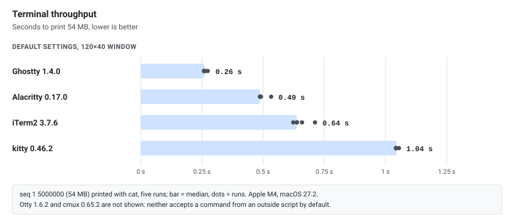

There are now two kinds of terminal on the Mac. iTerm2, kitty, Alacritty and Ghostty are general-purpose terminal emulators: they draw text fast and well, and the rest is up to your shell, tmux or editor. Otty and cmux are newer and built around **AI coding agents**: vertical tabs that show what each agent is doing, notifications when one needs input, and a CLI that lets the agents themselves open panes and workspaces.

This guide compares all six on macOS 27.2 (Apple M4, 16 GB). The versions are:

| Terminal | Version | Install |
|----------|---------|---------|
| iTerm2 | 3.7.6 | `brew install --cask iterm2` |
| kitty | 0.46.2 | `brew install --cask kitty` |
| Alacritty | 0.17.0 (94e7c88) | `brew install --cask alacritty` |
| Ghostty | 1.4.0 | `brew install --cask ghostty` |
| Otty | 1.6.2 | `brew install --cask otty` |
| cmux | 0.65.2 | `brew install --cask cmux` |

## At a Glance

| | iTerm2 | kitty | Alacritty | Ghostty | Otty | cmux |
|---|---|---|---|---|---|---|
| License | GPL-2.0 | GPL-3.0 | Apache-2.0 / MIT | MIT | Proprietary, free | GPL-3.0-or-later (app) |
| Language | Objective-C, Swift | C, Python | Rust | Zig, Swift (macOS UI) | Rust | Swift, libghostty |
| Rendering | Metal | OpenGL | OpenGL | Metal | GPU | Metal (libghostty) |
| Platforms | macOS | macOS, Linux | macOS, Linux, Windows, BSD | macOS, Linux | macOS (Windows beta) | macOS |
| Tabs and splits | Yes | Yes, with layouts | **No** | Yes | Yes, vertical tabs | Yes, vertical tabs |
| Config | GUI, plist | `kitty.conf` | `alacritty.toml` | `key = value` file | `config.toml` | `cmux.json` + Ghostty config |
| Images | iTerm2 protocol, Sixel | kitty protocol | None | kitty protocol | kitty, iTerm2, Sixel | kitty protocol |
| Scripting | Python API, AppleScript | `kitty @` remote control | IPC (`alacritty msg`) | AppleScript, keybind actions | `otty` CLI | `cmux` CLI over a Unix socket |
| App size | 194 MB | 149 MB | 14 MB | 67 MB | 70 MB | 233 MB |
| Architectures | Universal | Universal | Universal | Universal | arm64 | arm64 |

App sizes come from `du -sh` on the installed bundle and architectures from `lipo -archs`. Otty's language comes from its binary, which carries `rustc` build paths; its source is not public. cmux's repository holds a GPL app and a separately licensed (BUSL-1.1) server part.

## iTerm2

iTerm2 is the long-standing macOS default replacement for Terminal.app. Its strengths are features, not raw speed:

- **tmux integration** (`tmux -CC`): tmux windows and panes become native iTerm2 tabs and splits, and they survive a disconnect.
- **Triggers**: regular expressions on the output that highlight, notify or run an action.
- **Profiles** that switch on host, directory or user, a hotkey window, instant replay, and a Python API for automation.
- Everything is configured in the GUI, which is easy to start with but awkward to keep in dotfiles (the settings are a plist; you can point iTerm2 at a folder to load and save it).

It is the only one of the six without a plain-text config file.

## kitty

kitty is a GPU-rendered terminal by Kovid Goyal, written in C with Python for the configuration and its "kittens" (small helper programs).

- Its own **graphics protocol** (now supported by Ghostty, Otty and others) and **keyboard protocol**, which lets programs see key combinations that classic terminals cannot report.
- Tabs, windows and several **layouts** (tall, fat, grid, splits, stack), plus session files that open a whole layout at once.
- Remote control: `kitty @` changes a running kitty from a script, for example opening a new window with a command or changing colors.
- Kittens: `kitten icat` shows an image, `kitten ssh` copies the shell integration and terminfo to the remote host, `kitten themes` switches themes.

A minimal `~/.config/kitty/kitty.conf`:

```conf
font_family      Menlo
font_size        14
scrollback_lines 10000
remember_window_size no
initial_window_width  120c
initial_window_height 40c
```

## Alacritty

Alacritty is a deliberately small Rust terminal: it renders text with OpenGL and does nothing else. There are **no tabs and no splits**; the project expects you to use tmux, Zellij or your window manager for that. It is the only one of the six that also runs on Windows and the BSDs, and the app is 14 MB.

It has a vi mode for moving through the scrollback, regex hints for opening URLs, and live reload of `~/.config/alacritty/alacritty.toml` (older YAML configs must be converted with `alacritty migrate`):

```toml
[font]
normal = { family = "Menlo" }
size = 14

[scrolling]
history = 10000

[window]
dimensions = { columns = 120, lines = 40 }
```

## Ghostty

Ghostty, by Mitchell Hashimoto, is written in Zig with a **native UI on each platform** (Swift and AppKit on macOS, GTK on Linux), so its tabs, splits and settings look like those of a Mac app. `ghostty --version` on macOS shows the renderer and font engine:

```text
Ghostty 1.4.0

Version
  - version: 1.4.0
  - channel: stable
Build Config
  - Zig version   : 0.17.0
  - build mode    : .fast
  - app runtime   : .none
  - font engine   : .coretext
  - renderer      : renderer.generic.Renderer(renderer.Metal)
  - libxev        : kqueue
```

- Fastest of the six in the throughput run.
- **819 built-in themes** (`ghostty +list-themes`), and a theme can follow the system light or dark mode.
- A drop-down "quick terminal", the kitty graphics protocol, and sensible defaults: an empty config works.
- Its core is also a library, **libghostty**, which cmux uses.

On macOS the `ghostty` binary is inside the app bundle (`/Applications/Ghostty.app/Contents/MacOS/ghostty`), and it does not open terminal windows from the command line: use `open -na Ghostty --args -e <command>`. A config file at `~/.config/ghostty/config`, checked with `ghostty +validate-config`:

```ini
font-family = Menlo
font-size = 14
# in bytes, not lines
scrollback-limit = 10000000
window-width = 120
window-height = 40
```

## Otty

Otty is a free (but closed-source) GPU terminal written in Rust and aimed at people who run several coding agents. Next to tabs and splits it has vertical tabs with badges, session recovery, prompt queuing and a history of agent sessions, plus a large `otty` CLI:

```text
Commands:
  open         Launch a new Otty window
  connect      Connect to an SSH host in Otty, with ssh's own arguments (`otty connect -p 2222 -i key user@host`). No Anywhere registration is required
  config       Manage configuration
  window       Manage windows (requires running app)
  tab          Manage tabs (requires running app)
  pane         Manage panes (requires running app)
  view         Open a file or URL inside an Otty pane, read-only by default (requires running app)
  watch        Run a command with progress badge (spinning → finish/error badge)
  features     Try terminal feature samples (colors, emoji, OSC sequences, images, …)
  remote       Manage Remote Access — let a paired phone or laptop watch, or take over, a pane on this machine (requires running app)
  state        Report an agent's lifecycle state (used by hooks and integrations). Invoked as `otty state:<kind> key=value ...` (e.g. `otty state:claude session-id=abc state=processing`)
  import       Import data into Otty: another terminal's config (ghostty / kitty / alacritty), zoxide frecency, or a font file via `otty import <path-or-url>` (.ttf / .otf / .ttc / .otc)
  export       Export the current Otty config to another terminal's format (ghostty / kitty / alacritty). Default is stdout — use `-o <path>` to write to a file
```

(Shortened; `otty --help` lists more.) Useful details:

- `otty import ghostty|kitty|alacritty` reads your existing config. Without `--overwrite` or `--keep` it is a dry run that only prints the preview.
- `otty features list` prints test samples for what it supports, including the **kitty, iTerm2 and Sixel** image protocols, OSC 8 links, OSC 52 clipboard and OSC 133 shell integration.
- `otty pane run` runs a command in a pane and returns its output, which is what agents use to drive it.
- Sending keystrokes from outside is **off by default**: `otty pane send-text` answers `error: send-text is disabled. Set ipc-allow-send-keys = true in your config to enable it.`

The config is TOML at `~/.config/otty/config.toml`, and `otty config validate` checks it:

```toml
font-family = "Menlo"
font-size = 14
```

## cmux

cmux, by Manaflow, is a native Swift and AppKit app built on **libghostty**: the terminal itself is Ghostty, and cmux adds the workspace around it. The app bundles its own Ghostty build (`Ghostty 1.3.2-HEAD` in cmux 0.65.2).

- **Vertical tabs** (workspaces) whose sidebar shows the git branch, the linked PR, the working directory, listening ports and the latest notification.
- A blue ring around a pane and a lit tab when an agent waits for input, plus macOS notifications.
- A scriptable **browser pane** next to the terminal, and session restore of panes, scrollback and agent sessions.
- Wrappers for Claude Code, Codex, Amp and others ship in the app (`cmux-claude-wrapper`, `cmux-codex-wrapper`, ...).

Terminal settings (font, theme, colors) come from your **Ghostty config** at `~/.config/ghostty/config`; cmux's own settings are in `~/.config/cmux/cmux.json` (`cmux settings path`), and `cmux reload-config` reloads both. The `cmux` CLI is in `/Applications/cmux.app/Contents/Resources/bin/`.

The CLI talks to the app over a Unix socket, and by default **only processes started inside cmux may connect**. From an outside shell:

```text
$ cmux new-workspace --name bench --command "bash bench.sh cmux"
cmux: 'new-workspace' is now an alias for 'cmux workspace create'. The legacy form keeps working indefinitely; set CMUX_QUIET=1 to silence this notice.
Error: ERROR: Access denied - only processes started inside cmux can connect
```

That is the right default for a terminal whose CLI can type into panes, but it means you script cmux from inside one of its own panes (or set a socket password).

## Throughput

Every terminal ran the same script: print a 54 MB file (`seq 1 5000000`) with `cat`, five times, timing each run. Each app started with **default settings** (no config file: `ghostty --config-default-files=false`, `kitty --config NONE`, an empty `alacritty.toml`, a stock iTerm2 profile) and a 120×40 window, on an Apple M4 with a 5K display.

```bash
seq 1 5000000 > seq.txt        # 54,444,420 bytes
# bench.sh, run inside each terminal
now() { perl -MTime::HiRes=time -e "printf q(%.3f), time"; }
for i in 1 2 3 4 5; do s=$(now); cat seq.txt; e=$(now); echo "run $i: $(echo "$e - $s" | bc) s"; done
```

| Terminal | Runs (s) | Median |
|----------|----------|--------|
| Ghostty 1.4.0 | 0.258, 0.274, 0.259, 0.260, 0.265 | **0.26 s** |
| Alacritty 0.17.0 | 0.533, 0.487, 0.491, 0.488, 0.488 | 0.49 s |
| iTerm2 3.7.6 | 0.638, 0.638, 0.712, 0.623, 0.659 | 0.64 s |
| kitty 0.46.2 | 1.055, 1.044, 1.044, 1.044, 1.042 | 1.04 s |

[](throughput.svg "Open the diagram full size")

- Ghostty was the fastest, about twice as fast as Alacritty and four times as fast as kitty.
- Otty and cmux are missing from the table because neither accepts a command from an outside script by default (see above). cmux draws with libghostty, but that was not measured here.

Throughput matters when a build or `kubectl logs` floods the screen; latency (how fast a key press appears) matters more for typing and was not measured. With default settings, all four are fast enough that you will not notice.

## Choosing One

- **Ghostty**: the best default today. Fast, native on macOS, works without a config, and its config is a short text file.
- **kitty**: if you want layouts, sessions and remote control in the terminal itself, or use tools that rely on the kitty graphics or keyboard protocol. It also runs on Linux with the same config.
- **Alacritty**: if you already live in tmux or Zellij and want the smallest, simplest terminal, including on Windows.
- **iTerm2**: if you rely on `tmux -CC`, triggers, profiles per host or the Python API.
- **cmux**: if you run several coding agents in parallel and like Ghostty: you keep your Ghostty config and get workspaces, notifications and a browser pane. Open source.
- **Otty**: the same agent-focused idea with its own engine, more built-in tools (watch, remote access, config import and export) and a Windows beta, but closed source.

The agent terminals and the classic ones are not either-or: cmux reads Ghostty's config, and `otty import` / `otty export` convert to and from Ghostty, kitty and Alacritty. Keeping one plain config file in your dotfiles and trying the others costs little.

Related: the [tmux cheat sheet]() covers tabs and splits for Alacritty, or for any terminal over SSH.
