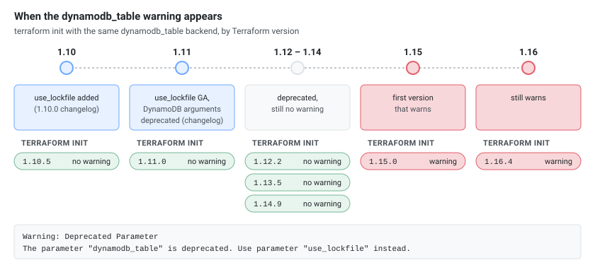

Since Terraform 1.15.0, `init`, `plan` and `apply` against an S3 backend that locks with DynamoDB print a warning about a deprecated parameter. Nothing fails, but the DynamoDB lock is on its way out and the replacement is a lock file stored in the S3 bucket itself. This guide shows the exact message, what it means, how the new lock works (with the real objects it creates), a safe migration in one change, and how to remove a stuck lock.

## 1. The Message

```text
Warning: Deprecated Parameter

  on main.tf line 16, in terraform:
  16:     dynamodb_table = "tf-locks"

The parameter "dynamodb_table" is deprecated. Use parameter "use_lockfile"
instead.
```

The same warning exists for the DynamoDB endpoint argument:

```text
The parameter "dynamodb_endpoint" is deprecated. Use parameter
"endpoints.dynamodb" instead.
```

Where it appears: `terraform init`, `terraform plan` and `terraform apply` each printed it once. `terraform validate` did not. Plan and apply still succeeded, so it is a warning, not an error.

**The warning is new in Terraform 1.15.0.** The arguments were deprecated in 1.11.0, but the versions before 1.15 say nothing. With the same `dynamodb_table` backend, `terraform init` printed:

[](tf-lock-warning-versions.svg "Open the diagram full size")

So a team that upgrades from 1.14 to 1.15 sees it for the first time, even though nothing in their configuration changed.

## 2. What It Means

HashiCorp's S3 backend documentation says that DynamoDB-based locking is deprecated and will be removed in a future minor version. Native S3 locking (`use_lockfile`) arrived in Terraform 1.10 and became generally available in 1.11.0, whose changelog also deprecated the DynamoDB arguments. The warning itself only arrived in 1.15.0 (section 1).

| Argument | Status |
|----------|--------|
| `use_lockfile` | The replacement. Locks with an object in the same bucket |
| `dynamodb_table` | Deprecated |
| `dynamodb_endpoint` | Deprecated, use `endpoints = { dynamodb = "..." }` |

### Not the other lock file

Terraform has two unrelated "lock files":

| File | What it locks | Where |
|------|---------------|-------|
| `.terraform.lock.hcl` | The **provider versions and checksums** your configuration was initialized with | Your working directory, commit it to Git. See [Terraform Lock File Checksums: zh and h1 Hashes]() |
| `terraform.tfstate.tflock` | The **state**, so two runs cannot write it at once | A temporary object in the S3 bucket, created by `use_lockfile` |

The deprecation message is about the second one.

## 3. Before and After

```hcl
terraform {
  backend "s3" {
    bucket         = "my-state-bucket"
    key            = "prod/terraform.tfstate"
    region         = "eu-west-1"
    encrypt        = true
    dynamodb_table = "terraform-locks"   # deprecated
  }
}
```

```hcl
terraform {
  backend "s3" {
    bucket       = "my-state-bucket"
    key          = "prod/terraform.tfstate"
    region       = "eu-west-1"
    encrypt      = true
    use_lockfile = true                  # lock object next to the state
  }
}
```

## 4. How the Native Lock Works

While an `apply` was running with `use_lockfile = true`, the bucket held two objects:

```text
demo/terraform.tfstate
demo/terraform.tfstate.tflock
```

The `.tflock` object is JSON that describes the lock:

```json
{"ID":"9cc00290-8f36-5046-ab0c-d45494e1180d","Operation":"OperationTypeApply","Info":"","Who":"user@host","Version":"1.16.4","Created":"2026-10-25T13:39:23.654217Z","Path":"tf-state/demo/terraform.tfstate"}
```

When the apply finished, the `.tflock` object was gone. It is created with a conditional write (`If-None-Match: *`), so a second Terraform run cannot create it while it exists. That requires an S3 store that supports conditional writes: the emulator used here did (a second upload with `If-None-Match` failed with `PreconditionFailed`), and AWS S3 does too.

The DynamoDB lock, for comparison, was an item whose `LockID` is the bucket and key (`tf-state/demo/terraform.tfstate`), plus a second item `tf-state/demo/terraform.tfstate-md5` that stores the state checksum and **stays** after the run.

[](tf-lock-two-locks.svg "Open the diagram full size")

## 5. What a Blocked Run Looks Like

With `use_lockfile` (the second `plan` while an `apply` held the lock):

```text
Error: Error acquiring the state lock

Error message: operation error S3: PutObject, https response error
StatusCode: 412, ...
api error PreconditionFailed: At least one of the pre-conditions you
specified did not hold
Lock Info:
  ID:        9cc00290-8f36-5046-ab0c-d45494e1180d
  Path:      tf-state/demo/terraform.tfstate
  Operation: OperationTypeApply
  Who:       user@host
  Version:   1.16.4
  Created:   2026-10-25 13:39:23.654217 +0000 UTC
```

With DynamoDB the error message ends in `ConditionalCheckFailedException: The conditional request failed`, with the same `Lock Info` block.

Useful options with `use_lockfile`:

```bash
terraform plan -lock-timeout=6s    # waits ("Acquiring state lock. This may take a few moments..."), gave up after exactly 6 s
terraform plan -lock=false         # reads without taking the lock (plan worked while the apply held it); never use it for apply
```

**By default a second run does not wait.** Without `-lock-timeout` it failed immediately (0.04 s against moto). Some guides say the second command "should wait"; that only happens with `-lock-timeout`, so set it in CI (for example `TF_CLI_ARGS_plan="-lock-timeout=5m"`, or pass the flag) if you want queued runs to wait for the lock. With `TF_CLI_ARGS_plan="-lock-timeout=30s"`, a `plan` started during an apply waited 7 s and then ran.

## 6. Migrate in One Change

Switch from `dynamodb_table` to `use_lockfile` in a single change, for every user and pipeline of the state at once.

**1. Check the Terraform version everywhere.** `use_lockfile` needs 1.10 or newer (generally available in 1.11). Check laptops and CI images with `terraform version`.

**2. Find every place that configures the backend.** `.tf` files, `.tfbackend` files and `-backend-config` arguments in pipelines (the `grep` commands in section 8).

**3. Check the S3 permissions of every identity that runs Terraform** (your user, the CI role), with that identity's credentials:

```bash
aws sts get-caller-identity                     # which identity the checks run as

# read the state: the backend needs this already
aws s3api head-object --bucket my-state-bucket --key prod/terraform.tfstate

# create the lock object the way Terraform does (conditional write), then remove it
touch empty
aws s3api put-object --bucket my-state-bucket --key prod/terraform.tfstate.tflock \
  --body empty --if-none-match '*'
aws s3api delete-object --bucket my-state-bucket --key prod/terraform.tfstate.tflock
```

The `put-object` returns an `ETag` when the identity may write the lock key and the store supports conditional writes. A second `put-object` with `--if-none-match '*'` while the object exists fails with `PreconditionFailed`, which is the behaviour Terraform relies on. `AccessDenied` on `put-object` or `delete-object` means a missing permission (see the IAM policy in section 8). Run this only while nothing runs against the state, and make sure the `delete-object` succeeds: a leftover `.tflock` blocks every run like a stale lock (section 7).

**4. Stop runs against the state.** Pause the pipelines and make sure nothing holds the DynamoDB lock. With nothing running, the table holds only the checksum item:

```bash
aws dynamodb scan --table-name terraform-locks --query 'Items[].LockID.S' --output text
# my-state-bucket/prod/terraform.tfstate-md5
```

A second item without `-md5` (`my-state-bucket/prod/terraform.tfstate`) is a run in progress.

**5. Replace `dynamodb_table` with `use_lockfile` and reinitialize.**

```hcl
    use_lockfile = true    # replaces dynamodb_table = "terraform-locks"
```

```bash
terraform init -reconfigure
```

A plain `terraform init` fails after this change:

```text
Error: Backend configuration changed

A change in the backend configuration has been detected, which may require
migrating existing state.

If you wish to attempt automatic migration of the state, run "terraform init
-migrate-state".

If you wish to store the current configuration with no changes to the state,
run "terraform init -reconfigure".
```

The state does not move, only the lock setting changed, so `-reconfigure` is the right choice. `plan` no longer prints the deprecation warning, and during an `apply` the bucket holds `terraform.tfstate.tflock`. Update the pipelines and `.tfbackend` files in the same change, then resume the pipelines.

**6. Delete the DynamoDB table later.** This removes the lock history and the checksum item for good and cannot be undone. Keep the table for a week or two as a way back, and delete it only after the change is merged everywhere and a few applies have run with the lock file. One forgotten repository that still points at the table will fail when someone uses it.

**The way back needs one extra step.** Lock-file-only runs don't update the checksum item (`<bucket>/<key>-md5`) that DynamoDB keeps, so after a few applies it no longer matches the state. Adding `dynamodb_table` back then fails on `init`:

```text
Error: Error refreshing state: state data in S3 does not have the expected content.

The checksum calculated for the state stored in S3 does not match the checksum
stored in DynamoDB.
```

If the state in S3 is the right one, delete the stale checksum item. `init` then works, and the next apply writes a new checksum:

```bash
aws dynamodb delete-item --table-name terraform-locks \
  --key '{"LockID":{"S":"my-state-bucket/prod/terraform.tfstate-md5"}}'
```

### IAM permissions

According to the backend documentation, with `use_lockfile` Terraform needs `s3:GetObject`, `s3:PutObject` and `s3:DeleteObject` on the lock object (the state key plus `.tflock`), in addition to the permissions on the state object. The DynamoDB permissions (`dynamodb:DescribeTable`, `GetItem`, `PutItem`, `DeleteItem`) are no longer needed once the table is removed.

## 7. Removing a Stuck Lock

If a run is killed (a CI job cancelled, a laptop closed), the lock can stay. After `kill -9` on a running apply, the `.tflock` object remained, and the next run printed the lock error with the lock ID.

```bash
terraform force-unlock <LOCK_ID>          # asks for "yes"; answering no printed "force-unlock cancelled."
terraform force-unlock -force <LOCK_ID>   # no prompt
```

```text
Terraform state has been successfully unlocked!
```

The `.tflock` object was removed and the next plan worked. Two safety points:

- **The ID must match.** A wrong ID is refused: `Failed to unlock state: lock ID '1234' does not match the existing lock ID '479ea5c2-...'`, followed by the lock info. Copy the ID from the `Lock Info` block (the line that starts with `ID:`), not from the `StatusCode: 412, RequestID: ...` line above it.
- **Only force-unlock a lock that is really dead.** Check `Who` and `Created` in the lock info first, and confirm that the run is not still going. Removing a live lock lets two runs write the state at the same time, which can corrupt it.

## 8. CI, Versioning and Finding Every Usage

### CI: pass the setting on the command line

A pipeline can switch on the lock file without editing the backend block, with a partial configuration:

```bash
terraform init -reconfigure -backend-config="use_lockfile=true"
```

With `use_lockfile` absent from `main.tf`, this created `terraform.tfstate.tflock` during an apply. A `.tfbackend` file (`terraform init -backend-config=prod.s3.tfbackend`) works the same way, so check those files too when you search for `dynamodb_table`.

### Removing dynamodb_table without adding use_lockfile means no lock

This is the easiest mistake in the migration. With **neither** setting, Terraform takes no lock at all: no `.tflock` object appeared during an apply, a second `plan` ran without any error, and `init -reconfigure` printed no warning. Every run that does not set `use_lockfile` after you drop the table is unprotected. Make `use_lockfile = true` part of the same change that removes `dynamodb_table`, and check for it in CI (next section).

### Find every backend that still needs migrating

```bash
# Still using the deprecated arguments (tf files, .tfbackend files, tfvars, HCL)
grep -rn -E 'dynamodb_table|dynamodb_endpoint' --include='*.tf' --include='*.tfbackend' --include='*.hcl' --include='*.tfvars' .

# S3 backends with no lock setting at all
for f in $(grep -rl 'backend "s3"' --include='*.tf' .); do
  grep -q -E 'use_lockfile|dynamodb_table' "$f" || echo "$f"
done
```

On a small tree with one file per case, the first command listed the `main.tf` with `dynamodb_table` and the `.tfbackend` file, the second the backend with no lock setting. They only see what is in files: a `use_lockfile` passed in a pipeline (previous section) is invisible to the second check, so keep one convention.

### S3 versioning keeps every lock object

Versioning on the state bucket is a good idea, because you can fetch an older state if a run goes wrong:

```bash
aws s3api list-object-versions --bucket my-state-bucket --prefix prod/terraform.tfstate
aws s3api get-object --bucket my-state-bucket --key prod/terraform.tfstate --version-id <version-id> old.tfstate
jq .serial old.tfstate        # compare with the current state's serial
```

Here the previous version had `serial` 2 and the current one 3. Restoring is a separate, careful step: copy it back, then run `terraform plan` before anything else.

But versioning has a side effect with `use_lockfile`: every apply creates and deletes a `.tflock` object, and on a versioned bucket each delete leaves a **noncurrent version and a delete marker**. After 3 applies the bucket held 3 `.tflock` versions and 3 delete markers (plus 3 versions of the state), while `aws s3 ls` showed only `terraform.tfstate`. The objects are tiny, but they pile up in version listings and make them noisy. A lifecycle rule can expire old noncurrent versions (a rule on the whole prefix also expires old **state** versions, so keep the retention long enough for rollbacks):

```hcl
resource "aws_s3_bucket_lifecycle_configuration" "state" {
  bucket = aws_s3_bucket.state.id

  rule {
    id     = "expire-old-versions"
    status = "Enabled"
    filter {}

    noncurrent_version_expiration {
      noncurrent_days = 90
    }
    expiration {
      expired_object_delete_marker = true
    }
  }
}
```

### Example IAM policy

Based on the permission list in the backend documentation. Lock object permissions are on the `.tflock` key, state permissions on the state key:

```json
{
  "Version": "2012-10-17",
  "Statement": [
    {
      "Effect": "Allow",
      "Action": "s3:ListBucket",
      "Resource": "arn:aws:s3:::my-state-bucket"
    },
    {
      "Effect": "Allow",
      "Action": ["s3:GetObject", "s3:PutObject"],
      "Resource": "arn:aws:s3:::my-state-bucket/prod/terraform.tfstate"
    },
    {
      "Effect": "Allow",
      "Action": ["s3:GetObject", "s3:PutObject", "s3:DeleteObject"],
      "Resource": "arn:aws:s3:::my-state-bucket/prod/terraform.tfstate.tflock"
    }
  ]
}
```

## Gotchas

- **No lock setting means no lock** (section 8). Dropping `dynamodb_table` without adding `use_lockfile` silently turns locking off.
- **Old Terraform versions ignore `use_lockfile`.** Mixed versions on one state defeat the lock. Pin the Terraform version in CI.
- **Going back to DynamoDB needs a fresh checksum.** After lock-file-only applies, delete the stale `-md5` item before re-adding `dynamodb_table` (section 6).
- **The `.tflock` object lives only during a run.** If you see it in the bucket with no run in progress, it is a stale lock (section 7).
- **`-lock=false` is for reading.** Do not use it with `apply` to get around a lock error.
- **A third-party S3-compatible store must support conditional writes** (`If-None-Match`) for `use_lockfile` to be safe. Check this before moving off DynamoDB.

## See Also

- [Terraform Lock File Checksums: zh and h1 Hashes]()
- [terraform.tfstate vs .terraform/terraform.tfstate]()
