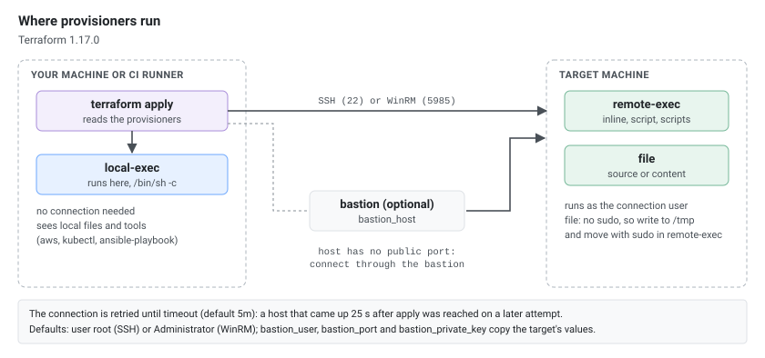
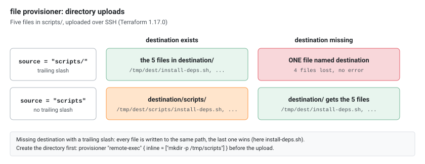
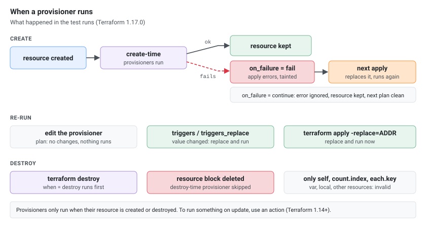

Provisioners execute scripts or commands on local or remote machines as part of resource creation or destruction. They are a last resort — prefer native resource arguments, cloud-init, or configuration management tools when possible.

Everything below was run on Terraform 1.17.0 with the hashicorp/aws 6.70.0 and hashicorp/null 3.3.2 providers.

## When to Use Provisioners

| Use Case | Better Alternative |
|----------|-------------------|
| Install packages on EC2 | `user_data` / cloud-init |
| Configure a server | Ansible, Chef, Puppet |
| Run a one-off script after creation | `local-exec` (acceptable) |
| Bootstrap a cluster | `null_resource` + `local-exec` |
| Upload a config file | `file` provisioner or `templatefile()` + `user_data` |

Provisioners should be used only when there is no declarative alternative available.

[](where-provisioners-run.svg "Open the diagram full size")

### The Declarative Alternative: user_data

The nginx install from the [remote-exec](#remote-exec) example, without SSH, keys or provisioners: the instance runs the script itself on its first boot (cloud-init).

```hcl
resource "aws_instance" "web" {
  ami           = "ami-0c55b159cbfafe1f0"
  instance_type = "t3.micro"

  user_data = <<-EOF
    #!/bin/bash
    apt-get update
    apt-get install -y nginx
    systemctl enable --now nginx
  EOF
}
```

Changing the script later is only an in-place update:

```text
  # aws_instance.web will be updated in-place
      ~ user_data                            = <<-EOT
Plan: 0 to add, 1 to change, 0 to destroy.
```

cloud-init runs user data scripts on the first boot only, so the new script would not run on the existing instance. Set `user_data_replace_on_change = true` to get a new instance instead:

```text
  # aws_instance.web must be replaced
      ~ user_data                            = <<-EOT # forces replacement
Plan: 1 to add, 0 to change, 1 to destroy.
```

## local-exec

Runs a command on the machine where Terraform is executed (your workstation or CI runner). Does not require any connectivity to the target resource.

```hcl
variable "environment" {
  type    = string
  default = "dev"
}

resource "aws_instance" "web" {
  ami           = "ami-0c55b159cbfafe1f0"
  instance_type = "t3.micro"

  tags = {
    Name = "web-${var.environment}"
  }

  provisioner "local-exec" {
    command = "echo 'Instance ${self.id} created in ${var.environment}' >> instances.log"
  }
}
# Result: appends the instance ID to a local log file after creation
```

### local-exec with Working Directory and Environment Variables

```hcl
resource "aws_instance" "app" {
  ami           = "ami-0c55b159cbfafe1f0"
  instance_type = "t3.micro"

  provisioner "local-exec" {
    command     = "./deploy.sh"
    working_dir = "${path.module}/scripts"

    environment = {
      INSTANCE_ID = self.id
      ENVIRONMENT = var.environment
      PRIVATE_IP  = self.private_ip
    }
  }
}
# Result: runs deploy.sh from the scripts/ directory with env vars set
```

### local-exec with Interpreter

Use a specific shell or scripting language.

```hcl
# Run a Python script: the script and its flags go in interpreter,
# command becomes the last argument
resource "null_resource" "python_script" {
  provisioner "local-exec" {
    command     = var.environment
    interpreter = ["python3", "scripts/process_data.py", "--env"]
  }
}

# Inline Python (passed to -c)
resource "null_resource" "python_inline" {
  provisioner "local-exec" {
    command     = "import json; print(json.dumps({'env': '${var.environment}'}))"
    interpreter = ["python3", "-c"]
  }
}

# PowerShell on Windows (PowerShell 7 on Linux/macOS is "pwsh")
resource "null_resource" "windows_script" {
  provisioner "local-exec" {
    command     = "Get-Date | Out-File -Append provisioner.log"
    interpreter = ["PowerShell", "-Command"]
  }
}

# Bash explicit
resource "null_resource" "bash_script" {
  provisioner "local-exec" {
    command     = "echo $HOSTNAME && date"
    interpreter = ["/bin/bash", "-c"]
  }
}
```

Terraform passes `command` as **one** argument after the interpreter list. With `interpreter = ["python3"]` and `command = "scripts/process_data.py --env dev"`, it runs:

```text
null_resource.python_script (local-exec): Executing: ["python3" "scripts/process_data.py --env dev"]
null_resource.python_script (local-exec): /Library/Developer/CommandLineTools/usr/bin/python3: can't open file '.../scripts/process_data.py --env dev': [Errno 2] No such file or directory
```

Python looks for a file whose name includes ` --env dev`. Put the script and its fixed flags in `interpreter` instead, as above:

```text
null_resource.python_script (local-exec): Executing: ["python3" "scripts/process_data.py" "--env" "dev"]
null_resource.python_script (local-exec): process_data.py args: ['--env', 'dev']
```

The inline variant works because `-c` takes exactly one argument (`{"env": "dev"}`), and so does `/bin/bash -c`. Without `interpreter`, the command runs through `/bin/sh -c` on Linux and macOS.

## remote-exec

Runs commands on the remote resource via SSH or WinRM. Requires a `connection` block.

```hcl
variable "ssh_key_path" {
  type        = string
  default     = "~/.ssh/id_rsa"
  description = "Path to the private SSH key"
}

variable "ssh_user" {
  type    = string
  default = "ubuntu"
}

resource "aws_instance" "web" {
  ami           = "ami-0c55b159cbfafe1f0"
  instance_type = "t3.micro"
  key_name      = "my-key"

  connection {
    type        = "ssh"
    user        = var.ssh_user
    private_key = file(var.ssh_key_path)
    host        = self.public_ip
  }

  provisioner "remote-exec" {
    inline = [
      "set -e", # stop at the first failing command
      "sudo apt-get update",
      "sudo apt-get install -y nginx",
      "sudo systemctl enable --now nginx",
    ]
  }
}
# Result: installs and starts nginx on the new instance via SSH
```

Terraform writes the `inline` list to one script (`/tmp/terraform_<random>.sh`) and only looks at its exit code, which is the exit code of the **last** command. A failure in the middle is ignored:

```hcl
inline = ["echo step one", "false", "echo step three ran anyway"]
```

```text
terraform_data.web (remote-exec): step one
terraform_data.web (remote-exec): step three ran anyway
Apply complete! Resources: 1 added, 0 changed, 0 destroyed.
```

With `"set -e"` as the first line, the same list stops at `false`:

```text
terraform_data.web (remote-exec): step one
Error: remote-exec provisioner error
error executing "/tmp/terraform_917870617.sh": Process exited with status 1
```

`remote-exec` waits for SSH by itself: it keeps retrying the connection until the connection `timeout` (default `5m`). A container that started 25 seconds after `terraform apply` was reached on a later attempt:

```text
terraform_data.wait (remote-exec): Connecting to remote host via SSH...
terraform_data.wait: Still creating... [00m30s elapsed]
terraform_data.wait (remote-exec): Connecting to remote host via SSH...
terraform_data.wait (remote-exec): ready on c00b17b04f17
terraform_data.wait: Creation complete after 31s
```

### remote-exec with Script File

```hcl
resource "aws_instance" "app" {
  ami           = "ami-0c55b159cbfafe1f0"
  instance_type = "t3.micro"
  key_name      = "my-key"

  connection {
    type        = "ssh"
    user        = "ec2-user"
    private_key = file("~/.ssh/id_rsa")
    host        = self.public_ip
  }

  provisioner "remote-exec" {
    script = "${path.module}/scripts/bootstrap.sh"
  }
}
# Result: uploads and executes bootstrap.sh on the remote instance
```

### remote-exec with Multiple Scripts

```hcl
resource "aws_instance" "app" {
  ami           = "ami-0c55b159cbfafe1f0"
  instance_type = "t3.micro"
  key_name      = "my-key"

  connection {
    type        = "ssh"
    user        = "ec2-user"
    private_key = file("~/.ssh/id_rsa")
    host        = self.public_ip
  }

  provisioner "remote-exec" {
    scripts = [
      "${path.module}/scripts/install-deps.sh",
      "${path.module}/scripts/configure-app.sh",
      "${path.module}/scripts/start-service.sh",
    ]
  }
}
# Result: runs all three scripts in order on the remote machine
```

## file Provisioner

Copies files or directories from the local machine to the remote resource.

```hcl
resource "aws_instance" "app" {
  ami           = "ami-0c55b159cbfafe1f0"
  instance_type = "t3.micro"
  key_name      = "my-key"

  connection {
    type        = "ssh"
    user        = "ubuntu"
    private_key = file("~/.ssh/id_rsa")
    host        = self.public_ip
  }

  # The file provisioner uploads as the SSH user: no sudo, and a directory
  # upload needs an existing destination. Create it first.
  provisioner "remote-exec" {
    inline = ["mkdir -p /tmp/scripts"]
  }

  # Copy a single file
  provisioner "file" {
    source      = "${path.module}/configs/app.conf"
    destination = "/tmp/app.conf"
  }

  # Copy the contents of a directory (trailing slash on source)
  provisioner "file" {
    source      = "${path.module}/scripts/"
    destination = "/tmp/scripts"
  }

  # Use content instead of a file (inline content)
  provisioner "file" {
    content = templatefile("${path.module}/templates/config.tpl", {
      db_host = aws_db_instance.main.endpoint
      db_name = "myapp"
    })
    destination = "/tmp/config.yml"
  }

  # Move everything into place with sudo, then run the copied script
  provisioner "remote-exec" {
    inline = [
      "sudo mkdir -p /opt/scripts /etc/myapp",
      "sudo mv /tmp/scripts/* /opt/scripts/",
      "sudo mv /tmp/app.conf /tmp/config.yml /etc/myapp/",
      "sudo chmod +x /opt/scripts/*.sh",
      "sudo /opt/scripts/setup.sh",
    ]
  }
}
# Result: uploads config and scripts, then executes them remotely
```

The `file` provisioner writes as the connection user and has no `sudo`. Uploading straight to `/opt/scripts`, as many examples do, fails for any user other than root:

```text
Error: file provisioner error

Upload failed: scp: /opt/scripts: Permission denied
```

Upload to a directory the user can write (`/tmp`, the home directory), then move the files with `sudo` in `remote-exec`. With that, the run above ended with `setup.sh ran as root`.

### Directory Uploads: the Trailing Slash

Whether `source` ends in `/` and whether `destination` already exists decide where the files land. Uploading a local `scripts/` directory with five files:

| `source` | `destination` | Result on the remote host |
|----------|---------------|---------------------------|
| `scripts/` | exists | the five files in `destination/` |
| `scripts/` | missing | **one file** named `destination`, the others lost, no error |
| `scripts` | exists | `destination/scripts/` with the five files |
| `scripts` | missing | `destination/` with the five files |

The second row is the trap: each file is written to the same path, so `/tmp/with-slash` ended up as a single file holding `install-deps.sh`. Create the destination first, as in the example above.

[](file-trailing-slash.svg "Open the diagram full size")

## Connection Block

Defines how Terraform connects to the remote resource for `remote-exec` and `file` provisioners.

### SSH Connection

```hcl
connection {
  type        = "ssh"
  user        = "ubuntu"
  private_key = file("~/.ssh/id_rsa")
  host        = self.public_ip
  port        = 22
  timeout     = "5m"
}
```

### SSH via Bastion Host

```hcl
connection {
  type        = "ssh"
  user        = "ec2-user"
  private_key = file("~/.ssh/id_rsa")
  host        = self.private_ip

  bastion_host        = var.bastion_ip
  bastion_user        = "ec2-user"
  bastion_private_key = file("~/.ssh/bastion_key")
}
```

### WinRM Connection (Windows)

```hcl
connection {
  type     = "winrm"
  user     = "Administrator"
  password = var.admin_password
  host     = self.public_ip
  port     = 5986
  https    = true
  insecure = true
  timeout  = "10m"
}
```

### Connection Reference

| Argument | Description |
|----------|-------------|
| `type` | `ssh` (default) or `winrm` |
| `user` | Remote username (default: `root` for SSH, `Administrator` for WinRM) |
| `private_key` | SSH private key content, usually `file("~/.ssh/id_rsa")` |
| `password` | Password (SSH or WinRM) |
| `host` | Target host IP or hostname (required) |
| `port` | Connection port (default: 22 for SSH, 5985 for WinRM; set 5986 with `https = true`) |
| `timeout` | How long to keep retrying the connection (default: `5m`) |
| `bastion_host` | Bastion/jump host for SSH |
| `bastion_port` | Bastion port (default: the value of `port`) |
| `bastion_user` | Bastion username (default: the value of `user`) |
| `bastion_private_key` | Bastion SSH key (default: the value of `private_key`) |
| `agent` | Use the SSH agent (`true`/`false`) |
| `host_key` | Expected remote host key; without it the host key is not checked |

The bastion example ran against a container with no published port, reachable only through the bastion: `reached a1e18a2071e7 via the bastion`. When the bastion uses the same user and key as the target, `bastion_user` and `bastion_private_key` can be left out.

### Ephemeral Keys (Terraform 1.10+)

A key passed in a variable can be `ephemeral`: Terraform uses it during the run and never writes it anywhere.

```hcl
variable "ssh_private_key" {
  type      = string
  ephemeral = true
}

variable "host" {
  type = string
}

resource "terraform_data" "web" {
  connection {
    type        = "ssh"
    user        = "deploy"
    host        = var.host
    private_key = var.ssh_private_key
  }

  provisioner "remote-exec" {
    inline = ["echo connected as $(whoami)"]
  }
}
```

```sh
TF_VAR_ssh_private_key="$(cat ~/.ssh/id_ed25519)" terraform apply
```

Connection settings are never stored in state, so the key is not in `terraform.tfstate` either way. The difference is a saved plan: with the variable `sensitive` instead, `terraform plan -out=plan.tfplan` wrote the key into the plan file; with `ephemeral` it did not. Applying the saved plan then needs the variable again:

```text
Error: No value for required variable

The ephemeral input variable "ssh_private_key" was set during the plan phase,
and so must also be set during the apply phase.
```

## Provisioners Run Only When the Resource Is Created

Changing a provisioner's `command` or script does **not** re-run it. After changing `echo first version` to `echo second version`, `terraform plan` reports:

```text
Terraform has compared your real infrastructure against your configuration
and found no differences, so no changes are needed.
```

The new command only runs when the resource is replaced: `terraform apply -replace=terraform_data.x`, or through `triggers` / `triggers_replace` below.

## null_resource and triggers

`null_resource` doesn't create infrastructure — it exists only to run provisioners. Use `triggers` to control when it re-executes.

```hcl
variable "app_version" {
  type        = string
  default     = "1.0.0"
  description = "Application version to deploy"
}

resource "null_resource" "deploy" {
  triggers = {
    app_version = var.app_version
    script_hash = filemd5("${path.module}/scripts/deploy.sh")
  }

  provisioner "local-exec" {
    command = "./scripts/deploy.sh ${var.app_version}"
  }
}
# Result: re-runs deploy.sh whenever app_version changes or deploy.sh is modified
```

Run four times in a row: the first apply runs `deploying version 1.0.0`, a second apply with no changes runs nothing, `-var app_version=1.1.0` replaces the resource and runs `deploying version 1.1.0`, and so does editing `deploy.sh` with the same version (`filemd5` changed).

### Common Trigger Patterns

```hcl
# Re-run when any instance changes
resource "null_resource" "post_deploy" {
  triggers = {
    instance_ids = join(",", aws_instance.app[*].id)
  }

  provisioner "local-exec" {
    command = "ansible-playbook -i inventory.ini site.yml"
  }
}

# Re-run every apply (always trigger)
resource "null_resource" "always_run" {
  triggers = {
    always = timestamp()
  }

  provisioner "local-exec" {
    command = "echo 'This runs every apply at ${timestamp()}'"
  }
}

# Re-run when a file changes (scp to /tmp first: a non-root user
# cannot write to /etc/app, "scp: failed to upload file")
resource "null_resource" "config_update" {
  triggers = {
    config_hash = filemd5("${path.module}/configs/app.conf")
  }

  provisioner "local-exec" {
    command = <<-EOT
      scp configs/app.conf ubuntu@${aws_instance.app.public_ip}:/tmp/app.conf
      ssh ubuntu@${aws_instance.app.public_ip} 'sudo mkdir -p /etc/app && sudo mv /tmp/app.conf /etc/app/'
    EOT
  }
}
```

## terraform_data (Terraform 1.4+ Replacement for null_resource)

`terraform_data` is the built-in replacement for `null_resource` — no `hashicorp/null` provider needed.

```hcl
resource "terraform_data" "deploy" {
  triggers_replace = [
    var.app_version,
    filemd5("${path.module}/scripts/deploy.sh"),
  ]

  provisioner "local-exec" {
    command = "./scripts/deploy.sh ${var.app_version}"
  }
}
# Result: same behavior as null_resource but no external provider required
```

### terraform_data with input/output

```hcl
resource "terraform_data" "bootstrap" {
  input = aws_instance.web.public_ip

  provisioner "local-exec" {
    command = "ssh ubuntu@${self.output} 'sudo apt-get update && sudo apt-get install -y nginx'"
  }
}
# self.output exposes the input value for use in provisioners
```

[](provisioner-lifecycle.svg "Open the diagram full size")

## Provisioner Failure Behavior

### on_failure = continue

By default, a provisioner failure taints the resource. Use `on_failure = continue` to ignore errors.

```hcl
resource "aws_instance" "web" {
  ami           = "ami-0c55b159cbfafe1f0"
  instance_type = "t3.micro"

  provisioner "local-exec" {
    command    = "optional-notification.sh ${self.id}"
    on_failure = continue
  }
}
# Result: if the script fails, Terraform continues without tainting the resource
```

### on_failure = fail (default)

```hcl
resource "aws_instance" "web" {
  ami           = "ami-0c55b159cbfafe1f0"
  instance_type = "t3.micro"

  provisioner "remote-exec" {
    inline     = ["sudo /opt/setup.sh"]
    on_failure = fail
  }
}
# Result: if setup.sh fails, the resource is tainted and will be recreated on next apply
```

A failing inline command stops the apply with:

```text
Error: remote-exec provisioner error

error executing "/tmp/terraform_446951288.sh": Process exited with status 1
```

and the next plan shows `# terraform_data.inline is tainted, so must be replaced`. With `on_failure = continue`, the same kind of failure (`/bin/sh: optional-notification.sh: command not found`) left the instance untainted and the next plan clean.

## Destroy-Time Provisioners

Run cleanup commands when a resource is destroyed.

```hcl
resource "aws_instance" "web" {
  ami           = "ami-0c55b159cbfafe1f0"
  instance_type = "t3.micro"

  provisioner "local-exec" {
    command = "echo 'Instance ${self.id} created' >> lifecycle.log"
  }

  provisioner "local-exec" {
    when    = destroy
    command = "echo 'Instance ${self.id} destroyed' >> lifecycle.log"
  }
}
# Result: logs both creation and destruction events
# Destroy-time provisioners can only reference self, count.index and each.key
```

`terraform destroy` leaves both lines in the log:

```text
Instance i-4de96e2fc8633a0ab created
Instance i-4de96e2fc8633a0ab destroyed
```

But a destroy-time provisioner only runs while its resource block is still in the configuration. Deleting the block and running `terraform apply` destroyed the instance and left the log empty. Remove the provisioner's resource with `terraform destroy -target=...` first, or keep the block until the resource is gone.

### Limitations of Destroy-Time Provisioners

```hcl
# VALID — uses self.*
provisioner "local-exec" {
  when    = destroy
  command = "deregister-instance.sh ${self.id} ${self.private_ip}"
}

# INVALID — cannot reference other resources
# provisioner "local-exec" {
#   when    = destroy
#   command = "cleanup.sh ${aws_eip.web.public_ip}"  # ERROR
# }

# INVALID — cannot reference variables
# provisioner "local-exec" {
#   when    = destroy
#   command = "cleanup.sh ${var.environment}"  # ERROR
# }
```

`terraform validate` rejects the invalid ones (the same for `local.*`):

```text
Error: Invalid reference from destroy provisioner

  on main.tf line 14, in resource "aws_instance" "app":
  14:     command = "echo cleanup ${var.environment}"

Destroy-time provisioners and their connection configurations may only
reference attributes of the related resource, via 'self', 'count.index', or
'each.key'.

References to other resources during the destroy phase can cause dependency
cycles and interact poorly with create_before_destroy.
```

`count.index` and `each.key` are allowed. To use a variable at destroy time, copy it into the resource first, for example into a tag or `terraform_data`'s `input`, and read it through `self`.

## Terraform Actions (1.14+): Commands on Update Too

Actions are the newer way to run an imperative step from Terraform. An `action` block describes the step; a resource's `lifecycle` triggers it, or you run it by hand. Unlike provisioners, an action can run when a resource is **updated**, not only created or destroyed. Providers ship the actions: hashicorp/local 2.9.1 has `local_command`, hashicorp/aws 6.70.0 has 12, from `aws_lambda_invoke` and `aws_sns_publish` to `aws_ec2_stop_instance`.

```hcl
terraform {
  required_providers {
    local = {
      source  = "hashicorp/local"
      version = "2.9.1"
    }
  }
}

variable "app_version" {
  type    = string
  default = "1.0.0"
}

resource "terraform_data" "app" {
  input = var.app_version

  lifecycle {
    action_trigger {
      events  = [after_create, after_update]
      actions = [action.local_command.deploy]
    }
  }
}

action "local_command" "deploy" {
  config {
    command   = "bash"
    arguments = ["-c", "echo deploying version $APP_VERSION"]
    environment = {
      APP_VERSION = var.app_version
    }
  }
}
```

The first apply runs it after the create:

```text
terraform_data.app: Creating...
Action started: action.local_command.deploy (triggered by terraform_data.app)
Action action.local_command.deploy (triggered by terraform_data.app):
deploying version 1.0.0
Action complete: action.local_command.deploy (triggered by terraform_data.app)
terraform_data.app: Creation complete after 0s [id=ed0230ae-534c-771c-16c4-05b1e28acdf0]
Apply complete! Resources: 1 added, 0 changed, 0 destroyed. Actions: 1 invoked.
```

An apply with no changes runs nothing. `-var app_version=1.1.0` is an **in-place update**, nothing is replaced, and the action runs again:

```text
Plan: 0 to add, 1 to change, 0 to destroy. Actions: 1 to invoke.
deploying version 1.1.0
Apply complete! Resources: 0 added, 1 changed, 0 destroyed. Actions: 1 invoked.
```

Run an action by hand with `-invoke`, without changing anything:

```sh
terraform apply -invoke=action.local_command.deploy
# Action started: action.local_command.deploy (triggered by CLI)
# deploying version 1.1.0
# Apply complete! Resources: 0 added, 0 changed, 0 destroyed. Actions: 1 invoked.
```

A provider action works the same way. Against moto, `aws_ec2_stop_instance` stopped the instance (`describe-instances` then reported `stopped`):

```hcl
action "aws_ec2_stop_instance" "web" {
  config {
    instance_id = aws_instance.web.id
  }
}
```

```text
Action action.aws_ec2_stop_instance.web (triggered by CLI): Sending stop command to EC2 instance i-2c41acad5ec7abec7...
Action action.aws_ec2_stop_instance.web (triggered by CLI): EC2 instance i-2c41acad5ec7abec7 has been successfully stopped
```

### Action Failures and Destroy Events

`action_trigger` takes `on_failure` (Terraform 1.16+). The default differs from provisioners: a failing action does **not** taint the resource. With an action that runs `exit 3`:

| `on_failure` | `terraform apply` | Resource |
|--------------|-------------------|----------|
| not set (`halt`) | `Error: Command Execution Failed`, exit code 1 | kept, next plan: no changes |
| `taint` | same error, exit code 1 | tainted, next plan replaces it and runs the action again |
| `continue` | `Warning: Command Execution Failed`, exit code 0, `Actions: 1 invoked, 1 failed.` | kept |

`before_destroy` and `after_destroy` events (1.16+) replace destroy-time provisioners, with the same catch: `terraform destroy` ran a `before_destroy` action (`draining before destroy`), but deleting the resource block destroyed the resource without running it.

| | Provisioner | Action |
|---|---|---|
| Runs on create | yes | `after_create` / `before_create` |
| Runs on update | no | `after_update` / `before_update` |
| Runs on destroy | `when = destroy` | `before_destroy` / `after_destroy` |
| Run by hand | `-replace` (recreates the resource) | `-invoke=action.TYPE.NAME` |
| Default on failure | taint | halt, no taint |
| Comes from | Terraform core (3 types) | providers (`local_command`, `aws_*`, ...) |

Actions run where the provider runs (your machine or the CI runner), so there is no `remote-exec` equivalent; for commands on the target, keep using `remote-exec` or move them to `user_data`.

## Practical Examples

### Format Disk, Install and Serve a Web Page

```hcl
resource "aws_instance" "web" {
  ami           = "ami-0c55b159cbfafe1f0"
  instance_type = "t3.micro"
  key_name      = "my-key"
}

resource "aws_ebs_volume" "data" {
  availability_zone = aws_instance.web.availability_zone
  size              = 10
}

resource "aws_volume_attachment" "data" {
  device_name = "/dev/xvdh"
  volume_id   = aws_ebs_volume.data.id
  instance_id = aws_instance.web.id
}

# Runs after the volume is attached. A provisioner inside aws_instance
# would run before the attachment exists, and mkfs would find no disk.
resource "terraform_data" "web_disk" {
  depends_on = [aws_volume_attachment.data]

  connection {
    type        = "ssh"
    user        = "ec2-user"
    private_key = file("~/.ssh/id_rsa")
    host        = aws_instance.web.public_ip
  }

  provisioner "remote-exec" {
    inline = [
      "sudo mkfs.xfs /dev/xvdh",
      "sudo yum install httpd -y",
      "sudo mount /dev/xvdh /var/www/html",
      "sudo sh -c \"echo 'Terraform Server Running' > /var/www/html/index.html\"",
      "sudo systemctl restart httpd",
    ]
  }
}
# Result: formats an attached EBS volume, installs Apache, mounts it, and serves a page
```

The apply runs in the order instance, volume, attachment, then `terraform_data.web_disk: Provisioning with 'remote-exec'`. On Nitro instance types such as t3 the volume shows up as an NVMe device (`/dev/nvme1n1`); Amazon Linux adds a link with the name from `device_name`, other distributions may not. The mount is also not persistent: add it to `/etc/fstab` or, better, do all of this in `user_data`.

### Run kubectl Commands

```hcl
variable "kubeconfig" {
  type        = string
  sensitive   = true
  description = "Base64-encoded kubeconfig content"
}

variable "command" {
  type        = string
  default     = "get nodes"
  description = "kubectl command to run"
}

resource "null_resource" "kubectl" {
  provisioner "local-exec" {
    command     = "kubectl ${var.command} --kubeconfig <(echo $KUBECONFIG | base64 --decode)"
    interpreter = ["/bin/bash", "-c"]

    environment = {
      KUBECONFIG = var.kubeconfig
    }
  }
}
# Result: runs a kubectl command using a kubeconfig passed as a variable
# Uses process substitution to avoid writing the kubeconfig to disk
```

Because `kubeconfig` is `sensitive`, Terraform hides the command's output:

```text
null_resource.kubectl (local-exec): (output suppressed due to sensitive value in config)
```

Without `sensitive`, `-var 'command=config current-context'` printed the context name (`demo`) and no kubeconfig file was written to disk.

### Install kubectl and Configure EKS

```hcl
variable "region" {
  type    = string
  default = "us-west-2"
}

variable "cluster_name" {
  type        = string
  description = "EKS cluster name"
}

resource "null_resource" "kubectl_setup" {
  provisioner "local-exec" {
    command = <<-EOF
      set -e
      mkdir -p ~/bin
      cd ~/bin
      curl -O https://s3.us-west-2.amazonaws.com/amazon-eks/1.30.4/2024-09-11/bin/linux/amd64/kubectl
      chmod +x ./kubectl
      aws eks --region ${var.region} update-kubeconfig --name ${var.cluster_name}
    EOF
  }
}
# Result: downloads kubectl binary and configures kubeconfig for the EKS cluster
```

`cd ~/bin` alone fails under `set -e` when the directory doesn't exist, hence the `mkdir -p`. The URL is the Linux x86-64 binary, so this only works on a Linux amd64 runner, and kubectl should be within one minor version of the cluster. `aws eks update-kubeconfig` (AWS CLI 2.37.7, against moto) prints `Added new context arn:aws:eks:us-west-2:123456789012:cluster/demo to <kubeconfig path>`.

### Run Ansible After Instance Creation

```hcl
variable "ansible_playbook" {
  type    = string
  default = "site.yml"
}

resource "aws_instance" "app" {
  ami           = "ami-0c55b159cbfafe1f0"
  instance_type = "t3.micro"

  tags = {
    Name = "app-server"
  }
}

resource "null_resource" "ansible" {
  triggers = {
    instance_id   = aws_instance.app.id
    playbook_hash = filemd5("${path.module}/${var.ansible_playbook}")
  }

  provisioner "local-exec" {
    command = <<-EOT
      ANSIBLE_HOST_KEY_CHECKING=False \
      ansible-playbook \
        -i '${aws_instance.app.public_ip},' \
        -u ubuntu \
        --private-key ~/.ssh/id_rsa \
        ${var.ansible_playbook}
    EOT
  }

  depends_on = [aws_instance.app]
}
# Result: runs the playbook after the instance is ready, re-runs if playbook changes
```

The resource being created doesn't mean SSH is up yet. Put a `remote-exec` with a `connection` block first (it waits, see [remote-exec](#remote-exec)), or the loop in [Wait for Instance to be Ready](#wait-for-instance-to-be-ready). Pointed at a running host, the command above ends with `ok=3 changed=1 unreachable=0 failed=0`.

### Register Instance with Load Balancer

```hcl
resource "aws_instance" "web" {
  count         = 3
  ami           = "ami-0c55b159cbfafe1f0"
  instance_type = "t3.micro"
}

resource "null_resource" "register_lb" {
  triggers = {
    instance_ids = join(",", aws_instance.web[*].id)
  }

  provisioner "local-exec" {
    command = <<-EOT
      aws elbv2 register-targets \
        --target-group-arn ${aws_lb_target_group.web.arn} \
        --targets ${join(" ", [for i in aws_instance.web : "Id=${i.id}"])}
    EOT
  }
}

variable "vpc_id" {
  type = string
}

resource "aws_lb_target_group" "web" {
  name     = "web"
  port     = 80
  protocol = "HTTP"
  vpc_id   = var.vpc_id
}
```

All three instance IDs were registered (`aws elbv2 describe-target-health` listed them). The declarative way is one `aws_lb_target_group_attachment` per instance, which also deregisters them when they are destroyed; this provisioner never does.

### Wait for Instance to be Ready

```hcl
resource "aws_instance" "app" {
  ami           = "ami-0c55b159cbfafe1f0"
  instance_type = "t3.micro"
}

resource "null_resource" "wait_for_instance" {
  depends_on = [aws_instance.app]

  provisioner "local-exec" {
    command = <<-EOT
      until ssh -o StrictHostKeyChecking=no -o ConnectTimeout=5 \
        ubuntu@${aws_instance.app.public_ip} "echo ready" 2>/dev/null; do
        echo "Waiting for SSH..."
        sleep 10
      done
    EOT
  }
}
# Result: blocks until SSH is available on the new instance
```

`remote-exec` does the same without a hand-written loop, see [remote-exec](#remote-exec).

### Generate Inventory File

```hcl
variable "instance_count" {
  type    = number
  default = 2
}

resource "aws_instance" "app" {
  count         = var.instance_count
  ami           = "ami-0c55b159cbfafe1f0"
  instance_type = "t3.micro"
}

resource "null_resource" "inventory" {
  triggers = {
    instance_ips = join(",", aws_instance.app[*].public_ip)
  }

  provisioner "local-exec" {
    command = <<-EOT
      cat > inventory.ini << EOF
      [app_servers]
      ${join("\n", [for ip in aws_instance.app[*].public_ip : "${ip} ansible_user=ubuntu"])}
      EOF
    EOT
  }
}
# Result: generates an Ansible inventory file with all instance IPs
```

With two instances it writes:

```ini
[app_servers]
54.214.229.83 ansible_user=ubuntu
54.214.29.189 ansible_user=ubuntu
```

Without the `variable "instance_count"` block, `terraform validate` fails with `Reference to undeclared input variable`. The `local_file` resource with `templatefile()` writes the same file without a shell.

## self Reference

Inside a provisioner, `self` refers to the parent resource's attributes.

```hcl
resource "aws_instance" "web" {
  ami           = "ami-0c55b159cbfafe1f0"
  instance_type = "t3.micro"

  provisioner "local-exec" {
    command = <<-EOT
      echo "ID:         ${self.id}"
      echo "Public IP:  ${self.public_ip}"
      echo "Private IP: ${self.private_ip}"
      echo "AZ:         ${self.availability_zone}"
      echo "Subnet:     ${self.subnet_id}"
    EOT
  }
}
# self.* gives access to all computed attributes of the resource
```

```text
aws_instance.web (local-exec): ID:         i-6e6fb0d94bcd14586
aws_instance.web (local-exec): Public IP:  54.214.238.28
aws_instance.web (local-exec): Private IP: 10.112.237.202
aws_instance.web (local-exec): AZ:         us-east-1a
aws_instance.web (local-exec): Subnet:     subnet-a3b15acd404d5d4ea
```

## Debugging Provisioners

`TF_LOG=DEBUG` shows what a provisioner does over SSH. For an `inline` list ending in `false`:

```sh
TF_LOG=DEBUG TF_LOG_PATH=tf.log terraform apply
```

```text
[DEBUG] Connecting to 127.0.0.1:2222 for SSH
[DEBUG] Beginning file upload...
[DEBUG] starting remote command: chmod 0777 /tmp/terraform_733916669.sh
[DEBUG] remote command exited with '0': chmod 0777 /tmp/terraform_733916669.sh
[DEBUG] starting remote command: /tmp/terraform_733916669.sh
[DEBUG] remote command exited with '1': /tmp/terraform_733916669.sh
[WARN]  Errors while provisioning terraform_data.web with "remote-exec", so aborting
```

The script name changes on every run; set `script_path` in the `connection` block to choose it, for example when `/tmp` is mounted `noexec`.

## Best Practices

1. **Prefer declarative alternatives** — use `user_data`, cloud-init, or Packer images instead of provisioners
2. **Use `null_resource` / `terraform_data`** for provisioners that aren't tied to a specific resource lifecycle
3. **Set `triggers`** so provisioners re-run when relevant inputs change
4. **Use `on_failure = continue`** for non-critical operations (notifications, logging)
5. **Keep provisioners idempotent** — scripts should be safe to run multiple times
6. **Avoid destroy-time provisioners** when possible — they can't reference variables or other resources
7. **Use `terraform_data`** (1.4+) instead of `null_resource` to avoid the null provider dependency
8. **Timeout considerations** — provisioners have no built-in timeout; add `timeout` to the connection or wrap commands with `timeout`
9. **Keep secrets out of commands and plans** — pass them through `environment` and mark the variable `sensitive` (Terraform then prints `(output suppressed due to sensitive value in config)`), and make keys `ephemeral` so they stay out of saved plans
10. **Changing a provisioner doesn't re-run it** — use `triggers` / `triggers_replace` or `terraform apply -replace=...`
11. **Start `inline` lists with `set -e`** — otherwise only the last command's exit code counts
12. **Consider an action** (1.14+) for steps that should also run on update or on demand

## Quick Reference

| Provisioner | Runs On | Use Case |
|-------------|---------|----------|
| `local-exec` | Terraform machine | Run CLI tools, scripts, notifications |
| `remote-exec` | Target resource | Bootstrap, install packages, configure |
| `file` | Target resource | Upload config files, scripts |

| Argument | Description |
|----------|-------------|
| `when = create` | Run on creation (default) |
| `when = destroy` | Run on destruction |
| `on_failure = fail` | Taint resource on error (default) |
| `on_failure = continue` | Ignore errors and proceed |
| `self.*` | Reference parent resource attributes |
| `triggers` | Map that forces re-creation when values change (null_resource) |
| `triggers_replace` | List that forces replacement (terraform_data) |

Related: [Terraform Cheatsheet](), [What's New in Terraform]() (`terraform_data` in 1.4, Actions in 1.14), [Ansible Cheatsheet]() and [Ansible Inventory Guide]().
