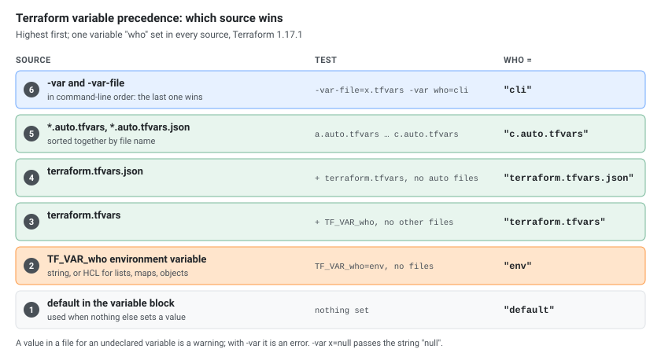
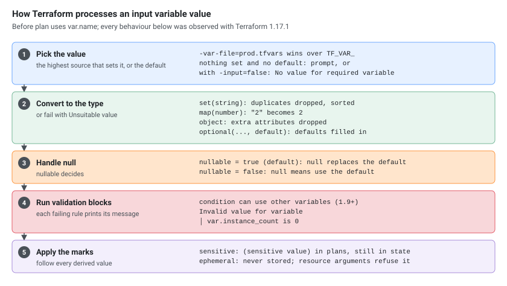

Input variables are how a Terraform configuration takes values from outside. This post covers declaring them, the types and how Terraform converts what you pass in, validation, where values can come from and which one wins, and sensitive and ephemeral values. Every example was run, and the errors shown are the real ones.

## Scope

Everything below was run with **Terraform 1.17.1** on macOS (arm64). Precedence, types, validation and functions were tested with configurations that only have `output` blocks and `terraform_data` resources, so no provider or cloud account was involved. The AWS resource snippets were checked with `terraform validate` against **hashicorp/aws 6.73.0**; `validate` works offline and makes no API calls.

## Declaring a Variable

```hcl
variable "variable_name" {
  description = "Description of the variable"
  type        = string
  default     = "default_value"
  sensitive   = false
  nullable    = true
  ephemeral   = false
}
```

All arguments are optional. Without `default` the variable is **required**: Terraform asks for it interactively, showing the description:

```text
var.region
  AWS region to deploy to

  Enter a value:
```

In CI, with `-input=false`, a missing value is an error instead:

```text
Error: No value for required variable

  on main.tf line 1:
   1: variable "region" {
```

## Where Values Come From and Which One Wins

```bash
# Environment variables: TF_VAR_ plus the variable name
export TF_VAR_instance_name="staging-server"
export TF_VAR_instance_count=3

# Files loaded automatically from the working directory
terraform.tfvars
terraform.tfvars.json
*.auto.tfvars
*.auto.tfvars.json

# Command line
terraform apply -var="instance_name=dev-server" -var="instance_count=1"
terraform apply -var-file="prod.tfvars"
```

To see the order, one variable `who` was set in every possible place at once, and the winning source removed after each run:

[](tfvars-precedence.svg "Open the diagram full size")

| Sources present | `who` = |
|---|---|
| default, `TF_VAR_who`, `terraform.tfvars`, `terraform.tfvars.json`, `a.auto.tfvars`, `b.auto.tfvars.json`, `c.auto.tfvars` | `"c.auto.tfvars"` |
| same without `c.auto.tfvars` | `"b.auto.tfvars.json"` |
| same without `b.auto.tfvars.json` | `"a.auto.tfvars"` |
| same without `a.auto.tfvars` | `"terraform.tfvars.json"` |
| same without `terraform.tfvars.json` | `"terraform.tfvars"` |
| only the default and `TF_VAR_who` | `"env"` |
| only the default | `"default"` |
| `-var who=cli -var-file=x.tfvars` | `"x.tfvars"` |
| `-var-file=x.tfvars -var who=cli` | `"cli"` |
| `-var-file=x.tfvars -var-file=y.tfvars` | `"y.tfvars"` |

So, from lowest to highest:

1. The `default` in the declaration.
2. `TF_VAR_` environment variables.
3. `terraform.tfvars`.
4. `terraform.tfvars.json`.
5. `*.auto.tfvars` and `*.auto.tfvars.json`, **sorted together by file name**: `b.auto.tfvars.json` overrides `a.auto.tfvars` and is overridden by `c.auto.tfvars`.
6. `-var` and `-var-file` on the command line, **in the order given**: the last one wins.

A value for a variable that isn't declared is only a warning in a file, but an error on the command line:

```text
Warning: Value for undeclared variable

The root module does not declare a variable named "not_declared" but a value
was found in file "z.tfvars".

Error: Value for undeclared variable
```

### Complex Values From the Environment and the Command Line

`TF_VAR_` and `-var` values for anything but a string are parsed as HCL:

```bash
export TF_VAR_allowed_ports='[8080, 8443]'
export TF_VAR_server_config='["m7g.large", 50, false]'
terraform apply -var='allowed_ports=[1,2]'
```

Without the brackets, `TF_VAR_allowed_ports='8080,8443'` fails with `Error: Extra characters after expression`.

`-var x=null` does **not** pass a null for a string variable: it passes the four-letter string `"null"`. To pass a real null, use a tfvars file (`x = null`).

## Variable Types

```hcl
variable "instance_name" {
  type    = string
  default = "my-instance"
}

variable "instance_count" {
  type    = number
  default = 3
}

variable "enable_monitoring" {
  type    = bool
  default = true
}

variable "availability_zones" {
  type    = list(string)
  default = ["us-west-2a", "us-west-2b", "us-west-2c"]
}

variable "unique_tags" {
  type    = set(string)
  default = ["web", "production", "critical", "web"]
}

variable "instance_sizes" {
  type    = map(number)
  default = { dev = 1, test = "2", prod = 5 }
}

variable "server_config" {
  type    = tuple([string, number, bool])
  default = ["t3.micro", 20, true]
}

variable "database_config" {
  type = object({
    engine    = string
    encrypted = bool
  })
  default = { engine = "mysql", encrypted = "true", extra = 1 }
}

variable "flexible_config" {
  type    = any
  default = { name = "example", count = 3, enabled = true }
}
```

Terraform converts every value to the declared type, which can change it. What these defaults became:

```text
set = toset([
  "critical",
  "production",
  "web",
])
sizes = tomap({
  "dev" = 1
  "prod" = 5
  "test" = 2
})
db = {
  "encrypted" = true
  "engine" = "mysql"
}
```

- A **set** removes the duplicate `"web"` and has no order of its own (shown sorted); you can't index it with `[0]`.
- A **map** or **list** of numbers turns the string `"2"` into the number `2`; a value that can't be converted is an error.
- An **object** keeps only the declared attributes (the `extra = 1` is dropped silently) and converts `"true"` to `true`.
- A **tuple** has a fixed length and a type per position.
- **`any`** keeps whatever it gets. It saves typing, but nothing checks the structure: prefer an `object` type.

### Optional Attributes

```hcl
variable "complex_config" {
  type = object({
    name     = string
    version  = string
    replicas = number

    resources = optional(object({
      cpu    = string
      memory = string
    }), {
      cpu    = "100m"
      memory = "128Mi"
    })

    health_check = optional(object({
      path = string
      port = number
    }), null)

    tier = optional(string)
  })
}
```

With `complex_config = { name = "app", version = "1.0", replicas = 2 }`:

```text
complex = {
  "health_check" = null /* object */
  "name" = "app"
  "replicas" = 2
  "resources" = {
    "cpu" = "100m"
    "memory" = "128Mi"
  }
  "tier" = tostring(null)
  "version" = "1.0"
}
```

An optional attribute without a default is `null`; with a default, the default fills in. A required attribute that's missing fails:

```text
Error: Invalid value for input variable

Unsuitable value for var.complex_config set using -var="complex_config=...":
attribute "replicas" is required.
```

### null, default and nullable

| Declaration | Value passed in a tfvars file | Result |
|---|---|---|
| `default = "fallback"` (nullable by default) | `x = null` | `null` replaces the default |
| `default = "fallback"`, `nullable = false` | `x = null` | `"fallback"`: null means "use the default" |

Set `nullable = false` when the module can't handle null, so callers can pass `null` to mean "use your default" (a common pattern in module wrappers).

## Validation

```hcl
variable "environment" {
  type = string

  validation {
    condition     = contains(["dev", "test", "stage", "prod"], var.environment)
    error_message = "Environment must be one of: dev, test, stage, prod."
  }
}
```

```text
Error: Invalid value for variable

  on main.tf line 1:
   1: variable "environment" {
    ├────────────────
    │ var.environment is "production"

Environment must be one of: dev, test, stage, prod.
```

### Test the Rule Against Real Values

A rule that looks right can reject valid input. This instance type check from many guides:

```hcl
condition = can(regex("^[a-z][0-9]+\\.", var.instance_type))
```

accepts `t3.micro`, but rejects `m7g.large`, `c6gn.16xlarge`, `m7i-flex.large` and `u-6tb1.metal`: all real EC2 types. And a range check on a number accepts `2.5`. Fixed versions:

```hcl
variable "instance_type" {
  type    = string
  default = "t3.micro"

  validation {
    condition     = can(regex("^[a-z][a-z0-9-]*\\.[a-z0-9]+$", var.instance_type))
    error_message = "Instance type must look like family.size, for example t3.micro or m7g.large."
  }
}

variable "instance_count" {
  type    = number
  default = 3

  validation {
    condition     = var.instance_count >= 1 && var.instance_count <= 10 && floor(var.instance_count) == var.instance_count
    error_message = "Instance count must be a whole number between 1 and 10."
  }
}

variable "vpc_cidr" {
  type    = string
  default = "10.0.0.0/16"

  validation {
    condition     = try(cidrsubnet(var.vpc_cidr, 0, 0) == var.vpc_cidr, false)
    error_message = "VPC CIDR must be a network address in CIDR notation, for example 10.0.0.0/16."
  }
}
```

| Input | Result |
|---|---|
| `t3.micro`, `m7g.large`, `c6gn.16xlarge`, `m7i-flex.large`, `u-6tb1.metal` | accepted |
| `t3micro`, `T3.micro` | `Instance type must look like family.size, ...` |
| `instance_count = 2.5` | `Instance count must be a whole number between 1 and 10.` |
| `10.0.0.0/16`, `172.16.0.0/12` | accepted |
| `10.0.0.5/16`, `10.0.0.0/33`, `abc` | `VPC CIDR must be a network address ...` |

The usual CIDR check, `can(cidrhost(var.vpc_cidr, 0))`, accepts `10.0.0.5/16`, which has host bits set. `cidrsubnet(x, 0, 0)` returns the network address (`10.0.0.0/16`), so comparing it with the input catches that, and `try(..., false)` turns invalid input into a failed check instead of an error.

### Several Rules and Cross-Variable Checks

A variable can have several `validation` blocks; each failing one prints its own message. Since Terraform 1.9 a rule can also refer to **other** variables:

```hcl
variable "max_count" {
  type    = number
  default = 5

  validation {
    condition     = var.max_count >= var.instance_count
    error_message = "max_count must be >= instance_count."
  }
}
```

```text
Error: Invalid value for variable

  on main.tf line 25:
    │ var.instance_count is 3
    │ var.max_count is 2

max_count must be >= instance_count.
```

Within one object, compare its own attributes:

```hcl
variable "scaling_config" {
  type = object({
    min_size         = number
    max_size         = number
    desired_capacity = number
  })

  validation {
    condition = (
      var.scaling_config.min_size <= var.scaling_config.desired_capacity &&
      var.scaling_config.desired_capacity <= var.scaling_config.max_size
    )
    error_message = "Must satisfy: min_size <= desired_capacity <= max_size."
  }
}
```

### Validating Lists of Objects

```hcl
variable "network_config" {
  type = object({
    vpc_cidr = string
    public_subnets = list(object({
      cidr = string
      az   = string
      name = string
    }))
  })

  validation {
    condition     = try(cidrsubnet(var.network_config.vpc_cidr, 0, 0) == var.network_config.vpc_cidr, false)
    error_message = "VPC CIDR must be a network address in CIDR notation."
  }

  validation {
    condition     = length(var.network_config.public_subnets) >= 1
    error_message = "At least one public subnet must be specified."
  }

  validation {
    condition = alltrue([
      for subnet in var.network_config.public_subnets :
      try(cidrsubnet(subnet.cidr, 0, 0) == subnet.cidr, false)
    ])
    error_message = "All subnet CIDRs must be network addresses in CIDR notation."
  }
}
```

## Using Variables

```hcl
locals {
  # Interpolation, and a direct reference
  full_name = "${var.project_name}-${var.environment}"
  type      = var.instance_type

  # Conditional
  instance_count = var.environment == "prod" ? var.prod_instance_count : 1

  # for expressions
  uppercase_zones  = [for zone in var.availability_zones : upper(zone)]
  environment_tags = { for key, value in var.tags : key => "${var.environment}-${value}" }
  production_zones = [for zone in var.availability_zones : zone if var.environment == "prod"]

  # Pick one environment out of a map of objects
  env_config = var.environments[var.environment]
}
```

### Dynamic Blocks

```hcl
variable "sg_name" {
  type    = string
  default = "web"
}

variable "ingress_rules" {
  type = list(object({
    from_port   = number
    to_port     = number
    protocol    = string
    cidr_blocks = list(string)
  }))
  default = [
    { from_port = 80, to_port = 80, protocol = "tcp", cidr_blocks = ["0.0.0.0/0"] },
    { from_port = 443, to_port = 443, protocol = "tcp", cidr_blocks = ["0.0.0.0/0"] },
  ]
}

resource "aws_security_group" "example" {
  name = var.sg_name

  dynamic "ingress" {
    for_each = var.ingress_rules
    content {
      from_port   = ingress.value.from_port
      to_port     = ingress.value.to_port
      protocol    = ingress.value.protocol
      cidr_blocks = ingress.value.cidr_blocks
    }
  }
}
```

### One Resource per List Item: for_each, Not count

A rule per port, written with `for_each` over a set so that removing a port from the middle of the list doesn't shift and recreate the others:

```hcl
variable "allowed_ports" {
  type    = list(number)
  default = [80, 443, 22]
}

variable "security_group_id" {
  type = string
}

resource "aws_security_group_rule" "ingress" {
  for_each          = toset([for p in var.allowed_ports : tostring(p)])
  type              = "ingress"
  protocol          = "tcp"
  from_port         = each.value
  to_port           = each.value
  cidr_blocks       = ["0.0.0.0/0"]
  security_group_id = var.security_group_id
}
```

`aws_security_group_rule` needs `type`, `protocol` and `security_group_id`; without them `terraform validate` reports `The argument "protocol" is required, but no definition was found.` (and the same for the other two). Newer AWS provider versions recommend `aws_vpc_security_group_ingress_rule`, one resource per rule.

## Functions for Working With Variables

Results from `terraform console`:

| Expression | Result |
|---|---|
| `format("%s-%s-%03d", "web", "prod", 7)` | `"web-prod-007"` |
| `title("hello world-app")` | `"Hello World-App"` |
| `split(",", "a,b,,c")` | `["a", "b", "", "c"]` |
| `merge({a=1, b=2}, {b=3})` | `{ a = 1, b = 3 }` (last wins) |
| `slice(["a","b","c"], 0, 2)` | `["a", "b"]` |
| `slice(["a"], 0, 2)` | `end index must not be greater than the length of the list` |
| `cidrsubnet("10.0.0.0/16", 8, 1)` | `"10.0.1.0/24"` |
| `tonumber("08")` | `8` |
| `tobool("true")` | `true` |
| `tobool("yes")` | `cannot convert "yes" to bool; only the strings "true" or "false" are allowed` |
| `upper(null)` | `argument must not be null` |

### Type Checks: tostring() Isn't One

```hcl
locals {
  is_string = can(tostring(var.flexible_input))
}
```

With `flexible_input = 5`, `can(tostring(...))` is `true`, because a number converts to a string. `can(tolist(...))` is `false` and `can(tostring(["a"]))` is `false`, so the conversions only tell you what a value **can become**. `type(var.flexible_input)` (`number`) works only in `terraform console`, not in a configuration. If the shape matters, declare a real type instead of `any`.

### try() vs coalesce()

`try()` returns the first argument that evaluates **without an error**, and a null is not an error. With `custom_instance_type = null`:

```text
> try(var.custom_instance_type, var.environment_defaults[var.environment].instance_type, "t3.micro")
tostring(null)

> coalesce(var.custom_instance_type, try(var.environment_defaults[var.environment].instance_type, null), "t3.micro")
"t3.micro"
```

Use `try()` for lookups that may fail (a missing map key or attribute: `try(var.database_config.port, 3306)` gives `3306`), and `coalesce()` to skip nulls. `try()` can't hide a typo in a variable name either: that's a static `Reference to undeclared input variable` error before anything is evaluated.

The same applies to optional values in general:

```hcl
variable "custom_domain" {
  type    = string
  default = null
}

resource "random_id" "suffix" {
  byte_length = 4
}

locals {
  domain_name = coalesce(var.custom_domain, "${random_id.suffix.hex}.example.com")
}
```

Use empty collections rather than null for optional lists and maps, so `for_each`, `length()` and `merge()` work without checks:

```hcl
variable "additional_tags" {
  type    = map(string)
  default = {}
}
```

## Sensitive Variables

```hcl
variable "database_password" {
  type      = string
  sensitive = true
}

variable "api_keys" {
  type      = map(string)
  sensitive = true
  default   = {}
}
```

`sensitive = true` hides the value in plan and apply output:

```text
  # terraform_data.db will be created
  + resource "terraform_data" "db" {
      + id     = (known after apply)
      + input  = {
          + password = (sensitive value)
          + user     = "admin"
        }
```

What it does **not** do:

- **Keep it out of the state.** After apply, `terraform.tfstate` contained `"password": "s3cr3t-Passw0rd"` in clear text. Encrypt and restrict access to the state backend.
- **Survive every path.** `terraform show` displayed the same password in clear text in the `output` attribute of the `terraform_data` resource: the provider returned it without the sensitive mark.

Sensitivity spreads to everything derived from the value. An output that uses it must be marked:

```text
Error: Output refers to sensitive values

  on main.tf line 14:
  14: output "pw_length" {

To reduce the risk of accidentally exporting sensitive data that was intended
to be only internal, Terraform requires that any root module output
containing sensitive data be explicitly marked as sensitive, to confirm your
intent.
```

With `sensitive = true` on the output, `terraform apply` prints `pw_length = <sensitive>`, while `terraform output pw_length` prints the value (`15`).

Sensitive values can't be `for_each` keys, because the keys appear in resource addresses:

```text
Error: Invalid for_each argument

  on main.tf line 19, in resource "terraform_data" "keys":
  19:   for_each = var.api_keys
    ├────────────────
    │ var.api_keys has a sensitive value

Sensitive values, or values derived from sensitive values, cannot be used as
for_each arguments.
```

When only the values are secret, iterate over the keys:

```hcl
resource "terraform_data" "keys" {
  for_each = toset(nonsensitive(keys(var.api_keys)))
  input    = each.key
}
```

## Ephemeral Variables

Since Terraform 1.10, `ephemeral = true` makes a variable that is **never written** to the plan file or the state. It may only be used where Terraform doesn't persist values: provider configuration, ephemeral resources, write-only arguments and other ephemeral values.

```hcl
variable "token" {
  type      = string
  ephemeral = true
}
```

Anywhere else, Terraform refuses it:

```text
Error: Invalid use of ephemeral value

  with terraform_data.eph,
  on main.tf line 18, in resource "terraform_data" "eph":
  18:   input = local.header

Ephemeral values are not valid for "input", because it is not a write-only
attribute and must be persisted to state.
```

Going through a `local` doesn't help: `local.header = "Bearer ${var.token}"` is ephemeral too. Root module outputs can't be ephemeral either (`Ephemeral outputs are not allowed in context of a root module`); only module outputs can.

Use `sensitive` for secrets that must end up in a resource (a database password Terraform has to set), and `ephemeral` for credentials Terraform only needs while it runs (a provider token).

## How a Value Is Processed

[](tfvars-pipeline.svg "Open the diagram full size")

## Complex Example: Multi-Environment Map

```hcl
variable "project_name" {
  type    = string
  default = "web"
}

variable "environment" {
  type    = string
  default = "dev"
}

variable "environments" {
  type = map(object({
    instance_type = string
    min_size      = number
    max_size      = number
    tags          = map(string)
  }))

  default = {
    dev = {
      instance_type = "t3.micro"
      min_size      = 1
      max_size      = 2
      tags          = { Environment = "development" }
    }
    prod = {
      instance_type = "m7g.large"
      min_size      = 3
      max_size      = 10
      tags          = { Environment = "production" }
    }
  }

  validation {
    condition     = alltrue([for e in values(var.environments) : e.min_size <= e.max_size])
    error_message = "min_size must not be greater than max_size."
  }
}

locals {
  env_config = var.environments[var.environment]
}

resource "aws_launch_template" "app" {
  instance_type = local.env_config.instance_type

  tag_specifications {
    resource_type = "instance"
    tags          = merge(local.env_config.tags, { Name = "${var.project_name}-${var.environment}" })
  }
}
```

An environment name that isn't a key of the map fails where it's used, not where it's set:

```text
Error: Invalid index

  on main.tf line 17, in locals:
  17: locals { env_config = var.environments[var.environment] }
    ├────────────────
    │ var.environment is "qa"
    │ var.environments is map of object with 1 element

The given key does not identify an element in this collection value.
```

Since validation rules can refer to other variables, `contains(keys(var.environments), var.environment)` in a rule on `environment` gives a clearer message.

## Best Practices

1. **Always add `description`**: it's shown in the interactive prompt and in generated module docs.
2. **Use precise types** (`object(...)` rather than `map(any)` or `any`); conversion happens anyway, the type makes it predictable.
3. **Use `optional()` with defaults** for object attributes callers rarely set.
4. **Test validation rules** against real values, including ones that should pass.
5. **Use `coalesce()` for null fallbacks** and `try()` for lookups that may fail.
6. **Mark secrets `sensitive`**, keep the state encrypted, and prefer `ephemeral` for credentials that don't need to be stored.
7. **Pass values in one place per environment** (`-var-file=prod.tfvars`); with several `*.auto.tfvars` files the file name decides who wins.

### Naming Conventions

```hcl
# Good: descriptive, snake_case, booleans start with a verb
variable "vpc_cidr_block" { type = string }
variable "enable_monitoring" { type = bool }
variable "allowed_ingress_ports" { type = list(number) }

# Bad: abbreviations, unclear, inconsistent
variable "vpc_cb" { type = string }
variable "flag1" { type = bool }
variable "Ports" { type = list(number) }
```

### Secure Defaults With Negated Booleans

```hcl
variable "public_access" {
  type        = bool
  description = "Allow public access to the bucket"
  default     = false
}

resource "aws_s3_bucket" "example" {}

resource "aws_s3_bucket_public_access_block" "example" {
  bucket = aws_s3_bucket.example.id

  block_public_acls       = !var.public_access
  block_public_policy     = !var.public_access
  ignore_public_acls      = !var.public_access
  restrict_public_buckets = !var.public_access
}
```

`public_access = false` (the default) turns all four blocks on.

## Links

- [Terraform: Input variables](https://developer.hashicorp.com/terraform/language/values/variables)
- [Terraform: Custom validation rules](https://developer.hashicorp.com/terraform/language/expressions/custom-conditions)
- [Terraform: Ephemeral values](https://developer.hashicorp.com/terraform/language/manage-sensitive-data/ephemeral)
- [Terraform Provisioners Guide](/posts/terraform-provisioners-guide/)
- [Terraform Lock File Checksums](/posts/terraform-lock-file-checksums/)
